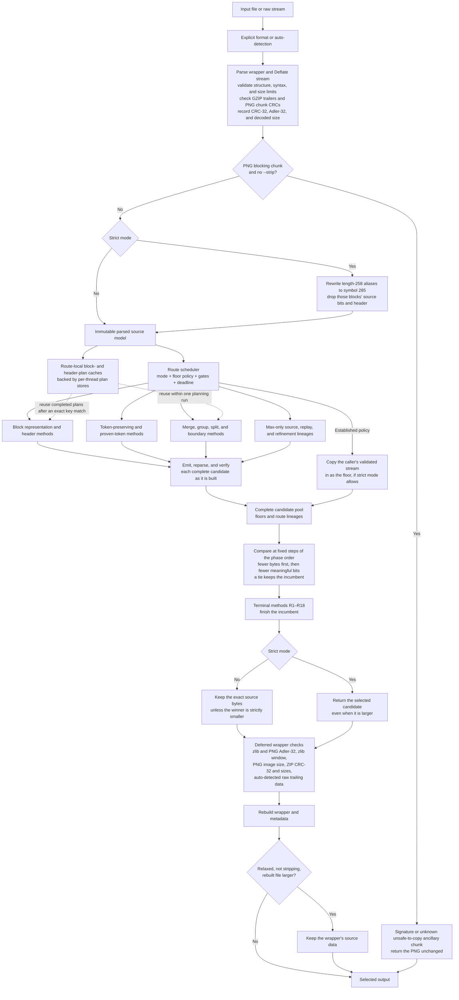
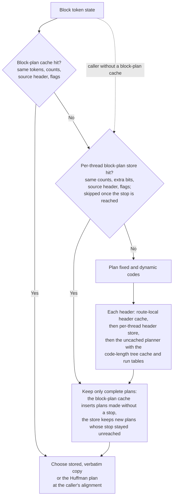
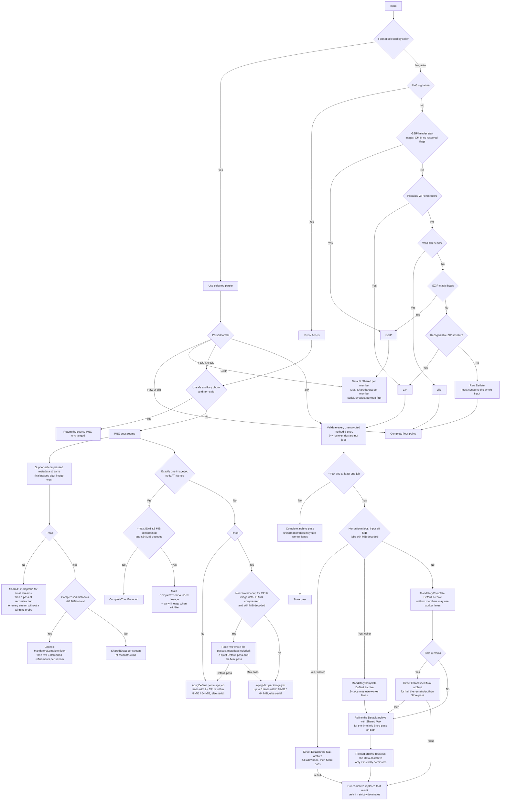

<!-- SPDX-License-Identifier: MIT -->

# Columbo routes and optimization methods

Columbo is a Deflate post-optimizer. It takes an existing Deflate stream, raw or
inside a PNG/APNG, GZIP, ZIP or zlib wrapper, and rewrites it as small as it can
without changing the decoded bytes. It re-encodes the stream from the source's
own literals, matches, blocks and Huffman codes: it has no LZ77 match finder and
calls no external recompressor ([Scope boundary](#scope-boundary)). Many of its
methods reconstruct or adapt those of earlier tools: DeflOpt, Defluff, deft4j,
Turtledeflate and Zopfli. The text names them as sources and as benchmarks, and
[Attribution](#attribution) says what comes from each.

This document serves two readers. For an engineer building a Deflate
post-optimizer in any language, it explains what each of Columbo's methods
changes, why that saves bits, and how to price, verify and schedule the result.
For Columbo itself, it is the authority on production routing: the format,
topology, work, memory, mode and deadline gates that decide which optional
routes build complete candidates. Code comments and other documents cite its
labels (R1–R18, D1–D4, M0–M14, G0, G0t, S0) and its anchors.

The code under [`src/`](../src/) is the ground truth. Where this document and
the code disagree, the code is right and the document needs fixing.

## How to use this document

The document has three parts. Part 1, from here through
[Suggested implementation order](#suggested-implementation-order), covers the
Deflate facts, vocabulary, cost model and principles every implementation needs.
Part 2, from [Method catalog](#method-catalog) through
[Candidate reuse and duplicate-work control](#candidate-reuse-and-duplicate-work-control),
explains each method. Part 3, from
[Routing decision tree](#routing-decision-tree) through
[Attribution](#attribution), gives Columbo's exact schedule and gates.

| Goal | Read |
| --- | --- |
| Learn what a post-optimizer may change | [Scope boundary](#scope-boundary), [Deflate essentials](#deflate-essentials), [Core concepts](#core-concepts) |
| Build a minimal, correct post-optimizer | [Overall pipeline](#overall-pipeline), [Cost model and candidate selection](#cost-model-and-candidate-selection), [Design principles](#design-principles), [Suggested implementation order](#suggested-implementation-order) |
| Choose which methods to implement | [Method catalog](#method-catalog), then the measured yield in each method entry |
| Implement tree, header or token methods | [Huffman code and header methods](#huffman-code-and-header-methods), [Token-spelling methods](#token-spelling-methods) |
| Implement merges, splits and boundary search | [Block-structure methods](#block-structure-methods), [Whole-stream routes](#whole-stream-routes) |
| Support PNG, ZIP, GZIP or zlib | [Container methods](#container-methods) |
| Make the search fast | [Candidate reuse and duplicate-work control](#candidate-reuse-and-duplicate-work-control), [Multithreading](#multithreading) |
| Add time limits and a slower mode | [Default and Max](#default-and-max), [Time limits](#time-limits), [Floors and the Max guarantee](#floors-and-the-max-guarantee) |
| Find when Columbo runs a route, and its limits | [Routing decision tree](#routing-decision-tree); [Route-gate reference](#route-gate-reference) for G0, G0t, M0–M14 and S0; each R or D method entry's gates list; [Inner stream-planner gates](#inner-stream-planner-gates) |
| Look up a label such as R13 or M7a | [Label index](#label-index) |
| Read verbose reports | [Scheduling and observability](#scheduling-and-observability) |
| Find a method's code or its credits | [Source map](#source-map), [Attribution](#attribution) |

Reading notes:

- Every bound and threshold is exact. A few are RFC 1951 limits, and the text
  names them as such: the 65,535-byte stored payload, matches of 3–258 bytes,
  286 literal/length and 30 usable distance symbols, the 32 KiB window, and the
  15-bit and 7-bit code-length limits. Every other bound is one Columbo chose to
  limit work, memory or time, not a format limit.
- Each exact gate or bound is written in one place, and other sections link to
  it. R1–R18 and D1–D4 keep theirs in their Part 2 entry, under "Columbo's gates
  and bounds", except R12, whose rule is in
  [Sweep repetition (R12)](#sweep-repetition-r12). G0, G0t, M0–M14, S0 and the
  replay limits are in the [route-gate reference](#route-gate-reference), and
  the planner's inner gates are in
  [Inner stream-planner gates](#inner-stream-planner-gates).
- A label appears with its name on first use in a section, such as "entropy cuts
  (R15)"; the [label index](#label-index) links every label to its entry.
- The catalog tables and method entries mark each method's cost with a speed
  indicator, explained in the [speed legend](#speed-legend).

## Scope boundary

Columbo changes how the decoded bytes are encoded, but it never adds LZ77
information the source does not already prove. This boundary decides whether a
method belongs in Columbo. The
[scope and invariants](research/future-deflate-methods.md#scope-and-invariants)
in Columbo's research notes state the same rules.

### Inside Columbo

- Parse and validate existing Deflate streams and supported wrappers.
- Reuse or rewrite Huffman tables and dynamic headers.
- Repack stored blocks or select stored, fixed, dynamic, or compatible exact
  source representations.
- Coalesce or repartition same-distance match runs.
- Replace selected existing matches with their decoded literals.
- Resegment proven matches at their original distance.
- Restore source matches after the other methods settle
  ([Original-match restoration (R1)](#original-match-restoration-r1)).
- Spell length 258 as symbol 285, or, in
  [relaxed mode](#strict-and-relaxed-output) only, also try the symbol-284 alias
  ([Per-block token search](#per-block-token-search)).
- Merge, split, collect, and regroup blocks, including bounded cuts inside
  proven matches.
- Compare complete output by file bytes and
  [meaningful Deflate bits](#meaningful-bits).
- Rebuild the wrapper around the selected stream and, with `--strip`, remove
  supported metadata and extraneous payloads
  ([Container methods](#container-methods)).

No method searches the history window. Every match Columbo emits is either a
source match, or lies inside one source match or inside a run of adjacent source
matches that share one distance, and keeps that distance. Every other decoded
byte becomes a literal.

Proven-submatch resegmentation and boundary polishing inside matches stay in
scope because they need no history search. A source match of length L at
distance d proves that each of its L decoded bytes equals the byte d positions
earlier. A shorter match at distance d whose bytes lie inside that interval
copies only proven bytes, and it starts no earlier than the source match, so its
distance stays valid.

A run of adjacent matches at one distance has the same property over its whole
length: every byte of the run copies from that distance, overlapping copies
included. Its internal boundaries can therefore move anywhere, as long as each
resulting match keeps a legal length of 3–258 bytes
([`src/deflate/search.rs`](../src/deflate/search.rs)).

Block boundaries change neither the decoded bytes nor the 32 KiB history window,
so a boundary may move anywhere, even into a match. A cut inside a match splits
it into fragments at the original distance, and a fragment shorter than three
bytes becomes literals ([`src/deflate/stream.rs`](../src/deflate/stream.rs)).

For example, a source match at decoded position 1,000 with length 20 and
distance 5 proves that bytes 1,000–1,019 equal bytes 995–1,014. A match of
length 8 at distance 5 from position 1,004 decodes bytes 1,004–1,011, all inside
that interval, so Columbo may emit it. A match that ran past byte 1,019 would
copy a byte that nothing proves. A block boundary at position 1,018 splits the
source match into an 18-byte match and a 2-byte fragment, which becomes two
literals.

### Outside Columbo

- Searching the 32 KiB history for new matches.
- Choosing a new distance for a match.
- Extending a match across bytes that no source match proves.
- Running Zopfli, libdeflate, or another recompressor.
- LZ77 path search over randomized or perturbed cost models.
- Sharing one dynamic tree between separately emitted Deflate blocks.
- Emitting reserved symbols or oversubscribed codes in any mode, or, in strict
  mode, incomplete codes and the length-258 alias. Relaxed mode allows only the
  single-code and empty forms that RFC 1951 and zlib accept, plus the alias.

The first five exclusions keep Columbo a post-optimizer. Each one needs match
discovery or a fresh LZ77 parse of the decoded bytes, and adopting such methods
would turn Columbo into a recompressor
([Turtledeflate out-of-scope methods](research/turtledeflate-methods.md#out-of-scope)).

The exclusion of new distances also costs little in practice. A probe on 24
October 2026 found that re-pointing every existing match to its nearest
equal-content distance would save only 0.023% of bits: 771 of 116,017 matches
could move ([research notes](research/future-deflate-methods.md)).

Deflate gives a dynamic block no way to refer to an earlier block's tree: each
dynamic block carries its own header. Merging the blocks is therefore the only
legal way for two ranges to share one tree.

Reserved symbols and oversubscribed codes are invalid Deflate, and every output
is reparsed by the same validating parser. The single-code and empty forms and
the alias decode in common decoders, but conservative decoders may reject them,
so strict output never uses them
([Strict and relaxed output](#strict-and-relaxed-output)).

Some inputs fall outside Columbo's supported formats rather than its methods:
ZIP64 archives and zlib streams with a preset dictionary are rejected, and
encrypted ZIP members are copied unchanged
([Container methods](#container-methods)).

## Deflate essentials

This primer covers only the parts of
[RFC 1951](https://www.rfc-editor.org/rfc/rfc1951) that Columbo's methods
manipulate. The RFC is normative; the constants here match
[`src/deflate/model.rs`](../src/deflate/model.rs) and
[`src/deflate/parse.rs`](../src/deflate/parse.rs).

**Bit order.** Deflate packs fields least significant bit first. Huffman codes
are packed starting with their most significant bit, and extra bits are plain
least-significant-first integers. A stream is a sequence of blocks that ends
after the block whose BFINAL bit is set; bytes after it are not part of the
stream.

**History.** A match copies `length` bytes from `distance` bytes back, up to
32,768 bytes, and may reach into earlier blocks. A match may overlap its own
output when its distance is shorter than its length, which is how Deflate codes
runs. Block boundaries therefore never limit what a match can copy.

**Block header.** Every block starts with 3 bits: BFINAL (1 bit), then BTYPE (2
bits). BTYPE 00 is stored, 01 is fixed Huffman, 10 is dynamic Huffman, and 11 is
invalid. A block's bits do not depend on where it sits in the stream, except its
BFINAL bit and, for a stored block, its padding.

**Stored blocks.** After the 3 header bits, the block pads to the next byte
boundary with 0–7 bits. Then come LEN (16 bits), NLEN (16 bits, the one's
complement of LEN) and LEN raw bytes. LEN is at most 65,535, so a longer stored
payload needs several blocks. A stored block has no end-of-block code, and its
cost depends on where it starts ([Bit alignment](#bit-alignment)).

**The two payload alphabets.** The literal/length alphabet has symbols 0–255 for
literal bytes, 256 for end-of-block, and 257–285 for match lengths. The distance
alphabet has symbols 0–29 for distances 1–32,768. Literal/length symbols 286–287
exist only in the fixed code, since HLIT stops at 286. Distance symbols 30–31
exist in the fixed code and may also get code lengths in a dynamic header. None
of these four symbols may occur in the data. Every fixed or dynamic block ends
with symbol 256.

**Length and distance extra bits.** Length symbols 257–264 code lengths 3–10
with no extra bits. Each later group of four symbols adds one extra bit, up to
281–284 (lengths 131–257, 5 extra bits). Symbol 285 codes length 258 with no
extra bits. Distance symbols 0–3 code distances 1–4 with no extra bits; from
symbol 4, each pair of symbols adds one extra bit, up to 28–29 (distances
16,385–32,768, 13 extra bits).

**Fixed blocks.** A fixed block uses built-in codes: literal/length symbols
0–143 take 8 bits, 144–255 take 9 bits, 256–279 take 7 bits, and 280–287 take 8
bits; every distance symbol takes 5 bits. There is no header beyond the 3 bits,
so an empty fixed block costs 10 bits.

**Canonical codes.** A Deflate Huffman code is fully defined by its code
lengths: codes are assigned in order of length, then of symbol value. A dynamic
header therefore sends only lengths, and every tree search in Columbo is a
search over code lengths. Payload code lengths are at most 15 bits, and
code-length code lengths at most 7 bits.

**Dynamic blocks.** A dynamic block transmits its codes before its data:

| Field | Bits | Meaning |
| --- | --- | --- |
| HLIT | 5 | 257–286 literal/length code lengths follow |
| HDIST | 5 | 1–32 distance code lengths follow |
| HCLEN | 4 | 4–19 code-length code lengths follow |
| Code-length code lengths | 3 each | HCLEN lengths of 0–7, in the order 16, 17, 18, 0, 8, 7, 9, 6, 10, 5, 11, 4, 12, 3, 13, 2, 14, 1, 15 |
| Code lengths | variable | HLIT + HDIST lengths, coded with the code-length code |

Code-length code entries left off the end of that order are zero. A code-length
value used late in the order, such as 1 or 15, therefore forces a longer HCLEN.

In this document HLIT, HDIST and HCLEN mean the counts they announce (257–286,
1–32 and 4–19), as in the table above. RFC 1951 uses the names for the raw field
values, which store each count minus 257, 1 and 4. The 3 × HCLEN header bits in
[Exact pricing](#exact-pricing) are therefore 3 × (field value + 4) in RFC
terms.

**The code-length alphabet.** Symbols 0–15 are code lengths. Symbol 16 repeats
the previous length 3–6 times (2 extra bits). Symbol 17 writes 3–10 zeros (3
extra bits), and symbol 18 writes 11–138 zeros (7 extra bits). The
literal/length and distance lists form one sequence of HLIT + HDIST lengths, so
a repeat can run from the end of one list into the start of the other. Columbo
calls this run-length spelling of the lengths the header's RLE, and each
code-length symbol in it, with its extra bits, an RLE token. A 16 with no
previous length, or a repeat that overruns the sequence, is invalid.

**Complete and incomplete codes.** A complete code uses the whole code space
(its Kraft sum is exactly 1). RFC 1951 lets a distance code be a single 1-bit
code, when the block uses one distance symbol, or have no codes at all, when the
block holds only literals. zlib also accepts a single 1-bit literal/length code,
and Columbo's parser follows zlib. The code-length code has no such exception:
zlib requires it to be complete, and so does Columbo. These incomplete forms are
the ones strict mode forbids
([Strict and relaxed output](#strict-and-relaxed-output)).

**The length-258 alias.** RFC 1951 gives symbol 284 lengths 227–257. Many
table-driven decoders also decode symbol 284 with extra value 31 as length 258,
and Defluff emits that spelling. It costs 5 extra bits per match more than
symbol 285, but can remove symbol 285 from the alphabet
([Defluff analysis](research/defluff-methods.md#length-258-symbol-handling)).
Columbo's parser accepts the alias as its only extension to RFC 1951. Strict
output never uses it ([Strict and relaxed output](#strict-and-relaxed-output)).

## Core concepts

These terms have fixed meanings here, in code comments, and in the
[codebase guide](architecture.md#terms).

**The source model.** Columbo parses each stream once into an immutable model,
and every route reads it. Each block keeps its tokens, decoded bytes, symbol
counts, source code lengths, its exact source dynamic header including the
code-length RLE sequence, and its original bit range with start residue and
block type. A stored block becomes a list of literal tokens. Empty blocks are
dropped, except one kept for an empty stream, so the model can have fewer blocks
than the stream. Replays and terminal methods reparse an emitted candidate into
a new model of the same kind
([`src/deflate/model.rs`](../src/deflate/model.rs)).

Source and spelling:

- **Token**: a literal byte, or a match of length 3–258 at distance 1–32,768,
  kept with its exact length symbol, distance symbol and extra bits as parsed.
  Keeping the symbols lets Columbo rescore the exact source spelling, including
  the length-258 alias.
- **Spelling**: the token sequence chosen for a range of decoded bytes: which
  literals, which matches, and how a match is split. Re-spelling keeps the bytes
  and changes the tokens.
- **Proven submatch**: a match at an existing source match's distance whose
  decoded bytes lie inside that source match's decoded interval. The source
  match proves those bytes repeat at that distance, so no history search is
  needed.
- **Stream identity**: the decoded size, CRC-32 and Adler-32 of the source's
  decoded bytes. Every rewrite must reproduce it
  ([Verification](#verification)).

Encodings and candidates:

- **Block plan** and **representation**: the chosen encoding of one block: a
  verbatim copy of the source block's bits ("original"), stored, fixed Huffman,
  or dynamic Huffman. A plan carries its exact bit cost.
- **Candidate**: a complete emitted stream that competes for selection.
- **Incumbent**: the best candidate so far in a comparison or lineage.
- **Floor**: a complete candidate kept before optional search; later work must
  beat it. Max keeps Default's complete result as a competitor so that, given
  enough time, it never returns a worse result than Default
  ([Floors and the Max guarantee](#floors-and-the-max-guarantee)).
- **Lineage**: a chain of candidates derived from one starting candidate. Each
  lineage is kept independently until it is compared with the others.
- **Replay**: reparsing a complete candidate and planning it again, so the
  planner can refit its trees and boundaries to its own output. A round replaces
  the candidate only when the stream is strictly smaller, in bytes and then
  meaningful bits. Each route's round limit is in
  [Replay limits](#replay-limits).
- **Fixed point**: a completed, unexpired replay that reproduces the same bytes
  and meaningful bits. Rerunning the same planner on those bytes would reproduce
  them, so it need not rerun.

Routes and modes:

- **Default** and **Max**: the two search modes. Max (`--max`,
  `Options::exhaustive`) adds slower routes
  ([Default and Max](#default-and-max)).
- **Route**: one strategy that builds a complete candidate, such as the ordinary
  planner, the deft4j source route, or a terminal method.
- **Ordinary planner**: Columbo's main stream planner (structural floor, token
  floors, splits, merges, boundary search), run with Default or Max options
  ([Stream-planner phase order](#stream-planner-phase-order)).
- **Feedback**: alternating spelling and codes. Re-spell the tokens under the
  current codes, rebuild the codes from the new counts, and repeat for a fixed
  number of passes or until nothing improves. Match-to-literal feedback and
  proven-submatch feedback (D1, D2) re-spell tokens this way, and the header
  search runs the same loop on the code-length code
  ([Token-spelling methods](#token-spelling-methods),
  [Dynamic header encoding](#dynamic-header-encoding)).
- **Max seed**: the ordinary planner's candidate before Default's feedback and
  terminal methods. Max's own routes start from it.
- **Complete Default endpoint**: the result of running the whole Default route
  on a stream. Max keeps it as a competitor so that Max does not end above
  Default.
- **Floor policy**: the rule a wrapper picks for each stream it hands to the raw
  optimizer. It says how that stream secures its Default floor and which Max
  routes may run beside it. For example, `Complete` serves raw and top-level
  zlib streams, and `CompleteThenBounded` a single-image PNG. `Shared` and
  `SharedExact` serve GZIP members and PNG metadata, and `ApngDefault` and
  `ApngMax` serve APNG frames. `Established` serves a stream whose caller
  already keeps a floor, and `MandatoryComplete` a Default branch inside a Max
  run. [Floor policies](#floor-policies) lists every use.
- **Bounded phase**: Max's first multi-route phase. The floor lineage and its
  descendant (M7) run on the caller thread inside one route window. Beside them
  run eligible workers for the deft4j source route (M1), the no-split source
  route (M2), source max and compact proven feedback (M3). `Complete` and
  `MandatoryComplete` have no bounded phase
  ([Raw-stream route tree](#raw-stream-route-tree)).
- **Terminal methods**: R1–R18, bounded passes applied to a complete incumbent
  after the main search.
- **Sweep**: one ordered pass of the terminal methods R1, R1b, R2–R11 (Default
  skips R6–R11), R1c, R13, R14 and R15. R12 is the rule that repeats the sweep
  in Max, not a member of it ([Sweep repetition (R12)](#sweep-repetition-r12)).
  R16 and R17 follow once the sweeps settle, and R18 runs last
  ([Terminal sweep order](#terminal-sweep-order)).
- **Finish**: taking a candidate through R1–R18.
- **Terminal tree floors**: the
  [compact payload-tree floor](#compact-payload-tree-floor) and the
  [bounded-depth tree floor](#bounded-depth-terminal-tree-floor), run after the
  main search and again as R18. Their first run, in the Default floor pass, is
  called the first tree floors.
- **Close**: run the terminal tree floors on a complete candidate. Columbo
  closes a topology contender that would lose, before comparing it, since a
  different topology may win only after the floors run. In Max it also closes
  the replaced candidates it keeps, because a smaller candidate can close larger
  than one it replaced
  ([M14: replaced-candidate close](#m14-replaced-candidate-close)).

Measures and limits:

- **Meaningful bits**: the stream's length in bits through the end of its final
  block, without the unused bits of the last byte
  ([Meaningful bits](#meaningful-bits)).
- **Alignment** (bit residue): a block's starting bit position modulo 8. Stored
  blocks pad to a byte boundary, so their cost depends on it
  ([Bit alignment](#bit-alignment)).
- **Soft deadline, grace, hard stop**: the soft deadline is the timeout; new
  timed routes start only before it (gate G0). Active work may continue for a
  grace of 10% of the timeout plus one second (none for a zero timeout); the
  hard stop is the soft deadline plus the grace ([Time limits](#time-limits)).
- **Work units**: deterministic counters that bound a method's effort
  independently of time.
- **Strict mode**: `--strict 1`, the default (`Options::strict`): every Huffman
  code is complete, at least two usable distance codes are present, and length
  258 uses symbol 285. **Relaxed mode** (`--strict 0`) allows RFC 1951's empty
  and single-code forms and the symbol-284 alias for length 258
  ([Strict and relaxed output](#strict-and-relaxed-output)).

**Labels.** R labels name terminal methods. D labels name the methods Default
adds around the ordinary planner. Default's floor pass runs match-preserving and
integrated
[proven-submatch feedback (D1, D2)](#proven-submatch-resegmentation-and-feedback-d1-d2)
and, in strict mode only, the
[balanced-tree cleanup (D3)](#tree-lengthening-and-balanced-tree-cleanup-d3).
The [source topology (D4)](#source-topology-d4) is a separate lineage. M labels
name Max routes and the rules that schedule them (M0–M14), G0 and G0t the timing
gates, and S0 the source-max state order. Suffixed labels such as R1b, M2c and
M10a–M10d are variants. The [label index](#label-index) lists them all.

## Cost model and candidate selection

Every decision in Columbo reduces to one question: is this complete stream
smaller than the incumbent? This section defines "smaller", explains how blocks
and streams are priced, and how a candidate is verified before it can win.

### Exact pricing

Columbo prices every block plan exactly, in bits, before it emits anything, and
the emitter must reproduce that count. Each plan's cost includes its 3-bit block
header:

- **Fixed:** 3 + the sum over tokens of (fixed code length + extra bits) + 7 for
  the end-of-block code.
- **Dynamic:** 3 + 5 + 5 + 4 + 3 × HCLEN + the sum over header RLE tokens of
  (code-length code length + 2, 3 or 7 extra bits for symbols 16, 17 and 18) +
  the sum over tokens of (code length + extra bits) + the end-of-block code
  length.
- **Stored:** for each chunk of at most 65,535 bytes, 3 + padding + 32 + 8 ×
  chunk bytes. The padding is (8 − ((a + 3) mod 8)) mod 8 for start residue a.
  Later chunks start byte-aligned, so their padding is 5. For example, a
  100-byte stored block costs 3 + 5 + 32 + 800 = 840 bits at residue 0, 835 at
  residue 5 (padding 0) and 842 at residue 6 (padding 7).
- **Verbatim copy:** the source block's own bit length, from its BFINAL bit
  through its last bit, including any stored padding. Emission rewrites only
  BFINAL and copies the rest.

A plan is infeasible if any used symbol, end-of-block included, has no code
([`src/deflate/header.rs`](../src/deflate/header.rs) `token_bits`,
[`src/deflate/block.rs`](../src/deflate/block.rs) `stored_block_bits`).

A stream costs the sum of its block plans, each priced at the residue where it
starts; the first block starts at residue 0. That sum is the stream's meaningful
bits, and its byte length is the sum rounded up to whole bytes.

Emission must reproduce the priced count. The bit writer is sized to the planned
total and refuses any write beyond it, so an underpriced plan becomes an
internal error instead of a silently different stream
([`src/deflate/bitstream.rs`](../src/deflate/bitstream.rs)). An overpriced plan,
which emits fewer bits than planned, is caught only by a debug-build assertion.
Each candidate records the writer's final position, so comparisons always use
the emitted count.

Payload cost depends on a block's tokens only through their symbol counts and
extra-bit total. Two blocks with equal counts, extra bits, source header and
policy therefore get the same plan in any token order, which is what lets
Columbo reuse completed plans
([Block-plan caches and stores](#block-plan-caches-and-stores)).

A tree is accepted by its complete block cost, header included, not by its
payload bits alone. A tree with slightly dearer payload can have a much smaller
header, so each tree is priced with its best header
([Dynamic header encoding](#dynamic-header-encoding)).

Estimates only rank. Many searches use cheap estimates to rank or prune
candidates: entropy scores for cuts, histogram estimates of headers, a fixed
15-bit cost for a symbol without a code. An estimate is not a bound and can be
wrong in either direction, so it may decide which candidates to build but never
which one wins. The selected candidates are replanned with exact pricing
([`src/deflate/header.rs`](../src/deflate/header.rs)
`estimate_boundary_block_bits`).

Corpus measurements play the same limited role. They set gates, deciding which
routes run and how far, but never accept an output: every candidate is compared
by its exact complete-stream bytes and meaningful bits.

### Meaningful bits

Meaningful bits are the stream's length in bits through the end of its final
block: through its end-of-block code, or through its last payload byte if the
final block is stored. The alignment padding of stored blocks inside the stream
counts. Only the 0–7 unused bits that fill the last byte are excluded. The
parser reports the count as its bit position after the final block, and the
emitter as its bit position after the last write
([`src/deflate/parse.rs`](../src/deflate/parse.rs)).

A stream of B bytes has one of eight meaningful-bit counts, 8B − 7 through 8B. A
same-byte result that saves one meaningful bit is a real win, which the CLI
writes unless `--dry-run` is used.

Counting bit-only wins does not make search loops endless. Every accepted step
strictly decreases the pair (bytes, meaningful bits), and a stream of at most L
bytes has at most 8L positive meaningful-bit scores, so a loop that accepts only
strict wins must stop
([terminal closure validation](research/terminal-closure-validation.md#why-a-single-sweep-misses-reachable-savings)).

The public saving, `Optimization::bits_saved`, counts bytes first
([`src/lib.rs`](../src/lib.rs)):

- 8 bits per removed byte when the output is shorter;
- when the length is unchanged, the reduction in total meaningful bits over all
  of the file's Deflate streams, or 0 if that total did not fall (a ZIP member
  converted to Store counts as its decoded size in bits; see [ZIP](#zip));
- 0 when the output is longer.

For example, take a 1,000-byte raw source stream with 7,996 meaningful bits. A
1,000-byte output with 7,994 bits saves 2 bits. A 999-byte output with 7,992
bits saves 8 bits, one whole byte, although its meaningful bits fell by only 4.

The CLI replaces a file only when `Optimization::should_replace()` is true:
`bits_saved` is nonzero, `--strip` changed the output, or ZIP's mandatory Store
normalization of a tiny member applies ([ZIP](#zip)). Otherwise it leaves the
file unchanged, or copies the input to a missing `--out` file. With `--dry-run`,
it only reports.

Padding bits never count as a saving. A padding-only change is not reported as a
saving and does not replace a file for compression alone. Generated candidates
write zero padding bits, except that a verbatim copy of a source stored block
keeps that block's own alignment bits. When the source wins, its own padding
bits are kept, since they belong to the source bytes.

With `--strip`, Columbo zeroes the stored-block alignment bits and the
final-byte padding of the selected stream, a kept source included
([`src/deflate/parse.rs`](../src/deflate/parse.rs) `normalize_padding`). The
zeroed bits are not counted in `removed_data_bytes`, but any changed output is
written under `--strip`.

### Bit alignment

A block's alignment, or bit residue, is its starting bit position modulo 8. The
first block of a stream starts at residue 0, and each later block starts at the
running total of the earlier blocks' bits, modulo 8.

Fixed and dynamic block costs do not depend on alignment. A stored block's cost
does: after its 3 header bits it pads to the next byte boundary, so it costs 0–7
padding bits depending on where it starts. Any change to an earlier block can
therefore change a later stored block's cost.

The padding also absorbs small savings. A stored block ends on a byte boundary,
so bits saved before it shorten the stream only when they move that boundary
back by a whole byte. For example, a stored block that starts at bit 13 ends its
header exactly at bit 16; if earlier blocks shrink by 1–7 bits, its padding
grows by the same amount and the stream does not get shorter.

A source stored block can be copied verbatim only at its original residue,
because its copied bits include its original padding. Fixed and dynamic source
blocks can be copied at any residue; in strict mode, a dynamic one only when its
codes are strictly compatible ([`src/deflate/block.rs`](../src/deflate/block.rs)
`reusable_original_bits`).

Implementation advice:

- Compute a block's cheapest fixed or dynamic plan once, then compare it at each
  residue with the stored cost and the verbatim-copy cost (`ReusableBlockPlan`
  in [`src/deflate/block.rs`](../src/deflate/block.rs)).
- In boundary searches, keep one state per residue at each boundary
  ([Boundary graphs](#boundary-graphs)).
- Test every method at all eight incoming residues, as Columbo's validation
  reports do (for example the
  [code-length tree validation](research/code-length-tree-validation.md)).

### Candidate ordering

Two complete candidates for the same raw stream compare by output bytes first,
then, at equal bytes, by meaningful bits. An exact tie keeps the incumbent, so
routing and output stay deterministic
([`src/deflate/optimize.rs`](../src/deflate/optimize.rs) `is_strictly_better`).
PNG image-stream lineages use the same rule.

The incumbent is the candidate reached first in the scheduler's fixed phase
order (`select_candidate` in
[`src/deflate/optimize/schedule.rs`](../src/deflate/optimize/schedule.rs)). That
order is part of the output contract: changing it changes outputs whenever
candidates tie ([Routing decision tree](#routing-decision-tree)).

Columbo never collects candidates and sorts them at the end. Each route compares
its result with the incumbent of its lineage as soon as the result is built, and
lineages are compared with each other at fixed steps of the phase order. In
relaxed mode the winner then faces the source once more
([Strict and relaxed output](#strict-and-relaxed-output)).

Inside one block at one residue, ties follow a fixed representation order: a
verbatim source copy wins any tie, then stored, then fixed, then dynamic. The
order follows Columbo's earlier C implementation
([`src/deflate/block.rs`](../src/deflate/block.rs)
`select_aligned_representation`).

Among dynamic plans of equal cost, the first one found is kept: the source
header as transmitted, then the source code lengths with a newly searched
header, then the tree families in their fixed order
([Block representation](#block-representation),
[Dynamic header encoding](#dynamic-header-encoding)).

Container-level choices between whole lineages use dominance instead, over file
bytes and aggregate meaningful bits (the sum over the container's streams):

- In ZIP Max, the refined Default archive must strictly dominate the Default
  floor archive to replace it, and direct Max on the original members must
  strictly dominate the archive it would replace ([ZIP](#zip)). Strict dominance
  means no worse in both measures and better in at least one.
- In PNG Max, each Max candidate for a compressed metadata chunk body replaces
  the best body so far, starting from its Default floor, only when it strictly
  dominates it in the same sense ([PNG and APNG](#png-and-apng)).
- Under these rules, a contender with fewer bytes but more aggregate bits loses,
  and a tie keeps the floor.
- The APNG whole-file race is the exception. Per-stream floors cannot guarantee
  the Default result when Max splits its time across APNG streams, so Max can
  run a complete Default pass of the whole file beside itself. The Max file then
  replaces the Default file when it is no larger in both measures, so an exact
  tie keeps the Max file ([PNG and APNG](#png-and-apng)).

Dominance keeps a container's Max result no worse than its Default floor in
either measure ([Floors and the Max guarantee](#floors-and-the-max-guarantee)).
The code documents no reason why the APNG race lets a tie keep Max.

### Verification

Columbo fails closed: it never returns a rewritten stream that it has not parsed
back to the source's identity.

**Before any search.** The parser validates the whole stream and runs to
completion before any deadline check, so no result describes a partly decoded
stream. The same parser checks the source and every rewrite. It rejects:

- input that ends before the final block does;
- block type 3, or a stored LEN that is not the complement of NLEN;
- HLIT above 286, or a code-length code that is not complete;
- a repeat code 16 with no previous length, or a repeat that overruns HLIT +
  HDIST lengths;
- a literal/length code without an end-of-block code;
- an oversubscribed code, or a payload code that is neither complete nor a
  single 1-bit code (the distance code may also be empty);
- a literal/length symbol above 285 or a distance symbol above 29 in the data;
- a distance of 0, above 32,768, or reaching before the start of the stream.

The only accepted extension to RFC 1951 is the length-258 alias
([Deflate essentials](#deflate-essentials)). The parse also computes the stream
identity (decoded size, CRC-32 and Adler-32), the largest distance and the
meaningful bits ([`src/deflate/parse.rs`](../src/deflate/parse.rs)).

Resource limits apply to every route and are enforced before or during the
parse:

- Input is at most `max_input_bytes` (default 1 GiB).
- Cumulative decoded bytes are at most the smaller of `max_decoded_bytes`
  (default 1 GiB) and the ratio limit, max(`max_expansion_ratio` × input bytes,
  64 MiB). The ratio defaults to 512, and `None` disables the ratio limit. It is
  applied once per input, so container members share one allowance
  ([`src/format/mod.rs`](../src/format/mod.rs)).
- The parsed model is at most 256 MiB, charged as tokens × token size + decoded
  bytes + blocks × (block size + 4 KiB), and at most 262,144 source blocks,
  empty blocks included. These two limits are not configurable: a tiny stream
  can hold hundreds of thousands of one-literal blocks, so input size cannot
  bound the model.
- Model and output buffers are reserved fallibly, so an allocation failure
  becomes an error rather than an abort.

**After every rewrite.** Each candidate is verified as it is built:

1. In strict mode, emission refuses any dynamic plan whose codes are not
   strictly compatible, as an internal error.
2. The bit writer is sized to the planned bits and refuses to write past them.
3. The emitted bytes are reparsed with the same parser and decoded limit. The
   reparse must consume exactly the emitted length and reproduce the source's
   decoded size, CRC-32 and Adler-32.
4. A mismatch is an internal error that fails the whole call; it does not just
   drop the candidate.

The identity check compares the decoded size and two checksums, not the decoded
bytes. The parser has already computed all three, so the check is cheap even in
release builds ([`src/deflate/optimize.rs`](../src/deflate/optimize.rs)
`validate_replayed_stream`).

Comparisons use the emitter's exact bit count; the reparse only proves identity.
The validated parse is kept, because it supplies the output's largest distance,
which the zlib wrapper uses for its window field, and the model that the next
replay or terminal method starts from.

A verbatim copy refers to bit ranges of the bytes its model was parsed from.
After an accepted replay, those references point into the wrong bytes, so
Columbo reparses the current candidate before planning from it again.

Relaxed mode delays one check. It skips the validation parse of a candidate
whose first emission is not strictly smaller than its route's input stream,
because relaxed mode would keep that input anyway. That input is the source, or
a candidate the route reparsed. If an outer route still selects those bytes,
Columbo validates them before returning ([Replay limits](#replay-limits)).

**Wrapper checks.** Each wrapper compares its own records at a different time
([Container methods](#container-methods)):

- GZIP: before any member is searched, preflight checks the optional header CRC
  and every member's trailer CRC-32 and ISIZE.
- PNG chunks: every chunk CRC is checked when the chunks are parsed, before any
  search.
- ZIP: Store members, and Deflate members declaring at most 4 decoded bytes, are
  checked without a search. A larger Deflate member's CRC-32, decoded size and
  consumed length are checked after its search.
- zlib: the header is validated first; the Adler-32 and the advertised window
  are checked after the search.
- PNG image data: the zlib Adler-32 and advertised window, then the exact IHDR
  or fcTL decoded size, are checked after the search.
- Raw Deflate: an auto-detected stream must consume the whole input, and
  trailing data is rejected only after the search. With `--raw`, trailing data
  is kept unless `--strip` is set
  ([zlib and raw Deflate](#zlib-and-raw-deflate)).

For ZIP members and PNG image streams, the declared decoded size is the parser's
decoded limit, so a stream that decodes past it fails during the parse. A stream
that decodes short of its declared size, or has a bad checksum, in zlib, PNG
image data or a larger ZIP Deflate member is reported only after a full search
of that stream.

### Strict and relaxed output

Strict mode (`--strict 1`, the default, `Options::strict`) emits output that
conservative decoders accept. Every literal/length, distance and code-length
code is complete, at least two of distance symbols 0–29 have codes, and length
258 is always symbol 285. Codes on distance symbols 30 and 31 do not count
toward the two. The rule follows libdeflate issue #323
(`has_strictly_compatible_huffman_codes` in
[`src/deflate/model.rs`](../src/deflate/model.rs)).

Relaxed mode (`--strict 0`) also allows the distance codes RFC 1951 permits (a
single 1-bit code, or no codes), a single 1-bit literal/length code that common
decoders accept, and the symbol-284 alias for length 258. These forms can save
bits: a single or empty code shortens the header, and the alias can remove
symbol 285 from the tree. The CLI prints a caution once per batch in relaxed
mode.

Strict mode acts at three points:

- **Normalization before scheduling.** In every block that contains a length-258
  match spelled as symbol 284 with extra value 31, Columbo rewrites that match
  to symbol 285, recounts the frequencies, and drops the block's source bit
  range, source code lengths and source header, so no alias survives through
  exact source reuse or a rewrite of the source header. Nothing else changes at
  this step.
- **Refusal at reuse.** A source dynamic header that is not strictly compatible
  stays in the model, but is refused wherever it would be reused: by the
  verbatim-copy check, by source-header scoring, and by a final guard in
  emission ([Verification](#verification)).
- **Planning.** When an alphabet has fewer than two used symbols, the tree
  builder adds a count of 1 on symbol 0 or 1 (on both when none is used), so
  every built code has at least two codes. Two 1-bit distance codes are cheap
  only when code-length symbol 1 is already in the header. Symbol 1 is 18th in
  the code-length order, so otherwise they can force 18 code-length code lengths
  to be sent. In one benchmark miss, completing an empty distance code this way
  raised that count from 14 to 18: four more 3-bit fields, 12 bits, before any
  change to the code-length code itself
  ([strict distance completion audit](benchmark-miss-regression-audit.md#strict-distance-completion-on-30-september-2026)).
  Strict distance completion (R1b) therefore later prices other complete
  distance codes for such blocks
  ([Strict distance completion (R1b)](#strict-distance-completion-r1b)).

Completing a code or replacing the alias can cost bits. Strict mode may
therefore emit a larger standards-compatible stream when the source uses the
length-258 alias or a Huffman code that is not strictly compatible.

**Relaxed source fallback.** In relaxed mode, after every route has finished,
Columbo keeps the exact source bytes, including their original padding bits and
whatever their Huffman codes, unless the selected candidate is strictly smaller
in bytes, then in meaningful bits. Strict mode has no whole-source fallback: it
returns the generated candidate even when that is larger. Planners in either
mode may still copy individual source blocks verbatim when the mode allows their
codes.

Otherwise the source joins the candidate pool in only two cases:

- Under the `Established` floor policy, used by ZIP direct Max, PNG metadata
  Max, and the Max refinement of PNG's quick single-image Default floor, the
  caller's input stream is copied in as the "Normal floor" candidate
  ([Floor policies](#floor-policies)). In strict mode the copy is made only
  when every source block could be copied verbatim: no block was rewritten by
  [length-258 normalization](#block-representation), every dynamic block's
  codes are strictly compatible, and the blocks cover the whole stream, with no
  dropped empty block whose header went unchecked. Otherwise no copy is made
  and the bounded phase builds its own floor. This matters for ZIP direct Max
  and PNG metadata Max, which pass the original member or chunk stream; the
  refinement of PNG's quick floor passes a strict rewrite.
- In relaxed mode, a planner that returns no plan yields a copy of the source as
  its candidate. This happens when the planner starts with its stop already
  reached (below) or the plan list cannot be allocated. Strict mode reports that
  allocation failure as an error instead, because strict output must rewrite
  incompatible codes.

**Spent deadline.** If a stream's ordinary planner starts with its stop already
reached, as at a zero timeout ([Time limits](#time-limits)), relaxed mode keeps
the source bytes, or a stored-only repack of a stream made only of stored
blocks. Strict mode still plans a complete rewrite, because strict output must
be compatible ([Stream-planner phase order](#stream-planner-phase-order)). Max's
mandatory Default floors never take this path, because they plan with no stop.
Which container streams take it after the file deadline is in
[Container methods](#container-methods).

**Library versus CLI.** The library returns the selected bytes in
`Optimization::data`, even when a strict repair made them larger. A larger
output has `bits_saved` of 0, so `should_replace()` is false unless a rewrite is
required ([Meaningful bits](#meaningful-bits)). The CLI therefore writes a
larger strict output only when a rewrite is required anyway: `--strip` changed
the file, or ZIP's mandatory Store normalization applies. It does not write an
equal-size strict repair that saves no meaningful bit either.

**Wrapper rebuilds.** A wrapper can change without a saving. The zlib header,
for example, is always rebuilt with FLEVEL 3 and the smallest sufficient window
([zlib and raw Deflate](#zlib-and-raw-deflate)). A header-only change has
`bits_saved` of 0, so the CLI does not write it on its own. In relaxed mode
without `--strip`, each wrapper (zlib, GZIP, PNG and ZIP) also falls back to its
source data when the rebuilt result is larger than the input.

## Overall pipeline

Every input follows the same path. Columbo parses it into an immutable model,
lets routes build complete candidate streams from that model, keeps the best
candidate, and rebuilds the wrapper around it.

A container runs the per-stream steps for each Deflate stream it holds, under
the floor policy and time slice it gives that stream
([Wrapper and floor-policy routing](#wrapper-and-floor-policy-routing)). In Max,
some containers run them more than once on the same stream, once for each
container-level lineage they build, and then choose between those lineages (step
11).

What happens to one stream:

1. **Detect and parse.** The caller names the format, or Columbo detects it from
   signatures and structure ([Format detection](#format-detection)). Then:
   - The wrapper parser validates the container. GZIP also checks its optional
     header CRC and every member's trailer here, before any search, and PNG
     checks every chunk CRC.
   - A PNG with a signature chunk or an unknown unsafe-to-copy ancillary chunk
     is returned unchanged right after this chunk parse, unless `--strip` is
     set. Such a chunk may depend on the exact bytes of the critical chunks
     ([PNG and APNG](#png-and-apng)).
   - The Deflate parser decodes the whole stream, validates its syntax, and
     enforces the input, decoded-size and model limits. It records the stream's
     identity (decoded size, CRC-32 and Adler-32), its largest distance and its
     [meaningful bits](#meaningful-bits).
   - Parsing finishes before any route checks a deadline, so a timeout never
     leaves a stream partly decoded ([Verification](#verification)).
2. **Normalize for strict mode.** In strict mode, the default, Columbo rewrites
   every length-258 alias to symbol 285. It drops each affected block's source
   bit range, code lengths and header, so no route can bring the alias back
   through reuse. Nothing else changes: other source headers that are not
   strictly compatible stay in the model and are refused at reuse
   ([Strict and relaxed output](#strict-and-relaxed-output)). From here on,
   routes only read the model; the one exception is the `Established` floor copy
   (step 4), which strict mode makes only when no block needed this
   normalization and every source header is strictly compatible.
3. **Schedule.** The scheduler combines the mode
   ([Default and Max](#default-and-max)), the floor policy (the wrapper's choice
   of how this stream secures its Default floor and which Max route families it
   allows, [Floor policies](#floor-policies)), the route gates
   ([Route-gate reference](#route-gate-reference)) and the stream's deadline
   ([Time limits](#time-limits)). Its phases run in a fixed order
   ([Raw-stream route tree](#raw-stream-route-tree)), and each optional route
   checks the deadline where it would start
   ([G0: timed-route start](#g0-timed-route-start)).
4. **Secure a floor.** Before optional search, the stream gets a complete floor
   that later work must beat
   ([Floors and the Max guarantee](#floors-and-the-max-guarantee)). The floor
   depends on the mode and the [floor policy](#floor-policies):
   - **Default:** the ordinary planner's candidate after proven-submatch
     resegmentation and feedback
     ([D1, D2](#proven-submatch-resegmentation-and-feedback-d1-d2)),
     [tree lengthening and balanced-tree cleanup (D3)](#tree-lengthening-and-balanced-tree-cleanup-d3)
     and the terminal tree floors. Under `ApngDefault`, the policy for the
     frames of a multi-image APNG, Default skips these steps.
   - **Max:** usually a Max seed or a bounded floor
     ([M0: bounded-floor prebuild](#m0-bounded-floor-prebuild)). Under
     `Complete`, `CompleteThenBounded`, `SharedExact` and `ApngMax`, Max also
     keeps a complete Default endpoint (for `ApngMax`, the APNG Default
     endpoint). The policy sets when that endpoint joins the comparison: from
     the start, or after some Max routes have run
     ([Floor policies](#floor-policies)).
   - **`Established`** (Max only): the caller already holds a complete stream,
     so Columbo copies its input in unchanged as the "Normal floor" candidate.
     Descendants reparse that copy, so the usual identity checks still apply.
     In strict mode Columbo makes the copy only when every source block could
     be copied verbatim; an input with the length-258 alias or codes that are
     not strictly compatible gets no copy, and the bounded phase builds its own
     floor ([Strict and relaxed output](#strict-and-relaxed-output)).
5. **Build candidates.** Each route builds a complete candidate from the model
   with the method families in the diagram; the
   [Method catalog](#method-catalog) lists their methods and speeds. The
   ordinary planner runs in both modes and searches block structure
   ([Block-structure methods](#block-structure-methods)), token spellings
   ([Token-spelling methods](#token-spelling-methods)), and block
   representations and headers
   ([Huffman code and header methods](#huffman-code-and-header-methods)).
   Default's only other lineage is the source topology (D4, step 8); Max adds
   its source, replay and refinement lineages
   ([Whole-stream routes](#whole-stream-routes)). Route-local block-plan and
   header-plan caches, backed by per-thread stores, let a route reuse a
   completed plan once its full key matches, instead of planning it again
   ([Candidate reuse and duplicate-work control](#candidate-reuse-and-duplicate-work-control)).
6. **Emit and verify.** Each candidate is emitted from exactly priced block
   plans, reparsed, and checked against the source's identity as soon as it is
   built, not once at the end. A mismatch is an internal error that fails the
   whole call, rather than a dropped candidate ([Exact pricing](#exact-pricing),
   [Verification](#verification)). A route with a replay budget replans from the
   reparsed candidate and keeps each round only while it is strictly smaller
   ([Replay limits](#replay-limits)). In relaxed mode, a first emission that
   does not beat its route's input stream (the source, or a candidate the route
   reparsed) skips its replays and its reparse. Columbo validates such bytes
   only if an outer route still selects them.
7. **Compare.** Lineages meet at fixed steps of the phase order. A contender
   replaces the incumbent only with fewer bytes, or with equal bytes and fewer
   meaningful bits. An exact tie keeps the incumbent, so the phase order settles
   ties and the output stays deterministic
   ([Candidate ordering](#candidate-ordering)). Nothing sorts the whole pool at
   the end. In Max, the complete Default endpoint kept in step 4 joins at one of
   these steps.
8. **Finish.** The terminal methods then finish the incumbent: Default's sweep
   skips R6–R11, and Max repeats a sweep that changed the stream
   ([Terminal sweep order](#terminal-sweep-order),
   [Sweep repetition (R12)](#sweep-repetition-r12)). Each mode adds steps around
   that finish:
   - **Default:** a source topology (D4) that already beats the unfinished
     incumbent is finished too, and the smaller endpoint is kept. The source's
     own block layout can reach a different local optimum from the planner's
     ([Source topology (D4)](#source-topology-d4)).
   - **Max:** a deadline could have handed any candidate the incumbent replaced
     to the finish instead, and the finishing steps are not monotone in their
     starting size. Max therefore uses the terminal tree floors to close the
     incumbent and the replaced candidates it kept, then finishes the incumbent.
     If a closed candidate beats the closed incumbent, Max finishes the smallest
     such candidate too and keeps the smaller endpoint. It then closes the
     candidates its sweeps replaced. A few route wins before the finish discard
     the kept list, so some replaced candidates are never closed
     ([M14: replaced-candidate close](#m14-replaced-candidate-close)).
   - **Max, last:** Default's own finish of the complete Default endpoint (R1c,
     R13–R18), and any R1b win, are kept only as final competitors. They are
     compared after Max's terminal stage, so that Max does not end above Default
     ([Floors and the Max guarantee](#floors-and-the-max-guarantee)).
9. **Fall back to the source.** In relaxed mode, Columbo keeps the exact source
   bytes, original padding bits included, unless the finished winner is strictly
   smaller by the rule in step 7. Strict mode returns the selected candidate
   even when it is larger. The source joins the candidate pool only as an
   `Established` floor, or as the copy a relaxed planner yields when it returns
   no plan. Otherwise it competes only in this final fallback
   ([Strict and relaxed output](#strict-and-relaxed-output)). With `--strip`,
   Columbo then zeroes the stored-block alignment bits and the final-byte
   padding of whichever stream it returns ([Meaningful bits](#meaningful-bits)).
10. **Check and rebuild the wrapper.** Some wrapper checks wait until the
    stream's search has finished. A damaged zlib stream, PNG image stream, or
    ZIP Deflate member declaring more than 4 decoded bytes therefore fails only
    after a full search of that stream ([Verification](#verification)). An
    auto-detected raw stream must also consume the whole input: trailing bytes
    are rejected only after the search, while `--raw` accepts them and keeps
    them unless `--strip` is set
    ([zlib and raw Deflate](#zlib-and-raw-deflate)). The wrapper is then rebuilt
    around the selected stream ([Container methods](#container-methods)).
11. **Choose and report.** In relaxed mode without `--strip`, a wrapper whose
    rebuilt result is larger than its input falls back to its source data
    ([Strict and relaxed output](#strict-and-relaxed-output)). ZIP's Max
    archives, PNG's Max metadata bodies and the APNG whole-file race then choose
    between their lineages by dominance over file bytes and aggregate meaningful
    bits, while PNG image-stream lineages keep the per-stream rule of step 7
    ([Candidate ordering](#candidate-ordering)). The CLI replaces the file only
    when the output is shorter or saves at least one meaningful bit, when
    `--strip` changed the bytes, or when ZIP's mandatory Store normalization of
    a tiny member applies ([Meaningful bits](#meaningful-bits)).

## Design principles

These rules carry over to any Deflate post-optimizer. Each one comes from
Columbo's code and from a measured success or failure in its validation reports,
linked as evidence.

1. **Price complete streams exactly, and use estimates only to rank.** Accept a
   change only after the whole candidate stream is emitted and its exact bytes
   and meaningful bits are counted ([Exact pricing](#exact-pricing)). An entropy
   estimate, a histogram delta or a lower bound may decide which candidates get
   priced, and corpus measurements may set gates, but neither ever accepts an
   output. Estimates mislead at the margins that matter: an entropy estimate put
   a re-planned boundary relocation at 0.043% of all bits on 1,052 PNG outputs,
   but exact pricing kept only 234 bytes on 12 of 33 files
   ([rejected experiments](research/future-deflate-methods.md#rejected-or-deferred-experiments)).
   As a filter, estimates work well: the distance-alphabet ladder (R13) exactly
   prices at most the two best-estimated rungs per block and still keeps 100.0%
   of the exact optimum on PNG
   ([Distance-alphabet ladder (R13)](#distance-alphabet-ladder-r13)).
2. **Accept only strict improvements, and let an exact tie keep the incumbent.**
   A candidate replaces the incumbent only with fewer output bytes, or with
   equal bytes and fewer meaningful bits
   ([Candidate ordering](#candidate-ordering)). Strict descent makes every
   improving loop finite, because a stream of L bytes has at most 8L positive
   meaningful-bit scores
   ([terminal closure](research/terminal-closure-validation.md#why-a-single-sweep-misses-reachable-savings)).
   It also lets a repeated sweep skip a method at an input score it has already
   tried: along one strictly descending chain, each score belongs to exactly one
   candidate (code comment). Columbo's open-ended Max replays use the same
   bound: at most eight rounds per byte of the first emitted candidate
   ([Replay limits](#replay-limits)).
3. **Keep a complete floor before any optional search.** Build a complete, valid
   candidate first, whether the source itself, a cheap re-encoding or the
   complete Default endpoint, and let later work only replace it. A deadline or
   a route that stops early then costs savings, never correctness. Columbo's
   planner builds a linear stored-only repack before it checks a container's
   shared deadline, so a large ZIP cannot end up optimizing only its first
   member, and it secures a complete floor that does not depend on the deadline
   before any spelling or split search
   ([`src/deflate/stream.rs`](../src/deflate/stream.rs)). Max keeps the complete
   Default endpoint as a competitor, so running out of time in Max's own routes
   costs only Max's extra savings
   ([Floors and the Max guarantee](#floors-and-the-max-guarantee)).
4. **Bound work with deterministic work units, and let time only gate starts.**
   Give each method a budget counted in its own operations (DP edges, exact
   prices, work units). Use the clock only to decide whether a route may start,
   and when a started one must hand over its best complete candidate
   ([Time limits](#time-limits)). Results then depend on the input, not on
   machine speed or load, except where a deadline actually cuts a search. Scale
   each budget with what the method touches. When entropy cuts (R15) and
   terminal merges (R16) moved from a fixed 2^28 work units to a budget that
   grows with the stream, 3 PNGs got smaller, and every other Default output
   stayed byte-identical ([Entropy cuts (R15)](#entropy-cuts-r15)). The
   thresholds in this document are such work bounds unless the text names them
   as RFC 1951 limits ([How to use this document](#how-to-use-this-document)).
5. **Order steps so that each one refines the state it was designed for.**
   Columbo's pipeline encodes four ordering rules, each found through a measured
   failure of the opposite order
   ([Terminal sweep order](#terminal-sweep-order)):
   - **Fit headers after the codes are chosen.** The payload/header tradeoff
     (R2), literal/length span (R3) and joint tree and RLE (R4) fit code lengths
     and headers to the codes a block already has, so they follow the step that
     chooses those codes. Symbol set removal (R5) compares token rewrites
     against the fitted parent, so it follows the fit. `ApngDefault` skips the
     first tree floors, so its in-sweep fit targeted codes that later steps
     replaced: in the first pass on 20 APNG files, the smoothed-tree finish
     (R14) alone saved 94,436 bits. Running R2–R5 after the late tree floor
     (R18) instead saved 261,016 bytes on 2,431 APNG stickers; moving only R2–R4
     had left 216 files larger by 3,072 bytes in total, against 58 files and
     1,059 bytes with R5 moved too
     ([APNG header fit](research/apng-header-fit-validation.md#r5-follows-the-fit)).
   - **Re-slide after every tree change.** The fixed-tree boundary slide (R1c)
     fits boundaries to the trees it sees, so the tree-changing finishing steps
     follow it, and it slides again after each of their wins. Placed before the
     slide, R13 made five PNGs one byte larger
     ([R13 placement](research/distance-ladder-validation.md#placement)). Placed
     right after strict distance completion (R1b), the slide made two Max
     outputs 10 and 2 bytes larger, because Max's tree floors then started from
     slid boundaries
     ([R1c placement](research/boundary-slide-validation.md#placement)).
   - **Merge blocks only after the finish has settled.** Placed before R15,
     terminal merges (R16) grew one ZIP by 62 bytes; placed inside the repeated
     finish, they grew one APNG frame by 2 bytes, because a strictly smaller
     intermediate led R13–R15 to a worse fixed point. After the settled finish,
     every merge step can only lower the result
     ([terminal merges](research/terminal-merge-validation.md#origin)).
   - **In Max, let a sweep settle before the response and finishing steps.**
     Header-directed match response (R10), length-symbol exchange (R11), R1c and
     R13–R15 run in a sweep only when nothing earlier in that sweep changed the
     candidate, as long as another sweep could still start. Placed after R5 in
     Max's sweep, R13 redirected the Max-only header methods R6–R9 and stopped a
     closure test at 36,675 bits instead of at most 36,637
     ([R13 placement](research/distance-ladder-validation.md#placement)).
6. **Expect a better parent to finish worse: keep competing lineages, and close
   what you replace.** The finishing steps are not monotone in their starting
   size, so the smaller of two parents can end larger. On one PNG, Max's early
   lineage, which refines a quick Default floor, ended 543 bytes larger because
   a boundary slide had first made that floor smaller. Skipping the slide
   restored the file but lost a net 3,156 bytes over 131 paired cases, so the
   loss is recorded rather than fitted
   ([8 October audit](benchmark-miss-regression-audit.md#early-lineage-parent-8-october)).
   Columbo acts on this in three places:
   - It finishes competing lineages before choosing, as for the source topology
     lineage (D4) ([Source topology (D4)](#source-topology-d4)).
   - It runs the tree floors on a topology contender that would lose, before
     comparing it, since a different topology may win only after them (code
     comment).
   - In Max, it keeps complete candidates that later steps replace and closes
     them at the end, though a few later wins discard them
     ([M14: replaced-candidate close](#m14-replaced-candidate-close)). A
     complete Max search once ended 1 byte above the same search cut at 10
     seconds. Keeping and closing the replay parents of later source max (M12)
     fixed it, and raised the hundred-file guard from 91 to 94 of 100 floors
     ([24 October audit](benchmark-miss-regression-audit.md#source-max-replaced-parents-24-october)).
     That guard is Columbo's regression check: it holds the latest 100 unique
     benchmark files to their historical results, its floors.
7. **Derive gates from the mechanism, not from corpus-fitted sizes.** A gate
   should follow from why the method works: the pipeline order, what earlier
   steps already did, or a format property. Linear passes therefore get no size
   class: a 1 MiB class on the boundary slide would have excluded 727 of its
   first 2,246 predicted Default bytes, all from PNG streams of 1.2–3.2 MB
   decoded ([slide method](research/boundary-slide-validation.md#method)). The
   APNG header fit applies exactly where the stream's first tree-family choice
   comes late, under `ApngDefault`. A compact-stream size limit borrowed from
   another method also removed the small-stream losses, but it ran R2–R4 twice
   on most APNG frames, cost about 33% more CPU on 120 APNG-heavy PNGs and had
   no basis in this effect, so it was rejected
   ([APNG header fit](research/apng-header-fit-validation.md#origin)).
   Single-file losses are recorded with their causes, never fitted with
   file-specific rules
   ([accepted tradeoffs](benchmark-miss-regression-audit.md#accepted-trade-offs)).
8. **Never buy a net win with losses on small streams.** Reject a change that
   makes small streams larger to save more elsewhere, and prefer a rule that
   leaves the streams it does not target byte-identical. Such a loss shows that
   the rule is wrong for that class of stream. Moving the header fit after R18
   for every stream saved 6,358 bytes on 120 APNG-heavy PNGs, but grew 22 of
   1,052 PNGs and 21 of 202 containers by up to 11 bytes. All were small static
   streams, where the floor phase has already chosen the trees and the early fit
   gives the later steps a better parent
   ([APNG header fit](research/apng-header-fit-validation.md#origin)). In the
   same way, R16 runs after the settled finish although merging inside the
   repeated finish saved more on a 33-file sample (5,299 against 5,223 bytes),
   because only the settled placement cannot grow an output
   ([terminal merges](research/terminal-merge-validation.md#origin)). A residual
   loss that every tried fix costs more than it recovers is recorded with its
   cause as an accepted tradeoff
   ([accepted tradeoffs](benchmark-miss-regression-audit.md#accepted-trade-offs)).
9. **Cache only completed results, keyed by everything they depend on, and
   verify every hit exactly.** A fingerprint only selects an entry: compare the
   complete key before reuse. Never store a result computed after its stop was
   reached, since it may be incomplete. Planning reads a block's tokens only
   through their symbol counts and extra bits, so a block plan can be keyed by
   those counts rather than by token order. Columbo's block-plan and header-plan
   stores both cut Default CPU substantially with identical output
   ([Candidate reuse and duplicate-work control](#candidate-reuse-and-duplicate-work-control)).
10. **Validate on complete files: decode every output, use a control arm, and
    rerun deadline-bound losses.** Columbo's validation reports follow these
    rules:
    - Measure a method with complete-file A/B runs against its predecessor.
    - Decode every output with an independent decoder. Columbo's harnesses use
      Python's `zlib`, `gzip` and `zipfile` and check PNG chunk CRCs and APNG
      frames ([example](research/late-tree-floor-validation.md#validation)).
    - Test at all eight incoming bit alignments, and against exhaustive oracles
      where the problem is small enough.
    - Add a control arm to isolate the cause. R13's validation ran a third arm
      that skipped the ladder but slid a second time. The ladder itself saved
      475,910 PNG bytes over the control, but on one GZIP file the control alone
      reached 535 of the candidate's 544 bytes, so most container bytes came
      from repeating R1c
      ([R13 measurements](research/distance-ladder-validation.md#measurements)).
    - Test Max methods on frozen parents, complete candidates saved from earlier
      runs, before trusting timed Max deltas. Check that a zero-budget Max has
      no more bytes and no more meaningful bits than a timed Default run.
    - Rerun every grown deadline-bound row before calling it a regression. In
      one APNG check Max hit its deadline on 56 of 58 files, so their
      differences were deadline variance
      ([R5 follows the fit](research/apng-header-fit-validation.md#r5-follows-the-fit)).
    - Keep the first measured cohort rather than the best repeat
      ([guard](research/terminal-closure-validation.md#matched-hundred-file-guard)).
11. **Make every compression decision deterministic.** Use integer or
    fixed-point arithmetic, fixed tie rules, and rescue work whose size does not
    depend on when the deadline fired. Columbo's Deflate engine uses no floating
    point, so R15's entropy scan uses logarithms with 16 fraction bits and
    chooses the same cut on every platform
    ([R15 design](research/entropy-cut-validation.md#design)). Its hard-stop
    tree rescue prices every dynamic block rather than the largest one, so a
    deadline crossed a few milliseconds earlier cannot change which block is
    rescued
    ([accepted general changes](benchmark-miss-regression-audit.md#accepted-general-changes)).
    Exact byte comparison with a reference then finds tie-order mistakes that
    decompression alone cannot
    ([Defluff emulation](research/defluff-methods.md#exact-emulation-with-unicorn)).
12. **Profile the build you ship, and confirm every speedup end to end.**
    Measure with the release settings you distribute. Columbo's release profile
    keeps overflow checks, which can block vectorization: wrapping additions
    that provably cannot overflow cut a Kraft-sum check from 345 to 52 ns on 316
    lengths ([d72c937](research/efficiency-review.md#d72c937-23-october-2026)).
    Allocation is costly enough to show in profiles: 1% of samples once went to
    timekeeping inside macOS's `free`
    ([e79a60a](research/efficiency-review.md#e79a60a-24-october-2026)). Judge an
    idea by what it recomputes, and confirm micro-benchmark wins on real calls
    and whole runs. Per-call run tables for the shortest code-length RLE were
    faster on captured calls but slower on a small sprite, so they were
    rejected. The same tables, kept per thread across calls, were rarely rebuilt
    and were kept
    ([Code-length codes and RLE run tables](#code-length-codes-and-rle-run-tables)).
13. **Check that a speedup preserves output only on runs that no deadline
    cuts.** A faster build moves where a deadline-bound Max search stops, so its
    output can differ although nothing in the search changed. Compare outputs on
    Default runs, zero-budget Max and Max runs that complete, and compare speed
    by instructions retired on the completing runs
    ([efficiency methods](research/efficiency-review.md#methods)). Before
    calling a deadline-bound loss a regression, rerun the baseline with a second
    more: in one case the faster build had only reached the baseline's own
    11-second result a second sooner
    ([2c702f5](research/efficiency-review.md#2c702f5-25-october-2026)).
14. **Put a method in Default only when it wins broadly at negligible cost.**
    Columbo's validation policy keeps rare header and boundary wins in Max
    ([validation policy](research/future-deflate-methods.md#validation-policy)).
    The alphabet boundaries (R6) stay Max-only because in Default their rare
    wins cost 12–28% more CPU
    ([Alphabet boundaries (R6)](#alphabet-boundaries-r6)). The 128 KiB Default
    size class of R1b–R5 stays because lifting it grew two outputs for 6.7% more
    CPU ([Payload/header tradeoff (R2)](#payloadheader-tradeoff-r2)).

## Default and Max

Columbo has two modes that share one cost model and one acceptance rule. Default
runs the methods that win broadly at negligible runtime cost, each repeated only
a fixed number of times. Max (`--max`, `Options::exhaustive`) adds slower
routes, repeats the terminal methods while they improve, and keeps searching
until it reaches a fixed point or its deadline.

Max builds on Default instead of replacing it: it keeps Default's complete
result as a competitor, so with enough time its own routes can only add savings.
The one exception is a class of APNG frames that the whole-file race does not
cover ([Floors and the Max guarantee](#floors-and-the-max-guarantee)). This
section describes the time model both modes share and the rules that tie Max to
Default; the route-by-route schedule is in the
[Routing decision tree](#routing-decision-tree).

### Time limits

Each input file has one timeout, a wall-clock budget for starting work. The
CLI's `--timeout` defaults to 180 seconds, clamps requests to 10–4,000 seconds
and rounds fractions up; it rejects zero. The library's `Options::timeout` takes
any `Duration`, zero included, and a container can hand one stream a zero slice
of the file's time.

Four rules turn the timeout into stopping points
([`src/deflate/stop.rs`](../src/deflate/stop.rs)):

- **Soft deadline.** The timeout itself. A new timed route starts only before
  it, and only while no sibling route has failed
  ([G0: timed-route start](#g0-timed-route-start)). The clock decides whether
  work starts; how much a started method does is bounded by its own work units,
  up to the hard stop.
- **Grace and hard stop.** Started work may continue for a grace of 1 second
  plus 10% of the timeout, or none for a zero timeout; containers compute each
  stream's grace per call (**Containers** below). The hard stop is the soft
  deadline plus the grace. Active routes poll it and, once it is reached, return
  their best complete candidate. A route that fails cancels its siblings, which
  then reach the hard stop at once.
- **Linear finalization.** Cheap linear steps may start after the soft deadline,
  until the hard stop: the fixed-tree boundary slide (R1c), the finishing steps
  from the distance-alphabet ladder (R13) through the terminal token replay
  (R17), the bounded-depth tree floor, and Max's tree-floor closes of the
  candidates its sweeps replaced. A stream whose search used its whole allowance
  therefore still gets them. Before R1c could start late, Max never slid the
  final incumbent of its largest streams, although Default slid them
  ([linear finalization share](benchmark-miss-regression-audit.md#linear-finalization-share-on-8-october-2026)).
- **Clock-free work.** Some work ignores the clock:
  - parsing, validation and the complete no-growth fallback;
  - Max's mandatory Default floors, except the Max-only R6–R9 that follow on the
    complete Default endpoint and, in `MandatoryComplete` branches, the source
    topology lineage (D4) and the late tree floor (R18), which stay on the
    clock;
  - two steps limited to small streams: tree lengthening and balanced-tree
    cleanup (D3), and the compact payload-tree floor, which still needs a
    nonzero timeout unless it is mandatory.

  A Max stream can therefore run past its timeout plus grace when its Default
  route alone takes longer. Under a rejected schedule, a reclaim pass's
  mandatory floor stretched a 14-second allowance to 22 seconds
  ([linear finalization share](benchmark-miss-regression-audit.md#linear-finalization-share-on-8-october-2026)).

Max divides a stream's allowance further:

- **Route windows.** A bounded phase that runs several routes closes its window
  early, so the follow-up routes keep part of the time. A window's end hands the
  phase's incumbents to the next phase and is not a timeout
  ([G0: timed-route start](#g0-timed-route-start)).
- **Terminal share (G0t).** A Max stream that owns its time gives its primary
  routes an earlier deadline, so an unfinished primary search cannot starve the
  terminal methods. A source in the 1 MiB terminal class gets a search share,
  and a larger source a finalization share.
  [G0t: Max terminal share](#g0t-max-terminal-share) defines the class and both
  shares, and says which policies reserve them.

**Example.** A standalone stream with the CLI's default 180-second timeout has a
grace of 1 + 18 = 19 seconds. New timed routes start until 180 seconds, and
active work hands over its best complete candidate by 199 seconds. Under a G0t
search share in Max, primary routes stop at 144 seconds (4/5) with no grace,
while terminal work keeps the full 199 seconds. Under a finalization share,
primary routes start until 171 seconds (19/20) and stop by 190 seconds, 9
seconds (1/20 of 180) before the full hard stop.

**Zero timeout.** A zero timeout also has zero grace, so the soft deadline and
the hard stop both fall at the start. G0 never opens, timed work stops at its
first poll, no terminal share is reserved, and both terminal tree floors are
skipped unless the work is mandatory. A planner entered with its stop already
reached still returns a safe plan
([Strict and relaxed output](#strict-and-relaxed-output)).

At a zero timeout Default therefore returns that plan, refined at most by D3 in
strict mode, while Max still builds its mandatory Default floors in full.
Columbo's tests check that a zero-budget Max has no more bytes and no more
meaningful bits than a timed Default run, for zlib, GZIP, a static PNG and an
APNG outside the whole-file race, which itself needs a nonzero timeout
([Floors and the Max guarantee](#floors-and-the-max-guarantee)).

**Containers.** All streams of one file share one file deadline, measured from
the start of the file ([`src/format/deadline.rs`](../src/format/deadline.rs)).
Each stream's call gets a timeout of at most the file time left, often a
weighted slice of it, and its own grace. Max's mandatory floors may run past a
slice, which leaves less time for later streams and for Max's own routes. A
slice's end, a route window's end and a terminal-share yield are scheduling
events, not timeouts. Only the expiry of the file deadline sets the public
timeout result, and a `MandatoryComplete` stream never reports a timeout to its
container ([Scheduling and observability](#scheduling-and-observability)). Each
wrapper's slice weights, grace rule, reclaim pass and metadata reserve are in
[Wrapper and floor-policy routing](#wrapper-and-floor-policy-routing), and what
streams still get after the file deadline is in
[Container methods](#container-methods).

### Floors and the Max guarantee

**What Default restricts.** Default methods must win broadly at negligible
runtime cost, and rare header or boundary wins stay in Max
([validation policy](research/future-deflate-methods.md#validation-policy)).
Default therefore:

- replays the ordinary planner at most 3 rounds: one groups adjacent source
  blocks, and two more settle the new layout's boundaries and tables
  ([Replay limits](#replay-limits));
- leaves the planner's widest searches to Max, such as the adaptive split and
  the entropy-state scout
  ([Inner stream-planner gates](#inner-stream-planner-gates));
- runs strict distance completion (R1b) and R2–R5 only on candidates of at most
  128 KiB compressed and 128 blocks, from streams of at most 128 KiB decoded,
  where Max allows 1 MiB ([Shared terminal rules](#shared-terminal-rules));
- runs one terminal sweep without R6–R11, with one extra R13–R15 pass after a
  win and no sweep repetition (R12)
  ([Terminal sweep order](#terminal-sweep-order));
- runs none of the Max routes M0–M14
  ([Route-gate reference](#route-gate-reference));
- under `ApngDefault`, runs each frame's initial planner once without replay and
  skips D1–D3 and the first tree floors, so APNG cost does not grow with every
  frame's route count ([Floor policies](#floor-policies)).

**What Max must guarantee.** Max is the mode that spends time for bytes, and
Columbo holds it to three rules:

1. **Full savings given time.** Given enough time, Max must reach its full
   savings: no fixed budget may cap its search in a way that more time cannot
   overcome, and more time must never cost savings. The benchmark audit calls
   the second part Max's first principle: a longer search must not end above a
   shorter one
   ([24 October audit](benchmark-miss-regression-audit.md#source-max-replaced-parents-24-october)).
2. **Best savings per time under a limit.** When the deadline comes first, Max
   should have spent its time where it saved the most, so cheap high-yield steps
   must not be starved by long searches.
3. **Never above Default.** With the same strictness, stripping and safety
   limits (`max_input_bytes`, `max_decoded_bytes`, `max_expansion_ratio`), and
   enough time for Default to finish, Max's output is never larger than
   Default's, and at equal bytes it never has more meaningful bits.

**How Columbo meets rule 1.** Each Max pass has a work bound, but only strict
descent limits the number of passes. Sweep repetition (R12) repeats a sweep that
changed the stream ([Sweep repetition (R12)](#sweep-repetition-r12)). Max
replays run until a metric fixed point or the deadline, capped at eight rounds
per byte of the first emission ([Replay limits](#replay-limits)).

The finishing steps are not monotone in their starting size, so a deadline that
hands an earlier candidate to the finish can end lower than a complete search.
Max therefore keeps the complete candidates that its lineage steps, its later
routes and its route-gated terminal methods replace, and closes them with the
tree floors at the end
([M14: replaced-candidate close](#m14-replaced-candidate-close)). Later source
max (M12) does the same for its replay parents
([M12: later source max](#m12-later-source-max)). The coverage is not complete.
A few later wins, such as a winning M12 replay parent or the final compact
balanced tree (M4), replace the incumbent with a candidate that keeps nothing,
and the candidates kept until then are lost; M14 lists these cases.

The closes of what lineage steps and routes replaced are optional work and start
only under G0, since closing them late can push the incumbent's own final tree
floor past the hard stop. The closes of what the sweeps replaced run as linear
finalization once both endpoints are complete, so they can only lower the
result. [M14: replaced-candidate close](#m14-replaced-candidate-close) gives the
timing rules and the measured failure behind each.

**How Columbo meets rule 2.** Each pass is bounded so that the slides and merges
after it still get time, and R12 repeats a pass that changed the stream, so the
remaining work stays reachable as time allows
([work that scales](research/entropy-cut-validation.md#follow-up-work-that-scales-with-the-stream)).
Repetition paid only once terminal time was reserved
([Sweep repetition (R12)](#sweep-repetition-r12),
[G0t: Max terminal share](#g0t-max-terminal-share)). Letting linear finalization
start until the hard stop, with a finalization share outside the 1 MiB class,
made 242 DeflOpt Max rows smaller, 701 identical and 14 larger, 11,602 bytes net
([linear finalization share](benchmark-miss-regression-audit.md#linear-finalization-share-on-8-october-2026)).

**How Columbo meets rule 3.** Max keeps Default's complete result wherever it
can, and it may replace that result only by winning against it:

- **The complete Default endpoint.** Under `Complete`, `CompleteThenBounded` and
  `SharedExact`, Max runs Default's whole route, the source topology lineage
  (D4) included, as mandatory work that ignores the clock, and keeps its result.
  The Max-only R6–R9 may then strengthen it within the Max allowance
  ([Floor policies](#floor-policies)). D4 must be part of it: without D4, Max
  once ended a PNG above Default at the same allowance
  ([Source topology (D4)](#source-topology-d4)).
- **Default options in the mandatory floors.** The mandatory floors run with
  Default options and Default's work bounds, so they repeat Default's own steps
  exactly, even when Max's optional budget has expired. That rules out Max-only
  shortcuts inside methods both modes run: pricing the rungs of the
  distance-alphabet ladder (R13) with Max's tree families broke that equality
  and was rejected, so both modes price the rungs with the ordinary planner
  ([R13 placement](research/distance-ladder-validation.md#placement)).
- **A late comparison.** Max's own lineages start from the source or from the
  [Max seed](#core-concepts) (for `ApngMax`, a replay-bounded floor built
  separately), not from the complete endpoint. Seeding them from it can lead to
  a different local optimum (code comment). The endpoint joins the incumbent
  later, at a point the floor policy sets. Under `Complete` it joins only just
  before the deferred source-max split (M10d), so it cannot redirect the
  rewritten-seed refinement (M13). [Floor policies](#floor-policies) gives each
  policy's join point, and [Late max sequence](#late-max-sequence) shows them in
  order.
- **Final competitors.** Default's own finish on that endpoint (R1c, R13–R18),
  and an R1b win, are kept only as final competitors, compared after Max's
  terminal sweeps. Boundaries fitted to the current trees can hide an
  improvement that Max's own tree floors would find
  ([R1c placement](research/boundary-slide-validation.md#placement)), and R1b's
  uniform distance tree changes the header that R2–R9 start from and can lead
  them to a worse fixed point
  ([strict completion as a final competitor](benchmark-miss-regression-audit.md#strict-completion-as-a-final-competitor)).
- **APNG.** For a multi-image APNG, each `ApngMax` frame keeps the complete APNG
  Default endpoint and, when smaller, the exact endpoint of `ApngDefault`'s
  finish as a final competitor ([Floor policies](#floor-policies)). Both
  include the source topology lineage (D4) as mandatory work, as `ApngDefault`
  runs it, so each frame keeps its Default result even when the file skips the
  whole-file race below. Per-frame floors cannot guarantee the Default result
  when Max splits its time across frames. Where the
  [APNG whole-file race](#wrapper-and-floor-policy-routing) applies, Max
  therefore also races a complete Default pass of the whole file, each side with
  the full allowance. The Max file is kept only if it is no larger in file bytes
  and in aggregate meaningful bits ([PNG and APNG](#png-and-apng)).
- **ZIP and PNG metadata.** ZIP Max builds the complete Default archive
  (`MandatoryComplete`), and a Max archive replaces it only when it is no worse
  in file bytes and aggregate meaningful bits and better in one ([ZIP](#zip)).
  PNG Max with at most 64 MiB of compressed metadata in total caches a complete
  Default floor for each compressed metadata stream before the image routes can
  use up the deadline, and replaces each floor only by the same strict
  dominance. Larger metadata is optimized under `SharedExact`, which keeps the
  complete Default endpoint as for a GZIP member
  ([PNG and APNG](#png-and-apng)).

**Short timeouts.** The guarantee assumes enough time. Mandatory floors always
finish, even past the deadline, but under a short deadline that overrun takes
time from later streams and from Max's own routes. Some Default steps also stay
on the clock in the `MandatoryComplete` branches that ZIP and PNG metadata use:
D4 starts only under G0, and the late tree floor (R18) runs as timed
finalization ([Floor policies](#floor-policies)). Max and Default at the same
short timeout therefore need not compare as they do with enough time. The APNG
whole-file race is the exception. Its Default pass gets the same full allowance
as Max, and the Max file is kept only if it is no larger in file bytes and
aggregate meaningful bits. So even under a short nonzero timeout, the result is
never larger than that Default pass
([APNG whole-file race](#wrapper-and-floor-policy-routing)).

**Evidence.** On the DeflOpt benchmark, with Max given Default's runtime rounded
up plus 5 seconds, no Max row is worse than Default across 957 pairs
([DeflOpt benchmark](deflopt-benchmark.md)). On 2,431 APNG stickers, no Max row
is larger than Default in file bytes or meaningful bits
([APNG Default benchmark](deft4j-apng-default-benchmark.md)).

## Suggested implementation order

The stages below build a post-optimizer in an order where each stage can be
tested on the one before. Each says what it buys. Yields come from Columbo's
validation reports, each measured against its own predecessor on Columbo's
private corpora, so they are not additive and will differ on other inputs. Much
of the foundation predates those reports and has no incremental measurement; for
those stages, the reference benchmarks only show what the finished system
reaches.

The finished system's reference results (totals are summed from each report's
rows, which the reports do not print):

- **DeflOpt** ([report](deflopt-benchmark.md)): on 957 pairs, Default is better
  on 949, equal on 6 and misses 2, both by 1 byte and both strict-policy floors
  that reach parity with `--strict 0`. Default is 1,244,884 bytes smaller than
  DeflOpt in total, and Max, given Default's runtime rounded up plus 5 seconds
  (at least 10), 1,257,538. The lead is concentrated: the median PNG row is 21
  bytes smaller, and the ten PNG rows with the largest leads carry 879,857 of
  the 1,178,334 PNG bytes.
- **Defluff** ([report](defluff-benchmark.md)), relaxed on both sides: on 66
  pairs, Default is better on 62 and equal on 4, 109 bytes and 938 meaningful
  bits smaller in total.
- **Timed deft4j** ([report](deft4j-timed-benchmark.md)), Max given deft4j's
  time plus 2 seconds, clamped to 10–180 seconds: 12 misses in 1,621 cases, each
  at most 1 byte and 2–3 bits. Eleven reach parity with `--strict 0`, and the
  twelfth is a signed PNG that Columbo returns unchanged. Max is 984,466 bytes
  smaller in total.
- **APNG stickers** ([Max report](deft4j-apng-benchmark.md),
  [Default report](deft4j-apng-default-benchmark.md)): at the same timed deft4j
  allowances, Max is byte-smaller than deft4j on all 2,431 files, 3,807,543
  bytes in total. Against the source files, Default saves 5,245,087 bytes and
  Max 5,865,692, so Max adds 11.8% more savings for about 26 times the total
  time (49,455 against 1,874 seconds).

**Stage 1: parser, exact pricer, emitter and verifier.** Build a validating
parser that keeps every token with its exact symbols and extra bits
([Core concepts](#core-concepts)), an exact pricer for each block representation
at each of the eight bit alignments ([Exact pricing](#exact-pricing),
[Bit alignment](#bit-alignment)), a bit-exact emitter, and a verifier that
reparses every output and checks it against the source's decoded size and
checksums ([Verification](#verification)). Keep the source stream as the first
floor, add the container parsers and rebuilders
([Container methods](#container-methods)), and decode every output with an
independent decoder in testing.

This stage saves nothing by itself, but every later stage depends on it: without
exact pricing and verification, no change can be accepted safely. There is no
measurement for it, but there is a test. **Checkpoint:** for every emitted plan
sequence, the summed priced bits equal the emitter's final bit position. Every
output reparses to the source's decoded size, CRC-32 and Adler-32, and decodes
identically in an independent decoder. Both hold for every representation a
block allows, at each of the eight start residues.

**Stage 2: representation choice and Huffman and header methods.** Re-plan each
block as the cheapest of a verbatim copy, stored, fixed and dynamic
([Block representation](#block-representation)). Build length-limited Huffman
codes with several builders and price each with its best header
([Length-limited Huffman families](#length-limited-huffman-families)), encode
the dynamic header with an exact code-length RLE search
([Dynamic header encoding](#dynamic-header-encoding)), and add the terminal tree
floors ([Bounded-depth terminal tree floor](#bounded-depth-terminal-tree-floor),
[Compact payload-tree floor](#compact-payload-tree-floor)).

This is DeflOpt's ground, and Default must reach DeflOpt parity, which the
finished system does except for the two strict-policy floors above. Columbo has
no isolated measurement of the base stage, and its later additions here were
small: at most 300 bytes each on their test sets
([Bounded-depth terminal tree floor](#bounded-depth-terminal-tree-floor),
[Length-limited Huffman families](#length-limited-huffman-families),
[Compact payload-tree floor](#compact-payload-tree-floor)). Headers bound this
stage's reach. On 30 completed Default PNG outputs, they took 0.2–0.4% of all
bits on large images and 2–13% on the smallest
([R15 origin](research/entropy-cut-validation.md#why-it-saves-bits)). These
methods therefore matter most on small streams such as sprites, frames and
archive members.

**Stage 3: merges and splits with alignment-aware boundary pricing.** Let the
planner change the block layout: merge adjacent blocks when one table serves
both more cheaply, split blocks where their statistics change, and price every
cut at its real bit alignment so that stored-block padding counts
([Merging blocks](#merging-blocks), [Splitting blocks](#splitting-blocks),
[Boundary graphs](#boundary-graphs)). Follow Columbo's phase order inside the
planner, since it decides ties and what survives a deadline
([Stream-planner phase order](#stream-planner-phase-order)).

This stage changes the counts each table serves, which no tree change can.
Columbo's reports have no incremental measurement of the base merges, splits and
boundary graph. Its later Max-only additions here were small: the
adjacent-boundary reseat won at most 10 bytes on any file, and the forced-split
escape one reproducible 4-byte win
([retained size methods](research/future-deflate-methods.md#retained-size-methods)).

Default needs the time model too: its own planner polls the hard stop, and its
later optional passes D1, D2 and D4 (stages 4 and 6) start only under G0. Add
the soft deadline, grace and hard stop here, before these slower searches
([Time limits](#time-limits), [G0: timed-route start](#g0-timed-route-start)).
**Checkpoint:** keep stage 2's per-block plan as the floor, so no output grows
against stage 2.

**Stage 4: token re-spelling.** Replace matches that cost more than their
literals, normalize same-distance runs, and re-split matches into proven
submatches, then rebuild the trees and repeat while the block shrinks
([Token-spelling methods](#token-spelling-methods)).

This is where Defluff and deft4j work, and the finished system leads Defluff on
62 of 66 pairs and ties the rest, relaxed on both sides. Columbo has no isolated
measurement of the base re-spelling. One retained addition shows how uneven the
gains are: the all-literals endpoint improved two of 34 strict files, by 493,708
bytes and by 7 bytes
([retained size methods](research/future-deflate-methods.md#retained-size-methods)).
**Checkpoint:** a useful target here is the pass rule of the
[Defluff report](defluff-benchmark.md). In relaxed mode, each output must be
equal to or smaller than Defluff's in both file bytes and meaningful bits.

**Stage 5: the terminal finish, in Columbo's order.** Apply bounded passes to
the complete incumbent: original-match restoration (R1), strict distance
completion (R1b) and the header methods R2–R5 (payload/header tradeoff,
literal/length span, joint tree and RLE, symbol set removal); then the
fixed-tree boundary slide (R1c), the distance-alphabet ladder (R13), the
smoothed-tree finish (R14) and entropy cuts (R15), sliding again after each
tree-changing win; then terminal merges (R16) and the terminal token replay
(R17) once the finish settles; and the late tree floor (R18) last
([Terminal sweep order](#terminal-sweep-order)). Keep this order; principle 5
above gives the failures of the others.

This stage gave Columbo's largest measured Default gains, because R13, R15, R16
and R17 change the counts each table serves. On 1,052 PNGs, R13 saved 475,932
bytes and R15 153,436, while none of R1–R5 saved more than 419 bytes on 365 raw
streams. Each method entry gives its own measurement. The gains are uneven: six
of 63 gaining PNG files held 99.9% of R13's measured headroom
([R13 headroom](research/distance-ladder-validation.md#headroom-probe)). In
their own measurements, R1c and R13–R18 each added at most 8.2% to Default CPU
on any test set (R15; the others at most 5.1%), and R2, R4 and R5 each added
about 4.5–12.7%.

**Stage 6: a second lineage from the source's own layout.** Keep the source's
block layout and give each block the smallest of three seeds: its ordinary plan,
a length-family chain and a re-spell from literals. Search the result with the
narrow whole-block search, finish it beside the planner's candidate and keep the
smaller endpoint ([Source topology (D4)](#source-topology-d4)).

This reaches spelling basins that match-by-match pruning cannot, and it brought
most of Max's advantage into Default. On a 25-PNG Max sample, Max's margin over
Default fell from 75,813 bytes before D4 to 1,794 after its third seed, each
step measured in its own run. [Source topology (D4)](#source-topology-d4) gives
each seed's yield and CPU cost.

**Stage 7: Max search and scheduling.** Add Max's floors and the Max guarantee
first, on the time model from stage 3 ([Time limits](#time-limits),
[Floors and the Max guarantee](#floors-and-the-max-guarantee)). Then add Max's
routes: the deft4j source route (M1), the no-split source route (M2), source
max, floor-seeded and rewritten-seed refinement, the Max-only terminal methods
R6–R11, sweep repetition (R12) with reserved terminal time (G0t), the
replaced-candidate close (M14) and later source max's replay-parent closes (M12)
([Whole-stream routes](#whole-stream-routes),
[Route-gate reference](#route-gate-reference)). Thread the independent routes
last ([Multithreading](#multithreading)).

Max buys a modest gain for a large time cost, and it is the mode measured
against deft4j. Its measured effects:

- **Whole mode:** given Default's runtime rounded up plus 5 seconds (at least
  10), Max is smaller than Default on 622 of the 957 DeflOpt pairs and saves
  12,654 bytes more in total, about 1% of Default's lead over DeflOpt. On the
  APNG stickers it adds 11.8% more savings for about 26 times the time.
- **Scheduling:** widening the reserved terminal time to the 1 MiB class saved
  1,009 bytes net on 138 PNGs (85 smaller, 30 tied, 23 larger)
  ([terminal closure](research/terminal-closure-validation.md#follow-up-on-13-september-2026-the-larger-max-work-class)).
  The linear finalization share saved 27,168 bytes on the timed deft4j rows
  ([linear finalization share](benchmark-miss-regression-audit.md#linear-finalization-share-on-8-october-2026)).
  [Sweep repetition (R12)](#sweep-repetition-r12) gives R12's own gain, and
  [Floors and the Max guarantee](#floors-and-the-max-guarantee) the share's
  DeflOpt result.
- **Max-only terminal methods:** R6–R11 each won a few dozen bytes at most on
  frozen Max parents; each method's entry gives its result.
- **Closes:** M14 made 2 of 369 early-finishing timed deft4j rows smaller and
  none larger
  ([replaced candidates](benchmark-miss-regression-audit.md#replaced-candidates-25-october)).
  M12's replay-parent closes are measured under
  [Source max route](#source-max-route).
- **Other Max routes:** Columbo's reports have no isolated incremental
  measurements for them; their evidence is the reference benchmarks above and
  the hundred-file guard.

**Checkpoint:** with enough time, no Max output is larger than Default's, and
none has more meaningful bits at equal bytes. A zero-budget Max has no more
bytes and no more meaningful bits than a timed Default run
([Floors and the Max guarantee](#floors-and-the-max-guarantee)). Parity with
deft4j is a target for Max given enough time, not a requirement for Default
([timed deft4j report](deft4j-timed-benchmark.md)).

**Remaining headroom.** Bit accounting of completed outputs leaves little inside
Columbo's scope ([research record](research/future-deflate-methods.md)):

- On 149 current Default PNG outputs (36.2 Mbit), headers take 0.71% of all
  bits, match extra bits 19.3%, and payload codes sit only 0.61% above the
  entropy of each block's own counts. Entropy-plus-header estimates put one more
  cut, two cuts or a merge at 0.03–0.05% each, and a planner-priced respelling
  probe, the better of fractional-cost and integer-cost respelling, found 0.008%
  ([Proven-submatch resegmentation and feedback (D1, D2)](#proven-submatch-resegmentation-and-feedback-d1-d2)).
- Giving Max 60 seconds instead of 10 saved 276 bytes (0.009%) on 38
  deadline-bound DeflOpt PNGs, 26 of them unchanged. Restarting Max from four
  token-identical re-encodings saved 3 bytes (0.0006%) on 103 small streams.
- Even re-pointing each match to its nearest equal-content distance, which
  Columbo's scope forbids, would save only 0.023% of bits
  ([Outside Columbo](#outside-columbo)).

The research record concludes that outputs are at a fixed point for spelling,
partition, time and starting point alike. It reopens the search only for a new
portable upstream method that works on existing tokens, a reproducible miss that
points to a specific absent tree, header, spelling or boundary state, or a
profile that shows substantial duplicated work or a significant hot path
([decision](research/future-deflate-methods.md#decision),
[Scope boundary](#scope-boundary)).

## Method catalog

This catalog indexes every method and route this document describes, most of
them in Part 2. Each row says in one line what the method changes and links to
the entry that explains how it works; several rows can share one entry. Exact
gates and bounds are written once: for R and D labels in the method's own entry,
for G, M and S labels in the [route-gate reference](#route-gate-reference), and
for the ordinary planner's inner methods in the
[inner stream-planner gates](#inner-stream-planner-gates). The
[label index](#label-index) links every label to its entry.

The **Modes** column says where a method runs:

- *Both*: in Default and in Max.
- *Default*: only in Default runs. These include the complete Default endpoint
  that some Max floor policies build
  ([Floors and the Max guarantee](#floors-and-the-max-guarantee)).
- *Max*: only in Max's own routes and planning. Max's mandatory Default floors
  plan with Default options, so Max-only planner steps, such as the extra tree
  builders, never run inside them.
- *Max wider*: Max runs a broader form of the method than Default.
- *Strict*: only with `--strict 1`.

The **Provenance** column credits algorithmic inspiration and behavioral
reconstruction, not copied code; [Attribution](#attribution) expands it.
**Columbo** marks a Columbo original, **Columbo C** behavior carried over from
Columbo's earlier C implementation, and **Columbo Rust** behavior added in the
Rust version. "As labeled in source" means the code names each primitive's
origin where it is defined.

The terminal methods R1–R18 close the second table in label order; the
[terminal sweep order](#terminal-sweep-order) gives the order in which they run.

### Speed legend

| Indicator | Speed | Meaning |
| --- | --- | --- |
| 🟢 | Fast | Small, bounded work; normally close to linear in bytes, blocks, or tokens. |
| 🟡 | Medium | Rebuilds and compares several trees, token spellings, or block layouts. |
| 🔴 | Slow | Searches broad token, table, merge, replay, or boundary state, especially in Max. |

- Indicators are qualitative cost classes, not measurements. Where a validation
  report measured a method's CPU cost or yield, its entry gives the numbers
  under **Measured**.
- Indicators rate cost, not value.
  [Suggested implementation order](#suggested-implementation-order) groups the
  methods into stages with their measured gains. On 1,052 PNGs in Default, six
  methods gave the largest measured gains. In order, they are the
  distance-alphabet ladder (R13), entropy cuts (R15), the source topology seeds
  (D4), terminal merges (R16), the smoothed-tree finish (R14) and the terminal
  token replay (R17). Each was measured against its own predecessor, so the
  gains do not add.
- Indicators are relative: a method rated fast can still take noticeable time on
  a very large stream, or on a file with many streams.
- A method whose cost spans two classes, usually because Max searches more
  widely than Default, shows either both indicators as a range or only the
  slower one.
- An indicator rates a method's work once it runs. Its gates decide whether it
  runs at all.

### Wrapper and scheduling methods

| Method | What it does | Modes | Speed | Provenance |
| --- | --- | --- | --- | --- |
| [Format detection](#format-detection) | Checks for PNG, GZIP, ZIP and zlib structure in a fixed order, then weaker GZIP and ZIP clues; else raw Deflate. | Both | 🟢 | **Columbo** |
| [Candidate selection](#candidate-ordering) | Per stream, fewer bytes then fewer meaningful bits win, a tie keeping the incumbent; relaxed mode keeps the source unless beaten. | Both | 🟢 | **Columbo** |
| [Container lineages](#candidate-ordering), [floor policies](#floor-policies) and [frame reuse](#png-and-apng) | Each stream gets a floor policy; ZIP, PNG-metadata and APNG-file lineages compete by dominance over bytes and bits; frames that decode alike share a spelling. | Both | 🟢–🔴 | **Columbo** |
| [Fair slices, member lanes, and APNG budgets](#container-methods) | Weighted time slices and reclaim for GZIP members, PNG jobs and ZIP Max members; [parallel lanes](#multithreading); [`ApngDefault`](#floor-policies); the APNG Max file floor. | Both | 🟡–🔴 | **Columbo Rust** |
| [PNG compressed-metadata scheduling](#png-and-apng) | Default: a short bounded probe of small metadata streams. Max: cached complete Default floors, then [`Established`](#floor-policies) descendants in leftover time. | Both | 🟡 | Original **Columbo C** probe limits; **Columbo Rust** floor preservation |
| [PNG invalid-exporter repair](#png-and-apng) | Accepts and drops a palette's `tRNS` chunk left in an RGBA image, where PNG forbids it, instead of rejecting the file. | Both | 🟢 | **PNG specification** / **Columbo Rust** |
| [PNG geometry, chunk coalescing, and APNG renumbering](#png-and-apng) | Checks IHDR/fcTL decoded sizes, Adam7 included; writes one IDAT and one fdAT per frame, saving 12 bytes per removed IDAT, 16 per fdAT; renumbers sequences. | Both | 🟢 | **PNG/APNG** / **Columbo** |
| [ZIP members and Store](#zip) | Optimizes unencrypted method-8 members; members decoding to 0–4 bytes always become Store; Max stores larger ones only at a ≥10% payload saving. | Both | 🟡–🔴 | **Columbo** |
| [zlib header normalization](#zlib-and-raw-deflate) | Rebuilds the header: FLEVEL 3, smallest CINFO covering the output's largest distance, valid FCHECK; rejects preset dictionaries; without `--strip`, the CLI writes no header-only change. | Both | 🟢 | **RFC 1950** / **Columbo** |
| [GZIP member scheduling](#gzip) | Optimizes members serially, smallest compressed member first, with decoded-size-weighted slices and reclaim; writes them in physical order; `--strip` drops optional header fields. | Both | 🟡 | **RFC 1952** / **Columbo** |

### Block, Huffman, and token methods

| Method | What it does | Modes | Speed | Provenance |
| --- | --- | --- | --- | --- |
| [Strict length-258 normalization](#block-representation) | Strict mode re-spells length 258's symbol-284 alias as symbol 285 and drops those blocks' reuse data; relaxed search also prices the alias. | Both | 🟢 | **RFC 1951** / **Columbo**; alias handling as in **Defluff** |
| [Empty-block and adjacent-stored preparation](#block-representation) | Drops empty blocks (keeping one for an empty stream) and joins adjacent stored blocks up to 65,535 bytes, within a memory gate. | Both | 🟢 | **Columbo** |
| [Exact source-block reuse](#block-representation) | Copies a source block's bits, rewriting only BFINAL; a stored block only at its original bit residue, a strict-mode dynamic block only with compatible codes. | Both | 🟢 | **Columbo**; emission informed by the bitstream locality of **libdeflate** |
| [Stored/fixed/dynamic comparison](#block-representation) | Prices every legal representation at its real alignment; ties prefer a verbatim copy, then stored, then fixed, then dynamic. | Both | 🟡 | **RFC 1951** / **Columbo**; tie order from **Columbo C** |
| [All-stored repack](#block-representation) | When every block of a multi-block stream is stored, rechunks the payload into legal 65,535-byte stored blocks without token search. | Both | 🟢 | **RFC 1951** / **Columbo** |
| [Strict/relaxed tree-shape policy](#strict-and-relaxed-output) | Strict: every code complete and at least two of distance symbols 0–29 coded. Relaxed: also single 1-bit codes, an empty distance code, the length-258 alias. | Both | 🟢 | **RFC 1951** / **Columbo**; strict rule from **libdeflate** issue #323 |
| [Safe payload decode and emission hot paths](#verification) | Validating parser with 258-byte match scratch, doubled overlap periods and sliced history updates; codeword and extra bits decode from one entry and are written together. | Both | 🟢 | Fast-Deflate techniques from **libdeflate**; safe **Columbo** implementation |
| [Deflate decode tables](#verification) | Two-level tables with 64-bit entries and roots of ≤10 literal/length and ≤6 distance bits; a 128-entry code-length table, probed per length near input end. | Both | 🟢 | **Columbo**; table dimensions informed by **7-Zip** and **libdeflate** |
| [Planned bit emission](#exact-pricing) | Reserves the priced output and refuses writes past it; a 64-bit accumulator drains 32-bit little-endian words, flushing before aligned byte copies; unplanned writers grow fallibly. | Both | 🟢 | **Columbo**, informed by the buffered emission of **libdeflate** |
| [Route-local plan caches](#block-plan-caches-and-stores) | Block-plan and header-plan caches per planning run, backed by bounded per-thread stores of completed plans. | Both | 🟢 | **Columbo** |
| [Length-limited Huffman families](#length-limited-huffman-families) | After pricing the source header, prices every pair of deduplicated trees: DeflOpt and order-key heaps; Max adds generic, two Defluff, deft4j and package-first builders. | Both; Max wider | 🔴 | **DeflOpt**, **Defluff**, **deft4j** and **Columbo** builders as labeled in source; only the package-first tie rule from **Zopfli** |
| [Reduced-depth payload-tree pair](#length-limited-huffman-families) | Prices exact Defluff tree pairs limited to depth 10 and to depth 9, outside the cross-product; kept only on an exact win. | Max | 🟡 | Reduced-depth dimension from **ECT**; **Columbo** implementation |
| [Equal-frequency and code-length adjustments](#length-limited-huffman-families) | Last tree steps of Max's block planner: reorders lengths among equal-count symbols, then greedy length swaps on blocks of ≤700 tokens. | Max | 🔴 | **Columbo** |
| [Bounded-depth terminal tree floor](#bounded-depth-terminal-tree-floor) | Reprices dynamic blocks' trees at every feasible depth limit through 14, after the main search and in R18; Max adds a hard-stop rescue. | Both; Max wider | 🟡 | Bounded-depth dimension from **7-Zip**, package-first tie rule from **Zopfli**; generalized **Columbo** implementation |
| [Compact payload-tree floor](#compact-payload-tree-floor) | On compact streams, prices bounded-depth and Brotli- or Zopfli-smoothed trees per block; a winning stream gets one balanced-tree closure. | Both | 🟡 | Smoothers by **Google Brotli** (MIT) and **Google Zopfli** (Apache-2.0); bounded-depth dimension from **7-Zip**/**ECT**; **Columbo** implementation |
| [Brotli- and Zopfli-smoothed tree families](#smoothed-and-rle-friendly-trees) | Exact Defluff trees at depths 15–9 from smoothed counts, priced on true counts; used by the compact payload-tree floor, R5 and R14. | Both | 🟡 | Smoothers by **Google Brotli** (MIT) and **Google Zopfli** (Apache-2.0), independently implemented; Brotli's applied to Deflate as in **ECT** |
| [Adjacency-quantized RLE tree](#smoothed-and-rle-friendly-trees) | Max planner only: rounds counts to about two significant bits where a neighbor rounds alike; one tree, priced on true counts. | Max | 🟡 | Inspired by **Zopfli**'s pseudo-frequencies, which **Turtledeflate** also uses; **Columbo** quantizer and exact scoring |
| [Zopfli RLE-friendly tree](#smoothed-and-rle-friendly-trees) | Max's block planner only, outside the cross-product: Zopfli's exact count smoothing, Columbo's generic 15-bit builder, true-count pricing. Elsewhere the smoothing feeds the smoothed families. | Max | 🟡 | **Zopfli** `OptimizeHuffmanForRle` smoothing, independently implemented; **Columbo** builder and pricing |
| [Header RLE search](#dynamic-header-encoding) | Seeds RLE spellings from eight repeat-code masks plus balanced and zero-repeat forms, then ≤4 feedback passes; the exhaustive search adds builders and a shortest spelling. | Both; Max wider | 🔴 | **DeflOpt**, **Defluff**, **deft4j** and **Columbo** as labeled in source; eight-mask grid from **Columbo C** |
| [Compact pair lengthening](#tree-lengthening-and-balanced-tree-cleanup-d3) | One length-L code goes to L−1 and two other length-L codes to L+1, keeping the Kraft sum; ≤18 extra payload bits. | Both | 🟡 | **Columbo Rust** |
| [Compact quad lengthening](#tree-lengthening-and-balanced-tree-cleanup-d3) | One length-L code goes to L−1 and four length-(L+1) codes to L+2, keeping the Kraft sum; ≤18 extra payload bits. | Both | 🟡 | Original **Columbo C** literal/length method; **Columbo Rust** distance extension |
| [Compact balanced-tree cleanup](#tree-lengthening-and-balanced-tree-cleanup-d3) | Prices pair and quad moves alone and in pairs on a one-block dynamic stream; D1, D3, M3, M4 and the compact payload-tree floor use it. | Both | 🟡 | **Columbo Rust** |
| [Per-block token search](#per-block-token-search) | Runs a block's token methods in a fixed order, as a timed full search or a deadline-free floor, keeping the smallest exactly planned block. | Both; Max wider | 🟡–🔴 | **Columbo**; primitives keep their labeled sources |
| [Feedback seed trees](#match-to-literal-expansion) | Before optional search, prices two trees from the block's own counts: Columbo's tree with Defluff's limiter, then exact Defluff; a tie keeps the earlier plan. | Both | 🟢 | **Defluff** builder and limiter; **Columbo** tree and placement |
| [Defluff-derived rescan](#match-to-literal-expansion) | Per seed tree, expands matches it cannot code or whose literals cost strictly less, rebuilds the tree, then rescans the source tokens under it. | Both | 🟡 | Two-generation rescan from **Defluff**; **Columbo** pricing |
| [Defluff fixed-code comparison](#match-to-literal-expansion) | Expands every source match whose literals are strictly cheaper under the fixed codes, then replans the block. | Both | 🟢 | **Defluff**; **Columbo** pricing |
| [Same-distance normalization](#same-distance-match-run-normalization) | Coalesces or cost-repartitions runs of adjacent matches that share one proven distance; the distance never changes. | Both | 🟢 | **Columbo** |
| [Match-to-literal alternatives](#match-to-literal-expansion) | Expansion ladder (≤12 passes per seed table), individual pruning and, in Max, match groups: existing matches become their literals when exact repricing wins. | Both; Max wider | 🔴 | **Columbo**; labeled primitives keep **DeflOpt**, **Defluff** and **deft4j** attribution |
| [Preflighted all-literals endpoint](#match-to-literal-expansion) | Prices the all-literal block; a one-tree estimate skips it at ≥256 bits above the incumbent; tokens are built only on a strict win. | Both | 🟡 | Idea from **libdeflate**; **Columbo** implementation |
| [Cumulative short-length bands](#cumulative-short-length-bands) | Expands every match in a cumulative band of length symbols (260, 260–261, … 260–264, or wider bands from 257) and replans each band. | Both | 🟡 | **Columbo**, inspired by **deft4j** least-family pruning |
| [Proven-submatch resegmentation and compositions](#proven-submatch-resegmentation-and-feedback-d1-d2) | Re-spells a proven match's bytes as literals and submatches at its distance: an endpoint lineage, D1, D2 and M3 orders, Max compositions. | Both | 🟡–🔴 | **Columbo**; closed-loop search shape from **Google Guetzli** |
| [Length-family chain](#length-family-chain-and-re-spell-from-literals) | D4 seed: a prune chain (≤32 passes) under rebuilt deft4j heap codes, then another after each of ≤3 whole length-family expansions. | Default | 🟡 | **deft4j**'s least-expensive family and pruning transforms; **Columbo** chain and placement |
| [Re-spell from literals](#length-family-chain-and-re-spell-from-literals) | D4 seed: starts from literal-only codes and readmits source matches cheaper than their literals, rebuilding codes for up to 32 passes. | Default | 🟡 | **Columbo**; two-way counterpart of **deft4j**'s prune chain |
| [Terminal tightening](#match-to-literal-expansion) | Huffman blocks after a plan's last alignment-dependent block get the feedback seed trees, then one strict match-to-literal replay under their codes. | Both | 🟡 | **DeflOpt**-inspired strict table replay; **Defluff** seed trees; **Columbo** scheduling |
| [Table replay ladder](#match-to-literal-expansion) | In the whole-stream merged replay, follows a seed plan's codes through four expand-and-rebuild passes, keeping the best intermediate only if strictly smaller. | Both | 🟡 | **Columbo** |
| [Original-match restoration (R1)](#original-match-restoration-r1) | Restores certified source matches under the final trees and headers when that makes the whole stream strictly smaller. | Both | 🟢 | **Columbo** |
| [Strict distance completion (R1b)](#strict-distance-completion-r1b) | Prices complete uniform distance trees of depth 1–4 for dynamic blocks that use at most one distance symbol. | Both; Strict | 🟢 | **Columbo** |
| [Fixed-tree boundary slide (R1c)](#fixed-tree-boundary-slide-r1c) | Moves each boundary between non-stored blocks to the cheapest token cut under both blocks' current trees, then replans moved blocks, repeating while blocks move. | Both | 🟢 | **Columbo** |
| [Payload/header tradeoff (R2)](#payloadheader-tradeoff-r2) | Swaps two code lengths when the payload grows 1–18 bits but the header shrinks more; tokens and code support fixed. | Both | 🟡 | **Columbo** |
| [Literal/length span (R3)](#literallength-span-r3) | Tries every legal advertised literal/length count (HLIT) with complete header pricing; tokens and codewords fixed. | Both | 🟡 | **Columbo** |
| [Joint tree and RLE (R4)](#joint-tree-and-rle-r4) | Chooses complete payload code lengths (depth ≤9) and their RLE together under the parent's code-length code. | Both | 🟡 | **Columbo** |
| [Symbol set removal (R5)](#symbol-set-removal-r5) | Removes 2–4 used length or distance symbols, or a mix of both, to shrink the header: affected matches become literals or proven submatches. | Both | 🟡 | **Columbo** |
| [Alphabet boundaries (R6)](#alphabet-boundaries-r6) | Tries cut pairs at the first and last occurrences of symbols, symbol groups and high-symbol tails; a winning pair opens a denser cut graph. | Max | 🟡 | **Columbo** |
| [Code-length tree (R7)](#code-length-tree-r7) | Chooses the code-length code and its cheapest RLE together by enumeration and an exact Kraft DP; payload code lengths fixed. | Max | 🟡 | **Columbo** |
| [Code-length rotations (R8)](#code-length-rotations-and-coupled-swaps-r8-r9) | Rotates three distinct positive code lengths within one payload alphabet, keeping its Kraft sum, and reprices the header. | Max | 🟡 | **Columbo** |
| [Coupled code-length swaps (R9)](#code-length-rotations-and-coupled-swaps-r8-r9) | Swaps code lengths in both payload alphabets at once, since their shared RLE makes the combined saving differ from the sum. | Max | 🟡 | **Columbo** |
| [Header-directed match response (R10)](#header-directed-match-response-and-length-exchange-r10-r11) | Under the current tree and single length swaps, re-spells every match optimally as literals and proven submatches, so a header-saving tree can win. | Max | 🟡 | **Columbo** |
| [Length-symbol exchange (R11)](#header-directed-match-response-and-length-exchange-r10-r11) | Moves a used length symbol's code length to an unused length symbol, then re-spells every match as literals and proven submatches. | Max | 🟡 | **Columbo** |
| [Sweep repetition (R12)](#sweep-repetition-r12) | Repeats the terminal sweep after a strict improvement while G0 allows, rerunning only methods whose input changed. | Max | 🟢–🟡 | **Columbo** |
| [Distance-alphabet ladder (R13)](#distance-alphabet-ladder-r13) | Spells every match outside a kept set of distance symbols as literals; estimates up to 88 kept sets per block and prices the best two exactly. | Both | 🟡 | Inspired by **zenflate**'s runs-only guard; **Columbo** method |
| [Smoothed-tree finish (R14)](#smoothed-tree-finish-r14) | Adopts the cheapest smoothed-family tree for each non-stored block with tokens when strictly smaller; fixed blocks may become dynamic. | Both | 🟡 | Smoothers by **Google Brotli** and **Google Zopfli**; every-block comparison as in **ECT** and **zenzop**; **Columbo** placement |
| [Entropy cuts (R15)](#entropy-cuts-r15) | Cuts non-stored blocks where symbol statistics change: a linear entropy scan proposes each cut, exact pricing decides, kept halves are cut again. | Both | 🟡 | Top-down recursive splitting as in **Google Zopfli**'s block splitter; linear entropy scan and terminal placement **Columbo** |
| [Terminal merges (R16)](#terminal-merges-r16) | Once the sweeps settle, merges neighbors that price strictly smaller as one block than as encoded; a win re-slides and re-cuts. | Both | 🟡 | **Columbo** |
| [Terminal token replay (R17)](#terminal-token-replay-r17) | Replays the Default extended token floor on finished dynamic blocks with their final codes, so re-cut or merged blocks get token search. | Both | 🟡 | **DeflOpt**-style table replay; **Columbo** floor and placement |
| [Late tree floor (R18)](#late-tree-floor-r18) | Runs the terminal tree floors once more after R17, so blocks the finish cut, merged or re-spelled, and APNG Default frames, get them. | Both | 🟡 | **Columbo** placement of the existing tree floors |

### Structural and max routes

| Method | What it does | Modes | Speed | Provenance |
| --- | --- | --- | --- | --- |
| [Ordinary stream planner](#stream-planner-phase-order) | Builds complete floors, then in fixed order: Max's reseat and escape, grouped-layout and source-order searches, Max's merge cleanup, the global boundary graph. | Both; Max wider | 🟡–🔴 | **Columbo** |
| [Fixed/fixed 10-bit join](#merging-blocks) | Emits adjacent fixed blocks as one, dropping the first block's 7-bit end-of-block code and the second block's 3-bit header. | Both | 🟢 | **DeflOpt** |
| [Shared source dynamic tree](#merging-blocks) | When adjacent source blocks carry identical dynamic code lengths, prices their merged range under that tree, saving the repeated header. | Both | 🟢 | **Columbo** |
| [Source-aligned floor](#boundary-graphs) | For 2–8 source blocks, prices every contiguous range (36 at eight blocks) and picks the cheapest segmentation along source boundaries. | Both | 🟡 | **Columbo** |
| [deft4j tree floor](#boundary-graphs) | Prices deft4j's heap tree, then prunes matches under it and rebuilds; runs on merged source-aligned ranges and, with single-match trials, in the extended floor. | Both | 🟡 | Heap trees and prune-and-rebuild from **deft4j**; **Columbo** placement |
| [Whole-stream merged replay](#boundary-graphs) | For a whole-stream source-aligned range decoding to ≥100,000 bytes: one extended token floor, then extended-floor and ladder replays of seeds within 256 bits. | Both | 🟡 | **Columbo** |
| [Greedy adjacent grouping](#merging-blocks) | Walks source blocks left to right, carrying each strictly winning merged block into the next adjacent comparison. | Both | 🟡 | Original **Columbo C** block-list behavior |
| [Bounded grouping with ordered selection](#merging-blocks) | Scores every span of ≤16 blocks from summed symbol counts, picks the cheapest segmentation, then fully plans only the chosen groups. | Both | 🟡 | **Columbo** |
| [Bounded and wide collection](#merging-blocks) | Folds runs of adjacent Huffman blocks into single blocks under bounded or wide size limits; the bounded layout is also replayed. | Both | 🟡 | **Columbo** |
| [Selected-plan merge cleanup](#merging-blocks) | After the source-order search wins, merges neighbors of a compact plan left to right whenever the merge is strictly cheaper. | Max | 🟡 | **Columbo** |
| [Adjacent merge in the source-order walk](#merging-blocks) | Merges a pending block into its neighbor when a searched merge, the fixed join or a shared source tree beats planning them apart. | Both | 🔴 | **Columbo**; fixed join from **DeflOpt** |
| [Comparison-floor boundary reseat](#splitting-blocks) | Re-cuts each adjacent block pair of a compact comparison floor with the adaptive probe; keeps the single best strict reseat. | Max | 🟡 | **Columbo** |
| [Forced-split boundary escape](#splitting-blocks) | Forces a well-separated runner-up cut in the floor's largest block, prices both halves, then runs one reseat pass; needs a strict win over the floor. | Max | 🟡 | Pushed-split concept from **Turtledeflate**; **Columbo** implementation |
| [Source split family](#splitting-blocks) | Per source block: seven decoded-eighth cuts and, in Max, 32-token cuts on small blocks and child token search; Default adds a runner-up midpoint split. | Both | 🔴 | **Columbo** |
| [Adaptive split probe](#splitting-blocks) | Sample–smooth–narrow histogram search that proposes one cut; per-source splitting keeps it only on an exact win of ≥32 bits. | Max | 🟡 | Search shape from **Turtledeflate**; **Columbo** implementation |
| [Inside-match boundary polishing](#boundary-polishing-inside-proven-matches) | Adds exact cut siblings inside proven matches: each fragment becomes a canonical match at the original distance, or literals. | Both | 🔴 | **Columbo** |
| [Entropy-state boundary scout](#splitting-blocks) | Fits 2–8 code states to the existing tokens and offers ≤16 state-switch points to the boundary graph; emits no block itself. | Max | 🔴 | Block-splitter search shape from [Google Brotli](https://github.com/google/brotli); **Columbo** Deflate costs and exact acceptance |
| [Priority and global boundary graphs](#boundary-graphs) | Price legal ranges between cuts at every bit residue, choosing the cheapest complete path; Max may run the priority form early. | Both | 🔴 | **Columbo** |
| [Source topology (D4)](#source-topology-d4) | Keeps the source block layout: seeds each block with the smallest of its plan, chain and re-spell, then runs the narrow per-block search. | Default | 🟡 | **deft4j**'s family and pruning transforms; **Columbo** route |
| [deft4j source route (M1)](#deft4j-source-route-m1) | Reconstructs deft4j's per-block candidate graph and greedy left-to-right merge walk on the source, within memory and deadline bounds. | Max | 🔴 | Derived from **deft4j** beta-17, operation order kept; **Columbo** deduplication, budgets, second seed and fixes |
| [No-split source route (M2, M2c)](#no-split-source-route-m2-m2c) | Keeps source boundaries: per block, a deft4j-derived seed and the narrow search, merging neighbors in source order; M2c reruns it once on a changed result. | Max | 🟡 | **deft4j**-derived seed; **Columbo** route, search and merge policy |
| [Source max route](#source-max-route) | Runs the full Max planner on the original source at most once per stream: as an earlier phase's worker (M8, M9 and others), else at M12. | Max | 🔴 | **Columbo** |
| [Fragmented collection and replay (M11)](#fragmented-collection-and-replay-m11) | Collects a fragmented stream's ≥64 source blocks into 2–8 runs, then replays with Default options while each round strictly improves. | Max | 🔴 | **Columbo** |
| [Floor-seeded max continuation (M7, M7a)](#floor-seeded-and-rewritten-seed-refinement-m7-m7a-m13) | M7 continues a completed floor with the Max planner under [M6](#m6-bounded-png-policy)'s `GenericParallel` or `FloorExpansion` policy, else with bounded grouping; M7a continues a winning descendant first. | Max | 🔴 | **Columbo** |
| [Rewritten-seed refinement (M13)](#floor-seeded-and-rewritten-seed-refinement-m7-m7a-m13) | Reparses the selected rewrite and reruns the Max planner on it, unless that encoding is a known fixed point. | Max | 🔴 | **Columbo** |
| [Compact split floor (M10c, M10d)](#boundary-polishing-inside-proven-matches) | Prices decoded-eighth splits of compact completed parents, smallest parent first, coarse to fine; forwards the best complete prefix at the deadline. | Max | 🟡 | **Columbo** |
| [Terminal merge route](#terminal-merge-route-and-fixed-points) | M10b's weak-deft4j reseed branch only: greedy merges of a seed's blocks with floor plans, then at most 2 Default replays; not R16. | Max | 🟡 | **Columbo** |
| [Fixed-point suppression](#terminal-merge-route-and-fixed-points) | Marks an encoding that an unexpired Max replay reproduced exactly, so M13 and M7a do not rerun the same planner on it. | Max | 🟢 | **Columbo** |

## Huffman code and header methods

The methods in this section keep every token of a block fixed. They change only
the block's code lengths and the way its dynamic header describes them: HLIT,
HDIST, the code-length code and the run-length spelling of the lengths. The
objective is the block's exact size, payload plus header: each token's codeword
and extra bits under the chosen lengths, plus every header bit
([Exact pricing](#exact-pricing)). A method keeps a tree only when that exact
total falls, and the stream that uses it must still win the strict whole-stream
comparison ([Candidate ordering](#candidate-ordering)).

A Huffman tree minimizes payload and nothing else. Many trees reach the same
minimum, or come close to it: symbols with equal counts can exchange lengths,
and builders break ties and limit depth in different ways. Their headers differ,
because the header spells the length sequence with repeat codes and a
code-length code, so its cost depends on runs of equal lengths and on which
length values occur. A tree a few payload bits worse can have a cheaper header:
on one completed stream, five more payload bits buy twelve fewer header bits
([joint tree and RLE, R4](#joint-tree-and-rle-r4)). So Columbo builds several
trees per alphabet with different builders, tie rules and depth limits, prices
every combination exactly, and later trades payload bits for header bits on
purpose.

These terms recur below.

**Max planning** is the exhaustive mode (`Options::exhaustive`) of the block
planner, the terminal tree floors and the balanced-tree cleanup. Max's own
searches and its finish use it. Default never does. Neither do the passes that
Max runs with Default options: its complete Default floors and endpoints, the
stream planner's structural and floor plans, and its Default refinements. Those
follow Default's rules even inside Max.

**Default's header search** and the **exhaustive header search** are the two
breadths of the [header planner](#dynamic-header-encoding); the exhaustive one
adds code-length builders and the shortest spelling. Max planning uses the
exhaustive search, and several finished-block methods use it in both modes.

A plan is **strictly compatible** when its literal/length, distance and
code-length codes are all complete and at least two of distance symbols 0–29
have codes, so that conservative decoders accept it (code comment, citing
libdeflate issue #323). In strict mode every tree build first adds dummy counts
so that each alphabet has at least two codes
([Strict and relaxed output](#strict-and-relaxed-output)).

**Floor policies** such as `ApngDefault`, `MandatoryComplete` and
`CompleteThenBounded` tell the raw-stream optimizer how to build and keep a
stream's Default floor, and which Max routes may run beside it.
[Floor policies](#floor-policies) defines each.

These methods run in three places:

- Inside the block planner, for every dynamic block it plans: the
  [length-limited families](#length-limited-huffman-families) and, in Max
  planning, the reduced-depth pair, the
  [RLE-friendly trees](#smoothed-and-rle-friendly-trees), equal-frequency
  rearrangement and length swaps.
- On completed candidates: the terminal tree floors
  ([bounded-depth](#bounded-depth-terminal-tree-floor) and
  [compact payload-tree](#compact-payload-tree-floor)), which run again as the
  [late tree floor (R18)](#late-tree-floor-r18), and the
  [compact balanced-tree cleanup](#tree-lengthening-and-balanced-tree-cleanup-d3).
- As terminal methods on the complete incumbent:
  [strict distance completion (R1b)](#strict-distance-completion-r1b), the
  [payload/header tradeoff (R2)](#payloadheader-tradeoff-r2), the
  [literal/length span (R3)](#literallength-span-r3),
  [joint tree and RLE (R4)](#joint-tree-and-rle-r4), the
  [code-length tree (R7)](#code-length-tree-r7),
  [code-length rotations and coupled swaps (R8, R9)](#code-length-rotations-and-coupled-swaps-r8-r9),
  and the [smoothed-tree finish (R14)](#smoothed-tree-finish-r14).

Some trees stay out of the block planner on purpose. Tree prices steer later
token feedback, so replacing an intermediate winner with a locally cheaper tree
can lead feedback to a worse fixed point (comments in
[`src/deflate/optimize.rs`](../src/deflate/optimize.rs) and
[`src/deflate/header.rs`](../src/deflate/header.rs)). The floors and terminal
methods work on finished blocks, where no later search depends on the tree.

Header plans, code-length codes and run spellings are cached per route and per
thread; [Header-plan caches and stores](#header-plan-caches-and-stores) and
[Code-length codes and RLE run tables](#code-length-codes-and-rle-run-tables)
give the keys and limits.

### Length-limited Huffman families

🔴 Default and Max · block planner ·
[`src/deflate/header.rs`](../src/deflate/header.rs),
[`src/deflate/huffman.rs`](../src/deflate/huffman.rs)

The block planner chooses one dynamic plan per block from three kinds of
candidate: the source block's own header, the source's code lengths under a new
header, and every pair of trees from a family of builders. Each builder is a
deterministic Huffman construction limited to 15 bits. The builders differ in
how they order equal counts and in how they shorten codes that come out too
deep, so they produce different trees of equal or nearly equal payload, and
those trees have different headers.

| Builder | Tie rule on equal counts | When the tree is too deep | Source |
| --- | --- | --- | --- |
| DeflOpt heap, variants 0–3 | Binary heap keyed by count, then subtree height; variant bits make either sift-down compare counts only | DeflOpt's length-histogram repair | DeflOpt 2.07 |
| Order-key heap, variants 0–2 | As the DeflOpt heap, but the tie key is the node's creation order | DeflOpt's repair | Columbo |
| Generic, variants 0–3 | Two-queue or two-heap merge; bit 0 prefers newer nodes, bit 1 reverses the second child's order | zlib's overflow repair | Columbo C |
| Columbo/Defluff limited | Generic variant 0 | Package-merge, leaf first on ties | Columbo tree, Defluff limiter |
| Exact Defluff | Two-queue merge, leaf before branch on equal counts | Package-merge, leaf first on ties | Defluff 0.3.2 |
| Package-first | Package-merge, package before leaf on equal weight (Zopfli's rule) | Always runs package-merge; the exact Defluff tree is its fallback | Zopfli tie rule |
| deft4j Java heap | `java.util.PriorityQueue` order on counts only | deft4j's structural repair, else DeflOpt variant 0 | deft4j beta 17 |

Package-merge computes the minimum-payload code whose longest codeword fits the
limit. When a leaf and a package have equal weight it must take one first; leaf
first and package first are both optimal and can give different trees. Columbo
accepts a package-merge result only if every used symbol gets a length from 1 to
the limit, every unused symbol gets none, and the Kraft sum is exactly 1;
otherwise it keeps the builder's fallback tree.

**How it works**

1. If the block came from a dynamic source block whose header is usable (in
   strict mode, strictly compatible), price that header unchanged, run-length
   spelling included, on the current tokens. Then price the source code lengths
   with a newly planned header. DeflOpt tries both.
2. Build trees per alphabet from the counts, strict dummy counts included:
   DeflOpt heap variants 0–3, then order-key heap variants 0–2, at most 7.
   Variant 3 of both heaps compares counts only, so the two would build the same
   tree, and it is built once. When a heap's variant 0 shows that the other
   variants of that heap, or of both heaps, build its tree
   ([code-length tree cache](#code-length-codes-and-rle-run-tables)), their
   copies are not built; step 3 would drop them. Max planning adds generic variants 0–3,
   Columbo/Defluff limited, exact Defluff, the deft4j Java heap, and the
   package-first tree started from the exact Defluff tree, at most 15.
3. Drop duplicates, invalid shapes, trees that leave a used symbol without a
   code, literal/length trees without a code for end-of-block (symbol 256), and
   distance trees that miss a used distance. Keep at most 20 per alphabet in
   build order; the cap is never reached.
4. Price every literal/length and distance pair in build order, literal/length
   outer: payload from the counts and extra bits, header from the
   [header planner](#dynamic-header-encoding). Default prices at most 49 pairs
   (7 × 7) and Max planning at most 225 (15 × 15). The stop is polled before
   each pair.
5. Max planning then tries, in this order: the reduced-depth pair, the
   [adjacency-quantized and Zopfli-smoothed trees](#smoothed-and-rle-friendly-trees),
   equal-frequency rearrangement and greedy length swaps. Each step checks the
   stop first.

**Reduced-depth pair** (Max planning only). Exact Defluff trees for both
alphabets at maximum depth 10, then at depth 9, each pair priced with the
exhaustive header search. A depth-limited tree can have a much cheaper header
than a payload-optimal tree with very long rare codes, as in ECT. The pair stays
outside the family cross-product.

**Equal-frequency rearrangement** (Max planning only). Start from the best plan
so far. Within each group of at least two used symbols that share a count,
reassign the group's lengths in symbol order, shortest first; then, as a second
arrangement, longest first. Each order is tried on the literal/length alphabet
alone and then on both alphabets, and each changed arrangement is priced, at
most four prices. Payload and the Kraft sum do not change, but the runs the
header spells do. The literal/length alphabet goes alone first because
rearranging both can hide a literal-side header win.

**Greedy length swaps** (Max planning only, blocks of at most 700 tokens). They
help most on small, literal-heavy blocks (code comment). For the literal/length
alphabet and then the distance alphabet, run up to 12 passes. Each pass tries
every swap of two unequal nonzero lengths whose payload change, (f_a − f_b) ×
(l_b − l_a), is not positive. It prices each swap with only the all-codes RLE
seeds (mask `0x01`) and commits the cheapest swap strictly below the current
state; the committed state is also priced with every RLE spelling (mask `0xff`).
The zero-cost guard stays on purpose: relaxing it changes intermediate winners
and so redirects later searches.

**Acceptance.** Every candidate is a complete plan priced exactly. The planner
replaces its best plan only on strictly fewer bits, so the earliest of equal
plans wins and the build order is part of the result.

**Pitfalls and lessons.**

- Pairs are priced in build order and never pruned by payload: a slightly dearer
  tree can have a much smaller header.
- Max's floors and Default-option passes plan without Max planning, so they use
  the Default family even inside Max.
- The generic builder's zlib-style repair can leave an incomplete code when the
  overflow count is odd, as in Columbo C; shape checks drop such trees.
- A broad cross-product of reduced depths 14–11 with the tree families found no
  unique wins in a 162-file PNG probe, made the corpus about 12% slower, and
  took one 48.8 KiB GZIP from about 1.5 to 4.2 s. Mixed depths therefore run
  only in the
  [bounded-depth terminal tree floor](#bounded-depth-terminal-tree-floor).
- A non-strict equal-height heap, as in zRecompress, gave 0 wins and 4 losses
  for 21.8% more wall time over 228 comparisons in the central planner, and
  nothing as a terminal sibling.

**Measured.** Package-first shapes: 18 of 62 Default and Max records, covering
12 of 31 files, improved by 33 bytes / 285 meaningful bits in total, none
larger; wall time rose 0.27%. Reduced-depth pair: focused cases beat every
depth-15 family pairing by 26 and 11 bits; in a Max A/B, three of six PNGs
improved by 5, 1 and 3 bytes and a 48.8 KiB GZIP by 2 bytes. The other families,
the equal-frequency step and the swaps predate the validation reports and have
no separate measurement.

Validation:
[future methods](research/future-deflate-methods.md#retained-size-methods);
builder reconstructions for
[DeflOpt](research/deflopt-methods.md#deflopts-huffman-length-builder),
[Defluff](research/defluff-methods.md#defluffs-huffman-length-builder) and
[deft4j](research/deft4j-methods.md#deft4js-huffman-tree-builder). Provenance:
**DeflOpt**, **Defluff** and **deft4j** builders and DeflOpt's source-header
repack, as labeled in source; **Zopfli**'s package-first tie rule with
**Columbo**'s package-list integration; reduced-depth dimension from **ECT**;
order-key heap, equal-frequency rearrangement and swaps **Columbo**.

### Bounded-depth terminal tree floor

🟡 Default and Max · terminal tree floor ·
[`src/deflate/optimize.rs`](../src/deflate/optimize.rs),
[`src/deflate/header.rs`](../src/deflate/header.rs)

This floor re-prices every dynamic block of a completed candidate with trees
whose longest codeword is limited below 15 bits. A shallower tree costs some
payload, but it removes long, rare lengths from the header. That can lengthen
runs, simplify the code-length code and shorten HCLEN, because the code-length
order sends the entries for values 14, 1 and 15 last. For example, a block whose
longest code is 15 bits sends all 19 code-length entries. Limited to depth 13,
with no 1-bit code and value 2 still in use, it sends 16. That saves 3 × 3 = 9
header bits in HCLEN alone, besides any change to the runs or the code-length
code.

7-Zip picks one reduced depth from token-count bands; Columbo prices every
feasible depth instead.

**How it works**

1. Parse the candidate and walk its blocks in order, tracking each block's
   starting bit alignment. A block that is not dynamic keeps its bits. If any
   block cannot be reused at its new alignment, the floor returns no candidate
   for the whole stream. That happens to a stored block that a smaller tree
   earlier in the stream moved to another bit residue, and, in strict mode, to a
   dynamic block that is not strictly compatible.
2. For each dynamic block and each depth limit d, build two trees per alphabet
   from the raw counts, strict dummy symbols included: the exact Defluff tree
   limited to d, and the package-first package-merge tree started from it,
   dropping duplicates. An alphabet's first feasible d is the smallest with 2^d
   at least its number of used symbols (at least 1); the last is 14.
3. Default uses one depth for both alphabets, from the larger of their first
   feasible depths through 14, and at each depth prices the up to 2 × 2 pairs
   with Default's header search.
4. Max collects every distinct tree of each alphabet over that alphabet's own
   depth range and prices the full cross-product with the exhaustive header
   search, so the two alphabets can end at different depths.
5. Each tree's payload is computed once for its own alphabet, so a pair's
   payload is the sum of its two trees' payloads plus the tokens' extra bits.
   Pairs are visited in increasing payload order: Default's up to four pairs
   within each depth, depths in increasing order, and Max's whole cross-product
   at once. A header costs at least one bit, so a pair whose payload alone is
   not below the best complete plan so far, from any depth, is skipped without
   building its header.
6. A block's best plan replaces the block only when strictly smaller than the
   block as currently encoded, whatever depth its current tree has. The stream
   is rebuilt with no replay or token feedback and kept only with strictly fewer
   bits.

**Rescue.** If the hard stop has already passed when the floor would start,
Default skips it and Max runs a fixed rescue instead: the Max pass over every
dynamic block, ignoring the stop. Ignoring the stop makes the result independent
of when the deadline fired, and the size and block limits below bound the work.

**Acceptance.** Per block, strictly fewer bits than as encoded; per stream,
strictly fewer bits, then the usual strict comparison.

**Pitfalls and lessons.**

- The floor compares with the block as encoded, so the completed parent's own
  tree, 15-bit or already limited by R4, R14 or the reduced-depth pair, stays an
  independent competitor.
- Both tie families matter: package-first shapes find wins that leaf-first
  shapes miss
  ([Length-limited Huffman families](#length-limited-huffman-families)).
- Giving up on a moved stored block loses savings. If smaller trees before a
  stored block save a bit count that is not a multiple of 8, the floor and its
  rescue return nothing, so every block's saving in the stream is lost. The
  terminal methods reprice the stored block's padding instead
  ([Shared terminal rules](#shared-terminal-rules)).
- Restricted depths failed inside the central planner but pay here, on finished
  blocks, where they cannot redirect token feedback. One depth chosen from
  token-count bands, as 7-Zip does, found attractive local trees in the planner,
  but the changed prices redirected later feedback, grew PngSuite outputs (for
  example 1,688 → 1,692 bytes) and cost about 4.8% more time.
- Ordering pairs by their separable payload bound left five Default controls
  output-identical and ran slightly faster (10.52 s against baselines of 11.13
  and 10.58 s).
- Symbol set removal (R5) prices one shared-depth bounded-depth candidate, with
  the exhaustive header search, for each rewrite it proposes
  ([Symbol set removal (R5)](#symbol-set-removal-r5)).

**Measured.** Against the binary before this floor: 55 of 176 PngSuite files
byte-smaller and 8 more smaller only in meaningful bits, 139 bytes in total,
none larger; wall time 27.70 → 27.82 s; three medium GZIPs gained 146 bytes. The
Max extension (exhaustive header, then independent depths) reproduced 5 bytes /
19 bits on 3 of 13 timed deft4j cases, none worse; the general mixed-depth
frontier at least 26 bytes / 208 bits on 3 of 15 cases, with neutral aggregate
Max time. The rerun as R18 is measured under
[Late tree floor (R18)](#late-tree-floor-r18).

**Columbo's gates and bounds**

- **Runs:** among the terminal tree floors, after the compact payload-tree floor
  and only when that floor did not qualify, since it already prices these trees.
  Default runs the floors after D1–D3 in its floor pass, under every policy
  except `ApngDefault`, and Max's complete Default floors run them the same way.
  Max also runs them on its final incumbent before the terminal sweep and on
  each losing topology before comparing it
  ([Raw-stream route tree](#raw-stream-route-tree)). Both modes run them again
  as [R18](#late-tree-floor-r18), and Max closes replaced candidates with them
  ([M14](#m14-replaced-candidate-close)).
- **Eligible:** mandatory floor work or a nonzero timeout (a container child can
  receive a zero slice); only blocks parsed as dynamic are re-priced.
- **Bounds:** depth limits from the first feasible depth through 14. Linear
  finalization: may start until the hard stop ([G0](#g0-timed-route-start)) and
  polls it before each pair and each block. A block the stop reaches keeps its
  best completed tree; later blocks keep their codes.
- **Rescue (Max only):** the hard stop passed before the floor started; the stop
  is a deadline with nonzero grace and no route cancellation (not a route
  window); candidate ≤1 MiB compressed, stream ≤1 MiB decoded, ≤128 parsed
  blocks, at least one dynamic block.

Validation:
[future methods](research/future-deflate-methods.md#retained-size-methods),
[late tree floor](research/late-tree-floor-validation.md). Provenance:
bounded-depth dimension from **7-Zip**, equality choice from **Zopfli**;
generalized **Columbo** implementation.

### Compact payload-tree floor

🟡 Default and Max · terminal tree floor ·
[`src/deflate/optimize.rs`](../src/deflate/optimize.rs),
[`src/deflate/header.rs`](../src/deflate/header.rs)

On small Huffman streams this floor prices trees built from smoothed counts
beside the bounded-depth trees. Smoothing makes nearly equal neighboring counts
equal, so the tree's lengths form runs that the header's repeat codes spell
cheaply; the payload is still priced on the true counts. Every block pays for
its own header, so header methods matter most on small streams such as sprites,
animation frames and archive members. On 30 completed Default PNG outputs,
headers took 0.47% of all bits, 0.2–0.4% on large images and 2–13% on the
smallest ([R15 origin](research/entropy-cut-validation.md#why-it-saves-bits)).

**How it works**

1. Check the gate below. If it passes, this floor also covers the bounded-depth
   floor, which then does not run on this candidate.
2. For each dynamic block, build the
   [bounded-depth](#bounded-depth-terminal-tree-floor) candidate: in Default
   with a shared depth and Default's header search, in Max with independent
   depths and the exhaustive header search.
3. Build the smoothed candidate: both
   [smoothers](#smoothed-and-rle-friendly-trees), exact Defluff trees at maximum
   depths 15 down to 9 with the same depth for both alphabets, and the
   exhaustive header search. It replaces the bounded-depth candidate only if
   strictly smaller.
4. A block takes the winner only if it is strictly smaller than the block as
   encoded. The stream is rebuilt with no replay and kept only with strictly
   fewer bits.
5. After a win, run one balanced closure, because a smoothed tree can make a
   pair or quad Kraft move profitable. The closure runs the
   [compact balanced-tree cleanup](#tree-lengthening-and-balanced-tree-cleanup-d3),
   which applies only to a single dynamic block of at most 4,096 tokens. If the
   cleanup finds a strictly smaller tree, this floor runs once more on that
   result, and the smaller of the two is kept.

**Acceptance.** As for the bounded-depth floor: per block strictly fewer bits
than as encoded, per stream strictly fewer bits, then the strict comparison.

**Pitfalls and lessons.**

- More closure work paid little. Four closure rounds instead of one saved
  another 12 bytes / 106 bits on PngSuite but took closure time from 0.619 to
  1.550 s. Replaying compact proven feedback after smoothing found the same 19
  bytes, but only 194 bits against 217, in 3.068 s instead of 0.619 s.
- The size class came from PngSuite evidence, and most of the smoothed-tree
  opportunity lies outside it; [R14](#smoothed-tree-finish-r14) now prices these
  families for every block.

**Measured.** Before the bounded-depth floor existed, a Default A/B on 176
PngSuite files: smoothing won in 36 of 166 Deflate streams and saved 300 bytes /
2,428 meaningful bits, the largest win 26 bytes; Zopfli seeds alone added 4
bytes / 32 bits on four streams; the closure won 28 of the 36 and added 19 bytes
/ 217 bits. Smoothing cost 51.633 ms over 165 eligible streams, and the closure
610.470 ms over its 36 inputs.

**Columbo's gates and bounds**

- **Runs:** first among the terminal tree floors, with the placements listed for
  the bounded-depth floor, and again in R18.
- **Eligible:** mandatory floor work or a nonzero timeout; the input stream
  being optimized ≤8 KiB compressed and ≤128 KiB decoded, which bounds the cost
  of reparsing the candidate; the reparsed candidate has 1–8 blocks, no stored
  block, and ≤4,096 tokens in total. The completed candidate's blocks, not the
  source's, decide whether the floor applies (code comment).
- **Bounds:** polls no stop; the size limits bound the work (two smoothers ×
  seven depths per block, plus the bounded-depth trees), and it runs to
  completion even after the hard stop.
- **After a win:** one balanced closure, and one more pass of this floor if the
  closure found a tree.

Validation:
[future methods](research/future-deflate-methods.md#retained-size-methods).
Provenance: smoothers by **Google Brotli** (MIT) and **Google Zopfli**
(Apache-2.0); bounded-depth dimension from **7-Zip** and **ECT**; **Columbo**
implementation.

### Smoothed and RLE-friendly trees

🟡 Default and Max · tree builders ·
[`src/deflate/huffman.rs`](../src/deflate/huffman.rs),
[`src/deflate/header.rs`](../src/deflate/header.rs)

These methods build a tree from adjusted counts, called pseudo-counts, and price
it on the true counts. Nearly equal counts give irregular lengths that the
header spells poorly; equalizing them gives runs of equal lengths that repeat
codes spell cheaply. The payload loss is priced exactly, so a misleading
pseudo-count cannot win.

Three count transforms are used:

- **Zopfli smoothing**, an independent implementation of Zopfli's
  `OptimizeHuffmanForRle`:
  - Trailing zero counts are ignored.
  - Runs of equal counts worth keeping are protected: zero runs of at least 5
    and nonzero runs of at least 7.
  - A left-to-right scan grows a stride while each count stays within 3 of the
    stride's reference value. A protected symbol or the end also ends it.
  - A stride of at least 4 symbols, or of at least 3 zero counts, is replaced by
    its rounded mean, at least 1 unless all its counts are zero.
  - The first reference is the first count. After each stride, the next
    reference is the rounded mean of the four counts starting with the one that
    ended the stride, or that count alone when fewer than four remain.
  - For example, take counts 10, 12, 9, 11 and 30, followed only by zeros.
    Counts 12, 9 and 11 stay within 3 of the reference 10, and 30 ends the
    stride. The four-symbol stride becomes its rounded mean, 42 / 4 = 10.5
    rounded to 11, giving 11, 11, 11, 11, 30.
- **Brotli smoothing**, an independent implementation of Brotli's fixed-point
  smoother, which ECT applies to Deflate:
  - It ignores trailing zeros, protects the same runs as Zopfli smoothing and
    works in 24.8 fixed point (counts × 256).
  - A stride ends at a protected symbol, just after one, at the end, or when 256
    × count differs from the reference by at least 1,240.
  - The first reference is 256 × the mean of the first three counts (of all of
    them when fewer than three remain), plus 420. After each stride it is 256 ×
    the mean of the three counts starting with the one that ended the stride,
    plus 420, or 256 × that count alone, with no offset, when fewer than three
    remain.
  - Once a stride holds 4 or more symbols, the reference becomes 256 × its
    running mean, plus 120 when it holds exactly 4.
  - Strides of at least 4 symbols get their rounded mean, at least 1 unless all
    their counts are zero.
- **Columbo's adjacency quantizer.** Each count c of at least 4 is rounded to
  the nearest multiple of 2^(floor(log2 c) − 1), about two significant bits;
  smaller counts stay. A used symbol takes its rounded count only when a
  neighboring symbol rounds to the same value.

Where they are used:

- **Block planner, Max planning only.** One paired tree from the adjacency
  quantizer, then one from Zopfli smoothing, outside the family cross-product.
  Both are built with the generic builder (variant 0, 15 bits, zlib-style
  repair) and priced with the exhaustive header search. A transform that changes
  no count is skipped, and a tree that leaves a used symbol without a code is
  rejected. Only the count smoothing follows Zopfli exactly; the tree comes from
  Columbo's builder, not Zopfli's own length-limited builder, so it can differ
  from the tree Zopfli would write.
- **Compact payload-tree floor, R14 and R5.** Brotli smoothing, then Zopfli
  smoothing (the adjacency quantizer is not used), each skipped if it changes no
  count. Exact Defluff trees at maximum depths 15, 14, …, 9, the same depth for
  both alphabets, priced with the exhaustive header search. The cheapest wins,
  and ties keep the earlier, so Brotli at depth 15 comes first.

**Pitfalls and lessons.**

- Pricing the smoothed families early, in the general bounded-depth floor,
  redirected R2–R5, the slide and the ladder: six PNGs grew by one byte, and one
  raw ZIP stream ended 6 bytes larger. They therefore run in the compact floor,
  in R5's rewrite pricing and, for every block, in R14.
- zenzop's "Brotli-inspired" smoother is a different algorithm. Beyond Columbo's
  plans and families it found only 1,517 bits on 279 regenerated PNG outputs and
  none on 365 raw streams, so it was not added.
- The Brotli and Zopfli transforms are Columbo's independent implementations;
  this entry describes Columbo's version.

**Measured.** Zopfli tree in the block planner: three of eleven Max files
improved by 2, 13 and 9 bytes, the rest tied, at about 0.26 s per file where
nothing was gained. The adjacency quantizer has no separate measurement. The
smoothed families' yields appear under the
[compact payload-tree floor](#compact-payload-tree-floor) and
[R14](#smoothed-tree-finish-r14).

Validation:
[future methods](research/future-deflate-methods.md#retained-size-methods),
[Turtledeflate notes](research/turtledeflate-methods.md#rle-friendly-pseudo-frequencies-are-zopfli-derived),
[smoothed-tree finish](research/smoothed-tree-finish-validation.md). Provenance:
Zopfli smoothing by **Google Zopfli** (Apache-2.0) and Brotli smoothing by
**Google Brotli** (MIT), independently implemented; the adjacency quantizer is
**Columbo**'s, from Zopfli's pseudo-frequency concept, which **Turtledeflate**
also uses.

### Smoothed-tree finish (R14)

🟡 Default and Max · terminal method ·
[`src/deflate/optimize.rs`](../src/deflate/optimize.rs),
[`src/deflate/header.rs`](../src/deflate/header.rs)

R14 prices the Brotli and Zopfli smoothed families for every completed block,
not only in compact streams. A probe found that these families beat the
transmitted trees of 279 of 1,052 completed `7212d6b` PNG outputs by 141,526
bits, 99.9% of it in streams outside the compact class. Regenerated with
`93cda73`, the same 279 outputs still held 143,670 bits (17,959 bytes). R14 runs
after the header fits, the boundary slide and the distance ladder, so it cannot
redirect them.

**How it works**

1. Parse the incumbent and plan its blocks left to right at their real bit
   alignment ([Shared terminal rules](#shared-terminal-rules)).
2. For each non-stored block with at least one token, fixed blocks included,
   build both [smoothed families](#smoothed-and-rle-friendly-trees) at maximum
   depths 15 down to 9 with the exact Defluff builder, priced on the true counts
   with the exhaustive header search.
3. Adopt the cheapest plan if it is strictly smaller than the block as encoded
   and, in strict mode, strictly compatible. A fixed block can become dynamic.
4. Emit the stream with no replay. A win replaces the trees that the fixed-tree
   boundary slide (R1c) fitted its cuts to, so R1c runs once more.

**Acceptance.** Kept only if the whole re-emitted stream is strictly smaller:
fewer bytes, or equal bytes and fewer meaningful bits.

**Pitfalls and lessons.**

- Placement decides the result. In the general floor before R2–R5, the same
  families redirected the header fits, the slide and the ladder, and grew
  outputs; R14 alone grew none and saved more than that early placement in every
  set. Running both placements saved 5,145 more PNG bytes, but still grew five
  files and cost 0.7% more CPU.
- R14 repeats with R13 and R15: after a pass in which any of them wins, Default
  (and Max, once no further sweep can start) runs one more R13 → R14 → R15 pass
  ([Terminal sweep order](#terminal-sweep-order)). Each win re-slides the
  blocks, which can expose another collapse or smoothing win. Repeating to a
  fixed point saved 4,844 PNG bytes against one pass's 4,297, but raised CPU
  4.5% over the first R14; one pass keeps 89% of the gain for about half the
  extra time of two passes.
- The compact payload-tree floor still runs its own smoothed pass and closure
  earlier, in the terminal tree floors; R14 comes in addition.

**Measured.** Final placement against `c28f1ad`, Default: 141 bytes on 19 of 365
raw streams, 27,472 bytes on 262 of 1,052 PNGs, 20,301 bytes on 89 of 202 GZIP,
zlib, ZIP and APNG files, and 7,139 bytes on 34 of 381 relaxed inputs, none
larger; CPU +0.6–2.7%. The PNG saving exceeds the probe's 17,959-byte headroom
because R1c slides again under the new trees. A Max sample of 25 PNGs at 60
seconds saved 4,136 bytes on 19 files; its one 1-byte loss did not reproduce
serially. The one-pass repeat, against `a880bcf`, added 4,297 PNG, 1,120
container and 1,034 relaxed bytes, none larger.

**Columbo's gates and bounds**

- **Runs:** in each sweep after the distance-alphabet ladder (R13) and before
  entropy cuts (R15), in both modes and in Max's slid Default endpoint,
  Default's exact finish inside Max's mandatory floors
  ([Terminal sweep order](#terminal-sweep-order)). Under `ApngDefault`, and in
  `ApngMax`'s exact endpoint, it also runs once after a late R5 win, before R17.
  In Max it runs only when
  nothing earlier in the sweep changed the candidate, or once no further sweep
  can start. Linear finalization: may start until the hard stop, without G0. In
  Max's slid Default endpoint, and in Default under `MandatoryComplete`, it is
  mandatory work with no stop.
- **Eligible:** no size or block limit; non-stored blocks with at least one
  token.
- **Bounds:** two families × seven depths per block; no work budget; polls the
  stop between blocks.
- **After a win:** one more R1c, and the R13–R15 repeat above.

Validation: [smoothed-tree finish](research/smoothed-tree-finish-validation.md).
Provenance: smoothers by **Google Brotli** (MIT) and **Google Zopfli**
(Apache-2.0); every-block comparison as in **ECT** and **zenzop**; **Columbo**
placement.

### Late tree floor (R18)

🟡 Default and Max · terminal method ·
[`src/deflate/optimize/schedule.rs`](../src/deflate/optimize/schedule.rs),
[`src/deflate/optimize.rs`](../src/deflate/optimize.rs)

R18 runs the terminal tree floors once more at the very end of the finish: the
compact payload-tree floor and its closure, or else the bounded-depth floor or
its Max rescue. The first floors run before R1, so blocks that R13 stripped of
distance symbols, R15 cut, R16 merged, R17 re-spelled or D4 replaced never saw
the bounded-depth family; R14 prices only the smoothed one. APNG Default frames
skip the first floors altogether, to keep per-frame cost down, so their trees
never saw the bounded-depth family.

**How it works.** As the
[compact payload-tree floor](#compact-payload-tree-floor) and the
[bounded-depth floor](#bounded-depth-terminal-tree-floor), applied to the final
candidate. A result is kept only if strictly smaller.

**Pitfalls and lessons.**

- The idea came from a second Default pass over Default's own output, which
  saved 1,424 bytes on 26 of 33 files, much of it in the bounded-depth floor.
- A boundary slide after an R18 win added nothing (net +1 byte on 120 APNG-heavy
  PNGs), so none runs.
- Under `ApngDefault`, R2–R5 run once after R18, so they fit the codes that R14
  and R18 choose ([Payload/header tradeoff (R2)](#payloadheader-tradeoff-r2)).
  R18 does not run again after a late R5 win: R14 and R17 alone saved 0.0009%
  for 0.5% more CPU, and R1c, R13–R17 and R18 together saved 0.0012% for 1.2%,
  a lower ratio.

**Measured.** Against `4af8ff1`, Default at the 180-second allowance: 96 bytes
on 18 of 365 raw streams, 2,768 bytes on 174 of 1,052 PNGs, 2,091 bytes on 71 of
202 GZIP, zlib, ZIP and APNG files, and 372 bytes on 32 of 381 relaxed inputs,
none larger; CPU +0.1% on raw streams and PNG, +1.7–1.8% on the others. The
origin probe on 120 APNG-heavy PNGs saved 4,017 bytes on 43, none larger. A Max
sample of 25 PNGs at 60 seconds saved 244 bytes on 7 files; two files grew by
1–2 bytes, and every Max output stayed no larger than Default.

**Columbo's gates and bounds**

- **Runs:** last in every finish: in Default after R17; in Max after the last
  sweep and its R16 and R17; and at the end of Max's slid Default endpoint,
  Default's exact finish inside Max's mandatory floors, so that this endpoint
  ends with R18 just as Default does
  ([Floors and the Max guarantee](#floors-and-the-max-guarantee) gives what Max
  guarantees). D4's lineage gets it as part of its
  finish. In Max, M14 then closes the candidates the sweeps replaced with the
  same floors ([M14](#m14-replaced-candidate-close)).
- **Eligible:** the gates of the two floors: mandatory work or a nonzero
  timeout; the compact floor's size, block, token and stored-block limits;
  otherwise the bounded-depth floor on dynamic blocks, with Max's rescue limits.
- **Bounds:** those of the two floors, under the terminal deadline: the full
  deadline and grace in Max with a [G0t](#g0t-max-terminal-share) share, and the
  timed terminal deadline even under `MandatoryComplete`. In Max's slid Default
  endpoint it is mandatory work with no stop.
- **After a win:** nothing; under `ApngDefault`, and in `ApngMax`'s APNG Default
  endpoint, R2–R5 follow in either case.

Validation: [late tree floor](research/late-tree-floor-validation.md).
Provenance: **Columbo** placement of the existing tree floors.

### Dynamic header encoding

🔴 Default and Max · header planner ·
[`src/deflate/header.rs`](../src/deflate/header.rs)

Given fixed literal/length and distance code lengths, the header planner finds a
cheap legal header for them. The header sends HLIT, HDIST and HCLEN, then a
3-bit code length for each of the first HCLEN symbols of the 19-symbol
code-length alphabet, in the fixed order 16, 17, 18, 0, 8, 7, 9, 6, 10, 5, 11,
4, 12, 3, 13, 2, 14, 1, 15. Then come the concatenated literal/length and
distance lengths, spelled with that code
([Deflate essentials](#deflate-essentials)).

Code 16 repeats the previous length 3–6 times, code 17 writes 3–10 zeros and
code 18 writes 11–138 zeros. The cheapest spelling depends on the code-length
code, and the cheapest code depends on the spelling's symbol counts, so the
planner starts from several spellings and alternates between the two. For
example, 20 zeros cost one code 18 (its codeword plus 7 extra bits) or two code
17s of 10 (each its codeword plus 3). With a 6-bit code 18 and a 2-bit code 17,
that is 13 bits against 10. So a greedy spelling with every code enabled, which
takes code 18 first, is not always cheapest.

**Cost.** A dynamic header costs:

- 17 fixed bits: 3 for BFINAL and BTYPE, 5 for HLIT, 5 for HDIST and 4 for
  HCLEN;
- 3 × HCLEN bits for the code-length code's lengths;
- for each spelled token, its code-length codeword, plus 2, 3 or 7 extra bits
  for codes 16, 17 and 18.

The last term depends only on how often each of the 19 code-length symbols
occurs, so the planner prices a spelling from those counts without rescanning
it.

HLIT, HDIST and HCLEN here are counts of entries sent; the fields store HLIT −
257, HDIST − 1 and HCLEN − 4. By default each count is trimmed: HLIT is the last
nonzero literal/length length plus one, at least 257; HDIST is the last nonzero
distance length plus one, at least 1; HCLEN ends at the last nonzero entry in
the order above, at least 4. R3 sends wider spans on purpose, and R4 and R7–R9
keep the parent's spans.

**How it works**

1. Split the concatenated lengths into runs of equal values. Runs cross the
   boundary between the two alphabets, because repeat codes may.
2. Seeds. For each of the eight masks that disable a subset of codes 16, 17 and
   18, build a greedy spelling. A zero run uses code 18 (up to 138) while at
   least 11 zeros remain, then code 17 (up to 10) while at least 3 remain, then
   explicit zeros. A nonzero run of at least 4 sends one explicit value, then
   code 16 (up to 6) while at least 3 repeats remain, then explicit values.
   Masks that differ only in code 17 when no zero run reaches 3, or only in code
   18 when none reaches 11, are merged; code 16's bit is always kept, because it
   also decides whether the two extra seeds below run. Identical seeds are
   dropped.
3. When code 16 is allowed, two more seeds:
   - The **balanced** spelling uses a repeat of 4 wherever at least 7 repeats
     remain and greedy sixes would leave 1 or 2, generalizing deft4j's 4 + 3 and
     4 + 4 splits. It is built only when some nonzero run has such a remainder.
     For example, nine equal nonzero lengths spell greedily as the value, one
     code 16 for six repeats and two explicit values: four symbols. The balanced
     seed spells them as the value and two code-16 repeats of four: three
     symbols.
   - The **zero-repeat** (residual) spelling also uses the balanced code-16
     rule, and sends 4 or more zeros left over after the enabled codes 18 and 17
     as one explicit zero plus code-16 repeats, as deft4j allows. It is built
     only when some zero run leaves 4 or more zeros.
   - There are at most 16 seeds: eight greedy, and one balanced and one
     zero-repeat seed for each of the four masks that keep code 16.
4. DeflOpt local rewrite, per seed and for each DeflOpt heap variant 0–3, as a
   loop:
   1. Build the 7-bit code-length code from the current spelling's symbol
      counts; stop if it is invalid.
   2. Price the header with that code and with its frequency-reordered form,
      which gives shorter codes to more frequent symbols, as DeflOpt does.
   3. Rewrite the spelling under the unreordered code: spell out each repeat
      whose explicit lengths are strictly cheaper, and turn a code 17 of 3–6
      zeros after a zero into code 16 when code 16's codeword is no longer.
   4. Stop unless the rewrite strictly lowers 2 × (code-17 count) + (code-16
      count) + (code-18 count), which bounds the loop. Otherwise price the
      rewrite under that same code and continue from it.
5. Feedback, up to four passes per seed, as in Defluff, which always emits its
   fourth pass. Each pass builds code-length codes for the current spelling and
   prices each valid one and its reordered form. Default's header search uses
   the order-key heap variants 0–3, the deft4j Java heap and Columbo/Defluff
   limited; the exhaustive header search adds DeflOpt heap variants 0–3, generic
   variants 0–3 and exact Defluff. If the first code, order-key variant 0, is an
   unrepaired complete Huffman code within 7 bits, it alone is priced, besides
   deft4j's pruned header: no code spells this spelling in fewer bits, and a tie
   keeps the earlier.
6. The feedback code is the one that spells the current spelling most cheaply,
   the first on ties. Except after the last pass, the spelling is rewritten
   under it with the DeflOpt rewrite or, in the exhaustive search, with the
   shortest spelling when that is strictly cheaper. The exhaustive search skips
   the DeflOpt rewrite when the spelling already costs what the shortest
   spelling does: every change the rewrite makes is strictly cheaper, so it
   would find none. A pass whose spelling does not change ends the seed.
7. In every pass, deft4j's pruned header: under deft4j's code-length code for
   the current spelling (complete, coding every used symbol), expand every
   repeat whose explicit lengths cost no more, rebuild deft4j's code from the
   new counts and price. Then, as deft4j's final `optimiseHeader` step, expand
   repeats strictly dearer under the rebuilt code, keep the code, and price
   again.

**Shortest spelling** (exhaustive header search only). Under a fixed code-length
code, no repeat crosses a run of equal lengths: code 16 repeats the previous
length, and codes 17 and 18 write zeros. Each run is therefore solved alone, by
a shortest path over the lengths left. The steps are one explicit length; code
16 for 3–6, not at the run's first position; and, for zeros, code 17 for 3–10 or
code 18 for 11–138. Because code 18 costs the same for every count, a monotone
queue finds its best step in constant time. Ties prefer explicit, then codes 16,
17 and 18, each with its shortest repeat.

**Default's and the exhaustive header search.** Both try all eight masks, both
extra seeds, the local rewrite and the deft4j prune; the exhaustive search adds
the code-length builders listed above and the shortest spelling. Max planning
uses the exhaustive search, and so do R1b, R2, R3, R4's final re-price, R8, R9,
every smoothed family, R5's bounded-depth candidate and the final re-price of
Default's balanced-tree winner, in both modes. Some callers narrow the masks:
greedy length swaps rank with mask `0x01`, which keeps only the all-codes seeds.

**Acceptance.** Every header is priced exactly. The planner keeps a new plan
only when strictly cheaper, so ties keep the earlier.

**Pitfalls and lessons.**

- Different seeds give different code-length symbol counts and so different
  code-length codes; feedback starts from each.
- K-best code-length feedback found 1 synthetic bit and no real gain, and took a
  Default sample from 2.67 to 4.00 s.
- Removing a rarely used short length value (1 or 2) to shorten HCLEN was
  rejected. Such a value set HCLEN in 1,439 of 1,734 dynamic blocks, but only 45
  used it rarely enough (at most 3 bits per saved entry) to pay for removing it.
  The bounded-depth floor already removes the long values 15, 14 and 13, and R1b
  handles the degenerate distance case.
- Turtledeflate also tries all eight masks. Columbo's grid comes from the
  original Columbo C implementation, an independent convergence.

**Measured.** No dedicated validation report; the header search predates them.

Validation:
[DeflOpt header encoding](research/deflopt-methods.md#encoding-a-dynamic-header),
[Defluff feedback](research/defluff-methods.md#four-finite-feedback-passes),
[deft4j prune](research/deft4j-methods.md#no-larger-rle-pruning-followed-by-recoding).
Provenance: **DeflOpt** (local rewrite and rebuild, code-length reordering, heap
variants); **Defluff** (four feedback passes, limited and exact code-length
builders); **deft4j** (Java-heap code-length code, equal-cost prune with rebuild
and `optimiseHeader`, the 4 + 3 and 4 + 4 splits that the balanced seed
generalizes); **Columbo** (the eight-mask grid from Columbo C, per the
[Turtledeflate notes](research/turtledeflate-methods.md#eight-code-length-rle-masks);
balanced and zero-repeat seeds; shortest spelling).

### Payload/header tradeoff (R2)

🟡 Default and Max · terminal method ·
[`src/deflate/header.rs`](../src/deflate/header.rs)

R2 swaps the code lengths of two symbols in one alphabet when the payload grows
a little but the header shrinks more. Swapping two nonzero lengths keeps the
Kraft sum, the maximum depth and the set of coded symbols, so the code stays
complete, and it can create runs of equal lengths that repeat codes spell
cheaply. R2 also re-prices the unchanged lengths with the exhaustive header
search, which finds some wins alone.

For example, on one completed raw stream of 4,071 meaningful bits, swapping the
lengths of distance symbols 13 and 17 spends one payload bit and removes seven
header bits: 4,071 + 1 − 7 = 4,065 bits. Both bit counts round up to 509 bytes,
so this win is in meaningful bits only.

**How it works**

1. For each dynamic block, take the parent's lengths trimmed to their minimum
   spans and price the payload P under them.
2. Re-price the unchanged lengths with the exhaustive header search.
3. For the literal/length alphabet and then the distance alphabet, list every
   pair of symbols with unequal nonzero lengths whose swap adds a payload tax of
   1–18 bits and removes more transitions than it adds. The tax is (f_a − f_b) ×
   (l_b − l_a); a transition is a position where neighboring lengths differ in
   the concatenated list, the seam between the alphabets included. Reserved
   distance symbols 30 and 31 are never swapped. Rank by tax − 3 × net
   transitions removed and keep the best 32.
4. Apply each proposal alone to the parent and price its header with the
   exhaustive search, at payload P + tax.
5. Keep the cheapest plan strictly below the parent block's bits; in strict mode
   it must also be strictly compatible.

**Acceptance.** Kept only if the whole re-emitted stream is strictly smaller.

**Pitfalls and lessons.**

- The ranking is a heuristic, not a bound; only the full price decides.
- Tokens, the set of coded symbols and the number of symbols at each length stay
  fixed. A swap changes only which symbol has which length, and with it the
  payload, the run-length spelling and the code-length code.
- R2 tries one swap per block and no combinations;
  [R8 and R9](#code-length-rotations-and-coupled-swaps-r8-r9) add rotations and
  coupled swaps in Max.
- The unchanged-tree re-price alone found 46 bits on 21 streams.
- R1b–R5 share one size class. Max allows them up to 1 MiB, because a small
  header problem should not become ineligible only because an unrelated block
  enlarged its stream. Default keeps 128 KiB: lifting it saved 90 bytes on 33
  files for 6.7% more CPU and grew two outputs.

**Measured.** 365 completed Default raw streams against `ee6ff1d`: 108 improved
by 81 bytes / 653 meaningful bits, 607 of those bits beyond same-tree
re-pricing; 11 containers: 56 bytes / 456 bits; runtime +4.45% on raw streams
and +7.29% on containers in single paired runs. Frozen Max parents: 7 of 10
improved, 4 bytes / 35 bits.

**Columbo's gates and bounds**

- **Runs:** in each sweep after R1 and strict distance completion (R1b), before
  R3, in both modes. Needs G0, except in Max's mandatory Default floors and in
  Default's sweep under `MandatoryComplete`, where it runs to completion. Under
  `ApngDefault`, and for the exact APNG Default endpoint that `ApngMax` keeps,
  it runs once after R18 instead of in the sweep. In Max it also runs in every
  sweep on Max's own incumbent, while the mandatory Default endpoint is kept
  separately ([Floors and the Max guarantee](#floors-and-the-max-guarantee)). In
  Max's own sweeps, a candidate it replaces is kept for the
  [replaced-candidate close (M14)](#m14-replaced-candidate-close), as for every
  method that needs G0 ([Shared terminal rules](#shared-terminal-rules)).
- **Eligible:** dynamic blocks; in strict mode the parent must be strictly
  compatible. ≤128 parsed blocks; candidate compressed size and stream decoded
  size each ≤128 KiB with Default options, Max's mandatory Default floors
  included, and ≤1 MiB in Max's own sweeps
  ([Shared terminal rules](#shared-terminal-rules)).
- **Bounds:** ≤32 proposals per alphabet; tax 1–18 bits; ≤1,024 full header
  prices per invocation, shared across the stream's blocks, the unchanged
  re-price included; polls the stop between prices.
- **After a win:** none.

Validation:
[payload/header tradeoff](research/payload-header-tradeoff-validation.md),
[1 MiB Max class](research/terminal-header-work-class-validation.md),
[`ApngDefault` order](research/apng-header-fit-validation.md). Provenance:
**Columbo**; proposal 1 in
[new byte-saving methods](research/new-byte-saving-methods.md).

### Literal/length span (R3)

🟡 Default and Max · terminal method ·
[`src/deflate/header.rs`](../src/deflate/header.rs)

R3 changes only HLIT, by advertising extra zero literal/length lengths. HLIT
costs 5 bits whatever its value, so the extra entries are free in that field.
They lengthen the zero run that continues into the distance lengths, since
repeat codes may cross the seam, and that can allow a cheaper repeat spelling or
code-length code.

**How it works**

1. For each dynamic block, let m be the parent's last nonzero literal/length
   length plus one, at least 257.
2. For each span from m to 286 except the parent's HLIT, pad the literal/length
   lengths with zeros to that span and price the header, with the parent's full
   distance list, using the exhaustive header search. Codewords, payload,
   distance lengths and HDIST do not change.
3. Keep the cheapest plan strictly below the parent block's bits; in strict mode
   it must also be strictly compatible.

**Acceptance.** Kept only if the whole stream is strictly smaller.

**Pitfalls and lessons.**

- Every span is priced, because shortcuts missed the gains. The shortest
  spelling under the parent's fixed code-length code missed all three, and a
  candidate list built from seam run lengths 3, 6, 7, 10 and 11 missed the one
  that saved a byte. A single extra zero can move a stream across a byte
  boundary.
- HDIST is not searched: for a nonempty distance alphabet, trimming dominates
  extra trailing zero distance lengths (the empty case was not analyzed).
- Searching spans jointly with the full code-length code and spelling (R7's
  solver) found only two gains on 365 parents, 3 bits and no bytes, both already
  found by span re-pricing, so it was not added.

**Measured.** 365 raw streams against `e4400b5`: 3 improved by 4 bits / 1 byte;
13 containers: 10 bits / 1 byte; Max: 2 of 25 references, 1 bit each; runtime
+0.66% on raw streams, neutral on containers.

**Columbo's gates and bounds**

- **Runs:** after R2, before R4; the same modes, G0 rule, M14 rule and
  `ApngDefault` placement as R2.
- **Eligible:** as R2.
- **Bounds:** at most 29 spans per block (257–286, less the parent's own);
  ≤1,024 full header prices per invocation, shared across blocks; polls the stop
  between prices.
- **After a win:** none.

Validation: [literal/length span](research/literal-span-validation.md).
Provenance: **Columbo**; proposal 2 in
[new byte-saving methods](research/new-byte-saving-methods.md).

### Joint tree and RLE (R4)

🟡 Default and Max · terminal method ·
[`src/deflate/joint.rs`](../src/deflate/joint.rs)

R4 chooses all payload code lengths together with their run-length spelling,
holding the parent's code-length code, HLIT, HDIST and tokens fixed. Choosing a
tree only for its payload misses blocks where a slightly worse payload has a
much cheaper header. A dynamic program can change several lengths, their
histogram and which unused positions get codes at once, which local swaps
cannot.

For example, on one completed single-block raw stream the payload grows from 956
to 961 bits while the rest of the block shrinks from 337 to 325 bits: five more
payload bits buy twelve fewer header bits. The stream falls from 1,293 to 1,286
meaningful bits and from 162 to 161 bytes. Six distance lengths change,
including two previously unused positions that receive codes.

**How it works**

1. The parent must be dynamic and strictly compatible, in both modes. Counts
   cover the HLIT + HDIST positions; distance positions from 30 on are reserved
   and stay 0.
2. Let D be the largest length of at most 9 that the parent's code-length code
   can spell. Allowed lengths are those from 1 to D that it gives a codeword; a
   repeat can only copy an earlier length, so no other length can appear.
3. A DP state is (position, remaining Kraft capacity in units of 2^(D − L) per
   length-L code, previous length). Each edge emits one code-length symbol and
   costs its header bits plus the payload of the lengths it assigns:
   - an explicit length L: its codeword plus the position's count × L;
   - code 16, repeating the previous length 3–6 times: its codeword + 2 bits,
     plus the covered counts × that length;
   - code 17 for 3–10 zeros (codeword + 3) or code 18 for 11–138 zeros (codeword +
     7), over unused positions only.
4. The two alphabets have separate capacities. A run may cross the seam without
   resetting the previous length, but the literal/length capacity must reach
   exactly zero there and the final state must reach zero, so both codes are
   complete.
5. The target is the parent block's bits minus the fixed part: 17 + 3 × HCLEN
   header bits plus the tokens' extra bits. Admissible suffix bounds, with
   payload and header computed separately, prune states that cannot beat it.
6. Trace back the lengths and spelling. Re-price the winner once with the full
   header planner, which keeps HLIT and HDIST but may choose another code-length
   code, and keep the cheaper.

**Acceptance.** The block must beat the parent's bits, and the whole stream must
be strictly smaller.

**Pitfalls and lessons.**

- The result is exact within its domain: a fixed code-length code, fixed spans,
  fixed tokens and lengths of at most 9. The suffix bounds are admissible, so
  pruning never discards a strict improvement; with enough budget the solver
  finds the minimum cost in that domain. A budget or stop returns only an
  already completed winner, or nothing.
- The depth cap loses nothing when the parent's code-length code has no codeword
  for a length above 9, because a repeat cannot introduce a nonzero length for
  the first time.
- Time and memory are significant on containers with many small streams, and
  concurrent container workers can each run a solver.
- Running R4 again late, only on blocks that R15 and R16 create, saved 3,884
  bytes on 120 PNGs for 13.8% more CPU and was rejected.

**Measured.** 365 raw streams against `9a74a21`: 160 improved by 3,344 bits /
419 bytes, none larger; 20 selected containers: 19 improved by 7,540 bits / 946
bytes; frozen Max references: 20 of 25, 417 bits / 53 bytes; runtime +6.1% on
raw streams and +12.7% on containers. The largest work charge was 76.8 million
units, below 2^27.

**Columbo's gates and bounds**

- **Runs:** after R3, before R5; the same modes, G0 rule, M14 rule and
  `ApngDefault` placement as R2.
- **Eligible:** dynamic blocks whose parent is strictly compatible, in both
  modes; relaxed-mode parents outside that domain are skipped. Size and block
  limits as R2.
- **Bounds:** depth ≤9; 2^27 work units per invocation, shared across blocks,
  charging preparation, dense scans and every candidate edge, legal or not; stop
  and budget checked every 32 capacity rows; scratch below 24 MiB per solver at
  depth 9 (the largest table has 1,800,117 cells at 318 entries); ≤1 full header
  re-price per successful block, not charged.
- **After a win:** none.

Validation: [joint tree and RLE](research/joint-tree-rle-validation.md).
Provenance: **Columbo**; proposal 3 in
[new byte-saving methods](research/new-byte-saving-methods.md).

### Code-length tree (R7)

🟡 Max · terminal method ·
[`src/deflate/header/tree.rs`](../src/deflate/header/tree.rs)

R7 chooses the code-length code and its cheapest spelling together, with the
payload lengths, HLIT, HDIST and tokens fixed. The spelling decides the
code-length symbol counts and the code decides which spelling is cheapest. The
header planner's feedback alternates between them and can settle early; R7
solves both at once.

**How it works**

1. Form the parent's literal/length lengths followed by its distance lengths
   (fewer than 319 entries) and count their runs per value. Skip a sequence with
   no nonzero value, or with a single nonzero value and no zeros, which would
   need a filler symbol.
2. HCLEN depends only on which nonzero values occur, because 16, 17, 18 and 0
   come first in the code-length order.
3. For each code-length length of symbol 16 (0–7, or only 0 when no run reaches
   4), price every nonzero run under each length 1–7 of its value: all explicit,
   as many six-repeats as fit plus an explicit remainder, or one more code 16
   with repeats of 3–6. An exact Kraft DP over capacity 128, with weight 2^(7 −
   L) per length-L code, then assigns lengths to the nonzero values at least
   total cost.
4. Enumerate the code-length lengths of 0, 17 and 18, each 0–7 and only where
   zero runs make it usable: any zero for 0, a run of at least 3 for 17, at
   least 11 for 18. Require the total weight to be exactly 128, and price the
   zero runs exactly with sliding-window minima; code 16 may also repeat a zero.
5. Keep the cheapest header strictly below the parent's header bits, then spell
   the lengths with the shortest spelling under the new code.

**Acceptance.** Strictly fewer header bits for the block, then a strictly
smaller stream.

**Pitfalls and lessons.**

- A completed enumeration is exact for the fixed payload lengths and spans.
  Unused code-length leaves cannot help, because removing them and collapsing
  single-child nodes never lengthens a used code or HCLEN. A stop keeps the best
  code so far but proves nothing.

**Measured.** Against `aa7888b`: on frozen Default parents, an opportunity
measure because R7 runs only in Max, 22 of 365 improved by 45 bits / 3 bytes;
frozen Max parents: 20 of 22, 41 bits / 4 bytes; public strict Max A/B: 10 of
13, 25 bits / 4 bytes. Default output stays byte-identical, and Default runtime
changed by −0.1% and +0.2%.

**Columbo's gates and bounds**

- **Runs:** Max only, after alphabet boundaries (R6) and before R8. Parents:
  Max's completed Default or APNG Default endpoint, strengthened within the Max
  allowance rather than as mandatory work, and Max's incumbent in every sweep.
  Needs G0. In Max's own sweeps, a candidate it replaces is kept for the
  [replaced-candidate close (M14)](#m14-replaced-candidate-close).
- **Eligible:** dynamic blocks; in strict mode the parent must be strictly
  compatible. ≤128 parsed blocks; ≤1 MiB compressed and decoded, also on the
  Default endpoints, which run with Default options.
- **Bounds:** 2^24 work units per invocation, shared across blocks; at most 8
  Kraft DPs and 4,096 combinations of the 0, 17 and 18 lengths per block;
  code-length lengths ≤7 and a complete code.
- **After a win:** none.

Validation: [code-length tree](research/code-length-tree-validation.md).
Provenance: **Columbo**; proposal 6 in
[new byte-saving methods](research/new-byte-saving-methods.md).

### Code-length rotations and coupled swaps (R8, R9)

🟡 Max · terminal methods ·
[`src/deflate/header/rotate.rs`](../src/deflate/header/rotate.rs),
[`src/deflate/header/coupled.rs`](../src/deflate/header/coupled.rs)

Both methods move payload lengths among coded symbols and re-price the complete
header. Tokens, HLIT, HDIST, the coded symbols and each alphabet's length
histogram stay fixed. They reach assignments that R2's single swaps miss.

**Rotations (R8).** R8 rotates the lengths of three symbols with pairwise
distinct nonzero lengths in one alphabet. When each pair swap that makes up a
rotation ties or loses, no walk of improving swaps reaches it, yet the rotation
itself can create a cheaper run.

1. For each alphabet, list the coded symbols. For each triple a < b < c with
   pairwise distinct lengths, in both rotation directions, compute the payload
   change Σ f × (new − old).
2. Keep rotations whose change lies within −32…+32 bits and that remove more
   transitions than they add. Rank by change − 3 × net transitions removed and
   keep 64. Reserved distance symbols 30 and 31 never take part.
3. Price each alone on the parent with the exhaustive header search, HLIT and
   HDIST fixed. Keep the cheapest strictly below the parent block's bits,
   strictly compatible in strict mode.

**Coupled swaps (R9).** R9 swaps two lengths in the literal/length alphabet and
two in the distance alphabet at once. One code-length code and one spelling
describe both lists, so a pair of swaps can make a different shared description
pay even when each swap alone ties or loses.

1. Build the distance menu first, since empty, singleton and uniform distance
   alphabets supply no swap, and stop if it is empty: pairs with unequal nonzero
   lengths, a payload change (f_a − f_b) × (l_b − l_a) within −32…+32, and no
   net transitions added. Unlike R2 and R8, a swap that removes no transition is
   kept, since it can still help the shared code. Rank by change − 3 ×
   transitions removed and keep 32. Build the literal/length menu the same way.
2. Cross the menus. Keep pairs whose combined change lies within −32…+32, ranked
   by combined change − 3 × transitions removed, counted once over all four
   positions so that swaps meeting at the seam are not double counted; keep 256.
3. Price each pair alone on the parent, as in R8.

**Acceptance.** Both methods: the block must beat the parent's bits, and the
whole stream must be strictly smaller.

**Pitfalls and lessons.**

- The menus and rankings are heuristics; every kept proposal gets a full price.
- R8's caps rarely bind: two streams exhausted generation work and one used all
  512 prices, yet an uncapped control gave identical bytes on all 396 parents.
- R9's caps leave some gain in multi-block streams: an uncapped control
  recovered 43 more bits on one file.

**Measured.** R8 against `81effe5`: 30 of 365 Default-plus-R7 parents improved
by 184 bits / 20 bytes; frozen Max parents 29 of 31, 204 bits / 22 bytes; public
strict Max A/B 7 of 12, 53 bits / 4 bytes; Default overhead +0.6%. R9 against
`b931212`: 43 wins on Default-derived parents, 293 bits / 34 bytes, with 76 of
those bits on 21 blocks beyond the best exhaustively priced single swap; frozen
Max parents 42 of 43, 302 bits / 37 bytes; public strict Max 5 of 13 improved;
Default overhead +0.27% and −0.11%.

**Columbo's gates and bounds**

- **Runs:** Max only; R8 after R7, R9 after R8 and before R10; the same parents,
  G0 rule and M14 rule as R7.
- **Eligible:** as R7.
- **Bounds:** R8: ≤64 rotations per alphabet, change −32…+32 bits, 2^24
  generation units (one per symbol scanned and per pair visited, three per
  triple) and 512 full header prices per invocation, shared across blocks. R9:
  ≤32 swaps per alphabet, ≤256 pairs, individual and combined change −32…+32
  bits, 2^20 generation units and 512 full header prices per invocation, shared
  across blocks. Both poll the stop and keep the best fully priced plan found.
- **After a win:** none.

Validation: [rotations](research/code-length-rotation-validation.md),
[coupled swaps](research/coupled-code-length-swaps-validation.md). Provenance:
**Columbo**; extensions of proposal 1 in
[new byte-saving methods](research/new-byte-saving-methods.md).

### Strict distance completion (R1b)

🟢 Default and Max, strict mode only · terminal method ·
[`src/deflate/header.rs`](../src/deflate/header.rs)

Strict mode must send a complete distance code with at least two codes. Planning
therefore completes an empty or one-symbol distance alphabet with two one-bit
codes. That completion uses code-length value 1, which comes 18th in the
code-length order, so when no other length is 1 it forces HCLEN up to at least
18 entries of 3 bits each. In the case that prompted R1b, an empty distance
alphabet, the completion raised HCLEN from 14 to 18: 4 × 3 = 12 bits for the
extra entries alone.

Any complete code that covers the used distance symbol decodes the same payload.
R1b therefore re-prices the block with uniform complete distance codes of depth
1–4. Each is one run of one code-length value. Depths 2–4 use values that come
earlier in the order (2 is 16th, 3 is 14th, 4 is 12th), trading the used
symbol's longer codeword for a shorter header. The cheapest depth depends on the
rest of the header and on that value's position in the order (code comment).

**How it works**

1. For each dynamic block whose tokens use at most one distance symbol and whose
   parent header is strictly compatible, build four uniform complete distance
   codes of depth d = 1–4: 2^d contiguous symbols of length d ending at the used
   symbol, starting at 0 when that does not fit or when no symbol is used.
2. Re-price the payload: only the used symbol's length changes, so the payload
   is the parent's plus count × (d − old length).
3. Price each completion with the exhaustive header search, keeping the
   literal/length lengths. Keep the cheapest that is strictly below the parent
   block's bits as encoded and strictly compatible.

**Acceptance.** Kept only if the whole stream is strictly smaller.

**Pitfalls and lessons.**

- Putting these candidates in the central planner found the same wins but cost
  about 2.4 times the CPU on affected small files, because that planner prices
  every trial block. As a terminal step R1b prices each finished degenerate
  block once.
- Moving R1b to the end of the sweep changed none of three files and made one
  Default output a byte larger. It runs right after R1, so R2–R5 start from the
  cheaper completion.
- In Max's mandatory Default endpoints, R1b first led R2–R9 to a worse fixed
  point on one file (32 bits saved instead of 37). So when R1b wins there, Max's
  parent omits it, and the endpoint with R1b competes only after Max's terminal
  searches, which apply R1b to Max's own incumbent
  ([Floors and the Max guarantee](#floors-and-the-max-guarantee)).
- R1b cannot close every strict-mode gap. In most remaining strict-mode misses
  against DeflOpt and deft4j references, the reference sends RFC 1951's single
  one-bit distance code, which strict mode must complete with a second code.
  That costs at least one more code-length symbol in the header's spelling, the
  codeword for value 1, which is 2–4 bits in those references' own headers.
  Columbo's remaining strict gaps of 2–3 bits are at or below that floor: they
  are the cost of the strict policy.

**Measured.** DeflOpt corpus, Default, 957 files: 13 smaller by 18 bytes / 141
meaningful bits in total, CPU +0.05%; it resolved one timed deft4j strict miss
(+4 → −1 bit). Final-competitor follow-up, 12 single-image PNGs in Max at 10
seconds: 4 smaller, none larger.

**Columbo's gates and bounds**

- **Runs:** strict mode only, in both modes; in each sweep right after R1,
  before R2. Needs G0, except in Max's mandatory Default floors and in Default's
  sweep under `MandatoryComplete`. In Max's mandatory Default endpoints its win
  is withheld from Max's parent, as described above. In Max's own sweeps, a
  candidate it replaces is kept for the
  [replaced-candidate close (M14)](#m14-replaced-candidate-close).
- **Eligible:** dynamic blocks using at most one distance symbol, with a
  strictly compatible parent header; ≤128 parsed blocks; ≤128 KiB compressed and
  decoded with Default options, ≤1 MiB in Max's own sweeps.
- **Bounds:** ≤4 prices per block; ≤1,024 full header prices per invocation,
  shared across blocks; polls the stop between prices.
- **After a win:** none.

Validation:
[strict distance completion](benchmark-miss-regression-audit.md#strict-distance-completion-on-30-september-2026),
[final-competitor evidence](benchmark-miss-regression-audit.md#strict-completion-as-a-final-competitor).
Provenance: **Columbo**, from the reference-miss audit of 30 September 2026.

### Tree lengthening and balanced-tree cleanup (D3)

🟡 Default and Max · tree cleanup ·
[`src/deflate/header.rs`](../src/deflate/header.rs),
[`src/deflate/optimize.rs`](../src/deflate/optimize.rs)

These moves trade a few payload bits for a cheaper header while keeping the code
complete. The new lengths can form runs, or drop a length value from the header.

A pair move shortens one length-L code by one bit and lengthens two other
length-L codes by one: the shortened code takes 2^−L more Kraft space and the
two lengthened codes free 2 × 2^−(L+1) = 2^−L. A quad move shortens one length-L
code and lengthens four length-(L + 1) codes to L + 2, freeing 4 × 2^−(L+2) =
2^−L. For example, take a pair move with L = 3. Shortening a code of count 4
saves 4 payload bits, and lengthening two codes of count 3 costs 6, a change of
+2 bits. The three codes' share of the Kraft sum stays 3/8: 1/4 + 2 × 1/16
replaces 3 × 1/8.

**How it works** (the compact balanced-tree cleanup)

1. Reparse the candidate. It must be one dynamic block of at most 4,096 tokens
   with a parsed header, whose lengths are the seed.
2. Pair moves per alphabet, for L from 2 to 14: shorten one of the five most
   frequent length-L codes and lengthen two other codes among the five least
   frequent length-L codes, at most 650 moves. Quad moves, for L from 2 to 13:
   shorten one of the five most frequent length-L codes and lengthen four of the
   five least frequent length-(L + 1) codes, at most 300 moves. The payload
   change is the lengthened counts minus the shortened count; moves above 18
   bits are dropped.
3. Price each move alone, with the other alphabet unchanged. Max skips
   standalone literal/length pair moves when the block has any distance symbol;
   those moves still enter step 4.
4. Keep the four lowest-change moves per alphabet (ties: pair before quad, then
   by lengths) and price their at most 16 literal/length × distance products
   whose combined change is at most 18 bits in Max, or at most 0 in Default.
   Pairing can exploit a header run that crosses the seam between the alphabets.
5. Max prices every candidate with the exhaustive header search. Default prices
   with its own header search and re-prices only the winner exhaustively.
6. Accept the best plan if its block is strictly smaller than the candidate, and
   rebuild the stream with no replay.

Who calls it:

- **D3** repeats the cleanup in Default floors on strict, literal-only,
  one-block streams, for up to four strictly improving rounds.
- **D1 and M3** end every compact proven-feedback candidate with one cleanup
  pass, because comparing before the cleanup can hide a locally dearer seed
  whose table leads to a smaller tree endpoint. D1 runs it with Default rules
  and M3 with Max rules
  ([Proven-submatch resegmentation and feedback (D1, D2)](#proven-submatch-resegmentation-and-feedback-d1-d2),
  [M3](#m3-compact-proven-feedback)).
- **The compact payload-tree floor** gives a winning floor one cleanup pass, its
  balanced closure.
- **M4** (Max, compact one-block dynamic sources under `CompleteThenBounded`)
  runs it on the floor-seeded parent after its compact split and on each
  source-max candidate, then reruns compact proven feedback on the tree result,
  since a smaller proven-feedback endpoint can hide the balanced-tree win. It
  runs once more, alone, on the final selected candidate. Its exact gate is in
  [M4](#m4-compact-balanced-tree).

**Acceptance.** The block must be strictly smaller than the candidate, and each
caller keeps the rebuilt stream only if it is strictly smaller.

**Pitfalls and lessons.**

- Codes with zero true count, such as strict-mode dummy symbols, lengthen for
  free, so they are the first lengthening candidates.
- Extending the balanced closure to Max's bounded-depth frontier changed no
  timed output in the deft4j probe and was removed.
- More rounds after smoothing paid little
  ([Compact payload-tree floor](#compact-payload-tree-floor)).

**Measured.** No corpus measurement of the cleanup itself; focused literal,
distance, paired and opportunity tests pass. As the compact floor's closure it
won 28 of 36 smoothed PngSuite streams and added 19 bytes / 217 bits.

**Columbo's gates and bounds** (D3)

- **Runs:** in the Default floor pass after D1 and D2 and before the terminal
  tree floors, under every Default policy except `ApngDefault`, and in Max's
  complete Default floors (`Complete`, `CompleteThenBounded`, `SharedExact`),
  not under `ApngMax`. D3 checks no deadline, so it runs even after the hard
  stop; its round and move limits bound the work.
- **Eligible:** strict mode; source ≤8 KiB compressed; exactly one nonempty
  source block, dynamic, with ≤4,096 tokens and no distance symbols. Each
  round's candidate must parse to one dynamic block of ≤4,096 tokens.
- **Bounds:** ≤4 rounds; per round ≤650 pair and ≤300 quad moves per alphabet
  and ≤16 paired prices, with Default's pairing limit of 0 bits.
- **After a win:** another round; D3 stops at the first round that does not
  strictly improve.

Validation:
[future methods](research/future-deflate-methods.md#retained-size-methods).
Provenance: pair moves and paired pricing **Columbo Rust**; quad moves from the
original **Columbo C** literal/length method, extended to distances in **Columbo
Rust**.

## Token-spelling methods

Token-spelling methods change which tokens spell a range of decoded bytes and
leave the bytes alone. Columbo allows only changes that the source already
proves correct, so no method ever reads the history window:

- Replace a match by the literals it decodes to. The bytes are known.
- Replace a match by literals and [proven submatches](#core-concepts): shorter
  matches at the same distance whose bytes lie inside the original match.
- Repartition a run of adjacent matches that share one distance into different
  lengths.
- Restore a source match that a candidate spelled as literals (R1), because the
  source match proves those bytes repeat at its distance.

Columbo never introduces a new distance and never searches for new matches
([Scope boundary](#scope-boundary)).

Re-spelling saves bits because Huffman codes are built from symbol counts. A
match that costs more than its literals under the current codes can be expanded
for a direct payload saving. Every change also moves counts: removing all uses
of a symbol frees its code space and can shorten the header (longer zero runs, a
smaller HLIT or HDIST), and even an equal-cost re-spelling, which changes no
payload bit, can let the next tree come out smaller. Codes and spelling depend
on each other, so most methods alternate: re-spell under the current codes,
rebuild codes from the new counts, and repeat. Estimates only rank candidates.
Every candidate is priced exactly as a complete block, and kept only when
strictly smaller ([Candidate ordering](#candidate-ordering)).

Two related methods live elsewhere: the D4 seeds
([Length-family chain and re-spell from literals](#length-family-chain-and-re-spell-from-literals)),
and block cuts inside proven matches
([Boundary polishing inside proven matches](#boundary-polishing-inside-proven-matches)).

### Per-block token search

🟡–🔴 Default and Max · block planner ·
[`src/deflate/search.rs`](../src/deflate/search.rs)
(`plan_block_with_search_policy`, `improve_plan_with_floor_policy`)

The per-block token search takes one block's existing tokens, proposes many
re-spellings, and prices each with the ordinary block planner (stored, fixed or
dynamic, with a header search), keeping the cheapest. It comes in two shapes.
The **full search** is time-bounded and widens in Max; it has narrow and
integrated variants, described below. The **block floor** is a cheap subset that
ignores deadlines, so every block gets some feedback even after a shared
container deadline.

**Inputs and forms.** Every form takes one block, its bit alignment and an
incumbent. The block carries its tokens and decoded bytes and, when it has them,
the source block's code lengths, header and encoded bits. The incumbent is the
block's ordinary plan from the [block planner](#block-representation) unless the
caller supplies one. Every form returns the cheapest exactly planned block it
found, and replaces the incumbent only on a strict win.

| Form | Deadline | Steps | Callers |
| --- | --- | --- | --- |
| Full search | Polls the stop | Full-search steps 1–14 except 4 and 10; match groups, the queue and the replay (11, 13, 14) only in Max | The ordinary planner's per-source search (list below) |
| Narrow search | Polls the stop | The full search without match groups, queue or replay, plus the large-source bands (step 10); individual pruning only when the caller asks | The [no-split route (M2, M2c)](#no-split-source-route-m2-m2c), whose individual-pruning variant asks; [source topology (D4)](#source-topology-d4), which does not |
| Integrated search | Polls the stop | The full search plus step 4, [proven-submatch resegmentation](#proven-submatch-resegmentation-and-feedback-d1-d2) right after same-distance normalization | D1's second seed, D2, the integrated replay planner (D1, D2 and M3 replay with it), and Max's larger source blocks (list below) |
| Basic block floor | Never polls | Default options; floor steps 1–5 | See **Where the block floor runs** |
| Extended block floor | Never polls | Default options; floor steps 1–10 | See **Where the block floor runs** |

Either floor also has an integrated form, which adds resegmentation as its step 2.
The narrow search keeps a long chain of source blocks from spending its time on
the first promising block (code comment).

**Which form the per-source search uses.** The ordinary planner searches each
source block in source order:

- Default runs the full search on every source block as a whole.
- Max runs the full search on blocks under 16 tokens or 128 decoded bytes.
- For any other block, Max also tries splits and runs the full search on each
  split child ([Splitting blocks](#splitting-blocks)). It then searches the
  whole block: a block of at most 512 tokens gets the full search, the
  integrated extended floor and the
  [short-family floor](#cumulative-short-length-bands); a larger block gets the
  integrated search.
- Compact blocks skip the integrated search because they have a separate
  proven-first route, [M3](#m3-compact-proven-feedback) (code comment). When
  [S0](#s0-source-max-state-order) gives a later source-max start the integrated
  compact proven order, that start gives compact blocks the integrated search
  instead, as for larger blocks.

**Pricing a match against its literals.** Many steps compare a match with its
literals under some set of code lengths. The match costs its length code, length
extra bits, distance code and distance extra bits; the literals cost the sum of
their codes. A comparison is either **strict** (literals strictly cheaper) or
**tie-including** (literals no dearer). A tie-including expansion leaves the
payload unchanged but changes the counts, which can make the next tree smaller.

A symbol with no code counts as 15 bits, the longest legal Deflate code. Columbo
can therefore expand a match into literals that have no code yet, because a
rebuilt tree will give them one; deft4j refuses such expansions. A few methods
treat a missing code differently:

- Match groups, and the queue built on them, drop any group that has a member
  with an uncoded literal, length or distance symbol.
- The Defluff rescan always expands a match whose own length or distance code is
  missing, and keeps a match whose literals lack a code.
- R1, R10 and R11 never use an uncoded symbol.

**Seed trees and seed tables.** Two kinds of starting code recur, with similar
names. The two **feedback seed trees** are new trees built from the block's own
counts ([Match-to-literal expansion](#match-to-literal-expansion)). A **seed
table** is an existing set of code lengths that expansions are priced under: the
source block's codes, the incumbent's codes or the fixed codes, as each step
lists.

**The full search.** Each step proposes token lists and replaces the incumbent
only with a strictly smaller block, so an earlier candidate wins ties. Unless a
step says otherwise, its transformations start from the block's source tokens,
not from the incumbent's. The steps run in this order:

1. Start from the block's ordinary plan, or from an already priced plan the
   caller supplies. The seeded narrow form instead starts from a supplied seed
   (M2's deft4j-derived plan, or D4's smallest seed) when it is strictly cheaper
   than the ordinary plan, and from the ordinary plan otherwise.
2. Price the two [feedback seed trees](#match-to-literal-expansion) on the
   unchanged tokens. This step runs before the first stop check.
3. [Same-distance normalization](#same-distance-match-run-normalization).
4. Integrated form only:
   [proven-submatch resegmentation](#proven-submatch-resegmentation-and-feedback-d1-d2),
   which re-spells the incumbent's tokens.
5. The length-258 alias. If the block spells length 258 as symbol 284 with extra
   value 31, price the canonical symbol-285 spelling, as Defluff does on input.
   In relaxed mode, whenever symbol 285 is used, also price every length-258
   match as the alias: symbol 284 plus five extra bits can be cheaper when it
   removes symbol 285 from the tree
   ([Strict and relaxed output](#strict-and-relaxed-output)).
6. Stop here if the block has no match.
7. The [all-literals endpoint](#match-to-literal-expansion), when the block is
   small or has few matches
   ([Inner token-search gates](#inner-token-search-gates)).
8. The [Defluff-derived two-generation rescan](#match-to-literal-expansion)
   under each feedback seed tree.
9. The [expansion ladder](#match-to-literal-expansion) from each seed table,
   then Defluff's fixed-code comparison.
10. Narrow form only: the
    [large-source length bands](#cumulative-short-length-bands).
11. Max only: [match groups](#match-to-literal-expansion).
12. [Individual pruning](#match-to-literal-expansion), in both modes, within its
    size gate ([Inner token-search gates](#inner-token-search-gates)).
13. Max only: the ordered token-state queue (below).
14. Max only: transformed-winner replay (below).

**Ordered token-state queue (Max).** Single expansions are greedy. The queue is
a beam search over sequences of whole-group expansions, whose intermediate steps
need not win. It starts from the incumbent and runs at most 5 depths:

1. Each state ranks its [match groups](#match-to-literal-expansion) under its
   own code lengths. The root first replans its tokens, because the incumbent
   may still use source codes.
2. Each state expands each of its first 6 groups alone as a child. A token list
   already seen is skipped.
3. Each child is priced and replaces the incumbent on a strict win. It enters
   the next beam if its bits are at most its parent's plus 256, or at most the
   best so far.
4. The next beam keeps the 8 cheapest children, and the search ends early when
   no child qualifies. A stored child keeps its slot but has no children.

When individual pruning changed the incumbent, the queue runs twice with one
shared visited set: first from the plan before pruning, then from the incumbent
(the pruned plan, unless the first run beat it). Queue edges only expand
matches, so only the intact root can reach states that keep the pruned matches.

**Transformed-winner replay (Max).** If the winner's tokens differ from the
source's, the full search runs again with Default options on the winner's tokens
as a new source block (which keeps the original source codes as a seed table),
for at most 4 rounds and only while each round is strictly smaller. Replaying
through the Default search reaches the new tokens' feedback states without
multiplying Max routes recursively.

**The block floor** (`improve_plan_with_floor_policy`). The floor always plans
with Default options, even inside Max, and never polls a stop. It runs only on
blocks that contain a match and fit its size limit
([Inner token-search gates](#inner-token-search-gates)). Its basic form:

1. Same-distance normalization.
2. Integrated form only: proven-submatch resegmentation of the incumbent's
   tokens, with Default policy.
3. The length-258 normalization of the source tokens and, in relaxed mode, the
   all-alias spelling.
4. A strict expansion of the source tokens under each of three seed tables: the
   source block's codes, the incumbent's codes, and the fixed codes, duplicates
   removed.
5. The all-literals endpoint, when bounded.

The extended form continues:

6. The [compact short-length bands](#cumulative-short-length-bands).
7. deft4j trees: deft4j's Java-heap tree from the block's counts, priced on the
   unchanged tokens; then a strict and a tie-including expansion under that
   tree, each rebuilt by Columbo's planner and by deft4j's heap, keeping the
   cheaper; then at most 8 single-match trials under that tree
   ([individual pruning](#match-to-literal-expansion)). The small trial count
   stops a many-frame container from spending its shared budget on nearly
   identical candidates.
8. The two feedback seed trees.
9. The Defluff-derived rescan.
10. One replay from the winner: if the winner's tokens differ from the source's,
    plan them as a new block (ordinary plan, feedback trees, deft4j trees
    without single-match trials, rescan) and keep the result if strictly
    smaller. This carries a strict intermediate expansion into a finished merge
    and repacks its header.

**Where the block floor runs.**

- **Mandatory token floor.** The stream planner applies the floor to every
  prepared block, then the short-family bands
  ([Stream-planner phase order](#stream-planner-phase-order)). It uses the
  extended form only for lists of at most 8 blocks, because on every large image
  block the extended steps would exhaust the caller's budget before grouping
  (code comment). When the stream has a
  [same-distance repartition run](#same-distance-match-run-normalization), it
  uses the integrated form, because a repartition changes the token boundaries
  that resegmentation works on. Lists of more than 128 blocks keep only the
  direct structural plan, because a token pass over hundreds of blocks would
  spend the container deadline on bookkeeping (code comment). Planners entered
  with a [secured comparison floor](#stream-planner-phase-order) (source max,
  Max replays and the established-floor Max descendant, M7) also keep only that
  plan, because the caller's incumbent already covers the token floor.
  [Inner stream-planner gates](#inner-stream-planner-gates) gives the exact
  gates.
- **Grouping and merge pricing.** Greedy adjacent grouping, bounded grouping and
  the selected-plan merge cleanup price blocks with the basic floor
  ([Merging blocks](#merging-blocks)).
- **Always the extended form:** R17, the
  [whole-stream merged replay](#boundary-graphs) and the
  [terminal merge route](#terminal-merge-route-and-fixed-points). Max's search
  of compact source blocks, except under S0's integrated order, and the D1, D2
  and M3 seeds always use the integrated extended form.

**Pitfalls and lessons.**

- Keep non-winning intermediate states. The expansion ladder and the queue
  continue from states that did not win, and deft4j's tie-including recode is
  judged only after its tree is rebuilt; a port that keeps only the best state
  after each operation does not reproduce deft4j
  ([deft4j methods](research/deft4j-methods.md)).
- Floors plan with Default options, so Max's floors use Default's tree and
  header families.
- A full search stopped by its deadline still returns a complete incumbent,
  since every step only replaces it with a complete priced plan.

**Measured.** No validation report covers the search or the floor as a whole;
the entries for their parts give the numbers that exist.

Provenance: **Columbo**. Labeled primitives keep their sources: **DeflOpt**
(strict first expansion pass, strict table replay), **Defluff** (feedback seed
builders, two-generation rescan, fixed-code comparison, length-258
normalization), **deft4j** (heap trees with prune and rebuild), **libdeflate**
(all-literals idea).

### Same-distance match-run normalization

🟢 Default and Max · block search and floors ·
[`src/deflate/search.rs`](../src/deflate/search.rs)
(`repack_same_distance_runs`)

A run of adjacent matches that share one distance copies every byte from that
same distance, overlapping copies included. Its internal boundaries can
therefore move freely: any partition into lengths of 3–258 decodes the same
bytes. A run decoding `S` bytes needs only `ceil(S / 258)` matches. Each removed
match drops a length code and a distance code, and the chosen lengths can sit on
cheaper length codes with fewer extra bits.

**How it works**

1. Find runs: a maximal sequence of at least two adjacent matches in one block
   with the same distance value. A literal or a different distance ends a run.
2. Let `m = ceil(S / 258)` and the deficit `d = 258 × m − S`, which is at most 257.
3. If `S` is at most 258, emit one match of length `S`. If `d` is 0, emit `m`
   matches of length 258.
4. Otherwise at most `min(m, d)` matches, the active slots, need to be shorter
   than 258. A DP over the active slots and the deficit used so far chooses each
   slot's length family to minimize length-code bits plus length extra bits
   under the current literal/length code lengths. The distance cost is the same
   for every partition, so it is left out. On ties a slot takes the smallest
   deficit, that is the longer match. One range-minimum query per length family
   keeps each layer's work proportional to the deficit times the number of
   length families, and the DP's size is bounded by the deficit, so long runs
   add no depth.
5. Emit `m − active` matches of 258, then the active lengths in descending
   order. Every match keeps the source distance and its distance encoding;
   lengths use their canonical encoding.
6. Default policy, which covers all Default work and Max's floors, runs the DP
   only when the run has at most 16 active slots. Otherwise it uses a legal
   minimum-token fallback that shortens `ceil(d / 255)` matches, at most two,
   since one match can absorb up to 255 bytes by dropping to length 3. Max's own
   token search always runs the DP.
7. Replan the whole block. In relaxed mode, if the result uses symbol 285 for
   length 258, also price the symbol-284 alias.

For example, four adjacent matches of 150 bytes at distance 1 decode `S = 600`
bytes. Then `m = ceil(600 / 258) = 3` and `d = 3 × 258 − 600 = 174`, so three
matches suffice, and at most `min(3, 174) = 3` of them can be shorter than 258.
The minimum-token fallback would emit 258, 258 and 84, since one match can
absorb the whole 174-byte deficit. With only 3 active slots both modes run the
DP instead, which may spread the deficit differently to put the lengths on
cheaper length codes. Either way the run loses one length code and one distance
code.

The code lengths come from the incumbent: its dynamic lengths, the fixed lengths
for a fixed incumbent, or the source block's lengths when the incumbent is a
verbatim copy or stored (the fixed lengths if the source has none).

**Acceptance.** The replanned block must be strictly smaller than the incumbent;
the DP prices only length codes, so the full replan decides.

**Pitfalls and lessons.**

- The transformation works inside one block. It crosses a source boundary only
  after another route has merged the blocks.
- A run with `S > 258` and either more than `m` matches or a nonzero deficit is
  a **repartition run**. Repartition-run counts gate the mandatory floor's
  integrated proven search, the priority boundary graph and the Max routes M8,
  M9 and M10a; M0 instead counts the matches in all same-distance runs.
- Verbose mode reports source-only counters, measured on the parsed input so
  they do not depend on search order or timeout: maximal runs, their matches and
  decoded bytes, direct coalesces (runs of at most 258 bytes), repartition runs,
  and the removable match tokens (the sum of matches minus `ceil(S / 258)`).
  Counter runs do span source blocks: an empty block does not end one, but
  stored bytes and literals do.

**Measured.** No size report. Efficiency only: one range-minimum query per
family made building a partition table up to 5.68 times faster on the largest
deficits, and two generated whole-file inputs 1.18 and 1.38 times faster
([efficiency review](research/efficiency-review.md#9860910-15-september-2026)).

Provenance: **Columbo**.

### Match-to-literal expansion

🟢–🔴 Default and Max · block search, floors and plan finishing ·
[`src/deflate/search.rs`](../src/deflate/search.rs)

Any match can be replaced by the literals it decodes to, because those bytes are
known. Under the current codes a match can cost more than its literals, so
expanding it saves payload at once. Expanding also moves counts: literal symbols
gain uses and the match's length and distance symbols lose them, so a tree
rebuilt from the new counts can make further matches dearer than their literals,
or remove whole symbols and shorten the header. Columbo explores this space with
several bounded families, all priced exactly as complete blocks under the
[cost convention](#per-block-token-search). It never finds a new match. Size
gates for each family are in
[Inner token-search gates](#inner-token-search-gates).

**Feedback seed trees.** Build two trees from the block's own counts, both
limited to 15 bits: first Columbo's ordinary tree with Defluff's package-merge
limiter, then Defluff's exact builder. In strict mode the distance counts are
first padded to two used symbols. Each tree is priced as a dynamic plan on the
unchanged tokens, so the first wins a tie. These seeds give later steps a
well-fitted table before any optional work, and they feed the rescan.

**Defluff-derived two-generation rescan.** For each feedback seed tree:

1. Expand every match the tree cannot code (its length or distance symbol has no
   code), and every match whose literals all have codes and cost strictly less
   than the match. Price the result. If nothing was expanded, skip to the next
   seed.
2. Rebuild the tree with the same builder from the new counts.
3. Rescan the original tokens under the rebuilt tree with the same rule, and
   price that too.

Columbo's planner, not Defluff's tables, prices each token list.

**Expansion ladder (DeflOpt-style table feedback).** The seed tables are the
source block's code lengths, the incumbent's dynamic lengths and the fixed
codes, duplicates removed. For each seed:

1. Unless the seed is the fixed codes, price one strict expansion of the source
   tokens. DeflOpt's first pass uses strict cost; including equal-cost matches
   in it changes the frequencies and can miss a smaller rebuilt table.
2. Then run at most 12 passes, starting from the source tokens. Each pass
   expands every match whose literals cost no more than the match (ties
   included) under the current lengths, plans the result, and continues from
   that pass's tokens and rebuilt code lengths whether or not the pass won.
   Continuing from the rebuilt codes, not the seed's, lets several strict wins
   follow in a row (code comment). Only a strictly smaller plan replaces the
   incumbent.
3. A seed stops early when nothing expands, planning fails, the plan has no code
   lengths (it chose stored), or the stop is reached.

After all seeds, **Defluff's fixed-code comparison** prices one strict expansion
of the source tokens under the fixed codes.

**Match groups (Max).** For each of at most two seed tables, the incumbent's
codes and the source codes, group the matches by length symbol and, separately,
by distance symbol. A group's delta is the sum of literal bits minus match bits
over its matches. A group is dropped if any member lacks a literal, length or
distance code. Sort by (delta, count, symbol), so the groups whose literals are
cheapest relative to their matches come first. Price the first 20 groups alone,
then the first 2, 3, 4 and 5 groups together. Expanding a whole group removes
that symbol from its alphabet, which can shorten the header and the other codes
even when no single match is dearer than its literals.

**Individual pruning.** Literal-heavy blocks often have one or two marginal
matches whose removal is masked when all expansions apply together. Rank every
match by (literal bits minus match bits, position) under the incumbent's codes,
or the source codes when the incumbent is a verbatim copy or stored, keep the
best 32, and price each expansion alone on the source tokens. It runs in both
modes within its size gate
([Inner token-search gates](#inner-token-search-gates)); the extended floor runs
the same trial under deft4j's tree with at most 8 trials.

**Preflighted all-literals endpoint.** Spell the whole block as literals: with
few matches, dropping the distance code and every length code can win.

1. Count the decoded bytes, plus one end-of-block.
2. Preflight: estimate the block with DeflOpt heap variant-0 trees and a
   greedy-RLE header, or the fixed codes if cheaper, and skip it when the
   estimate is at least 256 bits above the incumbent. The margin leaves rare
   small wins to the exact price.
3. Price exactly from the counts: the fixed codes (payload plus 3 header bits)
   against the best dynamic plan with Default tree families. Build the literal
   tokens only on a strict win.

It runs in the full search and the floor, on blocks that are small or have few
matches ([gates](#inner-token-search-gates)).

**Terminal tightening.** Every plan list that the stream planner returns passes
through `finish_plan`, and so do the lists of the
[endpoint-proven and integrated-proven lineages](#proven-submatch-resegmentation-and-feedback-d1-d2),
the no-split route, floor-seeded bounded grouping and M10b's linear terminal
merge route. The plans after the last alignment-dependent block (a stored block,
or a verbatim copy of a stored source block) are fixed, dynamic or verbatim
copies of Huffman blocks. Each of them within the size limits in
[Inner token-search gates](#inner-token-search-gates) gets:

1. The two feedback seed trees.
2. DeflOpt's strict table replay: expand every match strictly dearer than its
   literals under the plan's own codes, replan once with Default options at
   alignment 0, and retry the feedback trees. A plan that is still a verbatim
   copy after step 1 skips this step.

The replay's result is kept only if it is not stored and strictly smaller. The
step ignores deadlines. It exists because a cheaper block layout can reach the
deadline before its last blocks get optional feedback. Blocks before the last
stored block are skipped because a shorter Huffman block would shift that
block's padding. A stored result is rejected because its padding was priced at
the dummy alignment 0, and the planner already kept the valid stored form.
Tightening runs no extended-floor replay and no table ladder.

**Table replay ladder.** Starting from a selected Huffman plan's codes, run 4
passes. Each pass expands every match whose literals cost no more than the match
(ties included), replans with Default options at the block's real alignment, and
continues from the new tokens and codes even when it lost; it stops early when
nothing expands or a plan has no code lengths. The best state is kept only if
strictly smaller than the plan. A pass that loses can lead to a smaller next
one; the pass count was chosen from measurements. Its only caller is the
whole-stream merged replay, after an extended-floor replay of the same seed
([Boundary graphs](#boundary-graphs)).

**Acceptance.** Every family keeps a candidate only when its complete block is
strictly smaller than the incumbent. The ladders continue from losing states,
but a losing state never becomes the incumbent.

**Pitfalls and lessons.**

- deft4j applies two expansion strengths, strict without an immediate rebuild
  and no-larger with one. A port that applies only strict expansion misses
  deft4j's states, and a no-larger expansion is a seed, not a winner, until a
  complete block is priced ([deft4j methods](research/deft4j-methods.md)).
- Max's match groups combine at most five groups, ranked by each group's summed
  delta (literal bits minus match bits, lowest first), which puts valuable
  long-distance groups last; the
  [distance-alphabet ladder (R13)](#distance-alphabet-ladder-r13) covers that
  case.

**Measured.** All-literals endpoint: in a 34-file strict corpus, two outputs
improved, by 493,708 bytes and by 7 bytes, and Max found another 11 bytes on the
larger ([future methods](research/future-deflate-methods.md)). No validation
report covers the other families on their own.

Provenance: **Columbo**. Labeled primitives keep their sources: **DeflOpt**
(strict first pass, strict table replay in tightening), **Defluff** (feedback
seed builders, two-generation rescan, fixed-code comparison), **deft4j** (heap
trees, prune and rebuild), **libdeflate** (all-literals idea).

### Cumulative short-length bands

🟡 Default and Max · floors and narrow search ·
[`src/deflate/search.rs`](../src/deflate/search.rs)

Expanding every match of a set of length symbols removes those symbols from the
literal/length alphabet. That frees code space for the remaining symbols and can
shorten the header, so it can pay even when each match alone is cheaper than its
literals. Short lengths are the natural candidates, since a short match saves
few literal bits. Columbo prices fixed cumulative bands of length symbols,
expanding all their matches to literals as one candidate.

**How it works.** Three families, each priced from the source tokens and kept on
a strict win; their size gates are in
[Inner token-search gates](#inner-token-search-gates):

1. **Short-family floor.** For each `last` from 260 to 264, expand every match
   with a length symbol in 260..=`last`: five candidates, covering lengths 6,
   then 6–7, up to 6–10. Each is priced only with DeflOpt heap variants 0–3 and
   an explicit-length header with Default header search, which keeps it cheap.
   It runs after the block floor on every block of the mandatory token floor,
   "before a deadline can steer optional splitting to a locally attractive
   two-block layout" (code comment), and also on source-aligned floor ranges, on
   blocks the endpoint-proven lineage changed, and in the D1, D2 and M3 seeds.
   Its count changes are additive across blocks, so the planner's grouping can
   score many ranges without rescanning tokens
   ([Merging blocks](#merging-blocks)).
2. **Compact short bands** (extended floor). Expand symbols 257..=`end` for
   `end` in 257, 258, 259, 260, 262 and 264 (lengths 3, 3–4, 3–5, 3–6, 3–8 and
   3–10), each replanned in full.
3. **Large-source bands** (narrow search: the no-split route and D4, on large
   blocks). Expand symbols 257..=`end` for `end` in 262, 265, 267, 269 and 270
   (lengths 3–8, 3–12, 3–16, 3–22 and 3–26), plus one sparse set: symbols
   260–270 and 280 (lengths 6–26 and 115–130).

**Acceptance.** Each band is kept only if its block is strictly smaller than the
incumbent.

**Measured.** No dedicated validation report.

Provenance: **Columbo**, inspired by **deft4j**'s least-expensive family
pruning. deft4j removes one family chosen by its delta; the
[length-family chain](#length-family-chain-and-re-spell-from-literals) follows
that choice, while these bands price fixed families.

### Proven-submatch resegmentation and feedback (D1, D2)

🟡–🔴 Default and Max · block search, lineages, D1, D2 and M3 ·
[`src/deflate/search.rs`](../src/deflate/search.rs),
[`src/deflate/stream.rs`](../src/deflate/stream.rs),
[`src/deflate/optimize.rs`](../src/deflate/optimize.rs)

An existing match of length `L` at distance `D` proves that its `L` decoded
bytes repeat at distance `D`. Any literal inside that interval, and any shorter
match at distance `D` that stays inside it, is therefore legal with no history
search. Resegmentation re-spells one match as a path of literals and such proven
submatches. This can avoid a rare or expensive length symbol, drop a symbol from
the header, or move lengths onto cheaper codes with fewer extra bits.

For example, a match of length 20 at distance 4 uses length symbol 269 with 2
extra bits. Two matches of length 10 at distance 4 (symbol 264, no extra bits)
decode the same 20 bytes, because the original match proves that every byte of
its interval repeats at distance 4. The symbol-free family (step 4) forbids
symbol 269, so it can find such a spelling. If 269 occurs nowhere else in the
block, exact pricing can then accept a small payload loss that drops it from the
header.

**How it works (one pass over a block)**

1. **Input.** The pass re-spells the incumbent's tokens, not the source's. Code
   lengths are the incumbent's (dynamic or fixed), else the source block's, else
   the fixed codes. A symbol without a code costs 15 bits.
2. **Targets.** Only matches of length at least 4 can be targets. Rank them by a
   lexicographic key: uses the block's highest used length symbol; rare (its
   length symbol occurs at most twice); near a source split (a point where
   merged source blocks met lies inside the match or within 8 decoded bytes of
   it); length within 2 of its code's base length or of the next code's base;
   expensive (its length code is at least 9 bits, or absent); then more code
   bits, lower frequency, earlier position. Default keeps only matches with at
   least one of the five flags. Max ranks every match.
3. **Spelling graph.** For each target, the nodes are the positions 0..`L` of
   its decoded interval. A literal edge `k → k+1` costs that byte's code. A
   match edge `k → k+n`, for 3 ≤ `n` ≤ `L − k`, uses distance `D` with the
   canonical length encoding and costs length code, length extra bits, distance
   code and distance extra bits. No edge leaves the interval. The shortest path
   is solved backward with one range-minimum query per length family, because
   all lengths of one symbol share a price. At node 0 the whole-span source
   token is tried first, and strict comparisons keep it on ties, so the source
   wins estimated ties; if it is best, the target has no rewrite.
4. **Two rewrite families.** The payload family has no restriction. The
   symbol-free family forbids the source's own length symbol, so exact pricing
   can accept a tie or a small payload loss that drops that symbol from the
   header. The symbol-free family is skipped when it equals the payload family.
5. **Pricing.** Price the payload family, then the symbol-free family. Within a
   family, on compact blocks, price the best single rewrites alone first,
   ordered by estimated saving and then by rank, so one useful rewrite is not
   masked by the others. Then price all of the family's rewrites together.
6. **Highest-symbol elimination.** Rewrite every match of the block's highest
   used length symbol with that symbol forbidden, when it occurs at most 8 times
   (Default) or 64 times (Max) and every occurrence has a rewrite. Per-symbol
   target caps stop one common symbol from crowding out the others, so this
   separate candidate is what can remove the highest symbol entirely.
7. Every candidate token list is deduplicated, planned exactly, and kept only on
   a strict win; in relaxed mode a candidate that spells length 258 with symbol
   285 also has its symbol-284 alias priced.
8. Max repeats the pass from the new incumbent while its tokens keep changing;
   Default runs one pass.

**Acceptance.** In every order below, a candidate replaces the incumbent only
when its complete block (for D1 and D2, its complete stream) is strictly
smaller.

| Policy | Gate and breadth |
| --- | --- |
| Default pass | Block ≤50,000 tokens, ≤10,000,000 decoded bytes, ≥1 match. ≤8 flagged targets, ≤2 per length symbol; one pass. |
| Max pass | Block ≤250,000 tokens, ≤10,000,000 decoded bytes, ≥1 match. ≤32 ranked targets, ≤4 per length symbol. |
| Full Max graph | ≤12,000 tokens; ≤80,000 decoded bytes; ≤512 matches. Every match of length ≥4 is a target. |
| Single-rewrite trials | ≤4,000 tokens; ≤80,000 decoded bytes. ≤4 (Default) or ≤8 (Max) per rewrite family. |
| Highest-symbol elimination | Every pass, both modes: ≤8 (Default) or ≤64 (Max) occurrences, all rewritten. |
| Max repetition | After a pass that changed the tokens; until stable, the stop, or 12 passes. |

**Three orders.** Resegmentation changes the tokens that later replays start
from, so where it runs decides which fixed point a lineage reaches. Columbo
keeps each order as an independent candidate:

- **Endpoint-proven lineage.** Every route built through `build_candidate`
  reparses its finished endpoint, runs resegmentation on each eligible block
  with the route's own policy, adds the short-family floor to blocks that
  changed, replays like the route, and keeps the result only if strictly
  smaller. These routes are the ordinary Default route, Max's bounded and
  complete Default floors, Default refinements, and every Max-planner refinement
  (`refine_with_max_planner`, used for example by the floor-seeded continuation
  and the rewritten-seed refinement M13). A local win inside the planner would
  change the tokens later replays start from and can hide a better fixed point.
  `ApngDefault`, source max and the established-floor Max descendants do not
  build this lineage.
- **Integrated floor.** When the prepared stream has at least one same-distance
  repartition run, the mandatory token floor runs resegmentation with Default
  policy inside each block's floor, right after same-distance normalization
  ([Per-block token search](#per-block-token-search)).
- **Integrated search order.** The integrated search runs resegmentation after
  same-distance normalization and before the expansion ladder ("proven before
  feedback"). Its callers, and when Max's compact source blocks get it under
  [S0](#s0-source-max-state-order), are listed under
  [Per-block token search](#per-block-token-search).

**D1: match-preserving Default feedback.** For a one-block source, D1 builds two
seeds and settles each through both replay orders:

1. Seed A, the compact floor: the ordinary plan, then the integrated extended
   floor, then (in M3 only) the header-aware composition below, then the
   short-family floor.
2. Settle the seed: replay at most 3 rounds with the ordinary planner, and
   separately at most 3 rounds with the integrated-proven planner; keep the
   smaller. Then apply one
   [compact balanced-tree cleanup](#tree-lengthening-and-balanced-tree-cleanup-d3)
   and keep it if strictly smaller. Comparing seeds before the cleanup can hide
   a locally dearer seed whose table leads to a smaller tree endpoint.
3. Default only: seed B, the integrated-proven full search from a fresh ordinary
   price, settled the same way. M3 skips it because source max covers the full
   search.
4. Keep the smaller of the two; it replaces the incumbent only on a strict win.

The seeds and their replays always use Default options, even in M3; only M3's
composition and the balanced-tree cleanup use the caller's options.

**D2: integrated multi-block Default feedback.** For a compact source of 2–4
blocks, D2 keeps the source layout and merges nothing, and plans with Default
options. Each block, in source order, gets the ordinary plan, the integrated
extended floor, the short-family floor and the complete integrated-proven
search, followed by terminal tightening. The plans are replayed at most 3 rounds
with the ordinary planner. Only if that result is not strictly smaller than the
incumbent after D1, and the stop has not been reached, are the same plans
replayed at most 3 rounds with the integrated planner, keeping the smaller. The
ordinary replay is cheaper and finds many compact multi-block wins.

**Header-aware composition (Max, inside M3).** Rewrites that each lose alone can
together drop symbols or shorten an alphabet span, saving header bits. The
composition runs on M3's floor plan after the integrated floor and before the
short-family floor ([M3](#m3-compact-proven-feedback)):

1. Gate: Max; the floor plan has at most 8,000 tokens and 2–128 matches; the
   block has at most 80,000 decoded bytes; at least 2 menus (step 2) exist.
2. Menus: rank every match of length at least 4 by the target key and take the
   first 8 that have an alternative. A menu holds the source spelling and at
   most 3 alternatives: the payload-family path, the symbol-free path and all
   literals. An alternative is kept only if its symbol counts and extra bits
   differ from the source's and from every other alternative's. Menus are then
   processed in token order.
3. Beam: each state branches into "keep the source" or one alternative, updating
   its literal/length counts, distance counts, extra bits and estimated payload
   delta. A branch whose counts and extra bits repeat a state already in the
   next beam is dropped. Keep states within 24 estimated bits of the best delta,
   sort them by (delta minus header credit, delta, total alphabet span, active
   symbols, choices), and keep 16. The header credit is 2 bits per alphabet-span
   position removed (a smaller HLIT or HDIST) plus 2 bits per source symbol of
   frequency at most 2 that disappears.
4. Price exactly every final state that rewrites at least 2 matches, skipping
   token lists already priced. The beam bounds this to 16 complete block prices
   (in relaxed mode each may add one length-258 alias price); the code's cap of
   32 never binds. Strict wins only, so the earlier M3 floor wins exact ties.

**Closed-loop composition sibling (Max).** The beam's estimates can misjudge
combinations that exact Huffman pricing rewards. After the composition, for a
block with no source splits, at most 1,024 decoded bytes, 3–128 matches, at most
8,000 tokens, at least 3 menus and at least 3 moves:

1. Forward: for each menu, take the alternative with the best composition key
   from the unchanged parent, and sort these moves by key. Apply them
   cumulatively and price every prefix exactly. The last prefix, the aggressive
   endpoint, is priced even if it repeats an earlier token list.
2. Reverse repair: rerank the moves by their saving under the aggressive
   endpoint's code lengths, then undo them one at a time from the endpoint,
   least useful first, pricing each state. The full undo is never priced,
   because it reproduces the parent.
3. The best strict winner below the round's starting block becomes the incumbent
   and seeds a second round, with menus rebuilt from it. Both rounds share at
   most 24 complete block prices; the composition's result stays the incumbent
   unless beaten.

**Pitfalls and lessons.**

- Run resegmentation beside the ordinary lineage, not inside it: a quick local
  win can replace a spelling that reaches a better fixed point after replay
  (code comment).
- Fractional costs do not help. On 1,042 Huffman blocks (31.95 Mbit), a
  four-pass re-spelling that priced each symbol at `−log2 p` of the current
  counts found 1,615 bits, against 1,609 with integer code lengths; the better
  of the two per block reached only 2,536 bits (0.008%), so integer code lengths
  stay.
- A Guetzli-style priority refresh within a closed-loop round changed none of 39
  tiny outputs and was removed.
- R1, R5, R10, R11 and the cuts inside proven matches reuse the same
  proven-submatch idea.

**Measured.** No size report exists for the base search. One range-minimum query
per family cut the solver's time on two inputs from 34 to 18 ms and from 13 to 3
ms, with whole-file CPU unchanged
([efficiency review](research/efficiency-review.md#62f772a-1-october-2026)).
Composition: 98 of 1,706 eligible scanned blocks improved locally, and the final
A/B wins were 1 byte and 6 bits, and 2 bits at equal bytes. Closed loop: on 48
paired PNG, ZIP and GZIP files, all Default rows tied and one eligible Max
stream improved stably by 2 meaningful bits at equal bytes
([future methods](research/future-deflate-methods.md)). D1 and D2 have no
dedicated validation report.

**Columbo's gates and bounds: D1**

- **Runs:** in the Default floor pass, after the ordinary route and its
  endpoint-proven lineage, first of D1, D2, D3 and the terminal tree floors. In
  Default it runs under every floor policy except `ApngDefault`: it starts only
  while [G0](#g0-timed-route-start) allows and polls the hard stop, except under
  `MandatoryComplete` (a container's Default branch built for Max), where it is
  mandatory, with neither G0 nor a stop. In Max it runs as the same mandatory
  work in the complete Default floors of `Complete`, `CompleteThenBounded` and
  `SharedExact`. Neither `ApngDefault` nor `ApngMax` runs it; M3 is its Max
  counterpart.
- **Eligible:** the source parses to exactly one block, with at least one match,
  at most 4,000 tokens and at most 80,000 decoded bytes. Eligibility is judged
  on the source, not on the incumbent.
- **Bounds:** two seeds in Default, one in M3; each settled by both replay
  planners with at most 3 replays each, then one balanced-tree cleanup.
- **After a win:** the candidate replaces the incumbent only if strictly smaller
  (bytes, then meaningful bits); D2 then compares against it.

**Columbo's gates and bounds: D2**

- **Runs:** after D1, scheduled like D1.
- **Eligible:** 2–4 parsed source blocks; source at most 16 KiB compressed and
  128 KiB decoded; at most 16,384 tokens in total; at least one block within
  D1's block limits (at least one match, at most 4,000 tokens, at most 80,000
  decoded bytes).
- **Bounds:** ordinary replay at most 3 rounds; integrated replay at most 3
  rounds, only when the ordinary replay did not strictly beat the incumbent and
  the stop has not been reached.
- **After a win:** strict replacement of the incumbent, as for D1.

Provenance: **Columbo**; closed-loop search shape from **Google Guetzli**.

### Original-match restoration (R1)

🟢 Default and Max · terminal method ·
[`src/deflate/restore.rs`](../src/deflate/restore.rs)

Earlier routes may turn a source match into literals, or settle on a spelling
that is no longer cheapest under the final trees. Every source match certifies
an interval (decoded start, decoded end, distance): those bytes repeat at that
distance, whatever later candidates did with them. R1 keeps these certificates
and, under each block's final trees and header, re-spells certified intervals
with literals and submatches at the certified distance when that is cheaper.
Codes and headers stay; only tokens and block bit counts change, so a payload
bit saved is a stream bit saved unless a later stored block's padding absorbs
it.

**How it works**

1. **Certificates.** Walk the source's non-stored blocks in decoded order and
   merge consecutive matches with equal distance into one interval. A literal or
   a stored block ends a certificate; an empty block does not, so one may span
   source blocks. Its first match supplies the distance encoding.
2. **Walk the parent.** Process the parent's blocks with a running bit
   alignment. A stored block is repriced for its new padding. Every other block
   must be reusable bit for bit at its new alignment (in strict mode its codes
   must be [strictly compatible](#strict-and-relaxed-output)), or the pass
   yields nothing. Huffman blocks of more than 16,384 tokens are left unchanged.
3. **Clip.** Clip each certificate to the block. Keep it only if it spans
   3–4,096 decoded bytes, both ends fall on parent token boundaries, at least
   one parent token inside is a literal, and every parent match inside uses the
   certificate's distance.
4. **DP.** Solve the interval backward under the block's own code lengths. At
   each position, try the parent token starting there first, so it wins ties;
   then the literal, if coded; then, for each length symbol that has a code, the
   cheapest end in its length range, found with a sliding minimum over at most
   32 positions in which the shortest match wins ties. A match costs its length
   code and extra bits plus the certificate's distance code and extra bits.
5. **Accept the interval** if its cost is strictly below the parent tokens' cost
   and at least one chosen match covers a parent literal. Merging adjacent
   same-distance matches alone is left to same-distance normalization.
6. **Emit.** Subtract the saving from the block's bits, keep its header, emit
   with zero replays, reparse, and report the new largest distance to the
   wrapper, since a restored match can need more history than the parent used
   (zlib's CINFO).

**Acceptance.** The complete re-emitted stream must be strictly smaller: fewer
bytes, or the same bytes and fewer meaningful bits, with stored padding repriced
at each block's real alignment.

**Pitfalls and lessons.**

- Compare the whole stream: a later stored block's padding can absorb a local
  saving, and in one test four saved payload bits disappeared into padding.
- R1 stays out of the terminal tree floors, because its terminal spelling must
  not redirect the descendants of losing topologies.
- Certificates come from the stream given to the current raw-optimizer call. In
  an `Established` continuation, such as the Max refinement of PNG's quick
  single-image floor, that stream is an earlier rewrite, not the file's
  original.
- A broader adaptive search over the larger legal path set can pick a worse
  feedback path, so any future adaptive route must keep the ordinary result as a
  sibling candidate.

**Measured.** On 365 raw streams with completed Default parents (baseline
`dbe148e`): 48 improved, 18 bytes and 156 meaningful bits, no regressions. On 11
containers: 10 improved, 6 bytes and 63 bits. One Max witness gained 3 bits
where Max's replay was already at a fixed point. Runtime showed no repeatable
change (78.87 s before, 78.68 s after, alternating runs). A later sliding
minimum per length family made 1,024- and 4,096-byte intervals about 3.8 times
faster to solve
([efficiency review](research/efficiency-review.md#da2eefc-15-september-2026)).

**Columbo's gates and bounds**

- **Runs:** first in every terminal sweep, before R1b, in Default and Max,
  strict and relaxed. It reruns at the start of a sweep only when the
  candidate's (bytes, meaningful bits) changed since its last run. It needs
  [G0](#g0-timed-route-start), except in Max's mandatory Default endpoints and
  under `MandatoryComplete`, where it runs with neither G0 nor a stop; otherwise
  it polls the hard stop. In Max, a candidate it replaces is kept for the
  [replaced-candidate close (M14)](#m14-replaced-candidate-close).
- **Eligible:** the candidate's bytes differ from the source stream's; source at
  most 128 KiB compressed and decoded; candidate at most 128 KiB compressed;
  source and candidate each at most 128 blocks, in both modes; parsing the
  candidate drops no empty block; at least one certificate. Per block and
  interval: as in steps 2 and 3.
- **Bounds:** at most 2^20 DP edge charges per invocation, where each length
  family charges every length in its range although only its minimum is
  evaluated; the stop is checked every 256 charges. When the budget or the stop
  ends the pass, completed intervals are kept. Shared rules:
  [Shared terminal rules](#shared-terminal-rules).
- **After a win:** the sweep continues with R1b on the restored candidate.

Validation:
[original-match restoration](research/permanent-match-proofs-validation.md).
Provenance: **Columbo**; the "preserve proofs" formulation in
[novel formulations](research/novel-deflate-formulations.md).

### Symbol set removal (R5)

🟡 Default and Max · terminal method ·
[`src/deflate/symbol_set.rs`](../src/deflate/symbol_set.rs)

Removing several rarely used length or distance symbols as a unit can create
zero runs, remove isolated nonzero code lengths or shorten an alphabet tail, so
the header shrinks by more than the payload grows, even when no single removal
pays. On one completed parent the payload rose from 436 to 459 bits while the
rest of the block fell from 295 to 268 bits: 23 extra data bits bought 27 fewer
header bits, a net saving of 4 bits. Every change stays inside one existing
match.

**How it works**

1. **Parent.** A dynamic block with strictly compatible codes (required in both
   modes), at most 8,192 tokens and at most 128 KiB decoded.
2. **Bans.** For each alphabet (length symbols 257–285, distance symbols 0–29),
   list every window of 1–4 consecutive used symbols, widened to cover the
   unused symbols between them, so a submatch cannot reintroduce a nonzero
   length inside the intended zero run. Single symbols come first.
3. **Rewrite** under the parent's code lengths. A match whose distance symbol is
   banned becomes literals. A match whose length symbol is banned is re-spelled
   as literals and proven submatches that use no banned length symbol, with the
   [proven-submatch solver](#proven-submatch-resegmentation-and-feedback-d1-d2).
   A ban is skipped if it affects more than 64 matches or 8,192 bytes, or if
   some match has no legal spelling.
4. **Shortlist.** Score each rewrite with the header-aware estimate (DeflOpt
   heap variant-0 trees and a greedy header, or the fixed codes). Bans that
   touch at most 2 used symbols become seeds, the best 8 per alphabet. Bans that
   touch at least 2 used symbols and score at most the parent's estimate plus 16
   bits become proposals, the best 8 overall. Then every length seed is crossed
   with every distance seed (at most 64 mixed bans), and those within the window
   are proposed too. A single-symbol ban is never proposed alone.
5. **Price** each proposal at the block's real alignment with the ordinary
   planner (strict codes forced, Default tree families), plus one bounded-depth
   tree candidate and one RLE-smoothed tree candidate; the plan may be stored,
   fixed or dynamic. Then make one feedback attempt: rewrite the original
   matches with the same ban under the new code lengths, and reprice if the
   spelling differs.
6. Keep the best plan strictly below the parent block's current bits. Block
   boundaries never move.

**Acceptance.** The rebuilt stream must be strictly smaller
([Shared terminal rules](#shared-terminal-rules)).

**Pitfalls and lessons.**

- The estimate and its window rank candidates; they are not bounds, and the
  search is not exhaustive over symbol subsets or trees.
- A wider exploration needed over 50,000 spelling prices and more than 20
  minutes, and Max's full table cross-product was less effective than adding the
  two targeted tree families to Default pricing.
- Under `ApngDefault`, R5 runs after R18 with R2–R4, because running first
  against an unfitted parent it rewrote tokens that kept the late R4 from its
  earlier result. On 2,431 stickers, against the earlier baseline `6c81dfa`,
  moving only R2–R4 late made 216 files larger by 3,072 bytes; moving R5 with
  them left 58 larger by 1,059 bytes while 2,338 got smaller
  ([APNG header fit](research/apng-header-fit-validation.md)).
- A late R5 win is followed by R14 and R17, which in every other order see its
  rewrite: R14 chooses trees for the new counts and R17 replays the token floor
  under them. Against `5a40906` this made 611 of 2,431 stickers smaller by 5,225
  bytes, none larger, for 0.6% more CPU; refitting with R2–R4 instead saved more
  at a lower ratio and stays rejected
  ([R14 and R17 follow a late R5 win](research/apng-header-fit-validation.md#r14-and-r17-follow-a-late-r5-win)).

**Measured.** On 365 raw streams (baseline `287c02d`): 27 improved, 860 bits and
113 bytes, no regressions; 9 streams kept 49 bits and 8 bytes beyond the union
of existing routes. On 26 containers: 10 improved, 1,344 bits and 174 bytes.
Max: 4 of 25 frozen references, 25 bits and 4 bytes. CPU rose 9.9% on raw
streams and 12.3% on containers.

**Columbo's gates and bounds**

- **Runs:** after R4 in each sweep, in Default and Max. Under `ApngDefault` it
  runs once after R18, with R2–R4, and a win there is followed by R14 and R17
  ([Terminal sweep order](#terminal-sweep-order)). It needs
  [G0](#g0-timed-route-start), except in Max's mandatory Default endpoints and
  in the first sweep under `MandatoryComplete`. In Max, a candidate it replaces
  is kept for the
  [replaced-candidate close (M14)](#m14-replaced-candidate-close).
- **Eligible:** candidate at most 128 parsed blocks, and parsing drops no empty
  block; candidate compressed size and stream decoded size each at most 128 KiB
  with Default options (including Max's mandatory Default floors) or at most 1
  MiB in Max's own sweeps. Per block: as in step 1.
- **Bounds:** per proposal at most 64 affected matches and 8,192 rewritten
  bytes; at most 8 proposals, with one feedback attempt each. Per invocation,
  2^25 rewrite work units and 128 spelling prices; a rewrite charges twice the
  block's tokens plus the affected bytes plus `(L−1)(L−2)/2` for each re-spelled
  match of length `L`.
- **After a win:** the sweep continues with the next method.

Validation: [symbol set removal](research/symbol-set-validation.md). Provenance:
**Columbo**; proposal 4 in
[new byte-saving methods](research/new-byte-saving-methods.md).

### Distance-alphabet ladder (R13)

🟡 Default and Max · terminal method ·
[`src/deflate/distance_band.rs`](../src/deflate/distance_band.rs)

On image data with a strong period, a few short distances can carry a block
while many rare far distances lengthen every code and the header. Spelling every
match outside a kept set of distance symbols as literals removes those distance
codes and those matches' length symbols. The literals cost more payload, but the
block can get smaller. R13 finds good kept sets cheaply: it estimates many and
prices two.

**How it works**

1. **Eligible block:** not stored, with at least 2 used distance symbols.
2. **Rungs** are bitmasks of kept distance symbols, from three ladders:
   cumulative prefixes of the used symbols in ascending order (shortest
   distances first); each used symbol alone; and cumulative prefixes by
   descending count (a stable sort, so ties keep the shorter distance first).
   Duplicates are removed, and neither the full set (the parent) nor the empty
   set (all literals) is a rung, which gives at most 88.
3. **Estimate.** One pass over the tokens records, per distance symbol, the
   length-symbol counts, extra bits and literal bytes its matches would release.
   Each rung's estimate applies those changes to the block's counts and takes
   the smaller of a dynamic estimate (DeflOpt heap variant-0 trees, depth at
   most 15, plus a greedy header) and the fixed codes plus 3 bits.
4. **Select** the two lowest (estimate, mask) rungs whose estimate is not above
   the parent's own estimate. Estimate ties keep the numerically smaller bitmask
   (bit `i` is distance symbol `i`), which is not always the smaller set: {5}
   sorts after {0, 1}.
5. **Price** each selected rung unless the stop is reached: expand the matches
   outside the kept set, and plan the block with Default options at its real
   alignment, in both modes; it may choose stored, fixed or dynamic. Exact-price
   ties keep the rung tried first.
6. Adopt only a plan strictly smaller than the block as encoded.

**Acceptance.** The rebuilt stream must be strictly smaller.

**Pitfalls and lessons.**

- Placement matters. Before R1c, five files grew by one byte because the ladder
  redirected the slide. Mid-sweep in Max, a win redirected R6–R9. Pricing rungs
  with Max's tree families broke the rule that Max's mandatory first sweep
  reproduces the Default endpoint exactly, so both modes plan rungs with Default
  options, as R5 does.
- R13 can only remove existing matches; it cannot add the distance-1 matches
  that other matches swallowed, so most images gain nothing and the gain
  concentrates in a few periodic images.
- Existing searches did not reach these candidates: R5 bans at most four
  adjacent used symbols, Max's match groups rank long-distance groups last, and
  the bands act only on length symbols.
- Rung selection kept 100.0% of the PNG optimum of pricing every rung exactly,
  with 1,061 exact prices instead of 256,417; on the raw set it found 15 of the
  20 available bits. All three ladders stay because the frequency ladder holds
  most of the small wins the other two miss.

**Measured.** Rebased onto the fixed-point slide (baseline `617af17`): raw
streams 1 of 365 smaller (1 byte); PNG 50 of 1,052 smaller, 475,932 bytes;
containers 26 of 202, 205 bytes; relaxed inputs 16 of 381, 95,050 bytes. No
Default output grew, and CPU rose by at most 2.1%. In a 25-file Max sample, 24
runs used their whole allowance; four files got smaller and five larger (106
bytes saved against 110 lost), and one file ended 485 bytes larger in one of
three repeats, plausibly because the ladder's mandatory work on Max's Default
endpoint leaves less time for other routes.

**Columbo's gates and bounds**

- **Runs:** after R1c in each sweep, in Default and Max. In Max it runs only
  when nothing earlier in the sweep changed the candidate, or once no later
  sweep can start. It is linear finalization: it may start until the hard stop
  and needs no G0, and a candidate it replaces is not kept for M14. R13 also
  ends the quick Default parent of Max's PNG single-image early lineage
  ([Wrapper and floor-policy routing](#wrapper-and-floor-policy-routing),
  [evidence](benchmark-miss-regression-audit.md#iterated-slide-and-distance-ladder-on-9-october-2026)).
- **Eligible:** no stream size or block-count limit; parsing drops no empty
  block; per block as in step 1; unchanged blocks follow the
  [shared terminal rules](#shared-terminal-rules).
- **Bounds:** at most 88 estimated rungs and 2 exact plans per block; no work
  budget beyond the stop, which is polled every 4,096 tokens and between rungs.
- **After a win:** one more R1c. When no later sweep can revisit them (Default,
  or Max once G0 closes), a pass in which R13–R15 won repeats R13–R15 once
  ([Terminal sweep order](#terminal-sweep-order)).

Validation: [distance-alphabet ladder](research/distance-ladder-validation.md).
Provenance: idea from **zenflate**'s PNG-mode comparison with a runs-only parse;
**Columbo** removes existing matches instead of adding distance-1 matches.

### Header-directed match response and length exchange (R10, R11)

🟡 Max only · terminal methods ·
[`src/deflate/header/response.rs`](../src/deflate/header/response.rs),
[`src/deflate/header/response/exchange.rs`](../src/deflate/header/response/exchange.rs)

Fixed-token header methods such as [R2](#payloadheader-tradeoff-r2),
[R8 and R9](#code-length-rotations-and-coupled-swaps-r8-r9) change code lengths
but keep the tokens, and spelling methods change tokens but rebuild codes from
counts. R10 and R11 make joint moves: change the code lengths first, then
re-spell every match optimally under the new lengths with literals and proven
submatches. Neither step needs to win on its own. In one fixture the parent
block cost 438 bits, the swap alone 438, the winning spelling priced under the
parent's tree 440, the cheapest re-spelling under the parent's tree 438, and the
swap with its re-spelling 437.

**Match response DP (shared).** R10 and R11 re-spell each match the same way.
For one match of `n` bytes (3–258) at distance `D` under fixed code lengths:

- Solve right to left over the match's positions. At each start, take the
  cheapest of a literal, if coded, and, for each length symbol with a code and a
  base length that fits, the symbol's price (length code, length extra bits,
  `D`'s code and extra bits) plus the cheapest end in its length range.
- At position 0 the source token is also offered, and it wins ties.
- Uncoded symbols are unusable. Length 258 is reachable only through symbol 285;
  the symbol-284 alias survives only by keeping the source token.
- Literal tokens stay as they are.
- Each match is charged `3 × 259 + n(n + 1)/2` work units before it is solved,
  so a budget cutoff never leaves a partial spelling.

**R10: header-directed match response**

1. **Menu.** The unchanged tree comes first. Then come single swaps of two
   unequal nonzero code lengths `a` and `b` within the literal/length alphabet
   (literals, end-of-block and length symbols) or within the distance alphabet.
   A swap's payload tax on the current tokens is `(f_a − f_b)(l_b − l_a)`; swaps
   with a tax above 128 bits are skipped. Transitions are positions where
   neighboring code lengths differ in the concatenated HLIT and HDIST sequence,
   seam included; swaps that add transitions are skipped. The rest are ranked by
   tax minus 3 × transitions removed, and the menu keeps 256 entries, the
   unchanged tree included. The tax limit and the transition filter are
   heuristics, not bounds: re-spelling can repay a larger tax.
2. **Respond.** For each entry in order, while header prices remain, apply the
   swap and re-spell every match. Skip the entry when the tokens equal the
   current tokens, since fixed-token methods cover tree-only changes. Compute
   the payload (code lengths plus extra bits plus end-of-block), and skip when
   payload + 17 is at least the best block, because any dynamic header costs at
   least 17 bits (BFINAL, BTYPE, HLIT, HDIST and HCLEN). Otherwise spend one
   price on a full header for the advertised lengths and accept a strictly
   smaller block.
3. HLIT, HDIST, the set of coded symbols, the multiset of code lengths and the
   block boundaries stay fixed, and every re-spelled match stays inside its
   source match at the source distance.

**R11: length-symbol exchange.** R11 moves the code length of a used length
symbol (the donor, which has a code and a nonzero count) to a length symbol
257–285 that has no code (the recipient), possibly beyond the parent's HLIT, and
then re-spells. The donor always loses its code. The recipient may stay unused,
when its position alone makes the header cheaper; 5 of the 7 validated Max wins
leave it unused. Rebuilding a frequency-optimal tree after removing a symbol
does not reach these shapes.

1. **Bound** each donor and recipient pair. Among the 29 length symbols, `k`
   used donors and at most `29 − k` uncoded recipients give at most 14 × 15 =
   210 pairs. The bound is the literal and end-of-block bits, plus, for each
   match of `n` bytes, `ceil(n × r)`, where `r` is the lowest bits per byte,
   under the moved lengths, among its cheapest coded literal, its source token
   (if still coded), and the longest length of each coded family.
2. **Header.** If bound + 17 is below the best block, price the header alone at
   the trimmed HLIT (last coded symbol plus one, at least 257) and, when larger,
   at the parent's HLIT, keeping the cheaper: at most 2 prices per pair. Keep
   the pair if header plus bound is below the best.
3. **Respond.** Sort the pairs by (bound plus header, header, donor, recipient).
   Run the response DP in that order until a pair's bound reaches the best
   block, skipping a pair when some match cannot be spelled, and accept a
   strictly smaller block.
4. Literal, end-of-block and distance codes, the multiset of literal/length code
   lengths and the block boundaries stay fixed.

On one PngSuite stream, R11 removed symbol 265's single use and moved its length
to the unused symbol 261: the payload rose from 409 to 421 bits, the header fell
from 272 to 258, and the stream went from 681 to 679 bits (86 to 85 bytes).

**Acceptance.** The block must be strictly smaller and, in strict mode, strictly
compatible; then the rebuilt stream must be strictly smaller.

**Pitfalls and lessons.**

- Skipping unchanged spellings in R10 lost four tree-only wins in the
  exploratory solver; R2, R8 and R9 own those.
- The work cap binds often: 17 of 153 Default streams that generated R10
  candidates exhausted it, and one lost a bit.
- An earlier placement on unsettled Max comparison floors was dropped. Both wait
  for a settled sweep so that a new spelling cannot redirect R1–R9.
- R11's bound is admissible only for the chosen generated header, not for other
  encodings of the same tree, and only two spans are tried. Absent literal
  recipients added no wins in a probe and are not implemented.
- Neither method proves an optimum over other trees, certificates or header
  families, and R10 does not recover matches lost to earlier literalization; R1
  does.

**Measured.** R10 (baseline `bf3c20f`): an isolated pass on 365 frozen Default
parents improved 19 by 41 bits and 4 bytes; 5 of 7 frozen 10-second Max parents
improved by 21 bits and 4 bytes, two of them needing the joint swap and
response; a strict 10-second Max run on 26 cases gave 7 improvements and 18
ties, the last case being reproduced deadline variation. R11 (baseline
`2a2df1f`): isolated on 365 completed Default streams, 8 improved by 29 bits and
2 bytes; 7 of 8 frozen Max parents improved by 18 bits and 1 byte; a strict
10-second Max run on 24 cases gave 11 improvements, 13 ties and no regressions,
with strict Max time up 0.90%. Default outputs were unchanged by both.

**Columbo's gates and bounds**

- **Runs:** Max only, on Max's own sweep incumbent, never on the retained
  Default endpoints (those get only R6–R9). R10 follows R9, and R11 follows R10.
  R10 runs only when the candidate's (bytes, meaningful bits) are still those
  the sweep started with before R1, so R1–R9 changed nothing; R11 likewise needs
  R1–R10 to have changed nothing. Both need [G0](#g0-timed-route-start) under
  Max's allowance, and [R12](#sweep-repetition-r12) reruns them when their input
  changes. A candidate either replaces is kept for the
  [replaced-candidate close (M14)](#m14-replaced-candidate-close).
- **Eligible:** at most 128 parsed blocks; candidate and decoded size each at
  most 1 MiB; parsing drops no empty block; unchanged blocks follow the
  [shared terminal rules](#shared-terminal-rules). Per block: dynamic, at most
  4,096 decoded bytes, at most 1,024 tokens, 1–128 matches; in strict mode the
  parent's codes and the result's must be strictly compatible.
- **Bounds:** each invocation has its own budget of 2^25 work units and 512
  header prices, so R10 and R11 do not share one. R10's menu holds at most 256
  entries; R11 has at most 210 pairs and 2 header prices per pair. The stop is
  polled every 16 DP positions.
- **After a win:** in Max, R12 may sweep again.

Validation:
[header-directed match response](research/header-response-validation.md),
[length-symbol exchange](research/length-symbol-exchange-validation.md).
Provenance: **Columbo**; R10 and R11 are bounded instances of proposal 4 in
[novel formulations](research/novel-deflate-formulations.md) (synthesize short
headers first, then fit certified spellings).

### Terminal token replay (R17)

🟡 Default and Max · terminal method ·
[`src/deflate/search.rs`](../src/deflate/search.rs)
(`plan_terminal_token_replay`)

The main planner chose each block's spelling together with its trees. R13–R16
then re-cut, merge and re-tree blocks after that search has finished, so the
final blocks carry spellings chosen for other blocks and other codes. Under a
block's own final codes some matches can cost more than their literals, and
grouped expansions with refitted trees can pay even where no single match does.
R17 replays the extended block floor on each finished block, with its final
codes as the source codes.

**How it works**

1. For each block, with the stop checked before it: require a dynamic block
   (fixed and stored blocks are skipped), at most 50,000 tokens and at most
   10,000,000 decoded bytes.
2. Blocks of at least 4,096 tokens always get the replay. A smaller block gets
   it only if some match costs strictly more than its literals under the block's
   codes, with an absent code counted as 15 bits.
3. Run the [extended block floor](#per-block-token-search) at the block's real
   alignment, with Default options and no stop: same-distance runs; length-258
   normalization and the relaxed alias; strict expansions under the block's
   codes, the floor's best codes and the fixed codes; the all-literals endpoint
   when bounded; compact short bands; deft4j trees with at most 8 single-match
   trials; the feedback seed trees; the Defluff rescan; and one replay from the
   winner. It does not run the four-pass table ladder.
4. Keep the plan only if it is not stored and is strictly smaller than the block
   as encoded at its real alignment.

**Acceptance.** The rebuilt stream must be strictly smaller.

**Pitfalls and lessons.**

- The ungated floor on every block saved more on small blocks but at a poor rate
  per second: 1,380 bytes on 120 PNGs for 13–20% more CPU, against 1,226 bytes
  for 4.0% with the gate. On animated stickers, whose frames hold many small
  blocks, the ungated floor added little for its time.
- A large compressed tar archive was the least efficient measured case: its many
  blocks of at least 4,096 tokens all got the floor for a small saving.
- Once a block's floor starts, it runs to completion, because the floor ignores
  the stop.
- Pricing a losing R16 merge again with R17's re-spelling changed none of four
  witnesses.

**Measured.** Against baseline `d3550e1`: raw streams 8 of 365 smaller, 20
bytes; PNG 135 of 1,052, 16,197 bytes; containers 77 of 202, 2,686 bytes;
relaxed inputs 21 of 381, 10,527 bytes; none larger. CPU rose 0.6% on raw
streams, 2.1% on PNG and 5.1% on containers and relaxed inputs. On a 25-PNG Max
sample at 60 seconds, 11 files saved 4,376 bytes; 2 grew by 78 bytes, which did
not reproduce.

**Columbo's gates and bounds**

- **Runs:** after [R16](#terminal-merges-r16) and R16's R15 follow-up, once the
  sweeps settle (Default after its sweep; Max when no further sweep can start or
  a sweep changed nothing), whether or not R16 won, and before R18. R16 and R17
  share one input score, so both are skipped when the settled candidate has not
  changed since they last ran. It is linear finalization: it may start until the
  hard stop and needs no G0, and a candidate it replaces is not kept for M14.
  Default and Max use the same gate, and Max's slid Default endpoint ends the
  same way. Under `ApngDefault`, and in `ApngMax`'s exact endpoint, it also runs
  once after a late R5 win, after R14, with one more R1c after a win.
- **Eligible:** no stream size or block-count limit; parsing drops no empty
  block; per block as in steps 1 and 2; a block must also be reusable as encoded
  at its alignment (in strict mode, with strictly compatible codes), and
  unchanged blocks follow the [shared terminal rules](#shared-terminal-rules).
- **Bounds:** the floor's own limits; no work budget; the stop is polled between
  blocks only.
- **After a win:** one more R1c; in Max, R12 may sweep again.

Validation: [terminal token replay](research/token-replay-validation.md).
Provenance: **DeflOpt**-style table replay idea; **Columbo** floor and
placement.

## Block-structure methods

A block boundary changes neither the decoded bytes nor the 32 KiB history
window, so a post-optimizer may remove, move or add boundaries freely, without
searching for new matches. A cut inside a match splits that match into fragments
at its original distance, and a fragment shorter than three bytes becomes
literals
([Boundary polishing inside proven matches](#boundary-polishing-inside-proven-matches)).

Every boundary has a price and a benefit. Each block pays a 3-bit header and an
end-of-block code, and a dynamic block also sends its code lengths; in exchange,
each block gets Huffman codes fitted to its own symbol statistics. Merging two
blocks saves one header and one end-of-block code but codes both regions with
one compromise table; splitting does the reverse. Where a boundary falls also
moves bit alignment: a stored block pads to a byte boundary, so its cost depends
on where it starts, and a stored source block can be copied verbatim only at its
original residue ([Bit alignment](#bit-alignment)).

Layout work saves bits that header work cannot reach. On 30 completed Default
PNG outputs, dynamic headers took 0.47% of all bits, and the payload bits above
each block's own zeroth-order entropy came to only 0.82% of all bits. Methods
that keep tokens and blocks fixed can therefore only work inside the header
share; a further saving must change the counts each table codes
([entropy cuts](research/entropy-cut-validation.md#why-it-saves-bits)). Two of
the largest measured Default yields are layout methods: entropy cuts (R15) saved
153,436 bytes and terminal merges (R16) 35,117 bytes on 1,052 PNG files, each
measured against its own baseline.

This section covers how a block's representation is chosen, the order in which
the ordinary planner tries layouts, its merge, split and boundary-graph methods,
and the four terminal layout methods: the fixed-tree boundary slide (R1c),
alphabet boundaries (R6), entropy cuts (R15) and terminal merges (R16). Every
layout is accepted only after exact pricing of complete blocks at their real
alignment ([Exact pricing](#exact-pricing)). The exact gates of the planner's
inner methods are in [Inner stream-planner gates](#inner-stream-planner-gates);
each R entry here carries its own. Most of the ordinary planner's layout methods
have no dedicated validation report; measured yields are given where evidence
exists.

Four terms recur below:

- The **basic floor** is the [block floor](#per-block-token-search) without its
  extended part, always planned with Default policy.
- The **same-distance floor** adds one
  [same-distance normalization](#same-distance-match-run-normalization)
  candidate to a plan, always planned with Default policy.
- The **short-family floor** prices five cumulative re-spellings that turn every
  match of length symbols 260, 260–261, …, 260–264 (lengths 6–10) into literals
  ([Cumulative short-length bands](#cumulative-short-length-bands)).
- A **composite** is the concatenated view that split and graph searches work
  on: the tokens and decoded bytes of the blocks involved, the decoded offset of
  every token boundary, and the source boundaries. Its three payload copies,
  offsets, source spans and source splits must fit 48 MiB. An optional index of
  cumulative symbol counts every 256 tokens is kept when it also fits.

### Block representation

🟡 Default and Max · block planner ·
[`src/deflate/block.rs`](../src/deflate/block.rs)

Every planned block takes one of four representations: a verbatim copy of its
source bits ("original"), stored, fixed Huffman or dynamic Huffman. The planner
prices each complete legal form at the block's real bit alignment and keeps the
cheapest, so a block that compresses badly falls back to stored, and a source
block that is already optimal is copied instead of being rounded through a new
plan.

**How it works**

1. Price the Huffman forms once. Fixed costs 3 header bits plus the payload
   under RFC 1951's fixed codes, end-of-block included. Dynamic costs its
   complete planned bits: block header, code-length header, payload and
   end-of-block
   ([Huffman code and header methods](#huffman-code-and-header-methods)).
   Neither depends on alignment, so the cheaper one (fixed on a tie) is computed
   once per token state and cached
   ([Block-plan caches and stores](#block-plan-caches-and-stores)).
2. Price stored at the block's alignment `a`. Each chunk of at most 65,535 bytes
   costs 3 + padding + 32 + 8 × length bits. The first chunk pads by (8 − ((a + 3)
   mod 8)) mod 8 bits; every later chunk starts byte-aligned and so pads exactly
   5 bits. A stored plan larger than 65,535 bytes is emitted as several stored
   blocks. For example, a 100-byte block at alignment 0 pads (8 − 3) mod 8 = 5
   bits and costs 3 + 5 + 32 + 800 = 840 bits; at alignment 5 it pads 0 bits and
   costs 835. A 70,000-byte block at alignment 0 becomes chunks of 65,535 and
   4,465 bytes, costing 524,320 + 35,760 = 560,080 bits.
3. Take stored if it costs no more than the Huffman form.
4. Take the original copy if it is usable at `a` and costs no more than that
   choice.

Ties therefore go to stored, then fixed, then dynamic, the order of Columbo's C
implementation, and a usable original copy wins any tie.

**Original copies.** A block can copy its source bits only while it still
carries its source bit range; blocks built by a merge, a split or a cut have
none.

- A stored original is usable only at its original starting residue, because its
  padding depends on it. Fixed and dynamic originals are usable at any
  alignment.
- In strict mode a dynamic original is usable only if its transmitted codes are
  strictly compatible: all three codes complete and at least two of distance
  symbols 0–29 coded ([Strict and relaxed output](#strict-and-relaxed-output)).
- Emission writes a new BFINAL bit and copies the rest of the source block's
  bits verbatim. When the output's bit offset within a byte equals the source's,
  it copies a partial head, whole bytes and a partial tail; otherwise it copies
  up to 32 bits at a time.

**Strict length-258 normalization.** 🟢 In strict mode, before planning, every
length-258 match spelled with symbol 284 and extra value 31 is rewritten to
symbol 285, and the block's counts are recounted. The block also loses its
source bit range, source code lengths and source header, so no block copy or
header rescoring can bring the alias back
([Overall pipeline](#overall-pipeline)). The `Established` floor, a copy of the
caller's whole stream, is made in strict mode only when no block needed this
rewrite ([Strict and relaxed output](#strict-and-relaxed-output)). Relaxed mode
prices the alias as one more spelling instead
([Per-block token search](#per-block-token-search)).

**All-stored repack.** 🟢 When every block is stored, with at least 2 blocks and
at most 64,000,000 decoded bytes, the planner concatenates the payloads and
re-splits them into 65,535-byte stored blocks, the last one shorter, each priced
at its real alignment. It runs before the planner looks at any deadline, so a
container whose shared time is already spent still repacks its later all-stored
streams and does not optimize only its first one; in relaxed mode with the
deadline spent, it is the only plan the planner can return. The parser turns a
stored source block's bytes into literal tokens, so in every other case a stored
source block can also be re-coded as Huffman.

**Empty-block and adjacent-stored preparation.** 🟢 Right after the all-stored
repack and the deadline check, the planner prepares the block list in two steps.
Every later block-count gate in the planner counts prepared blocks.

1. Drop empty blocks, keeping one only when every block is empty. The parser
   already does this for the source; the planner repeats it on derived lists. An
   empty block costs at least 10 bits (a fixed header and end-of-block code).
2. Join each stored block onto a stored predecessor, left to right, while their
   payloads together fit one 65,535-byte stored block. Each join saves 3 header
   bits, the padding and 32 LEN/NLEN bits.

Both steps are skipped, and the list used as it is, when three copies of its
token and decoded buffers would exceed 48 MiB: the prepared list, the sequential
winner and a collected alternative can be live at once.

**Pitfalls and lessons.** Huffman prices do not depend on alignment, which is
what lets the source-aligned floor price each range once and the boundary graph
prepare each edge once; only stored padding and stored-original reuse vary by
residue. Anything that changes an earlier block's length shifts every later
residue, so steps that keep later blocks' prices must respect stored blocks
downstream. The fixed/fixed join is skipped before a stored plan priced at the
old alignment. Terminal tightening touches only blocks after the last stored
block or stored-original copy, and the compact split floor's header pass only
blocks after the last stored or copied block.

Provenance: stored/fixed/dynamic comparison **RFC 1951 / Columbo**, tie order
from **Columbo C**; exact source-block reuse **Columbo**, emission informed by
the bitstream locality of **libdeflate**; length-258 normalization and the
all-stored repack **RFC 1951 / Columbo**; preparation **Columbo**.

### Stream-planner phase order

🟡–🔴 Default and Max · ordinary planner ·
[`src/deflate/stream.rs`](../src/deflate/stream.rs)
(`plan_stream_with_progress`)

The ordinary planner runs its layout methods in a fixed order, and the order
matters under a deadline. Cheap floors that ignore the deadline come first, so
every stream under a shared container deadline gets structural optimization;
searches that can combine distant cuts run before the costly per-block token
search can use up the time. Every step after the floors replaces the incumbent
only with strictly fewer total bits, so on a tie the earlier step's plan stays.

1. **Stored repack.** If every block is stored, build the all-stored repack,
   before any deadline check.
2. **Spent deadline.** If the stop is already reached on entry, relaxed mode
   returns the all-stored repack when step 1 built one; otherwise it returns
   nothing, and the caller keeps the source bytes. Strict mode continues with
   regrouping off, because incompatible source alphabets must still be
   rewritten: it builds only the direct structural plan, keeps the cheaper of
   that plan and the repack, and returns at the early exit (step 12).
3. **Prepare** the block list: drop empty blocks and join adjacent stored
   blocks.
4. **Decide regrouping.** Cross-source layout work ("regroup") is allowed when
   time remains and the mode is Max or the encoded source is 16,000–100,000
   bytes, the common encoder-flush case; the upper bound keeps Default's work
   from growing quadratically. The encoded size is the blocks' source bits, or
   the stream's byte length once strict length-258 normalization has dropped a
   block's source bits
   ([Inner stream-planner gates](#inner-stream-planner-gates)).
5. **Regroup floors.** With regrouping on, build the
   [source-aligned floor](#boundary-graphs) (2–8 prepared blocks),
   [greedy and bounded grouping](#merging-blocks) (9–128 blocks), the
   [bounded collected layout](#merging-blocks) (more than 8 blocks) and the wide
   collected layout (more than 8 blocks, and Max or at least 128 blocks). The
   grouped and collected layouts are planned structurally, and every one
   competes as a floor.
6. **Comparison floor.** Build the mandatory token floor, or the direct
   structural plan when no time remains or the caller has secured a comparison
   floor (below). The cheapest of that plan, the stored repack and the regroup
   floors becomes the comparison floor; ties keep the earlier one in that order.
   All of these ignore the deadline once started.
7. **Max reseat and escape.** In Max, while time remains, run the
   [comparison-floor boundary reseat, then the forced-split boundary
   escape](#splitting-blocks).
8. **Selected grouped layout.** Of the greedy, bounded and collected layouts,
   the one whose floor is cheapest (ties in that order) gets a full source-order
   search: per-source splits and token search, with adjacent-merge search
   disabled. It runs before the source-order search so that the long source list
   cannot use up the deadline first.
9. **Priority boundary graph.** In Max, on a secured comparison floor with
   regrouping on, for one or two prepared blocks that pass the
   [priority test](#boundary-graphs).
10. **Source-order search.** Plan the prepared blocks in their own order with
    per-source splits, token search and the caller's adjacent-merge mode. This
    candidate stays because it suits unfragmented streams and keeps source
    boundaries where the cheap grouping misleads.
11. **Selected-plan merge cleanup** ([Merging blocks](#merging-blocks)). In Max,
    when the source-order result won.
12. **Early exit** when there is at most one block and it decodes to fewer than
    128 bytes, or when the stop is reached.
13. **Collected replay.** With regrouping on and more than 8 blocks, give the
    bounded collected layout a full source-order search unless it was the
    selected grouped layout. Then return if the stop is reached; Default also
    returns here whenever it reaches this step. Default allows cross-source
    partial edges only on short source lists, so the remaining cuts cannot
    improve on the plans above and would cost quadratic work.
14. **Exit without regrouping.** No cross-source candidates exist, and the
    per-source splits already ran.
15. **[Global boundary graph](#boundary-graphs)**, unless the priority graph
    ran.
16. **Terminal tightening** of the returned plan: the Huffman blocks after the
    last alignment-dependent block get the
    [feedback seed trees and a strict table replay](#match-to-literal-expansion).
    The no-split, proven-submatch, integrated-proven, terminal merge and
    floor-seeded grouping routes end with the same step
    ([Inner token-search gates](#inner-token-search-gates)).

The direct structural plan prices each prepared block once at its running
alignment with Default policy and no token search; the grouped and collected
floors are planned the same way. The mandatory token floor plans each prepared
block with the [block floor](#per-block-token-search), then the short-family
floor. That entry gives its extended and integrated forms, its 128-block limit
and their reasons; its gates are in
[Inner stream-planner gates](#inner-stream-planner-gates).

**Secured comparison floor.** A caller that already holds a complete incumbent
covering the token floor enters the planner with a secured comparison floor:
source max, every Max replay round, and the established-floor Max descendant
(M7). The planner then skips the mandatory token floor and builds only the
deadline-independent structural plan; the regroup floors are still built. A
secured floor is also a condition of the priority boundary graph. Below,
"comparison floor" without "secured" means the cheapest plan of step 6.

**Default and Max exits.** Default with regrouping on runs the global boundary
graph only for at most 8 prepared blocks; with more, it stops after the
collected replay, and without regrouping after the source-order search. Max
continues into the global graph while time remains.

Verbose progress names these phases "Establishing complete comparison floor",
"Comparison-floor boundary reseat", "Forced-split boundary escape", "Searching
selected grouped layout", "Searching original source order", "Selected-plan
merge cleanup", "Replaying collected block layout", "Building global boundary
graph", "Scouting entropy-state boundaries" and "Pricing block boundaries".

### Merging blocks

A merge removes one 3-bit block header, one end-of-block code and, for a dynamic
block, one code-length header, but codes both regions with one table. It pays
when the regions are similar enough that coding both with one table adds fewer
payload bits than the header and end-of-block code it saves. Columbo merges in
several ways, from exact joins that need no search to grouped layouts chosen
from additive estimates; the boundary graphs also merge, through cross-source
edges ([Boundary graphs](#boundary-graphs)).

**Fixed/fixed 10-bit join.** 🟢 Default and Max · `try_join_fixed_plans` ·
provenance **DeflOpt**

Two adjacent fixed-Huffman blocks share RFC 1951's fixed codes, so their tokens
can simply be concatenated. Dropping the first block's 7-bit end-of-block code
and the second block's 3-bit header saves exactly 10 bits per removed boundary
([DeflOpt methods](research/deflopt-methods.md#consecutive-fixed-block-coalescing)).

- The join applies whenever a fixed plan, including a copied fixed original, is
  appended after a fixed plan. The joined block is emitted as fixed, not copied.
- A join shifts every later bit position by 10 bits (2 modulo 8), so it is
  skipped when a stored plan later in the same batch was priced at the old
  alignment; plans appended afterward are priced at the shifted alignment. For
  example, a later stored block priced at residue 5 pads 0 bits; after the join
  it starts at residue 3 and pads 2 bits, so its old price is 2 bits short.
- The source-order walk offers the join as an exact merge candidate even when
  merge search is disabled.
- Greedy grouping and the selected-plan merge cleanup subtract 10 bits from two
  fixed plans' separate cost, so a real merge must beat the join.

**Shared source dynamic tree.** 🟢 Default and Max · `shared_dynamic_plan` ·
provenance **Columbo**

When adjacent source blocks transmit identical literal/length and distance code
lengths, their concatenated tokens can be coded with the first block's header
unchanged. That saves a block header, an end-of-block code and a whole dynamic
header with no payload change.

- Columbo compares only the transmitted code lengths. It prices the merged
  tokens under the first block's complete header, its code-length RLE and
  code-length code included, and rejects the candidate if any merged symbol
  lacks a code; strict mode also requires strictly compatible codes.
- It is priced in the source-order walk when merge search is enabled, for
  multi-block ranges of the source-aligned floor, and for boundary-graph edges
  that cover two or more whole source blocks.
- A merged block keeps the shared tree as its source header, so later planning
  can start from it.
- In the source-aligned floor and the boundary graph, merged ranges stay within
  250,000 tokens and 64,000,000 decoded bytes; the source-order walk's
  shared-tree candidate has no size limit.

deft4j beta-17 lists same-tree dynamic merging only as future work
([deft4j methods](research/deft4j-methods.md)).

**Greedy adjacent grouping.** 🟡 Default and Max · `greedy_huffman_blocklist` ·
provenance original **Columbo C** block-list behavior

One left-to-right walk holds a pending block, alone or already merged. For each
next block, it prices the pending and next blocks with the basic floor at their
real alignments; their separate cost loses 10 bits when both are fixed. It
prices the merged block with the same floor. A strictly cheaper merge becomes
the pending block, with the floor's tokens; otherwise the pending block is
emitted. Each merge stays within 250,000 tokens and 64,000,000 decoded bytes.
Unlike the source-order walk, it adds no fixed-join or shared-tree candidates.
The layout counts only if it has fewer blocks than the source; it is then
planned structurally as a floor and can become the selected grouped layout. It
runs in the ordinary planner with regrouping on and 9–128 prepared blocks, none
of them stored ([exact gates](#inner-stream-planner-gates)).

**Bounded grouping with ordered selection.** 🟡 Default and Max ·
`bounded_huffman_grouping` · provenance **Columbo**

A greedy walk misses groups whose first pair is neutral but whose three or more
blocks profit from one shared table. Bounded grouping instead chooses the
cheapest segmentation into groups of at most 16 contiguous blocks, and stays
cheap by scoring groups from additive summaries rather than planning them.

1. Plan each block alone with the basic floor at alignment 0. If any block's
   plan selects stored, abandon the layout: with Huffman blocks only, a group's
   price does not depend on its neighbors.
2. For each start block, extend the group one block at a time, up to 16 blocks.
   Each step adds the next block's literal/length and distance histograms and
   extra bits, removes one end-of-block, and adds the block's short-family
   summary: how its counts change when every match of length symbol 260, 261, …,
   264 is spelled as literals. Stop extending past 250,000 tokens or 64,000,000
   decoded bytes.
3. Score each group of 2–16 blocks from those counts: six stages (unchanged,
   then the matches of symbols 260, 260–261, …, 260–264 expanded cumulatively)
   times four DeflOpt heap tree variants, each with a complete non-exhaustive
   header price, keeping the minimum. A single block costs its own basic-floor
   plan.
4. A suffix dynamic program picks the cheapest segmentation; ties keep the
   shorter group.
5. Build each chosen group and plan it with the same-distance floor, not the
   whole basic floor, then with the short-family floor. If a plan costs more
   than its score, which happens only when building it failed under memory
   pressure, abandon the layout.

The summaries add across blocks, so many ranges are scored without rescanning
tokens. The ordinary planner runs bounded grouping with regrouping on and 9–128
prepared blocks, pricing ranges serially. M7 builds a floor-seeded standalone
grouping where it does not run the Max planner: in the serial phase when
[M5](#m5-route-level-parallel-cap) does not pass, and under `Shared`,
`SharedExact`, `ApngMax` and `Established`
([M7: floor descendant](#m7-floor-descendant)). This standalone form runs
bounded grouping only, for 2–128 blocks, pricing start rows on at most 4 workers
(fewer with fewer hardware threads or blocks) whose results return in source
order, so the result is deterministic ([Multithreading](#multithreading)).
Neither form accepts a stored source block
([exact gates](#inner-stream-planner-gates)).

**Bounded and wide collection.** 🟡 Default and Max · `collect_huffman_runs` ·
provenance **Columbo**

A long encoder-flush chain may need several source blocks under one table before
any pairwise merge pays off. Collection folds runs of adjacent Huffman blocks
without pricing. One source-order pass appends each block to the pending run
while both are non-stored and the run stays within its limits; a stored block
ends a run.

- **Bounded layout:** runs of at most 8,192 tokens and 512 KiB decoded. This
  keeps several local tables, as row-flushed PNG data needs, and keeps the
  source-pair cuts given to the boundary graph from growing quadratically.
- **Wide layout:** runs of at most 250,000 tokens and 64,000,000 decoded bytes,
  which suits uniform runs. It is built only in Max or with at least 128
  prepared blocks, and dropped if its block sizes equal the bounded layout's.

A layout is kept only if it has fewer blocks than the source, and abandoned past
2,048 blocks. Both need regrouping and more than 8 prepared blocks
([exact gates](#inner-stream-planner-gates)), and both are planned structurally
as floors. Only the bounded layout can become the selected grouped layout or get
the later collected replay; the wide layout only competes as a floor.

**Selected-plan merge cleanup.** 🟡 Max · `plan_selected_huffman_merge_floor` ·
provenance **Columbo**

When the source-order search strictly replaces the incumbent, one greedy merge
pass over its plan captures the common merge win of the first replay before the
boundary graph spends the remaining Max time. It needs 2–8 alignment-independent
blocks (no stored block or stored original), at most 8,192 tokens and at most
512 KiB decoded. Walking left to right, it merges the pending block, possibly
already merged, with the next and plans the result with the basic floor at its
real alignment; the merge is kept if strictly below the separate cost, minus 10
bits when both are fixed. The new plan counts only if its total is strictly
smaller. It works from the plans themselves, without reparsing the stream or a
source-tree seed.

**Adjacent merge in the source-order walk.** 🔴 Default and Max ·
`sequential_plan_with_source_search` · provenance **Columbo**, fixed join from
**DeflOpt**

The sequential walk behind the source-order search, the selected grouped layout
and the collected replay holds a pending block P. It plans P and the next block
C at their running alignments with the walk's per-source search, then weighs up
to three merged candidates against the separate cost P + C:

- the fixed/fixed join, when both are single fixed plans, in every mode;
- a searched merge, the merged block planned with the same per-source search. It
  needs merge search enabled and one of three conditions: the pair decodes to at
  most 512 bytes, the mode is Max, or the walk merges long runs and both blocks
  are non-stored. The pair must stay within 250,000 tokens and 64,000,000
  decoded bytes, and time must remain;
- the shared source dynamic tree, when merge search is enabled and both blocks
  transmit identical trees, with no size limit.

The best strict winner becomes the new pending block, which may absorb its next
neighbor too. Neither the fixed join nor the shared-tree candidate checks a size
limit or the stop, and each step copies the whole pending block; the shared tree
also rescores all of its tokens. A long run of fixed or same-tree blocks that
keep merging therefore costs time quadratic in its length. The merge mode
depends on the caller:

- **Long-run merging:** Default with regrouping on and more than 8 prepared
  blocks; on a long encoder-flush chain, this fold subsumes the ordinary
  sequential plan. The no-split route also merges long runs; it uses only a
  direct structural fallback, narrow whole-block searches and long-run merging,
  with no grouping, split probes or boundary graph
  ([No-split source route (M2, M2c)](#no-split-source-route-m2-m2c)). So does
  the terminal merge route
  ([Terminal merge route and fixed points](#terminal-merge-route-and-fixed-points)).
- **Local merging:** Default without regrouping. The walk searches only pairs
  that decode to at most 512 bytes together, and still offers the shared tree
  for any pair.
- **Merge search disabled:** every Max source-order walk, Default with
  regrouping and at most 8 blocks, and every grouped-layout and collected
  search. Merges there come from the regroup floors, the selected-plan merge
  cleanup and the boundary graph's cross-source edges, and the walk keeps only
  the fixed join.

### Splitting blocks

A split gives two regions their own codes for the price of one more header.
Columbo proposes cuts from fixed positions (decoded eighths and, in compact Max
blocks, every 32 tokens), from cheap histogram estimates (the adaptive probe and
the entropy-state scout) and by moving or adding boundaries in an existing plan
(the reseat and the forced split), and accepts every proposal only after exact
pricing of complete blocks. A cut at a token boundary keeps every token; a cut
inside a match splits that match
([Boundary polishing inside proven matches](#boundary-polishing-inside-proven-matches)).

**Source split family.** 🔴 Default and Max · `plan_source_with_splits` ·
provenance **Columbo**

Each source block in a full-search walk (the source-order search, the selected
grouped layout and the collected replay) may be split once; Default's nested
split can add a second cut.

1. Small blocks get only the whole-block search
   ([Per-block token search](#per-block-token-search)): fewer than 16 tokens,
   fewer than 128 decoded bytes or, in Default, fewer than 32,768 decoded bytes.
2. The unsplit base is Default's whole-block search, or in Max the ordinary
   block plan (the cached plan when available).
3. Cuts: the seven decoded eighths, each snapped to the start of the token that
   contains the byte just before its target (see Snapping under
   [Boundary polishing inside proven matches](#boundary-polishing-inside-proven-matches));
   an exact inside-match sibling at each eighth that falls inside a match (Max
   always; Default when tokens × 7 ≤ 32,768); and in Max, for blocks of at most
   512 tokens, a cut every 32 tokens with at least 32 tokens before it and more
   than 32 after. Token-boundary cuts sort first, then by decoded offset; cuts
   are deduplicated by offset and capped at 32. At most 28 exist: 7 snapped
   eighths, their 7 inside-match siblings and at most 14 cuts every 32 tokens.
4. Structural first: price every cut as two complete blocks at their real
   alignments with the route's block planner but no token search, and rank them
   by (bits, decoded offset, token). The whole-block Max beam search can use up
   the deadline before a useful split is reached, so every cut gets this exact
   price first.
5. Max: run the adaptive split probe; its cut is kept only if it is new and at
   least 32 bits smaller than the best plan so far.
6. Max, split first: when the best structural split beats the unsplit base,
   token-search both of its children before the whole-block search.
7. Max: run the whole-block Max token search, then token-search the children of
   the remaining ranked splits, cheapest first, while time remains.
8. Default instead tries the nested split below; its split children never get
   token search.

The best of these replaces the block only with strictly fewer bits, and the walk
plans the next block at the new running alignment. The eighth and 32-token
probes are Columbo's own, not derived from Turtledeflate
([Turtledeflate methods](research/turtledeflate-methods.md#what-is-not-incorporated)).

**Default nested split.** 🟡 Default · `plan_source_with_splits` · provenance
**Columbo**

A near-tied runner-up split can win once its larger child is split again; a
replay of the whole stream already does this for the winning split. When at
least two splits were priced and the runner-up is within 64 bits of the best,
Default takes the runner-up's larger child by decoded bytes (the left child on a
tie). It cuts that child at its decoded midpoint, at the largest token boundary
at or before the midpoint and strictly inside the child. It also tries the exact
midpoint when that falls inside a match and the block has tokens × 7 ≤ 32,768.
Each inner cut is priced structurally as a three-block layout and kept if
strictly smaller than the best. Only near ties justify the extra work, since one
added header rarely recovers a wider gap.

**Adaptive split probe.** 🟡 Max · `adaptive_histogram_split_search` · provenance
search shape from **Turtledeflate**, **Columbo** implementation

The probe looks for the token where the statistics change, which may lie
anywhere between the fixed eighths, using only histogram estimates, and proposes
one cut for exact pricing.

1. Index: when it fits within the composite's 48 MiB cap, the composite keeps
   cumulative literal/length and distance counts and extra bits every 256
   tokens. A range's histogram is the difference of two prefixes, each a
   checkpoint plus at most 255 counted tokens, with one end-of-block added.
   Without the index the probe proposes nothing.
2. A side's cost is the smaller of its stored size at alignment 0 and a cheap
   Huffman estimate: the better of the fixed tree and DeflOpt variant-0 heap
   trees with one greedy code-length RLE. A cut's score is the left side's cost
   plus the right side's, the right side with its own end-of-block.
3. Probe the midpoint. While the interval is wider than 16 tokens, score 8
   evenly spaced positions, both ends included. Smooth each score with its two
   neighbors (a sum of three); an end sample counts itself in place of its
   missing neighbor. Pick the lowest (ties: nearer the interval's midpoint, then
   the lower token) and narrow to the samples on either side, stopping if the
   interval does not shrink. Then score every position in the final interval.
4. The best cut has the lowest score (ties: nearer the original midpoint, then
   the lower token). It is proposed only if it beats the unsplit estimate.
5. At most 128 distinct positions are scored; a search that would need more, or
   that meets the stop, proposes nothing. The range must have 513–250,000
   tokens, at least 128 decoded bytes and token-boundary ends.
6. Secondary cut, for the forced split: among scored positions at least max(span
   / 7, 16) tokens from the best cut, the lowest local minimum (no scored
   neighbor better), with the same tie order.

The per-source split needs a 32-bit exact win, because a marginal split can
trigger a whole-stream replay that costs far more than it saves; the reseat and
the forced split accept any strict whole-plan win; R6 adds the best and
secondary cuts to its dense cut set. Columbo independently implements the
sample, smooth, narrow and scan skeleton of Turtledeflate's
`turtledeflate_best_block_split` and its 256-token histogram index. It uses 8
samples instead of 32, three-value smoothing instead of seven, a one-sample
narrowing radius instead of eight, a 16-token final scan instead of 1,024, a
probe cap, deadline checks and exact acceptance
([Turtledeflate methods](research/turtledeflate-methods.md#bounded-adaptive-split)).

**Entropy-state boundary scout.** 🔴 Max · `entropy_state_boundary_cuts` ·
provenance block-splitter search shape from **Google Brotli**; **Columbo**
Deflate costs and exact acceptance

The scout finds positions where a different pair of literal/length and distance
codes starts to fit better, which neither eighths nor source boundaries reveal.
It emits no block: its cuts become anchors in the global boundary graph and in
R6's dense graph, where exact pricing decides.

1. Use P = clamp(tokens / 512, 2, 8) states. Seed state k's histogram from
   min(256, tokens / P) tokens centered at (2k + 1) / (2P) of the stream.
2. Give each state DeflOpt variant-0 heap code lengths, limit 15, from its
   histogram plus one end-of-block. An empty distance histogram gets symbol 0,
   and in strict mode an alphabet with fewer than two used symbols gets one
   more. A symbol without a code costs ceil(log2 total) + 2 bits, and a token
   costs its code lengths plus its extra bits.
3. Assign states by a shortest path over the tokens with one running cost per
   state: staying costs nothing, switching from the best other state costs 128
   bits, costs are renormalized after each token, and ties stay in the current
   state. Backtrack from the cheapest final state.
4. Refine twice: rebuild every state's histogram from the tokens assigned to it
   (an empty state keeps its old histogram), then repeat steps 2 and 3. The
   third assignment, from the twice-refined histograms, is final.
5. Score each state change at least 16 tokens from both ends by the cost
   difference over up to 64 tokens on each side: the sum of max(0, right − left)
   before it plus the sum of max(0, left − right) after it. Keep the 16 highest
   nonzero scores (ties: the earlier position) as token-boundary cuts.

It runs in Max for 513–250,000 tokens, at least 128 decoded bytes, no stored
source block, time remaining and fewer than 2,048 cuts already in the graph. The
stop is polled every 256 tokens, and a reached stop yields no cuts.

**Measured.** Its gain is speed: on a three-regime 2,100-literal raw stream it
reached the same byte-identical 2,400-bit fixed point in one replay instead of
three (release medians 617 → 180 ms), and twelve representative PNG, GZIP and
ZIP controls were output-identical
([retained execution optimizations](research/future-deflate-methods.md#retained-execution-optimizations)).
A per-alphabet scout and a coarse transition scout produced no reproducible
output change and were rejected
([rejected experiments](research/future-deflate-methods.md#rejected-or-deferred-experiments)).

**Comparison-floor boundary reseat.** 🟡 Max ·
`plan_selected_huffman_boundary_reseat` · provenance **Columbo**

An encoder's flush points rarely sit where the statistics change. The reseat
moves one existing boundary of the comparison floor to the adaptive cut of its
two blocks' union, so each block's tree fits its own data better.

1. The floor must have 2–8 alignment-independent blocks, at most 8,192 tokens
   and at most 512 KiB decoded, and time must remain. With every block
   alignment-independent, the prices of blocks after a reseated pair stay valid.
2. For each adjacent pair, run the adaptive probe on the pair's union. Skip the
   pair when the probe is ineligible, finds no cut below the unsplit estimate or
   returns the existing boundary; otherwise price the two new blocks
   structurally (Max's exhaustive header search, no token search) at the pair's
   real alignment.
3. Keep only the pair with the largest exact saving, splice it in, and accept
   the plan only if its total is strictly smaller.

The loop stops early, keeping its best so far, at the stop or when a pair's
model or structural pricing fails. Exact gates:
[Inner stream-planner gates](#inner-stream-planner-gates).

**Measured.** Repeatable final wins of 10 bytes/80 bits, 1 byte/8 bits and 3
bits at equal bytes
([retained size methods](research/future-deflate-methods.md#retained-size-methods)).
Turtledeflate reseats repeatedly, alternating even and odd pairs; Columbo keeps
one strongest reseat per call
([Turtledeflate methods](research/turtledeflate-methods.md#bounded-reseat-and-forced-split-escape)).

**Forced-split boundary escape.** 🟡 Max · `plan_forced_split_boundary_escape` ·
provenance pushed-split concept from **Turtledeflate**, **Columbo**
implementation

A single greedy step cannot pass through a worse layout to reach a better one.
The escape forces one locally losing split, reseats a boundary of the result,
and keeps the outcome only if it beats the floor.

1. The floor must have 2–7 alignment-independent blocks (the added block must
   stay within the reseat's 8-block limit), at most 8,192 tokens and at most 512
   KiB decoded, and time must remain. A one-block floor never qualifies.
2. Pick the block with the most tokens among those with 513–250,000 tokens and
   at least 128 decoded bytes (ties: more decoded bytes, then the earlier
   block).
3. Run the adaptive probe on that block and take its secondary cut, which must
   be a token boundary strictly inside the block. It comes from the positions
   the same search scored, so no second search runs.
4. Price both children structurally and splice them in, giving the forced plan.
5. Run the reseat over every adjacent pair of the forced plan. Return the
   reseated plan if it is smaller than both the forced plan and the floor, or
   else the forced plan if it is smaller than the floor.

**Measured.** A reproducible 4-byte/25-bit final win and no displacement in the
first wider PNG/APNG sample
([retained size methods](research/future-deflate-methods.md#retained-size-methods)).
A standalone secondary cut without the reseat changed no output across 10 guard
files and was rejected. Turtledeflate repeats forced splits and reseats until
five consecutive attempts fail; Columbo makes one attempt
([Turtledeflate methods](research/turtledeflate-methods.md#forced-split-escape)).

**Compact split floor (M10c, M10d).** Max's late, deterministic split of compact
completed parents, at decoded eighths and their inside-match siblings with no
token or merge search, is described with its deadline rescue under
[Boundary polishing inside proven matches](#boundary-polishing-inside-proven-matches).
Its parent gates are [M10c](#m10c-compact-split-cleanup) and
[M10d](#m10d-deferred-source-max-split).

### Boundary graphs

A graph search over cut positions can combine distant cuts and merges that pay
off only together, which no greedy walk finds. Columbo uses two forms. The
source-aligned floor is a one-dimensional dynamic program over source
boundaries, exact for Huffman output. The global boundary graph adds new cuts
and tracks all eight bit residues, so stored and Huffman ranges compete at their
real alignment.

**Source-aligned floor.** 🟡 Default and Max · `source_aligned_huffman_floor` ·
provenance **Columbo**; the merged-range deft4j rebuild follows deft4j

The floor chooses which runs of consecutive source blocks to merge, keeping only
original source boundaries, and gives each chosen range its best spelling.
Huffman prices do not depend on bit alignment, so one price per range is valid
at every offset and the dynamic program is exact.

1. The nodes are the source boundaries 0..n. For each end e and each start s < e
   whose range has at most 250,000 tokens and 64,000,000 decoded bytes, compute
   the range's cost; eight blocks give 36 ranges.
2. A multi-block range costs the cheapest of its ordinary plan at the start
   alignment, the shared source dynamic tree when every block transmits the same
   trees, and three recodes of the merged range. The recodes are the
   same-distance floor (except for the large whole stream, whose extended floor
   starts with it), the deft4j tree floor and the short-family floor; the deft4j
   tree floor applies deft4j's Java-heap tree and its two whole-block recodes,
   without single-match trials, to ranges of at most 50,000 tokens and
   10,000,000 decoded bytes. Same-distance runs can cross an erased source
   boundary, and deft4j rebuilds a merged range's tree before pruning matches,
   so these recodes are priced on the merged range.
3. A single block costs its ordinary plan or its same-distance floor plan, and
   the program carries that plan so a singleton in the best segmentation keeps
   its spelling.
4. A range whose cheapest plan is stored is skipped, because a stored price
   depends on alignment; only the global graph can choose stored output.
5. Set best[e] to the minimum over s of best[s] + cost(s, e), with ties keeping
   the smallest s (the longest last range), then backtrack to build the layout.

It needs regrouping, 2–8 prepared blocks (12 in M11's fragmented replay), no
stored source block and a composite within 48 MiB. All planning uses Default
policy and ignores the deadline; Max keeps the result as an upper bound for
deeper searches. Exact gates:
[Inner stream-planner gates](#inner-stream-planner-gates).

**Whole-stream merged replay.** 🟡 Default and Max · inside
`source_aligned_huffman_floor` · provenance **Columbo**

Containers share one deadline, so a large stream might never reach its best
whole-stream spelling within its slice. For the range that covers every source
block, when it decodes to at least 100,000 bytes, the source-aligned floor
therefore runs one deadline-independent pass. Smaller streams reach the same
result within their normal search slice.

1. Build three seeds: the deft4j tree floor, the short-family floor and the
   [extended block floor](#per-block-token-search).
2. Let B be the lowest of those seeds and the range's ordinary or shared-tree
   plan.
3. Give each fixed or dynamic seed within B + 256 bits one extended-floor
   replay, which rebuilds the floor with the seed's own codes as source codes.
   It is limited to 50,000 tokens and 10,000,000 decoded bytes and kept if
   smaller and not stored.
4. Give that seed the four-pass table ladder, limited to 100,000 tokens and
   10,000,000 decoded bytes. Each pass expands every match whose literals cost
   no more under the current codes, replans, and continues from the new codes
   whether or not it won, keeping the best.
5. The cheapest non-stored recode becomes the range's cost.

A costlier table can be the intermediate state the ladder needs, which is why
near-tied seeds are replayed; the 256-bit margin keeps weak seeds from spending
later frames' shared time.

**Global boundary graph.** 🔴 Default and Max · `plan_global_boundary_graph`,
`boundary_dp` · provenance **Columbo**

The global graph chooses a complete new layout: which cuts to use and which
representation each range between them gets.

1. **Cut set.** Token-boundary anchors come first:
   - the stream's ends and every source block's start and end;
   - each source's seven snapped eighths, when it has at least 16 tokens and 128
     decoded bytes (in Default, also at least 32,768 decoded bytes);
   - in Max, a cut every 32 tokens in sources of at most 512 tokens;
   - with regrouping and at most 8 sources, the snapped eighths of each Huffman
     run (two or more consecutive non-stored sources) and of every contiguous
     group of at least two of its sources, for each such span with at least 16
     tokens and 128 decoded bytes.

   If these anchors alone exceed 2,048, the graph is abandoned. Inside-match
   eighths of the same spans follow (Max always; Default when the stream's
   tokens × 7 ≤ 32,768), then, in Max, the entropy-state scout's cuts. Both are
   added only while fewer than 2,048 cuts exist, so they cannot crowd out
   token-boundary anchors. The graph needs more than two cuts.
2. **Nodes.** One node per pair of cut and bit residue 0–7. The start node is
   the first cut at the stream's start alignment, with 0 bits.
3. **Edges.** For each cut in order and each later cut whose range is legal
   (below), prepare the edge once. A range that is exactly one source block with
   token-boundary ends gets that block's reusable plan and its original bits.
   Any other range is built from the composite and gets its reusable fixed or
   dynamic plan and, when it covers two or more whole source blocks with
   identical trees, the shared-tree price. Edges split only a match that one of
   their ends cuts; match-to-literal search stays in the sequential passes, so
   memory does not grow with cuts × alignments.
4. **Relaxation.** From each reachable residue r at the start cut, the edge
   costs the cheapest of stored at r, the original copy (a stored original only
   at its own residue), the Huffman plan and the shared tree; only the stored
   and stored-original prices vary with r. The destination residue is (the
   stream's start alignment + the path's total bits through this edge) mod 8,
   and a node is replaced only with strictly fewer bits. For example, with the
   stream starting at residue 3, a node reached with 1,000 bits has residue (3 +
   1,000) mod 8 = 3; a 77-bit edge from it leads to residue (3 + 1,077) mod 8 = 0.
5. **Result.** Take the cheapest residue at the last cut, backtrack and build
   each range. The result competes with the incumbent on total bits.

The graph is all or nothing: if the stop is reached while it runs, no graph
candidate survives. It is skipped when the composite model (three payload copies
plus offsets, source spans and source splits) exceeds 48 MiB; when only the
256-token checkpoint index does not fit, the graph still runs and counts each
range's histogram token by token. Default runs the graph only with regrouping
and at most 8 prepared blocks; Max runs it last whenever regrouping is on,
unless the priority graph ran
([Stream-planner phase order](#stream-planner-phase-order)). R6 reuses the same
eight-residue graph on one block
([Alphabet boundaries (R6)](#alphabet-boundaries-r6)).

**Edge legality.** Max allows any range inside one source block, while Default
allows only a prefix or a suffix, so it adds at most one boundary per source.
For example, with cuts at decoded offsets 0, 250, 500 and 1,000 inside a
1,000-byte source, Default allows the edges 0–250, 0–500, 0–1,000, 250–1,000 and
500–1,000 but not 250–500, so a path can use either inner cut but not both. A
range across sources stays within 250,000 tokens, split match fragments
included, and 64,000,000 decoded bytes, and never mixes stored and Huffman
sources. The exact rules are in
[Inner stream-planner gates](#inner-stream-planner-gates).

**Priority boundary graph.** 🔴 Max · `established_boundary_graph_priority` ·
provenance **Columbo**

With several same-distance repartition runs, distant cuts can pay off together,
and only the graph can combine them; in that case Max runs the graph before the
source-order search can use up the deadline. It runs when the planner was
entered with a secured comparison floor, regrouping is on, and the stream has
one or two prepared blocks, at most 8,192 tokens, at least 100,000 decoded bytes
and at least two
[same-distance repartition runs](#same-distance-match-run-normalization),
counted across block boundaries. A two-block input here is typically the first
replay after a structural split; longer lists keep source-order priority. The
priority graph is the global graph run earlier, and it marks the boundary search
done before it starts, so the final graph is skipped even if the priority graph
found nothing or was cut short.

### Boundary polishing inside proven matches

🔴 Default and Max · [`src/deflate/stream.rs`](../src/deflate/stream.rs)
(`materialize_range_tokens`, `append_proven_match_fragment`) · provenance
**Columbo**

The best decoded cut may fall inside an existing match, and snapping it to a
token boundary could move it by up to 257 bytes. Columbo keeps the snapped
token-boundary candidate and may add an exact sibling at the decoded target.
Every byte inside a source match equals the byte one distance back, so any
fragment of it is still a legal copy at that distance. A fragment of 3–258 bytes
becomes one match at the original distance with its canonical length code, and a
one- or two-byte fragment becomes known literals. No new distance is introduced
and no history is searched, and the decoded length of every built range is
checked.

**Snapping.** For a decoded eighth target t, the snapped cut goes before the
token that contains byte t − 1, so a target exactly on a token boundary moves
back one token and is never tried exactly; a cut that would land on the span's
own start is dropped. An exact sibling is added only when t lies strictly inside
a match. Default's nested split instead snaps a midpoint to the largest token
boundary at or before it. For example, take a 160-byte span with at least 16
tokens, its bytes numbered from 0; its eighth targets are 20, 40, …, 140. If a
match covers bytes 15–24, target 20 lies inside it: the snapped cut goes before
the match, at 15, and the exact sibling at 20 splits it into two 5-byte matches
at its distance. If one token starts at 38 and the next at 40, target 40 snaps
to 38, because byte 39 belongs to the token at 38.

**Where siblings are added.** The per-source split and the global boundary graph
add siblings under their own conditions
([Inner stream-planner gates](#inner-stream-planner-gates)), and so does R6's
dense cut set ([Alphabet boundaries (R6)](#alphabet-boundaries-r6)). The compact
split floor follows its own rules, below.

**Measured.** In the boundary slide's fixed-tree scan of 518 completed Default
PNG outputs, inside-match positions at length-code thresholds added only 12 bits
beyond the best token cut, and none on 283 Max streams, so the remaining yield
of inside-match cuts is small
([boundary slide](research/boundary-slide-validation.md#rejected-cuts-inside-matches-at-length-code-thresholds)).

**Compact split floor (M10c, M10d).** 🟡 Max ·
[`src/deflate/stream.rs`](../src/deflate/stream.rs)
(`plan_compact_source_split_floor_until`) · provenance **Columbo**

The compact split floor adds at most one cut per block of a compact completed
parent, at a decoded eighth or its inside-match sibling, with no token, merge or
replay search. Its work is small and deterministic, so it can run late and still
capture split wins that timed routes missed. It forwards a complete best prefix
at the deadline: blocks not yet reached keep their base plan.

1. In the timed form (M10c, M10d), each block's base is its original bits at its
   alignment when they are reusable, or else its cached or ordinary plan:
   repeating the Max route's table search here could use the whole grace before
   the first split. Untimed callers plan each base normally.
2. In each block with at least 16 tokens and 128 decoded bytes (no 32,768-byte
   condition), the cuts are the seven snapped eighths and their inside-match
   siblings. A sweep with Max options adds every sibling; a sweep with
   non-exhaustive options adds them only when tokens × 7 ≤ 32,768.
   Token-boundary cuts go first. Within each group the timed form orders cuts by
   distance from the block's 7/8 point, and untimed callers by decoded offset;
   the order decides which cuts are priced before a deadline.
3. Each cut is priced as two blocks at their real alignments, and the best pair
   is kept if strictly below the base. The output may hold at most 12 blocks;
   otherwise the floor yields nothing.
4. The timed form runs coarse to fine. A first sweep prices those cuts with
   ordinary (non-exhaustive) headers. Exhaustive header replanning then refines
   the blocks after the last block kept in original or stored form, whose later
   prices stay valid. If time remains, a second sweep runs with the route's Max
   options, and the smaller result wins.
5. If the stop is already reached when the floor starts, it runs a bounded
   rescue instead, but only for a route whose stop allows bounded finalization:
   a hard deadline with nonzero file grace and no route cancellation, or an
   always-reached stop. The rescue gives the eligible block with the most
   decoded bytes (the last such block on a tie) ordinary-header prices for every
   snapped and exact eighth (at most 14 probes), then an exhaustive price of the
   best child pair, kept if smaller. Zero-grace container children and
   route-window yields forward their incumbent immediately.

**Callers.** Which parents get the floor, in which order and under which
deadline is given in [M10c](#m10c-compact-split-cleanup) and
[M10d](#m10d-deferred-source-max-split). After a G0t primary yield
([G0t: Max terminal share](#g0t-max-terminal-share)), M10d passes an
always-reached stop while the full allowance's soft deadline is open. The floor
then runs only the rescue (step 5), never the exhaustive sweeps that would spend
the reserved terminal share. Untimed callers, among them M11's fragmented
replay, run the same floor without a deadline
([Fragmented collection and replay (M11)](#fragmented-collection-and-replay-m11)).

A result with the same token and decoded arrays, block count and block types as
its parent is a deterministic endpoint. It is recorded so it is not immediately
replanned; an accepted split or block-type change is a new state and stays
eligible. The candidate is emitted with no replay.

### Fixed-tree boundary slide (R1c)

🟢 Default and Max · terminal method ·
[`src/deflate/slide.rs`](../src/deflate/slide.rs)

The slide moves each boundary between two adjacent Huffman blocks to the
cheapest token cut under the trees those blocks already transmit; "fixed-tree"
means the trees are held fixed while cuts move, not RFC 1951's fixed codes. A
boundary changes neither the decoded bytes nor the window, so a token may change
sides whenever the neighbor's trees can code it, and with both trees fixed the
headers are unchanged and a cheaper cut saves payload bits outright. Re-planning
a moved block can then find cheaper trees, which can make further cuts
profitable, so the slide repeats to a fixed point. No earlier route prices every
token cut against the selected trees.

**How it works**

1. Require at least two blocks, and require every non-stored block's transmitted
   trees to pass the strict policy (strictly compatible codes in strict mode);
   otherwise the slide yields nothing. Stored blocks stay in place.
2. Sweep the boundaries left to right. For a pair of non-stored blocks,
   concatenate their tokens. The scan range starts after the last left token
   that the right block's trees cannot code, even as literals, and ends at the
   first right token that the left block's trees cannot code; each block keeps
   at least one token.
3. Price each token on each side: a token in its own block keeps its spelling,
   and a joining match costs the cheaper of its own code and its decoded bytes
   as literals, a tie keeping the match.
4. Scan every cut in the range and take the cheapest, in one walk that prices
   each token once: a cut's total differs from the range's first cut's by the
   left minus right prices of the tokens between them, and a left token the
   right trees cannot code restarts the comparison past it. Ties go to the cut
   nearest the current one, so an equal cut never moves the boundary. Move only if the cut changes, rebuilding both blocks with
   each joining token spelled as priced.
5. Repeat sweeps while any boundary moves, at most 16 per round. A pair
   unchanged since its last complete search, tracked by per-block generation
   counters, is skipped.
6. Assemble at real alignments: unchanged blocks reuse their original bits,
   stored blocks are repriced for their new padding, and each moved block is
   re-planned from its new counts with the run's own options (so Max uses its
   exhaustive header search). A re-plan is adopted only if strictly cheaper at
   the block's alignment, so a tie keeps the transmitted header. A block
   re-planned as stored keeps its boundaries from then on.
7. Repeat rounds while some re-plan was adopted, at most 16 rounds. Rounds work
   on the plan, and the stream is emitted once.

**Acceptance.** The emitted stream replaces its parent only if it is strictly
smaller, in bytes and then meaningful bits; stored padding can absorb a payload
saving, so the complete emission is compared.

**Pitfalls and lessons.**

- A slide fitted to the current trees can remove an improvement that a later
  tree-changing method would find. Placed right after strict distance completion
  (R1b), it made two Max outputs 10 and 2 bytes larger. In the first, the slid
  Default endpoint became the parent of Max's terminal tree floors, and the
  bounded-depth floor lost the 5 bytes it had found on the unslid endpoint.
  Hence the late placement, the rule that Max slides only when nothing earlier
  in its sweep changed the candidate, and Max's slid Default endpoint being only
  a final competitor. After the finishing methods R13–R17 change trees, the
  slide runs again under the new trees.
- Cuts inside matches at length-code thresholds were tested and rejected: only
  122 of 1,011 boundaries lay inside a match, and those positions added 12 bits
  beyond the best token cut, against 17,967 bits from token cuts. Respelling
  joining matches as shorter same-distance matches would add only 453 bits, so a
  joining match is offered only as literals.
- Each move is optimal for its pair given its neighbors, not a joint optimum
  over all boundaries. Merging a block into a neighbor would also save a header,
  but the slide keeps every block nonempty (none of the measured slides emptied
  one); removing boundaries is left to terminal merges (R16).
- The pass is linear and parses one candidate, so it has no size class; a 1 MiB
  class would have excluded 727 of the first 2,246 predicted Default bytes.
- The PNG early lineage's quick floor is a Default run, so its finish includes
  R1c, and refining a slid parent can end larger than refining an unslid one;
  skipping R1c there was rejected at a net 3,156 bytes lost over 131 paired
  cases, so the loss is recorded, not fitted
  ([evidence](benchmark-miss-regression-audit.md#early-lineage-parent-8-october)).
- Tests compare two-block slides with an exhaustive cut oracle and check that an
  iterated slide equals repeated single rounds and finds nothing when run again.

**Measured.** Three stages, each against its predecessor (baselines `a2a4c7a`,
`bf2fe12`, `120a21f`), saved 6,640 bytes on 518 Default PNG files, 15,471 bytes
on 40 GZIP and ZIP files and 932 bytes on 12 medium PNGs in Max at 60 seconds.
No output grew, and per-stage CPU rose 0.3–1.2% on the 518-file set. Sliding to
a fixed point (baseline `7212d6b`) added 549 bytes on 54 of 1,052 Default PNG
files, 3,145 on 17 of 202 container files, 210 on 11 of 381 relaxed inputs and 1
on 365 raw streams. No Default output grew, and Default CPU rose 0.2–1.1%. In
Max at 60 seconds the results depended on timing; the one steady gain was
525–526 bytes on one PNG, and the losses did not repeat.

**Columbo's gates and bounds**

- **Runs:**
  - In every terminal sweep, Default and Max, strict and relaxed. In sweep order
    it comes after symbol set removal (R5) in Default and after length exchange
    (R11) in Max. Under `ApngDefault`, which moves R2–R5 after the late tree
    floor (R18), it follows R1b.
  - In Max it runs only when nothing earlier in the same sweep changed the
    candidate, or once no further sweep can start.
  - It runs once more after every winning distance-alphabet ladder (R13),
    smoothed-tree finish (R14), entropy cut (R15), terminal merge (R16) and
    terminal token replay (R17). It also starts Max's slid Default endpoint. A
    rerun on an unchanged input is skipped
    ([Sweep repetition (R12)](#sweep-repetition-r12)).
  - It is linear finalization: it may start until the hard stop, not only while
    [G0](#g0-timed-route-start) allows.
  - Max's PNG single-image early lineage gets no separate call, because its
    quick floor is an ordinary Default run whose finish includes R1c
    ([Wrapper and floor-policy routing](#wrapper-and-floor-policy-routing)).
- **Eligible:** no size or block-count limit; the parse must keep every wire
  block; at least two blocks; every non-stored block's trees must pass the
  strict policy. Only boundaries between two non-stored blocks move; stored
  blocks, and blocks re-planned as stored, keep theirs.
- **Bounds:** at most 16 sweeps per round and 16 rounds, each sweep linear in
  tokens; unchanged pairs are skipped. The stop (the hard stop in timed work) is
  polled before each boundary, every 65,536 cut positions and before each
  re-plan; completed moves are kept.
- **After a win:** the sweep continues with R13; in Max, the strict improvement
  lets sweep repetition (R12) run another sweep. Candidates that R1c replaces
  are not kept for [M14](#m14-replaced-candidate-close).

Validation: [boundary slide](research/boundary-slide-validation.md). Provenance:
**Columbo**; it grew out of testing length-threshold cuts inside matches on 2
October 2026, with follow-ups on 2, 6 and 8 October 2026.

### Alphabet boundaries (R6)

🟡 Max only · terminal method ·
[`src/deflate/stream/alphabet.rs`](../src/deflate/stream/alphabet.rs)

R6 cuts one block into two or three blocks, or into more through a dense
boundary graph, around where symbols or symbol groups first and last occur. A
region that alone uses certain symbols can get its own tables, so its neighbors
can use smaller alphabets; matches stay valid because block boundaries do not
reset the window. Two cuts can win together when either alone loses: in a
synthetic test, a 323-byte literal sequence costs 1,508 bits whole, 1,527 and
1,513 bits with either cut, and 1,464 bits with both.

**How it works**

1. For each used literal/length symbol (length symbols included) and each used
   distance symbol, record its token span from first to last occurrence. The
   candidate pairs (start, end) are each symbol's span; for each used symbol,
   the union of its span with those of all higher used symbols in its alphabet
   (the high-symbol tail); and the unions of 2–4 consecutive used symbols.
   Deduplicate them and drop the whole block; the menu has at most 1,580
   entries.
2. Estimate each range as the smaller of its fixed-tree cost (3 bits, plus extra
   bits, plus 5 bits per distance, plus literal/length codes of 8, 9, 7 and 8
   bits for symbols 0–143, 144–255, 256–279 and 280–285) and the adaptive
   probe's histogram estimate. Keep the pairs whose three-range sum is at most
   the whole block's estimate plus 64 bits, and price the best 8 exactly as two
   or three blocks at the real alignment with the bounded (non-exhaustive)
   planner.
3. Only if one of those pairs beats the block's own bits, build a denser cut
   set. It holds the block's ends, its decoded eighths and their inside-match
   siblings, a cut every 32 tokens for blocks of at most 512 tokens, the
   entropy-state scout's cuts when it is eligible, the adaptive probe's best and
   secondary cuts, and every ranked pair's ends. With more than 80 cuts, keep
   the direct winner. Otherwise price every edge and solve the eight-residue
   boundary graph, keeping the graph's plan if it is smaller. If the stop or
   budget ends the graph partway, the direct winner survives.
4. Return the best plan strictly below the block's original bits at its
   alignment.

**Acceptance.** A block's new plan must be strictly smaller than its original
bits, and the whole stream must then be strictly smaller.

**Pitfalls and lessons.** A Default placement was measured and rejected: it
would have saved 4,335 bits / 539 bytes on 19 of 365 raw streams but cost 12.4%
more CPU on raw streams and 27.7% on containers, so rare boundary wins stay in
Max. The shortlist and estimate window are heuristics, not an exhaustive
partition search. Both modes price with the bounded table planner, so paired
cuts never start a Max token search at every edge. Graph cuts may split matches.

**Measured.** Against `3a314d1`: on five freshly frozen Max parents, four
improved by 481 bits / 59 bytes (381 bits / 47 bytes on three real inputs); in
public-API Max runs at 10 seconds, six of eight inputs improved by 83 bytes /
660 bits and none regressed. The retained Max-only build changed Default CPU by
+0.2% on raw streams and +0.1% on containers, with byte-identical Default
outputs.

**Columbo's gates and bounds**

- **Runs:** Max only, in every Max sweep after symbol set removal (R5) and
  before the code-length tree search (R7), only while
  [G0](#g0-timed-route-start) allows. It also runs on Max's completed Default
  endpoint (`Complete`, `CompleteThenBounded`, `SharedExact`) and on the APNG
  Default endpoint, within the Max allowance rather than as mandatory work. In
  Max's sweeps, a candidate R6 replaces is kept and later closed with the tree
  floors ([M14](#m14-replaced-candidate-close)).
- **Eligible:** candidate compressed size and stream decoded size each at most 1
  MiB, also on Max's Default endpoints, where R1b–R5 keep the 128 KiB Default
  class; at most 128 parsed blocks; the parse keeps every wire block. Per block:
  non-stored, 16–32,768 tokens, and original bits reusable at its alignment
  (strictly compatible in strict mode). Other blocks keep their encoding, and a
  non-stored block that cannot keep its original bits at its new alignment voids
  the invocation ([Shared terminal rules](#shared-terminal-rules)).
- **Bounds:** per invocation, one pass over the stream, so each repeated sweep
  (R12) starts afresh: 2^26 work units and 4,096 exact range prices. A block's
  scan charges its token count, each new range estimate 2 × 256 + 316 units, and
  each new exact range price its token upper bound × the token size plus its
  decoded bytes, and one price. Each block search keeps its own range-plan map
  and a 512-entry header-plan cache. Per block: at most 8 direct pairs (24 range
  prices), 80 cuts and 3,160 edges. The stop is polled every 256 tokens of the
  support scan and before each estimate, range price and graph edge.
- **After a win:** the strict improvement lets R12 run another sweep.

Validation: [alphabet boundaries](research/alphabet-boundary-validation.md).
Provenance: **Columbo**; proposal 5 of the
[byte-saving research memo](research/new-byte-saving-methods.md), 9 September 2026.

### Entropy cuts (R15)

🟡 Default and Max · terminal method ·
[`src/deflate/stream/entropy_cut.rs`](../src/deflate/stream/entropy_cut.rs)

R15 splits a completed block at token boundaries where its symbol statistics
change, and cuts each kept half again. A Huffman block sends one literal/length
and one distance table, so a block whose statistics change part-way codes both
regions with a compromise. For fixed counts a Huffman code is already optimal,
so within one block the only payload loss left is integer code lengths; giving
each region its own table can lower the payload by more than the extra header
costs.

**How it works**

1. An eligible block is non-stored, has at least 32 tokens, and has original
   bits reusable at its alignment; their size is the bar to beat.
2. Scan a token range once. Start with every token on the right side and move
   tokens one at a time to the left, updating both sides' literal/length and
   distance histograms (each side with one end-of-block), their totals, their
   sums of c·log2 c and their counts of used symbols. Each side's zeroth-order
   entropy, total·log2 total − Σ c·log2 c per alphabet, is then known at every
   cut in constant time, so the scan is exact over all cuts. Logarithms are
   fixed point with 16 fraction bits, computed by repeated squaring, with a
   table for small counts; no floating point reaches a decision. The stop is
   polled every 65,536 tokens. For example, a side with no matches whose
   literal/length counts are 8, 4, 2, 1 and 1 (end-of-block included) has total
   16 and entropy 16 × 4 − (8 × 3 + 4 × 2 + 2 × 1 + 0 + 0) = 30 bits, exactly
   what Huffman code lengths 1, 2, 3, 4 and 4 cost.
3. Over cuts with at least 16 tokens per side, find two candidates. Cut A has
   the lowest total entropy (earliest on ties) and is kept only if it saves at
   least 32 estimated bits against the whole range. Cut B has the lowest entropy
   plus a header estimate of 64 + 4 × used symbols bits per side (end-of-block
   included); it is kept only if that total is below the whole range's and B
   differs from A.
4. Price A: insert the cut and plan every segment of the block with the bounded
   planner at its chained alignment, reusing cached segment prices. Accept if
   the block's planned sequence is strictly smaller than the best so far, which
   starts at the block's own bits. Only if A is absent or rejected, price B the
   same way.
5. After an accepted cut, push both halves and process the left half first; each
   half is cut the same way. When the stop or budget ends the search, keep the
   best completed split.

**Acceptance.** A cut is kept only if the block's complete planned sequence, at
its real alignment, is strictly smaller; the whole stream must then be strictly
smaller.

**Pitfalls and lessons.**

- Entropy ignores the header each side must send, which the header-aware cut
  covers as a fallback. Pricing it first instead was rejected (7 smaller and 3
  larger on a 33-file sample, 24 smaller and 10 larger on 120 random PNGs), and
  up to two more entropy cuts after a failed one saved less for 6% more CPU.
- Interval (two-cut) proposals were rejected: 131 bytes on 4 of 33 files for 4%
  more CPU, while one large PNG grew 3,228 bytes as the extra scans spent the
  then-fixed budget.
- Each recursion level costs work in proportion to the stream, so a fixed 2^28
  budget stopped recursion on the largest streams; the budget now scales with
  the stream.
- Run before R2–R5 in Default, R15 saved 7,195 bytes on 43 of 120 PNGs but grew
  two outputs and cost 25% more CPU.
- The header-aware fallback makes one test image (two copies) one byte larger,
  deterministically: a 4-bit header-aware cut leaves blocks on which R14 no
  longer finds 8 bits. The loss is kept for the corpus gain.
- Integer logarithms keep cut choices identical on every platform; tests check
  both returned cuts against an exhaustive scan.

**Measured.** Against `2b40fb0`: 576 bytes on 12 of 365 raw streams, 153,436 on
115 of 1,052 Default PNG files, 62,572 on 65 of 202 container files and 6,226 on
21 of 381 relaxed inputs, none larger; CPU rose 1.6% on raw streams and 6.9–8.2%
on the other sets; in Max at 60 seconds, 10 of 25 PNG files were 7,671 bytes
smaller and none larger. The stream-scaled budget (`b212cee`) added 21,159 bytes
on 3 PNG files. The header-aware fallback (`23e4993`) added 146 bytes on 5 raw
streams, 27,300 on 70 PNG files (2 files 1 byte larger), 5,378 on 54 container
files and 2,198 on 11 relaxed inputs.

**Columbo's gates and bounds**

- **Runs:** Default and Max, after the smoothed-tree finish (R14) in every
  sweep; in Max only when nothing earlier in the sweep changed the candidate, or
  once no further sweep can start. It is linear finalization and may start until
  the hard stop. When the distance-alphabet ladder (R13), R14 or R15 changed the
  candidate in this sweep and no later sweep can revisit them (always in
  Default; in Max once G0 forbids another sweep), all three run once more, each
  with its re-slide (R1c). R15 also runs once more after a terminal-merge (R16)
  win, with its own R1c. Max's slid Default endpoint runs R13–R15 for up to two
  passes.
- **Eligible:** no size or block-count limit; the parse keeps every wire block;
  non-stored blocks with at least 32 tokens and original bits reusable at their
  alignment. Other blocks keep their encoding
  ([Shared terminal rules](#shared-terminal-rules)).
- **Bounds:** per pass over the stream, shared by all its blocks: 64 work units
  per token and decoded byte of the stream, at least 2^28, and 4,096 exact range
  prices. Each range scan charges twice its token count, and each new segment
  price charges its token upper bound × the token size plus its decoded bytes,
  and one price. Cuts are token boundaries only. The stop is polled every 65,536
  scanned tokens and before each new segment price.
- **After a win:** R1c runs once more; in Max, sweep repetition (R12) runs
  another sweep.

Validation: [entropy cuts](research/entropy-cut-validation.md). Provenance:
top-down recursive splitting as in **Google Zopfli**'s block splitter; the
linear exact-entropy scan, the header-aware fallback and the terminal placement
are **Columbo**'s.

### Terminal merges (R16)

🟡 Default and Max · terminal method ·
[`src/deflate/stream/merge.rs`](../src/deflate/stream/merge.rs)

R16 joins adjacent non-stored blocks once the terminal finish has settled. A
join saves one dynamic header and one end-of-block code, but codes both regions
with one table. The main search merges only in bounded forms
([Merging blocks](#merging-blocks)), the boundary slide (R1c) moves boundaries
but never removes one, and entropy cuts (R15) only add them. After the finish,
neighbors whose boundaries came from earlier layouts, or whose statistics
converged once R13–R15 rewrote their trees, can therefore cost more apart than
together.

**How it works**

1. Walk left to right with a pending block, starting with the first.
2. For the next block, check that both blocks are non-stored, the stop is not
   reached and the pair's work fits the remaining budget. Then charge the work,
   merge both into one range and plan it with the bounded planner, taking the
   cheapest of stored, that plan and any original copy at the pending block's
   start alignment.
3. Keep the merge if it is strictly smaller than the pending block's bits plus
   the neighbor's encoded bits at its own alignment. The merged block, its plan
   fixed at that alignment, becomes the pending block and may absorb the next
   neighbor. Otherwise emit the pending block (its original bits, or stored
   padding at its alignment) and make the neighbor pending.
4. A pair over the remaining budget, or met after the stop, stays unmerged and
   the pass continues; completed merges are kept. The pass returns plans only if
   some merge happened.

**Acceptance.** The rebuilt stream must be strictly smaller, in bytes and then
meaningful bits.

**Pitfalls and lessons.**

- Placement matters. Merging before R15 grew one ZIP output by 62 bytes, and
  merging inside the repeated finish grew one APNG frame by 2 bytes: a strictly
  smaller intermediate led R13–R15 to a worse fixed point (a 6-bit merge let R14
  end at 2,229 bytes instead of 2,227). After the settled finish, every R16 step
  only lowers the finished result.
- The merge pass itself is linear; most of R16's time goes to the R1c and R15
  passes that follow a win, which visit every block.
- Pricing losing merges with the token-replay floor recovered nothing, and
  re-planned boundary relocation after R16 kept too little for its cost (234
  bytes on 12 of 33 files for 4.5% more CPU).

**Measured.** Against `3d3f198`: 1 byte on 1 of 365 raw streams, 35,117 bytes on
91 of 1,052 Default PNG files (one file 1 byte larger, from search-slice
timing), 4,639 on 24 of 202 container files and 4,393 on 15 of 381 relaxed
inputs; CPU rose 0.6% on raw streams and 1.9–3.5% on the other sets. In Max at
60 seconds, 5 of 25 PNG files were 6,091 bytes smaller and four were 13 bytes
larger in all, losses that did not reproduce.

**Columbo's gates and bounds**

- **Runs:** once the sweeps settle: in Default after its sweep and its repeat
  pass; in Max when a sweep left the score unchanged or no further sweep can
  start. R16 and terminal token replay (R17) share one input score and are
  skipped together when the settled candidate equals the one they last ran on.
  It also runs in Max's slid Default endpoint. It is linear finalization and may
  start until the hard stop.
- **Eligible:** no size or block-count limit; the parse keeps every wire block;
  pairs of adjacent non-stored blocks. Every unchanged non-stored block must
  keep its original bits at its alignment, or the pass yields nothing.
- **Bounds:** one pass per invocation, with 64 work units per token and decoded
  byte of the stream, at least 2^28. Each attempted pair is charged both blocks'
  tokens × the token size plus both blocks' decoded bytes. The stop is polled
  before each pair.
- **After a win:** R1c runs once more, then R15 once more with its own R1c; R17
  follows whether or not R16 won. In Max, a win counts as an improvement for
  sweep repetition (R12), which runs another sweep while G0 allows.

Validation: [terminal merges](research/terminal-merge-validation.md).
Provenance: **Columbo**.

## Whole-stream routes

Each route in this section builds a complete candidate stream. The routes differ
from the ordinary planner in where they start or how widely they search. D4, M1
and M2 start from the source's own block layout, M11 from a coarse collection of
a fragmented stream, and source max from the original source under Max's full
planner. M7, M7a, M13 and the terminal merge route start from an already
rewritten candidate. Every result competes with the incumbent by bytes, then
meaningful bits ([Candidate ordering](#candidate-ordering)).

Several independent starting points help because every search here is local: a
search can only improve what its start lets it reach. Default's match-by-match
pruning stops once every remaining match is cheaper than its literals on its
own, and a planner searches near the partition it starts from. A route that
starts elsewhere reaches a different basin, and the cheapest endpoint wins.

Parent size does not predict endpoint size, so Columbo does not discard a
competing lineage just because it is larger now. Default finishes D4 beside the
planner's endpoint and keeps the smaller result. Max closes most losing
topologies with the terminal tree floors before it discards them, since a
different topology may win only after them. It also keeps most candidates that
later routes replace for the final close, although a few later replacements
discard that list ([M14](#m14-replaced-candidate-close)).

| Route | Starts from | Search | Modes |
| --- | --- | --- | --- |
| [D4](#source-topology-d4) | Source block layout | Per-block chain and re-spell seeds, narrow search; no merges | Default; mandatory in Max's complete Default floors, APNG's included |
| [M1](#deft4j-source-route-m1) | Source blocks | deft4j's per-block state graph, then greedy merges | Max |
| [M2, M2c](#no-split-source-route-m2-m2c) | Source blocks | deft4j seed and narrow search per block, then source-order merges | Max (`CompleteThenBounded`) |
| [Source max](#source-max-route) | Original source | Full Max stream planner, replayed until a round stops improving | Max |
| [M11](#fragmented-collection-and-replay-m11) | 2–8 collected runs | Fragmented replay planner with Default options | Max |
| [M7, M7a, M13](#floor-seeded-and-rewritten-seed-refinement-m7-m7a-m13) | Completed floor or selected rewrite | Max planner, or bounded grouping | Max |
| [Terminal merge route](#terminal-merge-route-and-fixed-points) | Floor-reseeded deft4j lineage | Greedy merges with extended floors, ≤2 Default replays | Max |

The exact gates of the M labels are in the
[route-gate reference](#route-gate-reference), and the order in which the routes
run is in the [routing decision tree](#routing-decision-tree). D4's gates are in
its entry below.

### Source topology (D4)

🟡 Default, and mandatory in Max's complete Default floors · whole-stream route ·
[`src/deflate/optimize.rs`](../src/deflate/optimize.rs),
[`src/deflate/optimize/schedule.rs`](../src/deflate/optimize/schedule.rs)

D4 builds a second Default candidate in the source's own block layout. It
re-spells and re-plans each nonempty source block from a better seed and never
merges, splits or moves a boundary. It finds no new distance. Apart from
re-cutting runs of adjacent matches at one distance
([Same-distance match-run normalization](#same-distance-match-run-normalization))
and re-spelling the length-258 alias, its token changes only turn matches into
literals.

Two things let D4 beat the planner. Default's planner prunes matches one at a
time and stops where every remaining match is cheaper than its literals alone;
D4's seeds, the
[length-family chain and the re-spell from literals](#length-family-chain-and-re-spell-from-literals),
reach spellings past that point. And the source's own layout is a different
starting partition from the planner's, so the search can settle in a different
basin. Max's routes M1 and M2 explore the same transforms and searches more
widely; D4 brings their cheapest part into Default.

**How it works**

1. Skip empty source blocks. Walk the nonempty blocks in order, tracking the
   running bit alignment.
2. Price the block's ordinary Default plan. Run the length-family chain bounded
   by that plan's size; a strictly smaller chain plan becomes the seed,
   otherwise the ordinary plan is the seed.
3. Run the re-spell from literals bounded by the seed's size; a strictly smaller
   result replaces the seed.
4. Search the block from that seed with the narrow form of the
   [per-block token search](#per-block-token-search): no match groups, ordered
   state queue or transformed-winner replay, plus the
   [large-source length bands](#cumulative-short-length-bands) on blocks of at
   least 128,000 decoded bytes and at most 80,000 tokens. D4 also leaves
   individual pruning out.
5. The narrow search prices a fresh ordinary plan and starts from the seed only
   if the seed is strictly smaller. Its token transformations still start from
   the source tokens. The seed is the incumbent they must beat, and, while it
   stays the incumbent, its code lengths are one of the starting code sets of
   the expansion passes.
6. Emit the plans with no replay. The stop is checked before each block: if it
   is reached before a block starts, return no candidate. A block whose search
   the stop cuts short keeps its best plan so far.
7. Keep the candidate only if it is strictly smaller than the incumbent at this
   point, which in Default has had D1–D3 and the first terminal tree floors.
   Finish the incumbent through R1–R18, then finish the D4 candidate the same
   way, and keep the D4 endpoint only if it is strictly smaller.

**Acceptance.** Two strict tests: the unfinished D4 candidate must beat the
incumbent before the finish, and its finished endpoint must beat the incumbent's
finished endpoint. A tie keeps the planner's endpoint.

**Pitfalls and lessons.**

- Finish both lineages before choosing. A candidate that is smaller before the
  finish can end larger after it. With the re-spell seed added, one PNG grew 40
  bytes deterministically because its smallest seed did not give its smallest
  endpoint; avoiding that would need a finished D4 candidate per seed.
- The D4 lineage gets neither D1–D3 nor the first tree floors, only R1–R18. It
  is finished after the incumbent, so a short deadline may leave it only the
  linear finalization steps ([Time limits](#time-limits)).
- Rejected forms: building D4 from M1's graph and greedy merges saved 66,314
  bytes on 21 of 1,052 PNGs for 24.7% more CPU, and the chains keep 88% of those
  bytes for a sixth of the added CPU. M2's long-run merges cost too much time
  for their gain, most of it spent on streams that did not improve
  ([M2](#no-split-source-route-m2-m2c)). So D4 does not merge; R16 can still
  merge its blocks during the finish.
- The class bounds are deliberate. Without M2's class, 10 large streams did not
  change for 18% more CPU on them. Below 128 KiB decoded, the build costs more
  than its rare gains, as on APNG frames: single-block sources gained nothing on
  150 PNGs and lost 17 bytes on 120 APNG-heavy PNGs, and a 32 KiB floor gained
  nothing on the 150 and only 29 bytes on the 120, for more CPU. Cutting the
  source's tokens at the planner's block boundaries instead, and seeding and
  searching those ranges the same way, was always smaller before the finish, but
  choosing that layout there made two files larger; finishing both layouts would
  save 3,083 bytes on 17 of 116 eligible PNGs for 14% more CPU on them.
- Max must run D4 too. Before D4 joined Max's complete Default floor, Max at 20
  seconds ended one sample PNG 146 bytes above Default at the same allowance.

**Measured.** Default at the 180-second allowance, each step paired against its
baseline commit on 365 raw streams, 1,052 PNGs, 202 containers and 381 relaxed
inputs:

- The chains (baseline `8463a1d`) saved 58,615 bytes on 7 PNGs and 57,059 on 4
  relaxed inputs, none larger, for 4.5% more PNG CPU.
- The narrow search (baseline `5b16e33`) saved 19,600 bytes on 11 PNGs and
  17,241 on 7 relaxed inputs, none larger, for 2.2% more PNG CPU.
- The re-spell (baseline `d4a6960`) saved 18,968 bytes on 19 PNGs and lost 40 on
  one, and saved 3,696 on 6 relaxed inputs and lost 41 on one, for 2.0% more PNG
  CPU.

Raw streams and containers did not change. An eligible stream that does not win
pays at most 0.43 s for the chains, 0.58 s for the search and 0.29 s for the
re-spell; most of a winner's extra time is its second finish. On the 25-PNG Max
sample at 60 seconds, Max's margin over Default fell from 75,813 to 18,754 bytes
with the chains, from 18,635 to 3,392 with the narrow search, and from 3,423 to
1,794 with the re-spell.

**Columbo's gates and bounds**

- **Runs:** in Default under every floor policy, including `ApngDefault` (whose
  frames skip D1–D3 and the first tree floors) and `MandatoryComplete`
  ([Floor policies](#floor-policies)); after D1–D3 and the first terminal tree
  floors, just before the finish. It starts only under
  [G0](#g0-timed-route-start) and stops at the hard stop, even under
  `MandatoryComplete`. In Max it runs only inside the complete Default floors of
  `Complete`, `CompleteThenBounded` and `SharedExact` and the APNG Default
  endpoint of `ApngMax`, as mandatory work with no G0 check and no stop, so Max
  keeps Default's D4 result
  ([Floors and the Max guarantee](#floors-and-the-max-guarantee)). Under
  `ApngMax`, the topology competes with the APNG planner's candidate, and both
  lineages get the APNG finish.
- **Eligible:** the stream decodes to ≥128 KiB (131,072 bytes) and is in M2's
  class: ≤1 MiB compressed, 2–128 nonempty blocks, every nonempty block fixed or
  dynamic.
- **Bounds:** per block, the chain takes ≤3 family steps with ≤32 prune passes
  per chain, and the re-spell ≤32 passes; the narrow search runs without
  individual pruning; no merges and no replay. The stop is checked before each
  block.
- **After a win:** in Default, the strictly smaller candidate is finished
  through R1–R18 after the incumbent, and the smaller endpoint is kept. In Max's
  complete Default floor, a D4 candidate strictly smaller than the floor after
  D1–D3 and the tree floors becomes a second lineage; both lineages get R1, R1b,
  R2–R5 and the slid finish (R1c, R13–R18), and the D4 lineage is kept only if
  its exact Default endpoint is strictly smaller
  ([Floors and the Max guarantee](#floors-and-the-max-guarantee)).

Validation: [chains](research/source-family-chain-validation.md),
[narrow search](research/source-layout-search-validation.md),
[re-spell](research/literal-respell-validation.md). Provenance: deft4j's
least-expensive family and pruning transforms; **Columbo** chain, re-spell,
route and placement.

### Length-family chain and re-spell from literals

🟡 D4 seeds only (Default, and Max's complete Default floor) · block token
methods · [`src/deflate/search.rs`](../src/deflate/search.rs)
(`plan_length_family_chain`, `plan_respell_from_literals`)

Both methods change which of one block's existing matches are spelled as
literals and rebuild the block's Huffman codes from the new counts, repeating
while the state changes. They are D4's per-block seeds. Each plans every state
exactly and returns its smallest plan only if that plan is strictly smaller than
the seed it competes with.

**Why a whole family can pay when no single match does.**

1. Default's pruning expands a match when its literals cost no more than the
   match under the current codes, and it stops once every remaining match is
   cheaper alone.
2. A length symbol keeps its code, and that code's share 2^-L of the code space,
   while any one of its matches remains. Each single expansion therefore leaves
   the symbol coded and costs bits.
3. Expanding every match of one length symbol removes the symbol from the
   alphabet. When the codes are rebuilt from the new counts, its code space goes
   to the remaining symbols, and the expanded bytes add to the literal counts,
   so many literal codes get shorter.
4. Under those codes further matches become dearer than their literals, and
   pruning resumes where match-by-match pruning had stopped.

deft4j's least-expensive family transform takes this step. Default's planner
never does for large blocks: its cumulative short-length bands expand only the
shortest lengths, and [symbol set removal (R5)](#symbol-set-removal-r5) stops at
8,192 tokens.

**Why start from literals.** Every pruning loop is one-way: it starts from the
source's matches, and an expanded match never returns. Under codes shaped by
many matches, a short match can stay just cheaper than its literals even when a
spelling with fewer matches, under literal codes shaped for it, would be smaller
overall. The re-spell starts from the other end. Under codes built from the
block's bytes alone, no length or distance symbol has a code, so only matches
that clearly pay survive the first pass. Their counts then give the matches
codes, and each later pass re-decides every source match under the rebuilt
codes, so a match dropped in one pass can return in the next.

Both methods price a match as the table replay does: its length and distance
codes plus extra bits, against the sum of its literals' codes, with an absent
code counted as 15 bits ([Per-block token search](#per-block-token-search)).
Each state is planned twice, with the ordinary planner and with deft4j's heap
code lengths under Columbo's header search, and the smaller plan counts. The
heap code lengths come from deft4j's Java builder with a 15-bit limit, which
Columbo also uses for zero or one used distance symbol. In strict mode the
distance counts are first padded to at least two codes, as the block floor pads
them.

**How it works: length-family chain**

1. Start from the block's own transmitted code lengths. A block without them (a
   fixed block, or a dynamic block whose length-258 alias strict mode rewrote)
   starts from deft4j's heap lengths for its counts.
2. Family step 0: expand every match whose literals cost no more under the start
   codes. If none expands, go to family step 1 without a chain.
3. After an expansion, run a prune chain of at most 32 passes. Each pass
   rebuilds deft4j's heap lengths from the current counts, plans the state, and
   keeps the plan if it is below both the bound and the chain's best so far. It
   then expands every match no cheaper than its literals under the new codes; if
   none expands, the chain ends.
4. Family steps 1–3: choose the length symbol whose matches together cost least,
   or save most, as literals under the current codes (ties go to the lowest
   symbol), expand all its matches, and run another prune chain. Stop early when
   no length symbol has matches.
5. Return the best plan, which is strictly below the bound (the block's ordinary
   plan), or nothing. A reached stop returns the best plan found so far.

**How it works: re-spell from literals**

1. Skip a block with no matches.
2. Start from deft4j's heap lengths for the block's byte counts plus one
   end-of-block, with no distance codes. Every length and distance symbol is
   therefore absent and priced at 15 bits.
3. In each of at most 32 passes, start again from the source tokens and expand
   every match whose literals cost no more under the current codes, so exactly
   the matches strictly cheaper than their literals stay. Stop if the spelling
   equals the previous pass's. Plan the state and keep it if it is below both
   the bound and the best so far, then rebuild deft4j's heap lengths from the
   new counts.
4. Return the best plan, which is strictly below the bound (the smaller of the
   ordinary plan and the chain's plan), or nothing.

**Pitfalls and lessons.**

- Keep them as D4 seeds. The chain inside every planner search saved 8,455 bytes
  on 33 files but made three larger by redirecting later search, for 19.6% more
  CPU.
- Start the re-spell from literal codes. Started from the source's own codes, it
  found 3 bytes on four probe files, against 18,928 bytes on 19 of 116 eligible
  PNGs from literal codes.
- Tracing deft4j's graph showed where these wins come from: the largest
  per-block wins, 45–51 kbit on 16,383-token blocks, began by expanding a
  long-length family (symbols 272–285), followed by about ten prune passes. The
  planner's own pruning loop, rerun with deft4j's heap codes but no family
  expansion first, found almost nothing.
- The 15-bit price for an absent code is what lets the re-spell price matches
  under literal-only codes. M1's transforms differ: they never expand a match
  with an absent code.

**Measured.** See [D4](#source-topology-d4). The chains saved 58,615 bytes on 7
of 1,052 PNGs, the largest wins 4.1% of a file; the re-spell saved 18,968 bytes
on 19 of 1,052 PNGs, the largest 0.8% of a file, with one 40-byte loss.

Validation: [chains](research/source-family-chain-validation.md),
[re-spell](research/literal-respell-validation.md). Provenance: the chain
follows deft4j's least-expensive family and pruning transforms; the chain itself
and the re-spell, a two-way counterpart of deft4j's prune chain, are
**Columbo**'s.

### deft4j source route (M1)

🔴 Max · whole-stream route ·
[`src/deflate/source_recode.rs`](../src/deflate/source_recode.rs)

M1 re-encodes every source block through a reconstruction of deft4j's per-block
candidate graph, then merges the optimized blocks greedily from left to right.
It changes token spellings (matches to literals only), code lengths, block types
and, by merging, boundaries; it finds no new match or distance. It stays
separate from the main search so that deft4j's operation order and tie rules
stay visible.

It saves bits for two reasons. Rebuilding the trees after no-larger pruning or a
whole-family expansion frees code space, so more matches become dearer than
their literals and the next rebuild shrinks payload and header together. And the
graph keeps intermediate states, not only winners: a no-larger rewrite that does
not win yet can lead to a better table later. Together these reach basins that
match-by-match pruning cannot. The merges then remove headers.

**How it works**

1. *States.* A state is a block's tokens plus its literal/length and distance
   code lengths. States live in an insertion-ordered queue; Columbo merges
   states with equal tokens and code lengths, keeping the first insertion's
   position, and memoizes each state's transforms, scores and family choices.
2. *Transforms.* **Strict** expands every match whose literals are strictly
   cheaper under the state's codes and keeps the codes. **Recode** rebuilds both
   code sets from the counts with deft4j's Java-heap builder (15-bit limit).
   **Pruned** expands every match whose literals cost no more, then rebuilds.
   **Least-expensive family** expands every match of the length symbol with the
   smallest total of literal cost minus match cost; **least-seen family** does
   so for the length symbol with the fewest matches; both keep the codes, and
   ties go to the lowest symbol. A match whose length, distance or literal code
   is absent is never expanded, and its family is never chosen.
3. *Fixed point.* From Pruned(s), Pruned is applied again while deft4j's default
   header-recode price strictly falls.
4. *Scoring.* A submitted state is priced with deft4j's ordered 56-way header
   grid, where the first of equal-sized headers wins. It replaces the block's
   best only if strictly smaller. deft4j's header-only branches are not separate
   states; the grid covers them.
5. *Graph walk.* add(s) submits Strict(s), Strict(Recode(s)) and
   Strict(Pruned(s)), and Strict of the fixed point if it moved. opt(s) runs add
   on s and on its two family states. multi(s) submits and runs opt on s,
   Recode(s), Pruned(s) and, if it moved, the fixed point from Pruned(s). The
   top level runs multi on the base state B, on Strict(B) if it changed, and on
   B's two family states.
6. *One block pass.* The incumbent is the block's reusable original bits,
   otherwise its source representation, with dynamic code lengths priced on the
   grid. Then three alternatives are priced: stored (at any size, as consecutive
   stored blocks), a dynamic block's unchanged tokens under the fixed code, and
   the fixed code after expanding every match strictly dearer than its literals
   under it. For a fixed or dynamic block the graph runs from B: the source's
   code lengths while the block keeps its original dynamic bits, otherwise
   deft4j heap lengths from its counts. Columbo then reruns the graph on the
   source tokens from the best plan's code lengths, if they differ.
7. *Adoption.* Each block, in source order at its true alignment, repeats step 6
   and adopts the strict winner as its new tokens and codes, dropping its
   original bits, until a pass finds no strict gain.
8. *Merge walk.* Left to right, two Huffman blocks merge into one block labeled
   fixed, so it carries no source tree. A stored current block absorbs any next
   block when their decoded total is ≤65,535 bytes, and the merged block is
   labeled stored. The merged block gets the full adoption loop (step 7), which
   chooses its actual representation, and replaces the pair only if strictly
   smaller than the pair. It stays current, so it can absorb its next neighbor
   too.
9. *Output.* Each block's plan at its true alignment, emitted with no replay.
   After the stop, a block not yet planned keeps a cheap plan: its original
   bits, its own tree, fixed or stored.

**Acceptance.** Every state, block pass and merge replaces its incumbent only if
strictly smaller. The route's candidate then competes as a topology, and a
losing one gets the terminal tree floors before the comparison.

**Pitfalls and lessons.**

- Never collapse the queue to the current winner. Equal-cost pruned states lead
  to later wins, and keeping only the best state after each operation does not
  reproduce deft4j.
- Apart from its time limit, memory bounds the route, not stream size: one 128
  MiB arena charges states and merged blocks by bytes, with no block-count
  limit. A full queue only truncates the graph, but a failed reservation during
  adoption or merging returns no candidate at all.
- The merges re-plan an ever larger block, and on the two measured files they
  took most of the build time. The graph costs about 8 µs per token; tried in
  Default, one PNG took 13.7 s, 8.7 s of it merging, and another 12.1 s, 11.9 s
  of it merging, and neither improved. Default therefore runs D4's chains
  instead.
- Columbo departs from deft4j beta-17 where beta-17 has quirks or limits. It
  recomputes the true alignment after every block, and it drops every empty
  block, where beta-17's removal ends its walk early. It keeps the builder's
  two-leaf result for zero or one used distance symbol, as deft4j's C
  implementation did. It also prices stored for blocks above 65,535 bytes.
- The route depends only on strict mode, not on Max options.
  [M1](#m1-deft4j-source) gives where it runs, and
  [M10a](#m10a-dependency-first-deft) and [M10b](#m10b-bounded-deft-refinement)
  how it is refined or rebuilt.

**Measured.** Before D4 existed, in the 60-second Max sample, Max beat Default
on 22 of 25 PNGs by 75,648 bytes, mostly through M1 and M2. On one 25-block
source with 303,573 matches, Default ended at 84 blocks, 34,699 matches and
4,333,880 bits, and M1's lineage at 26 blocks, 37,646 matches and 4,160,240 bits
(4.0% fewer), with header bits down from 33,419 to 11,641.

Gates: [M1](#m1-deft4j-source), [M10a](#m10a-dependency-first-deft),
[M10b](#m10b-bounded-deft-refinement). Validation:
[deft4j method analysis](research/deft4j-methods.md),
[source family chains](research/source-family-chain-validation.md). Provenance:
derived from **deft4j** beta-17. It reconstructs deft4j's per-block candidate
graph and its greedy left-to-right merge walk, and keeps deft4j's operation
order. **Columbo** adds state deduplication, byte-charged memory budgets,
deadlines, a second seed from the best plan's code lengths, the two-leaf
distance-code rebuild of deft4j's C implementation, and fixes to empty-block
traversal and alignment accounting.

### No-split source route (M2, M2c)

🟡 Max (`CompleteThenBounded`) · whole-stream route ·
[`src/deflate/stream.rs`](../src/deflate/stream.rs),
[`src/deflate/optimize.rs`](../src/deflate/optimize.rs)

M2 keeps the source's block boundaries, apart from merging neighbors in source
order. Each block is re-spelled from a deft4j-derived seed with the narrow
whole-block search, and adjacent blocks merge when one block prices strictly
smaller. M2 runs no split probes, grouping, boundary graph or broad replay.

It saves bits because the source's own layout, re-spelled, can reach a different
basin from the planner's partition, and long-run merges remove headers on
encoder-flush chains.

**How it works**

1. Prepare the blocks, dropping redundant empty ones, and price the direct
   structural plan as the fallback.
2. Walk the blocks in source order. A block's seed is one pass of M1's per-block
   graph (step 6 of [M1](#deft4j-source-route-m1)), with no adoption loop and no
   merge walk. The narrow search of [D4](#source-topology-d4) (step 4) then runs
   from the smaller of the seed and a fresh ordinary plan; its token
   transformations start from the source tokens. If the stop is reached after
   the seed, the block keeps the seed.
3. The cumulative expansion passes always run. Individual pruning is a variant:
   it ranks the matches by literal cost minus match cost under the incumbent's
   codes, then expands each of the 32 lowest alone and prices it, on blocks of
   at most 4,000 tokens. The first M2 candidate includes it for 2–3 nonempty
   blocks and leaves it out for 4 or more.
4. Each adjacent pair within 250,000 tokens and 64,000,000 decoded bytes is
   merged and searched the same way, its deft4j seed recomputed. The merge is
   kept if strictly below the separate cost and below a fixed/fixed join; a
   shared source tree is priced too ([Merging blocks](#merging-blocks)). The
   merged block stays pending and can absorb its next neighbor.
5. Keep the walk's plan only if it has strictly fewer bits than the fallback,
   and emit it with no replay.
6. If the candidate changed block boundaries or token spellings, give it one
   Default refinement, the Default planner with at most 3 replays, kept on a
   strict win. A candidate that changed only its Huffman headers gets none,
   since Max has already priced those tokens with a superset of headers.

Individual pruning changes alignments and adjacent-merge prices, so the two
variants are separate routes. With 4 or more blocks, leaving it out of the first
candidate keeps work on early blocks from using up the route window before later
alignment and merge states are priced. With enough time, the late M2 route (M2
late) prices the other variant on the original source, after M13, as an
independent topology; a losing result gets the terminal tree floors before the
comparison.

**Changed no-split continuation (M2c).** When the M2 candidate changed
boundaries or spellings and is strictly smaller than the source, Max reparses it
and, if it is still in M2's class, runs the no-split route on it once more. A
changed parent may give the route another fixed point. The variant follows the
new block count, and the rerun includes its one Default refinement. Sibling
sizes do not decide this, since a smaller sibling may have a different topology.
M10b gives the same continuation to a deft4j lineage whose Default refinement
exposed a new topology strictly smaller than both its parent and the completed
M2 candidate. The worker slot, the thread bound and why M2c needs no
parallel-route cap (M5) are in [M2c](#m2c-changed-no-split-continuation).

**Closing the lineage.** Before the comparison floor is set, the no-split
candidate folds into the deft4j lineage on a strict win. A changed candidate
that is not strictly smaller than every other retained lineage first gets the
terminal tree floors, because a slightly larger changed topology can still win
once the terminal methods change only its trees.

**Pitfalls and lessons.**

- The deft4j seed is recomputed for every merged block, and both the seeds and
  the merges are costly. As a D4 builder on 116 eligible PNGs, M2's whole route
  saved 26,099 bytes on 27 files for 43% more CPU on them. Chain seeds cut the
  build to a third or less and saved 25,282 bytes for 16% more; chain seeds and
  no merges saved 19,610 bytes for 4.9% more. The merges' 5,672 bytes cost 58 s,
  mostly on streams that did not improve, so [D4](#source-topology-d4) runs
  without them.
- Do not refine a header-only rewrite with the Default planner; it repeats
  header work Max has already done.

**Measured.** On one sample PNG, before D4 had the narrow search, M2 alone
reached 403,084 bytes against Default's final 409,608. No dedicated validation
report exists; the variant order is recorded with the
[accepted general changes](benchmark-miss-regression-audit.md#accepted-general-changes).

Gates: [M2](#m2-no-split-source), [M2c](#m2c-changed-no-split-continuation);
search limits in [Inner token-search gates](#inner-token-search-gates).
Provenance: **deft4j**-derived per-block seed; **Columbo** route, narrow search,
pruning variants and merge policy.

### Source max route

🔴 Max · whole-stream route ·
[`src/deflate/stream.rs`](../src/deflate/stream.rs),
[`src/deflate/optimize.rs`](../src/deflate/optimize.rs),
[`src/deflate/optimize/schedule.rs`](../src/deflate/optimize/schedule.rs)

Source max runs the ordinary planner with Max options on the original parsed
source, then replays it until a round stops improving. It is the broadest route:
it combines every structural method, from layouts and floors to splits, merges
and the boundary graph, with Max's token search. Because it starts from the
source's own tokens and boundaries, not from a rewrite, it can still reach
spellings and layouts that a rewrite has already given up, such as matches a
floor spelled as literals.

**What it searches.** The planner phases run in the fixed
[stream-planner order](#stream-planner-phase-order), entered with a secured
comparison floor:

1. The deadline-independent structural floors and layouts
   ([Merging blocks](#merging-blocks)). The fallback is the direct structural
   plan: source max skips the mandatory token floor, which the comparison floor
   already covers.
2. On the cheapest floor, the [comparison-floor boundary reseat and the
   forced-split boundary escape](#splitting-blocks). The escape forces one
   locally losing split and reseats a boundary of the result, a bounded form of
   Turtledeflate's pushed split that may pass through a worse state to reach a
   better partition. Both need a strict whole-plan win, and every Max planning
   pass runs them.
3. The full search of the selected grouped layout, then the priority boundary
   graph when eligible.
4. The source-order walk with full per-source splits and token search. In Max,
   with regrouping on, this walk keeps only exact fixed/fixed joins; merges come
   from the layouts, the source-aligned floor, the selected-plan merge cleanup
   after a winning source order, and the boundary graph's multi-source edges.
5. With more than 8 prepared blocks, the collected-layout replay, unless step 3
   already searched that layout. Then, unless the priority graph already ran,
   the global [boundary graph](#boundary-graphs), with the entropy-state scout's
   cuts.
6. Emit, then reparse and replan while each round is strictly smaller in bytes,
   then bits, for at most 8 rounds per byte of the first emission
   ([Replay limits](#replay-limits)). Replay rounds also skip the mandatory
   token floor. A round that completes before the stop and reproduces the exact
   bytes and bits marks a [fixed point](#terminal-merge-route-and-fixed-points).

**Initial and later source max.** Source max runs at most once per stream. It
starts early on a worker: in the initial bounded phase, in the `GenericParallel`
phase ([M6](#m6-bounded-png-policy)), beside the `ApngMax` floor continuation
(M7a) or in the [bounded follow-up](#multithreading). Otherwise it starts late
as M12, before the rewritten-seed refinement (M13) can spend the remaining time
on one large merged block. M12 also reuses a candidate an earlier phase
completed instead of repeating it. A later start takes the state order chosen by
[S0](#s0-source-max-state-order), which can be the integrated compact proven
order
([Proven-submatch resegmentation and feedback](#proven-submatch-resegmentation-and-feedback-d1-d2)).

**Closing the route (M12).** M12 closes the route's final candidate, then each
complete parent its replays replaced, with the compact balanced-tree cleanup
(M4) where it applies and, for a candidate that would lose, the terminal tree
floors. A deadline can stop the route after any replay and hand over that
parent, and a better parent can finish worse. Closing every parent keeps a
longer search from ending above a shorter one. A winning parent is a new
encoding, so it also clears source max's fixed-point claim on the incumbent. The
exact steps and gates are in [M12](#m12-later-source-max).

**Pitfalls and lessons.**

- A longer search can end above a shorter one. On one small sprite, the complete
  Max search ended at 447 bytes at every allowance, while an older build cut at
  10 seconds had stopped at a parent that closed to 446; the replaced-parent
  close fixed it.
- Only source max keeps its replay parents. The floor-seeded Max refinement, M11
  and M13 also replay until a round stops improving, but no evidence pointed at
  them, so they do not.

**Measured.** The replaced-parent close, against `f12cf8b`: byte-identical on
three cohorts of 176, 177 and 58 PNGs at unchanged CPU, and the hundred-file
guard rose from 91 to 94 of 100 floors; the closes take about 25 ms
([evidence](benchmark-miss-regression-audit.md#source-max-replaced-parents-24-october)).

Gates: [M8](#m8-initial-compact-source-max),
[M9](#m9-compact-source-token-route), [M12](#m12-later-source-max),
[S0](#s0-source-max-state-order), [M10d](#m10d-deferred-source-max-split).
Provenance: **Columbo**; the escape's pushed-split concept from
**Turtledeflate**.

### Fragmented collection and replay (M11)

🔴 Max · whole-stream route · [`src/deflate/stream.rs`](../src/deflate/stream.rs)
(`fragmented_collect_seed`, `plan_fragmented_replay`),
[`src/deflate/optimize/schedule.rs`](../src/deflate/optimize/schedule.rs)

M11 starts from a coarse layout of a highly fragmented stream: it collects runs
of small source blocks into 2–8 blocks and follows that lineage through bounded
replays. The planner's own collected floor uses runs of up to 8,192 tokens. A
finer 4,096-token collection can start slightly larger but reach a better layout
after strict replays, so M11 replays it as its own lineage.

**How it works**

1. The stream must have ≥64 parsed blocks, none stored, and an encoded source of
   16,000–100,000 bytes, counted as for
   [regrouping](#stream-planner-phase-order): the blocks' source bits, rounded
   up to bytes, or the stream's byte length once strict normalization has
   dropped a block's source bits.
2. One source-order pass appends adjacent Huffman blocks into runs of at most
   4,096 tokens and 512 KiB decoded. The collection must have fewer blocks than
   the source and 2–8 blocks. It is planned with the direct structural plan.
3. Replay with Default options and the fragmented replay planner, while each
   round is strictly smaller in bytes, then bits, for at most 8 rounds per byte
   of the first emission ([Replay limits](#replay-limits)), until the stop. Each
   round reparses the candidate. The planner accepts 1–12 non-stored blocks and
   keeps the cheapest of three plans: the mandatory token floor, the
   source-aligned floor over up to 12 blocks, and the compact split floor. The
   split floor runs with no deadline and counts only if it gives at most 12
   blocks. Repeated replays reach nested cuts, since each round can split the
   blocks the last one produced.
4. The result competes with the incumbent like any route. An incumbent it
   replaces is kept for the final close unless a later replacement discards that
   list ([M14](#m14-replaced-candidate-close)).

**Pitfalls and lessons.**

- The replays use Default options, so M11 never marks a Max fixed point.
- A losing M11 candidate is dropped without the terminal tree floors that other
  losing topologies get.

No validation report covers M11. Gates: [M11](#m11-fragmented-collection).
Provenance: **Columbo**.

### Floor-seeded and rewritten-seed refinement (M7, M7a, M13)

🔴 Max · lineage refinement ·
[`src/deflate/optimize.rs`](../src/deflate/optimize.rs),
[`src/deflate/optimize/schedule.rs`](../src/deflate/optimize/schedule.rs)

These routes start Max search from an already rewritten candidate instead of the
original source. A rewritten floor or incumbent has new boundaries, spellings
and trees, and those can expose Max transformations that a search from the
source may not reach before its deadline.

**Floor descendant (M7).** In the bounded phase, Max reparses the phase floor
and builds one descendant from it on the caller's thread, beside any phase
workers. Under `CompleteThenBounded` and `SharedExact` that floor is the Max
seed, kept apart from the complete Default endpoint; under `Shared` and
`ApngMax` it is the bounded floor. Both are the Default planner's candidate with
at most 3 replays, before D1–D3 and the terminal methods. Under `Established`
the floor is the caller's stream. Max builds the descendant only when the floor
would be selected, as [M7](#m7-floor-descendant) defines.

The bounded phase policy ([M6](#m6-bounded-png-policy)) picks the form. Under
`GenericParallel` and `FloorExpansion`, the descendant is the Max planner from
that floor, skipping the token floor the floor already covers, replayed until a
round stops improving. Otherwise the policy is `Standard`. M6 may have chosen
it, or M6 did not run, as under `CompleteThenBounded` without M5 and under
`Shared`, `SharedExact`, `ApngMax` and `Established`. Where M6 did not run, a
floor that reparses to at least two nonempty blocks, none of them stored, gets
bounded grouping ([Merging blocks](#merging-blocks)), emitted with no replay.
Where M6 chose `Standard`, the floor keeps the source's single nonempty block,
so M7 builds nothing. The two forms are exclusive: the Max planner starts from
the same grouping, so running both would repeat range pricing and could starve
the Max route.

**Best-first continuation (M7a).** When the M7 descendant, of either kind,
strictly beats the floor and no deft4j, no-split or source-max candidate beats
it, Max continues it before weaker parents. The continuation is the full Max
planner: one planning pass that includes the mandatory token floor, replays
until a round stops improving, then the endpoint proven-submatch lineage
([Proven-submatch resegmentation and feedback](#proven-submatch-resegmentation-and-feedback-d1-d2)).
A marked Max fixed point is not continued; a grouping descendant has no replays,
so it never is one.

Weaker parents wait, but independent work does not. Where M5 allows parallel
routes, sibling work runs beside the continuation, so a continuation that uses
its whole window cannot starve it. Every independent root still gets work as the
allowance grows. The conditions, the 2% rule for a compact split that must wait
and the sibling chosen under each floor policy are in
[M7a](#m7a-best-first-floor-continuation).

**Rewritten-seed refinement (M13).** After M12, Max reparses the selected
incumbent and runs the same full Max planner on it, keeping a strictly smaller
result. It skips an incumbent that is a known Max fixed point
([Fixed points](#terminal-merge-route-and-fixed-points));
[M13](#m13-rewritten-seed-refinement) gives the gates. Under
`CompleteThenBounded`, `SharedExact` and `ApngMax`, the incumbent may already be
the complete Default endpoint (for `ApngMax`, the APNG Default endpoint), which
joined the comparison floor before M11. `Complete` compares its endpoint only
after M13, so that endpoint cannot redirect the refinement.

**Pitfalls and lessons.**

- Prefer the strongest lineage, but keep the others running: parent size does
  not predict the better endpoint. Under bounded `ApngMax`, running
  original-source Max beside the continuation or the deft4j refinement
  recovered, at doubled time, 68 of 70 prior APNG byte-and-bit floors and was
  1,800 bytes and 14,440 meaningful bits smaller in aggregate
  ([evidence](benchmark-miss-regression-audit.md#accepted-general-changes)).
- A losing M13 candidate is dropped without the terminal tree floors.
- The compact split floor (M10c, M10d), which splits compact completed parents,
  floor-seeded ones included, is described under
  [Boundary polishing inside proven matches](#boundary-polishing-inside-proven-matches).

Gates: [M7](#m7-floor-descendant), [M7a](#m7a-best-first-floor-continuation),
[M13](#m13-rewritten-seed-refinement). Provenance: **Columbo**.

### Terminal merge route and fixed points

🟡 Max · lineage refinement · [`src/deflate/stream.rs`](../src/deflate/stream.rs)
(`plan_terminal_merge_route`),
[`src/deflate/optimize.rs`](../src/deflate/optimize.rs)
(`refine_with_terminal_merge`)

**Terminal merge route.** This is a merge cleanup for one lineage, not the
[terminal merges (R16)](#terminal-merges-r16) of the finish. It runs only in the
weak branch of [M10b](#m10b-bounded-deft-refinement), under the weak-deft
signal. There the deft4j route is rebuilt on the bounded phase's floor once that
floor strictly beats the source. The terminal merge route merges neighbors of
that rebuilt lineage whose single table costs less than their separate headers
and tables. After that lineage's Default refinement and any no-split
continuation, it runs if no M2 candidate is already strictly smaller, the seed
is at most 1 MiB, and G0 allows:

1. Reparse the seed; it must have 2–128 blocks, and the stop must not be reached
   yet. Plan with Default options; the direct structural plan is the fallback.
2. Walk the blocks in source order with long-run merge search. Each block, and
   each merged pair, gets the ordinary Default plan and then the extended block
   floor ([Per-block token search](#per-block-token-search)). The walk's work is
   linear in the block count, so it may finish after the soft deadline; once the
   stop is reached, each remaining block gets only a cached or ordinary plan.
3. Keep a merge if it is strictly below the separate cost and below a
   fixed/fixed join; the merged block can absorb its next neighbor.
4. Keep the walk only if it is strictly smaller than the fallback, then settle
   it with at most 2 Default replays. The result replaces the seed on a strict
   win.

**Fixed points.** A Max lineage replays until a round is not strictly smaller.
When that last round is a full Max-planner replay that finished before the stop
and reproduced exactly the same bytes and meaningful bits, the candidate is
marked an exact Max fixed point: the Max planner, run on that encoding, gave it
back unchanged. The mark saves time, not bits. The replay loop stops at that
round anyway; what the mark skips is a later full Max rerun on the same
encoding:

- M13 skips its rewritten-seed refinement on a marked incumbent.
- M7a does not continue a marked floor-seeded descendant.
- Source max also proves the incumbent stable when its own marked result has the
  incumbent's exact bytes and bits. A winning M12 replay parent is a new
  encoding, so it clears that claim.

Only full Max replays count. A round cut by the deadline proves nothing, and the
fragmented (M11), integrated-proven and Default replays never mark a fixed
point. The skip rests on that replay alone. M13's own pass is not identical to
it: its first planning pass also builds the mandatory token floor, and the
endpoint proven-submatch lineage follows its replays.

Gates: [M10b](#m10b-bounded-deft-refinement),
[M13](#m13-rewritten-seed-refinement), [Replay limits](#replay-limits).
Provenance: **Columbo**.

## Container methods

A container method finds each Deflate stream in a wrapper, gives it to the raw
optimizer under a share of one file-wide deadline, checks the result against the
wrapper's own records, and rebuilds the wrapper around the selected streams.
Wrappers also save bytes of their own: PNG writes each stream as one chunk and
drops a `tRNS` chunk that some exporters leave in invalidly, APNG reuses the
best spelling among frames that decode alike, ZIP can store a member instead of
deflating it, and every wrapper can drop metadata with `--strip`.

This section explains how each wrapper works. Which floor policy each stream
gets, when lineages race, and the exact gates of those races are in
[Wrapper and floor-policy routing](#wrapper-and-floor-policy-routing); parallel
lanes are in [Multithreading](#multithreading).

Rules shared by the wrappers:

- **One deadline, one decoded budget.** Within one pass over a file, all its
  streams share one file deadline (the configured timeout) and one cumulative
  decoded-size budget. The lineage races described below run whole passes side
  by side, each with its own allowance. Each stream's decoding is also capped at
  its known size where there is one: the size a ZIP record declares, the size
  PNG geometry implies, or the size GZIP preflight measured.
- **Slices and reclaim.** GZIP members, PNG image jobs and the ZIP members of
  Max's direct and refined archives each get a proportional slice of the file
  time. A slice is a scheduling allowance, not a file timeout: when it ends, the
  stream keeps its best complete candidate and its timeout flag marks it as
  yielded. After the initial schedule, streams that yielded before the file
  deadline are retried in a weighted reclaim pass, each from its source stream
  rather than from its earlier result. Each wrapper's slices, grace rule and
  reclaim pass are in
  [Wrapper and floor-policy routing](#wrapper-and-floor-policy-routing).
- **A timeout ends search, not validation.** After the file deadline, later GZIP
  and ZIP members and scheduled PNG image streams are still parsed, decoded,
  checksum-checked, charged to the decoded budget and given a complete output.
  Max's mandatory Default floors still run, since they ignore the clock except
  for the steps listed in [Time limits](#time-limits). Otherwise, a GZIP member
  or PNG image stream gets a zero slice with no grace, so its planner starts
  with its stop already reached. In relaxed mode it then keeps the source
  stream, or a repack when every block is stored; in strict mode it builds a
  direct structural re-plan, because strict output must be compatible
  ([Strict and relaxed output](#strict-and-relaxed-output)). A ZIP member still
  gets the rest of the file's grace, so work that polls only the hard stop, such
  as its ordinary planner and linear finalization, runs until the file's hard
  stop. Duplicate fdAT frames reuse their validated representative but charge
  the decoded budget once per occurrence. Only the PNG unsafe-ancillary early
  return stops after the chunk parse, before any stream is decoded.
- **When checks run.** GZIP preflight decodes every member and checks its
  trailer before any search. zlib streams, PNG image and metadata streams and
  ZIP members are decoded within their size limit only when their own
  optimization starts; the raw parser computes their CRC-32 and Adler-32, and
  the wrapper compares those with its stored values after the stream's search
  ([Verification](#verification)).
- **Container comparisons.** Choices between whole lineages, and between a
  cached PNG metadata floor and its refinements, use dominance over bytes and
  aggregate meaningful bits; per-stream choices, such as reclaim retries and the
  PNG single-image race, use the per-stream order
  ([Candidate ordering](#candidate-ordering)).
- **Relaxed no-growth fallback.** In relaxed mode without `--strip`, each
  wrapper returns its source data when the rebuilt result is larger: a whole
  GZIP file, a ZIP archive lineage, a PNG datastream (without a repairable
  `tRNS`), or a zlib stream (with a normalized header). Strict output may grow,
  since strict rewrites complete codes and replace the length-258 alias
  ([Strict and relaxed output](#strict-and-relaxed-output)).
- **`--strip`.** Each wrapper removes its own metadata and extraneous payload,
  as listed below, and every selected Deflate stream gets zeroed padding bits
  ([zlib and raw Deflate](#zlib-and-raw-deflate)).
  `Optimization::removed_data_bytes` counts only extraneous payload, such as
  bytes after a stream or after the wrapper's last record; it excludes stripped
  metadata fields and zeroed padding bits.

### Format detection

🟢 Default and Max · wrapper · [`src/format/mod.rs`](../src/format/mod.rs)

Raw Deflate has no signature or checksum, and any file can begin with a short
valid raw stream by accident. Detection therefore tries strong signatures first
and accepts raw Deflate only last, and only when the stream consumes the whole
input. Weak checks late in the order exist only to give a damaged GZIP or ZIP
file its specific error instead of a generic one.

**How it works** (`Format::Auto`), first match wins:

1. The PNG signature `89 50 4E 47 0D 0A 1A 0A`: PNG.
2. A GZIP header start: at least 4 bytes, `1F 8B`, CM 8, and no reserved flag
   bits (`FLG & 0xE0 == 0`): GZIP.
3. A plausible ZIP end-of-central-directory (EOCD) record: ZIP. Columbo looks in
   the last 22 to 65,557 bytes (the 22-byte record plus a comment of up to
   65,535 bytes) for an EOCD signature whose comment ends exactly at the end of
   the input. Failing that, it takes the last plausible EOCD anywhere, followed
   by a suffix of any length. The chosen record is plausible when:
   - both disk numbers (this disk and the directory's start disk) are 0;
   - the entries on this disk equal the total;
   - no field holds a ZIP64 sentinel value;
   - the central-directory offset plus its size equals the EOCD offset;
   - a central-directory header starts at that offset, or the directory is empty
     (no entries and size 0).
4. A valid zlib header: CM 8, CINFO at most 7, and `CMF × 256 + FLG` divisible
   by 31. FDICT is accepted here, so a preset-dictionary stream is detected as
   zlib and then reported unsupported.
5. The bare GZIP magic `1F 8B`: GZIP, so the GZIP parser reports what is wrong.
6. Recognizable ZIP structure: a leading local-header, central-header, EOCD or
   ZIP64-EOCD signature, which catches a truncated archive, or a consistent end
   layout, which catches an archive behind a prepended stub such as a
   self-extractor (ZIP64 sentinels count as consistent): ZIP, for a specific ZIP
   error.
7. Otherwise raw Deflate, which must consume the whole input. Trailing data
   requires `--raw`. Undetected input that does not parse as raw Deflate is
   reported as `unsupported or invalid input format`; resource and internal
   errors keep their own kind.

Before detection, Columbo checks `max_input_bytes`, then applies the
expansion-ratio limit once to the whole input, so a container's members share
one decoded allowance ([Verification](#verification)). The CLI exposes only
`--raw` as an explicit format; the library's other `Format` values skip
detection. ZIP preflight later rejects an archive with a second plausible EOCD
record rather than guess which layout is real.

Provenance: **Columbo**; signatures from the PNG specification, RFC 1950, RFC
1952 and the ZIP APPNOTE.

### PNG and APNG

🟢–🔴 Default and Max · wrapper · [`src/format/png.rs`](../src/format/png.rs),
[`src/format/png/chunks.rs`](../src/format/png/chunks.rs)

A PNG holds one zlib stream split across its IDAT chunks. An APNG adds one zlib
stream per animation frame, split across fdAT chunks. zTXt, compressed iTXt and
iCCP chunks each hold a small zlib stream of metadata. Columbo optimizes every
stream, then rebuilds the file chunk by chunk.

**Parsing.** Before any search, the chunk parser checks:

- the signature, and each chunk's length, type and CRC; unknown critical chunks
  are rejected;
- IHDR first and well formed, IEND empty, consecutive IDAT chunks, and PLTE
  before the image data of an indexed image;
- the contents, placement and count of known ancillary chunks;
- for APNG: one acTL before IDAT announcing 1–16,384 frames; fcTL and fdAT
  sequence numbers consecutive from 0; every frame rectangle inside the image;
  an fcTL before IDAT, if there is one, covering the whole image, since IDAT is
  then that frame's data; fdAT data for every frame that starts after IDAT (an
  fdAT holding only its sequence number is allowed but is not frame data); and
  as many fcTL chunks as acTL announced;
- the IDAT zlib header: CM 8, CINFO at most 7 and a valid FCHECK; a preset
  dictionary is unsupported.

Chunks that `--strip` removes are checked only for length, type and CRC, since
`--strip` is not a repair mode. The parser also caps a file at 65,536 chunks (an
empty chunk is 12 bytes but costs several model records), 16,384 frames (an
empty frame uses almost no decoded budget) and 4,096 retained compressed
metadata streams (their decoding runs even after the deadline). Bytes after IEND
stay outside the chunk model. The zlib and Deflate data are validated only when
each stream is optimized.

**Geometry check.** Each image stream must decode to exactly its filtered
scanlines: height × (1 + ⌈width × bits per pixel / 8⌉) bytes, summed over the
seven Adam7 passes (each pass's width and height follow from its start and step)
for an interlaced image. An empty pass contributes no bytes, not even a filter
byte. For example, a non-interlaced 10 × 4 RGB image with 8-bit samples (24 bits
per pixel) decodes to 4 × (1 + 30) = 124 bytes. An interlaced 1 × 1 RGBA image
with 8-bit samples has only one nonempty pass and decodes to 1 + 4 = 5 bytes.
IDAT uses the IHDR size and each frame its fcTL size. That size is also the
stream's decode limit, so a stream that decodes past it fails when its
optimization first parses it, before any search, and a small malicious stream
cannot make parallel workers hold large models; a stream that decodes short
fails after its search. Parallel workers only cap the size: the exact check and
the decoded-budget charge happen after the join, so no worker changes the shared
budget.

**Image jobs.** IDAT is one job. fdAT frames with identical compressed bytes and
decoded size share one job, represented by the earliest such frame. Columbo
groups them by sorting the frames' bytes, not by hashing them, which avoids
collision attacks. A duplicate reuses its representative's result. A job's
weight is its compressed size plus that of its duplicates, since its savings
repeat at every occurrence. The job order and each job's floor policy are under
**PNG and APNG image data** in
[Wrapper and floor-policy routing](#wrapper-and-floor-policy-routing).

**Slices.** Each job searches in a slice of the file time in proportion to its
weight, and the last, largest job gets nearly all the image time left. In
Default, image work keeps back time for the compressed metadata that follows it.
The formulas, that reserve, the reclaim pass and a worked example are under
**PNG and APNG image data** and **PNG compressed metadata** in
[Wrapper and floor-policy routing](#wrapper-and-floor-policy-routing).

Default lanes give each job the timeout the serial schedule would give it,
computed when the lanes start, so parallel work does not change its search; Max
lanes divide 96% of the remaining time among their jobs
([Multithreading](#multithreading)).

**Packet coalescing.** The output writes the whole optimized IDAT stream as one
IDAT chunk, in place of the first source IDAT, which saves 12 bytes (length,
type and CRC) per removed chunk. Each frame's fdAT chunks become one fdAT chunk,
which saves 16 bytes per removed chunk: the 12 bytes of framing plus the 4-byte
sequence number.

**APNG renumbering.** Removing fdAT chunks leaves gaps in the sequence numbers,
which must be consecutive. The output therefore rewrites every fcTL and fdAT
sequence number from a counter that starts at 0, in output order.

**Decoded-equivalent frame reuse.** Frames compressed differently can decode to
the same bytes, and then the best spelling of one is a valid spelling of all.
After every job is optimized:

1. Group fdAT frames (IDAT is not included) by decoded size, CRC-32 and
   Adler-32. Skip groups of one, and groups whose members all have the same byte
   length and meaningful bits, since equal scores cannot improve one another.
2. Decode a reference member, if it decodes to at most 32 MiB, so reuse cannot
   double memory use.
3. A member with the same compressed bytes as the reference is equal without
   decoding; any other member is compared with the reference by a streaming
   decode. The checksums only group candidates, since crafted inputs can
   collide; the byte comparison decides.
4. The best equal member (fewer bytes, then fewer meaningful bits) replaces
   every worse one. Each member keeps its own source bits for the saving count.

The pass is capped at 64 MiB of work, counting decoded plus compressed bytes for
each decode or comparison. Max finishes it even after the deadline, so that Max
keeps every saving Default finds; Default stops at the deadline.

**Compressed metadata.** zTXt, compressed iTXt and iCCP chunk bodies hold zlib
streams that Columbo parses leniently: data that only resembles zlib (shorter
than 6 bytes, an invalid header, a preset dictionary, data after the Adler-32,
or a distance beyond the advertised window) is returned unchanged. Invalid
Deflate data or a wrong Adler-32 inside a valid header is still an error. In
relaxed mode, a re-encoded body replaces the source body only if it is smaller,
or the same size with fewer meaningful bits or a normalized zlib header; strict
mode always uses it.

The schedule depends on the mode. Default probes small streams briefly before
the images, so a small profile or comment gets its saving without using up the
image time; the probes draw on their own work allowance, because a failed probe
is retried later. Max first caches each stream's complete Default result
(`MandatoryComplete`), so that image routes cannot leave Max worse than Default,
and refines it twice during reconstruction (`Established`). The first refinement
starts from the original stream, deft4j's starting point, because the floor may
have changed the source tokens. When the metadata is too large to cache, each
Max stream runs `SharedExact` instead.
[Wrapper and floor-policy routing](#wrapper-and-floor-policy-routing) gives the
limits, budgets and order.

**Max lineage races.** PNG Max can race two lineages side by side. Their gates,
time shares and selection rules are under **PNG single-image Max** and **APNG
whole-file race** in
[Wrapper and floor-policy routing](#wrapper-and-floor-policy-routing).

- **Single-image race.** A single-image run races its main `CompleteThenBounded`
  lineage, which keeps the exact Default result as its floor, against an early
  lineage on a worker that refines a quick Default pass. A dense same-distance
  match graph needs that reduced parent, and a small multi-block stream would
  otherwise build exact Default serially.
- **APNG file race.** An APNG run races the whole Max file against a complete
  Default pass of the whole file. Per-stream floors cannot guarantee the Default
  result when Max splits its time across APNG streams
  ([Floors and the Max guarantee](#floors-and-the-max-guarantee)).

**Invalid-exporter `tRNS` repair.** Some exporters convert an indexed image to
RGBA (color type 6) but keep the palette's `tRNS` chunk, which PNG forbids
there. Columbo accepts exactly that pattern, one non-empty `tRNS` no longer than
the palette, after a valid PLTE (a suggested palette in an RGBA image) and
before the image data, instead of rejecting the file, and drops it from every
output, the relaxed no-growth fallback included. Any other `tRNS` shape that is
invalid for its color type is an error. Dropping the chunk is a rewrite, so a
rewrite-sensitive chunk (next paragraph) blocks the repair unless `--strip`
removes that chunk.

**Unsafe-ancillary early return.** Signature chunks (`caBX`, which holds Content
Credentials, and `dSIG`) authenticate the original bytes, which Columbo cannot
re-sign, and an unknown ancillary chunk marked unsafe to copy (bit 5 of its
fourth type byte clear) may depend on the exact critical chunks. Without
`--strip`, Columbo returns the source PNG byte for byte, with zero bit metrics,
right after the chunk parse: CRCs, chunk order and known chunk contents are
checked and the IDAT zlib header is read, but nothing is decompressed. The
unchanged source keeps a repairable RGBA `tRNS`, while other invalid `tRNS`
shapes still fail the parse. `Optimization::blocking_chunk` names the first such
chunk, and the CLI prints `Note: <chunk> chunk in <path> prevents optimization;
run again with --strip to remove it` on stderr. `--strip` removes these chunks,
so optimization then proceeds.

**`iDOT`.** Apple's `iDOT` chunk holds offsets into the source IDAT layout for
parallel decoding. It does not block optimization. Every rewrite drops it,
because rewriting invalidates its offsets and decoders do not need it.

**Reconstruction.** Other chunks are copied byte for byte in source order. Bytes
after IEND are kept unless `--strip`. In relaxed mode without `--strip`, if the
rebuilt datastream (signature through IEND) is larger than the source's, Columbo
writes the source datastream instead. When the source has a repairable `tRNS`,
that fallback is the source chunks without the `tRNS` and without `iDOT`.

**`--strip`** removes bKGD, caBX, cHRM, cICP, cLLI, dSIG, eXIf, gAMA, hIST,
iCCP, iDOT, iTXt, mDCV, pHYs, sBIT, sCAL, sPLT, sRGB, sTER, tEXt, tIME and zTXt,
every unknown ancillary chunk, bytes after IEND, and any bytes after the
Adler-32 of an image zlib stream.

Provenance: **PNG/APNG specification** and **Columbo**; the metadata probe
limits from **Columbo C**, the metadata floors, frame reuse and races from
**Columbo Rust**.

### ZIP

🟡–🔴 Default and Max · wrapper · [`src/format/zip.rs`](../src/format/zip.rs)

A ZIP archive holds independent members, each a local header and its data,
indexed by a central directory at the end. Columbo re-encodes unencrypted
Deflate (method 8) members, stores a member (method 0) where that is smaller,
and rewrites both headers.

**Validation.** Before any search, preflight checks the whole archive:

- Classic ZIP only: spanned archives and ZIP64 archives or entries are
  unsupported.
- The central directory must end exactly at the EOCD record, and a second
  plausible EOCD anywhere is rejected as ambiguous.
- Each local header must match its central record: flags, method and name, and
  CRC-32 and sizes unless a data descriptor carries them. A data descriptor, 16
  bytes with its optional signature or 12 without, must repeat the central
  values.
- Local records must neither overlap nor extend into the central directory.
  Together with the next check, this keeps a hostile central directory from
  pointing many entries at one large record.
- The declared decoded sizes of all unencrypted method-0 and method-8 members
  must fit the decoded budget together.
- With `--strip`, an archive behind a self-extracting prefix (`MZ`, ELF, `#!` or
  Mach-O magic) or with an APK signing block before its central directory is
  refused (`cannot strip a self-extracting ZIP prefix`, `cannot strip an APK
  signing block`).

**Members.**

- Unencrypted method 8 with more than 4 decoded bytes and a nonempty payload: an
  optimization job. Its declared size is its decode limit, and its CRC-32, size
  and consumed length are checked after its search.
- Unencrypted method 8 with 0–4 decoded bytes: decoded and checked without a
  search, then always stored.
- Unencrypted method 0: CRC-32 and size checked.
- Other methods: copied undecoded.
- Encrypted members: copied byte for byte, flags included, because ZipCrypto's
  password-check byte depends on the data-descriptor bit.
- Every unencrypted member gets its data-descriptor values folded into its local
  header: bit 3 cleared, CRC-32 and sizes written, the descriptor dropped.
- In relaxed mode, a re-encoded member that would be larger keeps its source
  payload.

**The 0–4-byte Store rule.** Deflate needs at least a block header and an
end-of-block code, so no Deflate stream is smaller than the stored form of a
payload of at most 4 bytes. Columbo therefore stores every unencrypted method-8
member that decodes to 0–4 bytes, in Default and Max, bypassing every Deflate
route. A 4-byte payload can tie Store in bytes with fewer meaningful bits: a
fixed block holding one literal below 144 and a distance-1 match of length 3
takes 3 + 8 + 7 + 5 + 7 = 30 bits (header, literal, length code, distance code,
end of block), against Store's 32. The CLI still writes this mandatory
normalization, because it sets the result's `rewrite_required` flag, so
`Optimization::should_replace` is true, but it reports no saving
(`representation normalized; no size saving`). If these are the archive's only
Deflate members, Max runs a single pass instead of its archive lineages.

**The Max 10% Store rule.** For larger members, only Max may choose Store, and
only when (D − S) × 100 ≥ D × 10 and D > S, where D is the member's final
Deflate payload size and S its decoded size: Store must be at least 10% smaller
in payload bytes. The test ignores local-header, central-header and descriptor
savings. For example, a member with D = 1,000 and S = 905 keeps Deflate, since
95 × 100 = 9,500 < 10,000; with S = 900, 100 × 100 = 10,000 ≥ 10,000, so it is
stored. No reason for the 10% margin is documented.

**The Store pass.** After all Deflate work on one complete archive lineage,
Columbo parses that archive again (without `--strip`, which is already applied)
and, in physical order, converts each member the two rules select:

1. Decode the member, and require its declared size and CRC-32; a mismatch is an
   internal error.
2. Write a local record with method 0, the data-descriptor bit cleared, the
   CRC-32 and both sizes, followed by the decoded bytes.
3. Adjust the aggregate meaningful bits and rebuild the archive.

Default runs the pass once, on its single archive; Max runs it on every lineage,
its Default floor included, before the lineages are compared. Verbose output
lists each Deflate-to-Store change in the selected archive, with its Deflate and
Store sizes and the saving, zero-saving normalizations included. Other formats
need Deflate data and rely on the planner's stored blocks instead.

**Aggregate meaningful bits.** An archive's meaningful bits are the sum over its
Deflate members. A member converted to Store counts 8 bits per stored byte in
place of its Deflate meaningful bits, and members already stored in the source
count on neither side. Archive lineages compare by these aggregate bits, and
`bits_saved` reports them when the file length is unchanged
([Meaningful bits](#meaningful-bits)).

**Order and slices.** The member order, the time slices and their weights, and
each member's grace are under **ZIP member scheduling** in
[Wrapper and floor-policy routing](#wrapper-and-floor-policy-routing); the
reclaim pass is described there before the wrapper table.

**Max archive lineages.** Max keeps a complete Default archive
(`MandatoryComplete`, built with Default options) as its floor
([Floor policies](#floor-policies)). It also builds a direct Max archive from
the original members (`Established`) and refines the completed Default archive
with Max, using `Shared` floors rather than rebuilding Default per member; the
refinement starts from rewritten tokens the direct branch may not reach. Each
lineage passes through the Store pass first. The refined archive replaces the
Default archive only if it strictly dominates it in file bytes and aggregate
meaningful bits, and the direct archive replaces that result only under the same
rule. Whether the direct archive races the Default archive on a worker or
follows it with half the remaining time is under **ZIP Max archive lineages** in
[Wrapper and floor-policy routing](#wrapper-and-floor-policy-routing).

**Header updates and order.** Local records are written in physical order, and
unreferenced bytes before, between and after them are kept unless `--strip`.
Central records keep directory order, with updated flags, method, compressed
size and local offset. The EOCD gets the new entry count, central-directory size
and offset. An output that would need ZIP64 is an error.

**Whole-archive no-growth fallback.** In relaxed mode without `--strip`, a
lineage whose rebuilt archive is larger than its input archive returns its input
bytes and source aggregate bits instead. The Store pass then runs on that result
as on any other.

**`--strip`** removes empty directory entries (a name ending in `/`, with zero
sizes), the extra fields of unencrypted method-0 and method-8 members in both
headers, every file comment, the archive comment, and any bytes before the first
local record, between records, before the central directory and after the
archive.

Provenance: **ZIP APPNOTE** and **Columbo**; largest-first Default order from
**Columbo C**.

### GZIP

🟡 Default and Max · wrapper · [`src/format/gzip.rs`](../src/format/gzip.rs)

A GZIP file is one or more concatenated members, each a header, a raw Deflate
stream and an 8-byte trailer holding the CRC-32 and ISIZE. Columbo re-encodes
each member's Deflate stream and copies its header and trailer.

**How it works**

1. Preflight every member in order, before any search: at least 18 bytes, magic
   `1F 8B`, CM 8 and no reserved flags; skip FEXTRA, FNAME and FCOMMENT and
   check FHCRC; fully decode the Deflate stream, charging one cumulative decoded
   budget; check the trailer's CRC-32 and ISIZE. At most 16,384 members are
   accepted, because RFC 1952 allows any number and an empty member is only 20
   bytes.
2. After the last member, data that contains `1F 8B`, or ends with `1F`, is
   rejected, since it may hide a damaged or partial member; other trailing data
   is kept unless `--strip`.
3. Optimize the members' Deflate streams one at a time, each in a slice of the
   file time, and retry those that yield in the reclaim pass. Their order,
   slices and floor policies are under **GZIP** in
   [Wrapper and floor-policy routing](#wrapper-and-floor-policy-routing).
4. Rebuild the file in physical member order. In relaxed mode without `--strip`,
   a result larger than the input returns the input.

**`--strip`** drops the FEXTRA, FNAME, FCOMMENT and FHCRC fields and clears
their flags, keeps FTEXT (a content hint), MTIME, XFL and OS, and drops data
after the last member.

Provenance: **RFC 1952** and **Columbo**.

### zlib and raw Deflate

🟢 Default and Max · wrapper · [`src/format/zlib.rs`](../src/format/zlib.rs),
[`src/deflate/optimize.rs`](../src/deflate/optimize.rs)

A zlib stream is a 2-byte header, a raw Deflate stream and a 4-byte Adler-32.
Columbo optimizes the raw stream and rebuilds the header. The same code wraps
top-level zlib files and the zlib streams inside PNG.

**How it works**

1. Require at least 6 bytes and a valid header: CM 8, CINFO at most 7, and a
   valid FCHECK. A preset dictionary (FDICT) is rejected as unsupported; PNG
   metadata's lenient mode returns such data unchanged instead.
2. Optimize the raw stream after the header. Top-level zlib uses the `Complete`
   floor policy ([Floor policies](#floor-policies)) with `max_decoded_bytes` as
   its decode limit.
3. Require the Adler-32 after the stream. The source's largest match distance
   must fit the advertised window, 2^(CINFO + 8) bytes, and the Adler-32 must
   match the parse; these checks run after the search
   ([Verification](#verification)).
4. Build the new header. CINFO is chosen for the smallest window, at least 256
   bytes, that covers the output's largest distance: CINFO = max(log2 of the
   next power of two at or above that distance, 8) − 8. CM is kept, FLEVEL is
   set to 3 (maximum compression), FDICT is cleared, and FCHECK is recomputed so
   that `CMF × 256 + FLG` is a multiple of 31. The Adler-32 is copied. For
   example, a largest distance of 300 needs a 512-byte window, so CINFO = 9 − 8 =
   1 and the header is `18 D3`. A largest distance of 100 still gets the
   256-byte minimum (CINFO 0, header `08 D7`), and 32,768 gives CINFO 7 and the
   familiar `78 DA`.
5. In relaxed mode without `--strip`, a result larger than the source stream
   falls back to the source stream, with its header still normalized from the
   source's largest distance.
6. Keep bytes after the Adler-32 unless `--strip`.

The output's largest distance comes from the validated parse of the selected
stream ([Verification](#verification)). It never exceeds the source's, and can
be smaller after matches are spelled as literals, so the window never grows. A
header-only change saves no meaningful bit, so the CLI does not write it by
itself ([Strict and relaxed output](#strict-and-relaxed-output)).

**Raw Deflate.** A top-level raw stream runs the `Complete` floor policy with
`max_decoded_bytes` as its decode limit. When auto-detected, it must consume the
whole input. With `--raw`, bytes after the stream are kept, or removed and
counted as removed data with `--strip`.

**Padding normalization.** Generated candidates write zero padding and a kept
source keeps its own; with `--strip`, every selected stream in any wrapper gets
zeroed padding ([Meaningful bits](#meaningful-bits)).

Provenance: **RFC 1950** and **Columbo**.

## Candidate reuse and duplicate-work control

Most of Columbo's search time goes to pricing blocks and headers, and much of
that repeats work an earlier route already did. In a sampled Default profile,
64% of samples were under the dynamic block planner and 52% in its uncached
header plans, and an instrumented run found 30% of block-planning time
re-planning token states it had already planned
([efficiency review `04d63bd`](research/efficiency-review.md#04d63bd-20-october-2026)).
Reusing completed work saves that time, but only if every reused value is
exactly what uncached work would compute; otherwise reuse changes the output.
Columbo follows four rules:

1. **Key by everything the result depends on, and nothing else.** A block plan
   depends on symbol counts, not token order, so the store keys on counts and
   finds more hits
   ([Block-plan caches and stores](#block-plan-caches-and-stores)).
2. **Verify every hit exactly.** A fingerprint only selects an entry; every hit
   compares the complete key, so a hash collision can cost time but never change
   a result.
3. **Store only completed results.** A result computed under a search stop may
   have been cut short, so the shared caches and stores keep it only when the
   stop was still unreached after the work; header plans take no stop, so they
   are always complete.
4. **Bound memory, and release it when reuse ends.** Route-local caches live for
   one planning call, per-thread stores keep two generations within a byte
   charge, the block-plan store is emptied after each stream, and the header
   store after each top-level call.

Columbo has two general-purpose route-local plan caches, the block-plan cache
(`CanonicalPlanCache`) and the header-plan cache (`HeaderPlanCache`), with
bounded per-thread stores of completed block and header plans behind them. Each
thread also keeps a code-length tree cache and RLE run tables, and a few methods
keep local memos: R6 and R15 a range cache, the terminal sequence a one-entry
parse cache, and the deft4j route its state memos. There is no global route DAG
and no interval cache shared across routes or methods. Every cache and store
belongs to one thread, so none needs a lock.

These mechanisms were accepted only with identical output. Each change was
checked by public-API comparisons on 52 inputs, in Default with a 180-second
budget and in zero-budget Max; the later header changes were also checked by
replaying captured header plans and by Max runs that complete their search. A
Max run that reaches its deadline can still differ, as rule 13 of the
[Design principles](#design-principles) explains, so speed was compared by
instructions retired on completing runs
([efficiency methods](research/efficiency-review.md#methods)).

### Block-plan caches and stores

🟢 Default and Max · plan reuse ·
[`src/deflate/block.rs`](../src/deflate/block.rs),
[`src/deflate/plan_store.rs`](../src/deflate/plan_store.rs)

**Why a plan does not depend on token order.** Every quantity the block planner
computes is a sum over symbols: the fixed-code cost, the cost under the source
tree, and each candidate tree's payload, which is count × code length plus extra
bits per symbol. Candidate trees are built from the counts, and headers from the
code lengths. A block plan is therefore a function of:

- the symbol counts;
- the source block's own header;
- the call's `strict` and `exhaustive` flags.

The counts also fix two derived inputs. RFC 1951 gives each symbol a fixed
number of extra bits, so the counts fix the extra-bit total. The token count is
the literal/length count less the one end-of-block symbol, and it decides
whether exhaustive planning runs its greedy length swaps, which it does only for
blocks of at most 700 tokens. The key holds both as cheap checks and hands the
extra-bit total to the planner, which then need not scan the tokens again. The
planner does read the token slice in a few places, such as pricing the source
tree and the greedy length swaps, but only to sum per-token costs, which order
cannot change. The argument holds only while every planner step is such a sum; a
step that read token order would make the key unsound, so the tests compare
stored plans across both token orders.

The flags are the call's, not the run mode's: Max plans its floors and
structural ranges with `exhaustive` off, so those entries match Default's. A
Huffman plan's cost also does not depend on the block's bit alignment. Only a
stored block's cost depends on it, and so does whether a stored source block can
be copied verbatim. One entry therefore serves all eight residues, and the
caller layers stored cost and exact-source reuse on top at its own alignment
([Block representation](#block-representation)). The boundary graph uses the
same split: it prepares each range's plan once and prices it from every
reachable residue ([Boundary graphs](#boundary-graphs)).

**Block-plan cache** (`CanonicalPlanCache`). Each stream-planning call creates
one, for the floors, grouping, collection, merges and split children that price
the same blocks again.

- An entry holds the cheaper of the fixed and dynamic plans with its bits.
- The fingerprint mixes the token count, the 286 literal/length and 30 distance
  counts, and the flags; equal fingerprints chain.
- A hit requires equal flags, equal counts, an equal source dynamic header and
  the same token sequence, by shared buffer or element by element. This is
  stricter than the plan needs, as the store below shows, but loses no reuse: a
  block whose tokens differ only in order misses this cache, and its planning
  then looks in the per-thread store, which keys on counts.
- Only `plan_reusable_complete` inserts, and it plans with no stop, so the cache
  never holds a plan a deadline cut short; its callers are floor, structural and
  compact-split planning steps. Timed callers only look up, and on a miss plan
  under their own stop without inserting.
- At most 512 entries and 16 MiB of charged token buffers, which bounds the
  memory that entries keep alive for discarded candidates. Each entry is charged
  its whole token buffer, even when entries share one. A full cache stops
  inserting; it never evicts.
- Its own planning on a miss uses one header-plan cache that lives as long as
  the block-plan cache; a timed caller's miss plans with a fresh one.

**Per-thread block-plan store.** Token-spelling searches return to spellings
they have planned, and the boundary graph and structural ranges replan ranges,
mostly under a stop, which the block-plan cache does not keep. An instrumented
Default build logged 149,738 block plans taking 118 seconds, of which 35.4
seconds re-planned a token state the run had already planned.

1. A call whose stop is already reached neither reads nor fills the store, so it
   still returns the plan its deadline allows.
2. Otherwise the key is a fingerprint of the counts, the token count, the
   extra-bit total, the flags and the source header (its bits, all code lengths,
   code-length code lengths and RLE). Each length and distance symbol carries a
   fixed number of extra bits, so the total comes from the counts, as do the
   fixed-code price and the source header's payload on a miss; no step visits
   the tokens.
3. A hit verifies the token count, extra bits and flags, the set of used
   symbols, every nonzero count in symbol order, and the packed source header
   field by field.
4. On a miss, plan, and store the result only if the stop is still unreached
   afterward. Stops only move forward, so the plan finished. Only fixed and
   dynamic plans are stored; stored and verbatim-copy choices depend on
   alignment.
5. Each stream's optimization empties its thread's store when it returns, and so
   does the top-level `optimize` call. Plans rarely repeat across streams, and
   APNG Default lanes that kept their stores across frames raised the largest
   APNG files' peak memory by 20 to 42 MiB.

**Two-generation store** (`PlanStore`). The block and header stores share one
container that approximates least-recently-used eviction in a fixed byte budget,
with constant-time hash operations and no per-entry recency bookkeeping:

- Entries go into the current generation. When its charge reaches half the
  budget, 4 MiB of 8 MiB, it becomes the previous generation and the older one
  is dropped.
- A hit in the current generation is read in place. A hit in the previous
  generation is removed, and moved into the current one if its full key matches;
  a mismatch is dropped.
- There is one entry per fingerprint, so a colliding insert replaces the old
  entry.
- An entry's charge is a hash-table slot with growth slack (two slots' size),
  plus each packed allocation's length with 16 bytes added and rounded up to a
  multiple of 16, for allocator overhead.
- If a thread-local store cannot be borrowed or a reservation fails, the caller
  plans normally or skips the insert.

Replaying logged header plans, this policy saved 38% of header-planning time at
8 MiB of plan data (55% at 32 MiB), close to a true LRU of the same size; an
unbounded store would save 56%. Measured peak memory grew by about 1.6 times the
charged budget plus 5 MiB, so the 16 MiB first trial was halved.

**Measured.** On 33 Default inputs, the 8 MiB block-plan store took CPU from
167.1 to 138.1 seconds (1.21×); a 4 MiB store gave only 1.12× with up to 44.1
MiB more peak memory. The retained bundle, with the kept terminal parse, R15's
grown logarithm table and per-stream release, went from 164.5 to 128.0 seconds
(1.29×), with peak memory 1.9 MiB higher at the median and 11.9 MiB at most
([efficiency review `04d63bd`](research/efficiency-review.md#04d63bd-20-october-2026)).

### Header-plan caches and stores

🟢 Default and Max · plan reuse ·
[`src/deflate/header.rs`](../src/deflate/header.rs)

A header's cost depends only on the trimmed literal/length and distance
code-length sequences and the search policy; payload bits shift every
candidate's cost alike. Columbo therefore caches each header plan priced with
zero payload bits, and each caller adds its own payload bits with checked
addition. Any block or range whose trees have the same code lengths reuses the
plan, however different its tokens are, and different histograms often give the
same code lengths.

**Route-local header-plan cache** (`HeaderPlanCache`). The key is the two
trimmed code-length sequences, the `exhaustive` flag and the RLE-seed mask.
Equal fingerprints chain, and a hit compares the flag, the mask and both
complete sequences. A cache holds at most 512 entries, with no byte cap and no
eviction. It lives as long as its owner: a block-plan cache, an R6 or R15 range
cache, a tree-floor candidate search, or, for each `plan_block` or
`plan_reusable_block` call, a fresh cache. Because most block planning goes
through that last path, the route-local caches answered only 1.2% of lookups in
instrumented Default runs of 33 inputs, made before the store existed. In the
same runs, 56% of 1.45 million uncached header plans repeated the code lengths
and policy of a plan already completed earlier on the same thread, and they took
56% of planning time
([efficiency review `dc68b5f`](research/efficiency-review.md#dc68b5f-13-october-2026)).

**Per-thread header-plan store.** Misses in a route-local cache, and
explicit-length header plans such as those of greedy length swaps, consult a
per-thread store with the same key and verification.

- Each entry packs the code lengths two per byte and the RLE tokens as symbol
  and extra-value byte pairs in one allocation. Plans whose lengths exceed 15 or
  disagree with HLIT and HDIST do not pack and are not stored.
- The store holds two generations within an 8 MiB charge. Allocator overhead
  roughly doubles the resident cost: on the Default benchmark sample, peak
  memory rose by at most 20 MiB.
- Header plans take no stop, so every stored plan is complete.
- The store is emptied when the top-level `optimize` call returns, and freed
  when a worker thread exits. It is not emptied per stream, so a lane thread
  keeps it across the members and frames it processes within one call.

**Bypasses.** The terminal header methods R1b, R2 and R3 call the uncached
header planner directly, and R4 and R8–R11 plan through the advertised-length
planner, which keeps HLIT and HDIST fixed; neither path uses the two header
caches. They still use the per-thread code-length tree cache and run tables.

**Exhaustive flag.** The policy in these keys is the call's `exhaustive` flag.
Ordinary block planning sets it only in Max, and Max's floors and the bounded
table searches inside R6 and R15 clear it. The terminal header methods always
set it: R1b–R4 in both modes, R8–R11 in Max. The compact balanced-tree cleanup
sets it as well: with Max rules (M4) for every tree, and with Default options
(D3) for the winner's final re-price.

**Measured.** On 33 Default inputs, the packed 8 MiB store took CPU from 180.2
to 130.8 seconds (1.38×), with peak memory 3.8 MiB higher at the median and 20.0
MiB at most. A 16 MiB unpacked store gave 1.46× but up to 72.1 MiB more peak
memory and was rejected
([efficiency review `dc68b5f`](research/efficiency-review.md#dc68b5f-13-october-2026)).

### Code-length codes and RLE run tables

🟢 Default and Max · plan reuse ·
[`src/deflate/header.rs`](../src/deflate/header.rs)

Inside an uncached header plan, most work is building code-length codes and
respelling the RLE under them
([Dynamic header encoding](#dynamic-header-encoding)). Six mechanisms remove
repeats there; each relies on a provable equality, not on an estimate.

**Code-length tree cache.** Each code-length code (19 symbols, at most 7 bits)
comes from a builder that is a pure function of the RLE histogram, the 19 counts
of code-length symbols in a header's RLE. Header plans for different code
lengths often share a histogram, and repeats come close together.

- Each thread keeps 4,096 direct-mapped entries, about 1.3 MiB, allocated on
  first use. An entry holds one histogram and up to 14 builders' trees, with a
  bit per tree for "built" and one for "unrepaired Huffman tree".
- The slot comes from a four-lane multiply hash, found once per feedback pass
  for every builder it asks for. A hit compares the whole histogram by combining
  the differences, which vectorizes, instead of calling the C library's
  comparison.
- A different histogram that hashes to the slot replaces the entry and all its
  trees. The cache is emptied with the header-plan store.
- Two pairs of builders provably build the same tree and share one stored tree.
  The DeflOpt and order-key heaps' variant 3 both break every tie by frequency
  alone. Defluff's limited builder and Columbo's variant 0 start from the same
  Huffman tree and differ only in how they limit one deeper than 7 bits, so when
  neither needs limiting, one tree is stored for both.
- A histogram's first heap tree, when it is a variant 0, also learns which other
  heap variants build it. Every variant of both heaps starts from the same
  frequency-ordered heap and differs only in the tie rule of its merge
  sift-downs, and a comparison turns on a rule only when the frequencies are
  equal and the entry that would move up has the smaller height (DeflOpt) or
  creation order (order-key). The build notes such comparisons. Without any,
  every variant of its heap takes the same steps and builds, and repairs, the
  same tree; without either kind, so does every variant of both heaps. The tree
  is then stored for all of them. Later builds of a histogram do not track,
  since noting adds work to every comparison.
- Storing each histogram once with all its trees holds more trees in less memory
  than one slot per builder and histogram: in a completing Max run, 4,096
  entries built 10% fewer trees than 16,384 per-builder slots (1.7 MiB), and
  twice the entries only 5% fewer again.

**First-tree rule.** A header plan runs up to four feedback passes per RLE seed.
Each pass prices the candidate code-length codes for the current RLE, keeps any
strictly cheaper header, and follows the first code with the least RLE cost,
respelling the RLE under it. The first candidate is the order-key heap's variant 0.
When that is a complete Huffman tree that fits 7 bits without repair (complete
implies at least two coded symbols), no other code can win:

1. No prefix code spells the RLE's symbols in fewer code bits.
2. The repeat codes' extra bits are the same under every code.
3. Every usable code must give each used symbol a length, so none sends fewer
   code-length codes (a smaller HCLEN).
4. Every other builder's code, reordered or not, can therefore at best tie on
   header bits and on RLE cost, and a tie keeps the first.

The pass then builds and prices that code alone, besides deft4j's pruned header,
which prices a different RLE. The heap builders report whether they repaired a
tree, and the tree cache keeps that bit with each tree. The rule needs
strict-less-than acceptance and the Huffman tree as first candidate. It cannot
apply to the DeflOpt local rewrite's own trees, whose path follows each tree's
exact lengths, which a tree of equal cost can change. 89% of 731,419 replayed
passes qualified; replayed Max header plans ran 1.44× faster with 24.8% fewer
instructions, and 33 Default inputs took 54.4 instead of 58.8 seconds. A test
checks the rule against every builder on 20,000 random histograms
([efficiency review `e25d20d`](research/efficiency-review.md#e25d20d-25-october-2026)).

**Shared DeflOpt local-rewrite steps.** The four DeflOpt heap variants each run
the local rewrite from the same RLE seed. A step depends only on the current RLE
and the tree the variant builds there: the prices it offers, whether the loop
goes on, and the next RLE. The variants therefore share a record of steps, each
mapping a state and a tree to an outcome: invalid, stop, or the next state. A
variant that builds a recorded tree at a recorded state moves straight to the
recorded outcome, because offering the same prices again cannot change the best
plan, which only a strictly smaller price replaces. Each rewrite must strictly
lower the repeat rank, 2 × (code-17 count) + (code-16 count) + (code-18 count),
which bounds the loop. The first valid tree of each variant is reused in the
first feedback pass without being priced again. 68% of 34.3 million
local-rewrite calls had repeated an earlier call from the same seed with the
same RLE and tree
([efficiency review `c94eb07`](research/efficiency-review.md#c94eb07-23-october-2026)).

**Repeat-rewrite precheck.** The repeat rewrites read the RLE only when the
RLE's symbol counts show that some token could change. A repeat spelled out
costs more the longer it is, so the check tests each repeat code at its shortest
count: code 18 at 11 zeros, code 17 at 3 zeros, and code 16 at 3 copies of each
value 0–15 that occurs, and of 0 when codes 17 or 18 occur.

- The DeflOpt local rewrite and deft4j's final `optimiseHeader` prune return
  unchanged when no repeat code would be strictly cheaper spelled out. The
  DeflOpt rewrite also proceeds when a code 17 could become code 16, which needs
  both coded and code 16's codeword no longer than code 17's.
- deft4j's pre-rebuild prune also expands ties, since a tied rewrite can change
  the next tree, so it returns early only when every repeat code that occurs
  would cost strictly more spelled out.

In a completing Max run, 86% of DeflOpt rewrites changed nothing; the check
answered 78% of all calls, 51% of deft4j's pre-rebuild prunes and 54% of its
final ones
([efficiency review `d72c937`](research/efficiency-review.md#d72c937-23-october-2026)).

**Shortest RLE once per plan and tree.** Every header plan made with its
`exhaustive` flag set computes the shortest RLE of its code lengths under each
feedback tree ([Header-plan caches and stores](#header-plan-caches-and-stores)
says which plans set it). RLE seeds often reach the same tree, so the plan keeps
each tree's shortest RLE with its symbol counts, clears the list when the next
plan starts, and searches it linearly. In an exhaustive pass, the next RLE is
that shortest RLE when it is strictly cheaper under the tree than the DeflOpt
rewrite, compared from the symbol counts. The plan's runs of equal code lengths
are found once and shared by every seed and shortest RLE. 46% of 18.6 million
calls had repeated a tree within one plan; a memo kept per thread across plans
was rejected, since it raised that only to 52% and its key would need the plan's
code lengths
([efficiency review `0141972`](research/efficiency-review.md#0141972-23-october-2026)).

**Run tables.** The shortest spelling solves each run of equal code lengths
alone ([Dynamic header encoding](#dynamic-header-encoding)), so a run's cheapest
spelling depends only on the run's length and the costs of the codes that can
spell it: four 3-bit costs for a zero run (its own code and codes 16, 17 and
18), two otherwise.

1. Each thread keeps, for each combination of costs, the best token to start a
   run of each length (code 16 cannot start a run) and the best token to
   continue with each count of lengths left.
2. A table is built by dynamic programming from the run's end.
3. Ties follow the shortest spelling's order, which must match the
   position-by-position search exactly, or outputs change.
4. A table too short for a run is rebuilt long enough for the run and at least
   twice as long as before, capped at the header's count of code lengths.
5. There are 4,096 + 64 cost slots, and at most 131,072 run-length entries of 4
   bytes per thread; past that, all tables are dropped. They are released with
   the header-plan store.

Code-length tree search (R7) runs its own shortest-RLE search with fresh buffers
and does not use these tables ([Code-length tree (R7)](#code-length-tree-r7)).
On 403,865 captured shortest-RLE calls the tables ran 3.2× faster. In a
completing Max run, the tables alone cut retired instructions from 55.14 to
34.27 billion (38% fewer), and the whole change they shipped in, which also
shared each plan's runs, sped up the header-plan fingerprint, found one
tree-cache slot per pass and reused buffers, cut them 46.2%; tables were built
for only 0.27% of positions in that run. Run tables rebuilt for every search had
been rejected earlier: 1.33× faster on captured calls, but 8% slower on a small
sprite whose code lengths are mostly one run of zeros. Keeping them per thread,
for every combination of costs, removes those rebuilds
([efficiency review `2c702f5`](research/efficiency-review.md#2c702f5-25-october-2026),
[`d72c937`](research/efficiency-review.md#d72c937-23-october-2026)).

**Smaller controls.** The header planner also spells each distinct RLE-seed mask
once, after collapsing masks that differ only in a code no run could use, and
skips a mask's greedy seed when the codes it disables are ones the greedy
spelling would not use (code 16 with no nonzero run of 4, code 17 with no zero
run leaving 3 after code 18), since that seed repeats an earlier one;
deduplicates tree candidates in insertion order and never builds order-key
variant 3, which equals DeflOpt's; and skips code-length reordering when the
lengths already follow the frequencies, which optimal trees always do.

**Measured.** On 33 Default inputs, the first version of the code-length tree
cache alone (4,096 slots keyed by builder and histogram, later replaced by the
per-histogram entries above) took CPU from 125.3 to 115.5 seconds (1.08×); with
counted rewrites, packed heap keys and the shared local-rewrite steps, from
126.4 to 100.9 seconds (1.25×). A Max run that completes its search took 8.5
instead of 13.3 seconds (1.56×)
([efficiency review `c94eb07`](research/efficiency-review.md#c94eb07-23-october-2026)).

### Other duplicate-work rules

🟢 Default and Max · duplicate-work control ·
[`src/deflate/optimize.rs`](../src/deflate/optimize.rs),
[`src/deflate/optimize/schedule.rs`](../src/deflate/optimize/schedule.rs)

Several gates skip repeated routes:

- M9 starts source max alone, with compact proven feedback (M3) waiting, where
  one worker can replace two long ones on the same token graph
  ([M9](#m9-compact-source-token-route)).
- M13 skips a known fixed point ([M13](#m13-rewritten-seed-refinement)).
- R12 skips a terminal method whose input has not changed
  ([Sweep repetition (R12)](#sweep-repetition-r12)).
- `Established` starts Max from a floor the caller already holds instead of
  rebuilding Default ([Floor policies](#floor-policies)).
- fdAT deduplication optimizes identical frames once
  ([PNG and APNG](#png-and-apng)).

Besides those, Columbo:

- reuses a completed Default floor before Max descendants, instead of building
  the bounded floor again;
- parses a selected bounded floor once and gives that parse to its single M7
  descendant ([M7](#m7-floor-descendant));
- keeps the validated parse of a terminal method's accepted candidate, already
  made when the candidate was built, for the next terminal method, which would
  otherwise parse the same bytes again; this one-entry cache, keyed by the
  complete bytes, also serves a method that changes nothing, and is cleared
  before R1 restoration, which builds its own model, so two models are never
  held (on one large input it cut peak memory from 1,042 to about 940 MiB,
  [efficiency review `04d63bd`](research/efficiency-review.md#04d63bd-20-october-2026));
- closes most topologies that would lose with the terminal tree floors before
  comparing them, and closes a winning branch only once, at the final stage
  ([Late max sequence](#late-max-sequence),
  [M14: replaced-candidate close](#m14-replaced-candidate-close));
- prices bounded grouping ranges once before choosing the segmentation, since
  every candidate is a Huffman block and a range's price does not depend on its
  neighbors ([Merging blocks](#merging-blocks));
- skips an R1c boundary while both its blocks are unchanged since its last
  complete search found no cheaper cut: each block carries a generation that a
  move or a re-plan the slide adopts bumps, and a search the stop cuts short
  records nothing (59% of 27,374 slide searches on 33 Default inputs repeated a
  pair, [Fixed-tree boundary slide (R1c)](#fixed-tree-boundary-slide-r1c));
- merges per-block literal/length and distance histograms in fixed-size arrays
  when blocks join, subtracting one end-of-block symbol, and rebuilds a block
  histogram after plan adoption only when the token buffer changed;
- compares complete token and code-length arrays in the deft4j route's state
  queue after a fingerprint match, and memoizes each state's transforms and each
  working block's plan per bit residue
  ([deft4j source route (M1)](#deft4j-source-route-m1));
- keeps, in each R6 and R15 invocation, a cache of exactly planned ranges keyed
  by decoded start and end, with its own header-plan cache, charged against the
  method's work and price budgets
  ([Alphabet boundaries (R6)](#alphabet-boundaries-r6),
  [Entropy cuts (R15)](#entropy-cuts-r15));
- keeps the ordered token-state queue's visited set as whole token sequences,
  compared in full and hashed with a cheap multiply-rotate hash instead of
  SipHash ([Per-block token search](#per-block-token-search));
- stops summing a match's literal costs once the sum decides the comparison with
  the match, since every literal costs at least one bit: a 258-byte match that
  costs 20 bits reads at most 21 of its bytes
  ([Match-to-literal expansion](#match-to-literal-expansion)).

Validation: [efficiency review](research/efficiency-review.md), entries
[`dc68b5f`](research/efficiency-review.md#dc68b5f-13-october-2026) (header
store), [`04d63bd`](research/efficiency-review.md#04d63bd-20-october-2026)
(block store, kept parse, per-stream release),
[`c94eb07`](research/efficiency-review.md#c94eb07-23-october-2026) and
[`d72c937`](research/efficiency-review.md#d72c937-23-october-2026) (tree cache,
shared steps, prechecks),
[`0141972`](research/efficiency-review.md#0141972-23-october-2026) (shortest RLE
per plan), [`71ecf9f`](research/efficiency-review.md#71ecf9f-24-october-2026)
(settled slide boundaries, stopping sums, runs found once),
[`e79a60a`](research/efficiency-review.md#e79a60a-24-october-2026) (count-based
cache keys), [`2c702f5`](research/efficiency-review.md#2c702f5-25-october-2026)
(run tables) and
[`e25d20d`](research/efficiency-review.md#e25d20d-25-october-2026) (first-tree
rule); entries are labeled by their baseline commit. Provenance: **Columbo**.

## Routing decision tree

This part is Columbo's production schedule: which floor policy each wrapper
gives its Deflate streams, which routes run under each policy and mode, and the
order of the terminal methods. The diagrams use gate labels defined in the
[route-gate reference](#route-gate-reference) (top-level routes) and in
[Inner stream-planner gates](#inner-stream-planner-gates) (block and boundary
methods). The [label index](#label-index) names every label used here, such as
M0, M10d and G0t, and links to its entry. The
[codebase guide](architecture.md#terms) defines route, candidate, floor and
lineage.

Code: [`src/deflate/optimize/schedule.rs`](../src/deflate/optimize/schedule.rs)
runs one raw stream's phases in a fixed order;
[`src/deflate/optimize.rs`](../src/deflate/optimize.rs) defines the floor
policies (`DefaultFloor`) and the route gates and builders;
[`src/format/`](../src/format/) holds the wrapper schedules.

The floor policies are how Max keeps Default's result for every supported
wrapper; [Floors and the Max guarantee](#floors-and-the-max-guarantee) gives
that construction, the conditions it needs and where it does not hold.

### Floor policies

A floor policy tells the raw-stream optimizer how to build and keep Default's
floor for one stream, and which Max routes may run beside it. The wrapper
chooses a policy for each stream it hands over
([Wrapper and floor-policy routing](#wrapper-and-floor-policy-routing)); the raw
optimizer never sees the container. [Core concepts](#core-concepts) defines the
Max seed and a fixed point. The bounded phase, its follow-up, the comparison
floor and the primary deadline are defined at the start of the
[route-gate reference](#route-gate-reference), and route windows under
[G0: timed-route start](#g0-timed-route-start).

In Default mode the policy changes the raw route only for `ApngDefault` and
`MandatoryComplete`. `Complete`, `CompleteThenBounded`, `Shared` and
`SharedExact` run the identical Default route, so in Default a container bounds
a member only through the timeout and decoded-size limit it passes. `ApngMax`
and `Established` occur only in Max.

| Policy | Used by | What it does | Why it exists |
| --- | --- | --- | --- |
| `Complete` | Raw and top-level zlib streams; ZIP Default members; ZIP Max with no jobs; the PNG early lineage's quick parent | Max: builds the complete Default endpoint without a deadline (R6–R9 timed), holds it aside, compares it just before M10d; no bounded phase | A timeout never leaves Max above Default, and the late comparison cannot redirect M13 |
| `CompleteThenBounded` | The single image job of a PNG without fdAT frames | Max: keeps the complete Default endpoint as `Complete` does and runs the bounded phase with the single-image PNG route families | Max stays no larger than Default, and a slow floor cannot starve every Max-only route |
| `Shared` | Default GZIP members and PNG metadata streams; ZIP Max's refinement of the completed Default archive | Default: identical to `Complete`. Max: a bounded floor only; no complete endpoint, no G0t, no M10d | A container member must not use the time that later members need |
| `SharedExact` | GZIP members in Max; PNG metadata in Max when the file's compressed metadata exceeds 64 MiB | Max: builds the complete Default endpoint first (M0), then runs the bounded phase; no G0t, no M10d | Keeps each member of a serial multi-stream wrapper no worse than Default |
| `ApngDefault` | Each unique image job of a multi-image APNG in Default | Default: runs the planner once without replay; skips D1–D3 and the first tree floors; moves R2–R5 after R18 | Default cost would otherwise grow with every frame's route count |
| `ApngMax` | Each unique image job of a multi-image APNG in Max | Max: keeps the APNG Default endpoint and its exact competitor beside a replay-bounded seed; no single-image PNG families | Keeps each frame's APNG Default result, D4 included; the seed is a separate lineage, because a smaller seed does not dominate its terminal children |
| `Established` | Max only: ZIP direct Max, the PNG early lineage's refinement, PNG metadata refinements | Takes the caller-validated input as the floor (in strict mode only a strictly compatible one) and builds no Default floor | The caller already keeps that floor, so rebuilding Default would repeat its work |
| `MandatoryComplete` | Default-option branches inside a Max run: ZIP Max's Default archive and PNG Max's cached metadata floors | Runs the Default route without a deadline, except D4 and R18; never reports a timeout | Max must never end above this Default result, even when Max's clock runs out |

The **exact policies** are the four that keep a complete Default endpoint in
Max, and with it Default's slid final competitor: `Complete`,
`CompleteThenBounded`, `SharedExact` and `ApngMax`. `Shared` and `Established`
keep none, and `ApngDefault` and `MandatoryComplete` run only with Default
options.

**Policy details.** Work described as untimed or mandatory runs to completion
and ignores every deadline, so it can overrun the slice a container gave the
stream. Timed work runs under the stream's primary deadline: the whole
allowance, or a shorter part of it when the stream reserves a G0t terminal share
(see the table below), which keeps the rest for the terminal stage.

- `Complete` in Max builds the complete Default endpoint first, in this order:
  1. The ordinary planner (at most 3 replays, no stop); its output is cloned as
     the Max seed.
  2. Untimed: D1–D3 with the first terminal tree floors. D4, when eligible, then
     builds a second lineage, kept only if already strictly smaller than the
     planner's.
  3. Untimed: R1, R1b and R2–R5 finish each lineage, and D4's replaces the
     planner's only if its finished Default endpoint is strictly smaller. This
     finish is split into Max's parent and Default's exact endpoint
     ([Terminal sweep order](#terminal-sweep-order), "Max's mandatory Default
     endpoints").
  4. R6–R9 on the kept lineage's parent, under the primary deadline.

  The Max seed then becomes the incumbent. There is no bounded phase and no
  route overlap, and M1 runs serially under G0. The endpoint waits until just
  before M10d (**Where Max's routes start**, below).
- `CompleteThenBounded` always keeps the complete Default endpoint as its own
  lineage, built as for `Complete`. It is built before the bounded phase in the
  size bands and source shapes that
  [M0: bounded-floor prebuild](#m0-bounded-floor-prebuild) lists with their
  reason, and otherwise inside the phase on the caller thread. R6–R9 then run
  under the primary deadline when the endpoint is prebuilt, and under the
  bounded phase's route window when it is built inside the phase.
- `Shared` in Default is bounded only by the time slice the container passes;
  the container, not the policy, manages time slices and the decoded-size
  budget. In Max (ZIP refinement only), M0 builds only the bounded floor: the
  ordinary planner with at most 3 replays, Default options and no D1–D3, under
  the hard stop. That floor is also the Max seed. ZIP refinement uses `Shared`
  raw floors rather than rebuilding Default per member, because the completed
  Default archive is already kept.
- `SharedExact` in Max prebuilds the complete Default endpoint as for `Complete`
  (untimed, D4 included) and the Max seed. The bounded phase starts from the Max
  seed, and the endpoint joins the incumbent at the comparison floor. Its
  untimed endpoint can therefore overrun the member's slice and use time meant
  for later members.
- `ApngDefault` runs the stream planner once under the hard stop, with no replay
  and no
  [endpoint-proven lineage](#proven-submatch-resegmentation-and-feedback-d1-d2).
  It skips D1–D3 and the first terminal tree floors, still runs D4 when eligible
  and G0 allows, and runs R2–R5 after R18 instead of in the sweep
  ([Terminal sweep order](#terminal-sweep-order)).
- `ApngMax` prebuilds (M0) the complete APNG Default endpoint: the APNG planner
  once without replay and without a deadline, R1, then R2–R5 (R1b is left to
  Max's sweep when it would win), then R6–R9 under the frame's primary deadline.
  When smaller, it also keeps the exact `ApngDefault` endpoint as a final
  competitor, built in `ApngDefault`'s order
  ([Terminal sweep order](#terminal-sweep-order)). When D4 is eligible, its
  topology, built without a deadline, gets the same R1 and finish if it is
  smaller than the planner's candidate, and the lineage with the smaller exact
  endpoint is kept, so Max keeps `ApngDefault`'s D4 result
  ([Floors and the Max guarantee](#floors-and-the-max-guarantee)). Like
  `ApngDefault`, neither endpoint includes D1–D3 or the first tree floors. Its
  Max seed is the ordinary planner with at most 3 replays, built without a
  deadline.
- `ApngMax` builds its M7 descendant as the bounded grouping and runs
  original-source Max beside the M7a continuation; the table below gives its
  other routes.
- `Established` copies the raw optimizer's own input, already validated by the
  caller, as the floor candidate, with the source's meaningful bits; it builds
  no Default floor and runs no D4. In strict mode it copies the input only when
  every block could be copied verbatim, and otherwise leaves the bounded phase
  to build the bounded floor
  ([Strict and relaxed output](#strict-and-relaxed-output)). Every selected
  rewrite is still reparsed and identity-checked, and the caller compares the
  result against the floor it keeps. In relaxed mode the floor is never strictly
  smaller than the source, so no M7 descendant starts.
- `MandatoryComplete` runs with Default options under the Max call's timeout.
  Untimed: the ordinary planner (at most 3 replays), D1–D3 with the first
  terminal tree floors, and the first terminal sweep (R1, R1b–R5, R1c, R13–R15,
  R16, R17). Still on the clock: D4, which starts only under G0 and runs to the
  hard stop, and R18, which runs as timed finalization. The stream never reports
  a timeout.

**What each Max policy enables.** "Class" here means at most 1 MiB compressed
and decoded and at most 128 source wire blocks. The single-image PNG route
families are M2, M2c, M3, M4, M6, M8, M9, M10a, M10c and the late M2 route. M1
and M11–M14 run under every Max policy.

| Policy | M0 prebuild | Bounded phase (M5, M7, M7a, M10b) | Single-image PNG families | Source-max worker beside M10b | M10d | G0t share |
| --- | --- | --- | --- | --- | --- | --- |
| `Complete` | None; builds its endpoint at the comparison floor | No | No | No | Yes | Search in the class, else Finalization |
| `CompleteThenBounded` | Complete endpoint and Max seed in [M0](#m0-bounded-floor-prebuild)'s cases, else none | Yes | Yes | Yes | Yes | Search in the class, else Finalization |
| `Shared` | Bounded floor | Yes | No | No | No | None |
| `SharedExact` | Complete endpoint and Max seed | Yes | No | No | No | None |
| `ApngMax` | APNG Default endpoint and bounded floor | Yes | No | Yes | No | Search (primary 19/20) in the class, else Finalization |
| `Established` | Copies the input; in strict mode only a strictly compatible one | Yes | No | No | No | Finalization outside the class only |

[G0t: Max terminal share](#g0t-max-terminal-share) defines the two shares. M10d
runs only under the two policies that own the stream's terminal time, `Complete`
and `CompleteThenBounded`.

**Where Max's routes start.** Seeding the bounded routes from the complete
Default endpoint can lead them to a different local optimum, so under most
policies the endpoint waits:

- `Complete`: Max's routes start from the Max seed. The complete Default
  endpoint is compared only after M11–M13, just before M10d, so it cannot
  redirect the rewritten-seed refinement (M13).
- `CompleteThenBounded` with M0, `SharedExact` and `ApngMax`: the bounded phase
  starts from the Max seed (for `ApngMax`, its replay-bounded floor) while the
  endpoint waits. The endpoint then joins the incumbent at the comparison floor,
  so the topology merges, M11–M13 and the terminal searches start from or
  compare against the better of the two.
- `CompleteThenBounded` without M0: the complete endpoint is the bounded phase's
  floor from the start, and the Max seed seeds only the M7 descendant. M3's
  merge, M7a's comparison, M10b's floor reseed and M10c's normal parent
  therefore use the endpoint.
- `Shared` and `Established`: no complete endpoint exists; the routes start from
  the bounded floor or the caller's stream.

### Wrapper and floor-policy routing

Read it top to bottom. Detection picks a parser; the parsed format picks the
floor policy for each Deflate stream; container-level lineages (the PNG and APNG
races, the ZIP archive lineages) wrap those per-stream runs and choose between
complete files. "Strictly dominates" means no worse in file bytes and in
aggregate meaningful bits, and better in one. Two pairs of edges run at the same
time, not as alternatives. In the ZIP race, the "Yes, worker" edge builds the
direct archive while the "Yes, caller" edge builds and refines the Default
archive. In the APNG race, the "Default pass" and "Max pass" edges run side by
side.

`Shared` and `SharedExact` are per-stream floor and deadline policies: separate
members share no Huffman tree or candidate, only a thread's completed header
plans ([Header-plan caches and stores](#header-plan-caches-and-stores)).

Every multi-stream wrapper has one file deadline. A child's proportional
allowance is a scheduling slice, not a file timeout: when it ends, the best
complete candidate is kept. GZIP members, PNG image jobs and, in Max only, ZIP
members get proportional slices, and those whose run yielded enter a weighted
reclaim pass in the time actually left after the initial schedule. The reclaim
pass reruns each yielded member from its source with 95% of its weighted share
of the remaining time (the last pending member gets all of it), keeps the retry
only if strictly smaller (fewer bytes, then fewer meaningful bits), and repeats
while members still yield and the file deadline has not passed. ZIP Default and
ZIP Max's Default archive give each member all the remaining file time, largest
member first, so a member there yields only at the file deadline and the reclaim
pass never runs. Only expiry of the file deadline sets the public timeout result
([Scheduling and observability](#scheduling-and-observability)).

Each GZIP and PNG stream gets the raw optimizer's usual grace, computed from the
timeout its call receives: 1 second plus 10% of that timeout, or none for a zero
timeout ([Time limits](#time-limits)). ZIP members share the file's grace
instead, as **ZIP member scheduling** below states.

| Wrapper route | Default policy | Max policy | Order and time |
| --- | --- | --- | --- |
| Raw Deflate, top-level zlib | `Complete` | `Complete` | One stream; every route family runs serially |
| GZIP members | `Shared` | `SharedExact` | Serial, smallest compressed payload first; decoded-weighted slices; reclaim |
| PNG compressed metadata | `Shared` | Cached `MandatoryComplete` floors refined by `Established`; `SharedExact` above 64 MiB of compressed metadata in total | After the images, in chunk order |
| PNG single image job | `CompleteThenBounded` | `CompleteThenBounded`, raced by an early lineage when IDAT is within 8 MiB compressed and 64 MiB decoded and the source qualifies | The whole image allowance |
| APNG image jobs | `ApngDefault` | `ApngMax`, raced by a whole-file Default pass when the timeout is nonzero, 2+ CPUs exist and image data is within 8 MiB / 64 MiB | Small to large; compressed-weighted slices; lanes; reclaim |
| ZIP members | `Complete` | Archive lineages: `MandatoryComplete`, `Established`, `Shared` | Default archives largest first with all remaining time; Max's direct and refined archives smallest first with weighted slices |

The lists below give each wrapper's schedule: floor policies, order, time
slices, lineage races and their gates. Per-wrapper mechanics and format limits
are in [Container methods](#container-methods), and worker lanes and thread
limits are in [Multithreading](#multithreading).

**Auto detection** is the same in Default and Max and follows the order in the
diagram above. [Format detection](#format-detection) gives each test, why the
weak checks come last, and why auto-detected raw Deflate must consume the whole
input while `--raw` keeps trailing data.

**Raw Deflate and top-level zlib:**

- One stream under `Complete`. Default and Max route families run serially, with
  no route overlap. M10d may follow the timed routes for a compact completed
  source-max parent.

**GZIP** (member limit, preflight and rebuild in [GZIP](#gzip)):

- Members are optimized serially from smallest to largest compressed payload
  (index breaks ties), under one file deadline, with `Shared` in Default and
  `SharedExact` in Max. A Max member may still overlap its own routes under M5.
- Each member but the last in that order gets min(0.90 × timeout × its decoded
  share, 0.98 × remaining file time), where a member's weight is its decoded
  size (at least 1). The last, largest member gets 0.98 × the remaining time.
  Yielded members get the reclaim pass above.

**PNG compressed metadata** (`zTXt`, compressed `iTXt` and `iCCP` zlib streams):

- Each metadata stream's final pass runs during reconstruction, after image
  work, whatever its chunk position. Only Default's probes and Max's cached
  floors (below) run before or beside image work.
- Default, before image work: each unstripped stream of at most 4,096 zlib bytes
  gets a `Shared` probe with min(timeout, 100 ms). All probes share one 64 MiB
  compressed-plus-decoded work allowance. A probe that finds no replacement is
  not charged to the file's decoded-size budget, because its stream is decoded
  again later. A winning probe is kept and charged to the decoded budget; every
  other stream gets a `Shared` pass during reconstruction with the remaining
  file time. A probe never reports a file timeout.
- Default, image side: when the file keeps any unstripped compressed metadata
  stream, including one a probe has already improved, image jobs schedule from
  90% of the remaining time, and the image reclaim pass also keeps 10% back, so
  the metadata passes keep some time. An iCCP chunk before IDAT counts too,
  since every final metadata pass follows the images.
- Max, at most 64 MiB of compressed metadata in total: a complete Default floor
  (`MandatoryComplete`, Default options) is built and cached for every stream
  ahead of reconstruction, because image routes could otherwise use up the
  deadline before reconstruction reaches the stream and leave Max worse than
  Default. For a static PNG a worker builds the floors beside image work; the
  **Static PNG metadata floor** site in [Multithreading](#multithreading) gives
  its budget and its fallback. For an APNG they are built serially before image
  work.
- Max refinement: as reconstruction reaches each cached stream, in chunk order,
  an `Established` original-source branch runs with min(timeout, half the file
  time then remaining), and then an `Established` continuation of the cached
  floor runs with all the file time still left. Both decode against the known
  size without charging the budget again. Each result replaces the best so far
  only if it is no worse in metadata bytes and meaningful bits and better in
  one. With no file time left the cached floor is kept, so an early stream's
  continuation can use the whole remainder and leave later streams with their
  cached floors.
- Max, more than 64 MiB in total: each stream runs `SharedExact` during
  reconstruction with the remaining file time.
- Max reserves no image time for metadata: metadata refinement uses only the
  time image search leaves.

**PNG and APNG image data:**

- Jobs are formed as in [PNG and APNG](#png-and-apng). One job (no fdAT frames)
  runs `CompleteThenBounded`; more run `ApngDefault` in Default or `ApngMax` in
  Max.
- Jobs run from small to large compressed size, source order breaking ties, so a
  large stream cannot use up the deadline (code comment); only the last job is
  the reserved largest.
- Serial slices: each job but the last gets min(timeout × its compressed-weight
  share × 0.90, 0.98 × the image remainder), with 0.80 instead of 0.90 above 32
  jobs; the rest of its share covers parsing, checksums and reconstruction (code
  comment). The last gets 0.98 × the image remainder. The image remainder is the
  remaining file time when the job starts, or 90% of it in Default when
  compressed metadata follows.
- For example, take a 60-second timeout, no compressed metadata and three jobs
  of 10, 30 and 60 KiB compressed. The first two jobs get min(5.4 s, 98% of the
  image remainder) and min(16.2 s, 98% of the image remainder). The last gets
  98% of the image remainder when it starts.
- Multi-image work runs on worker lanes when the **Multi-image PNG jobs** gates
  in [Multithreading](#multithreading) hold; other image work is serial.
- Yielded jobs get the reclaim pass, weighted by compressed size, keeping 10% of
  the time back in Default when metadata follows.
- M6's `GenericParallel` policy, M8, M7a and M10b govern original-source Max
  overlap inside a stream. M10d runs only for a single job, after all timed
  routes; `ApngMax` children reserve 1/20 of their slice for terminal work
  instead (G0t).

**PNG single-image Max:**

- Gate: Max, one image job, IDAT at most 8 MiB compressed and 64 MiB decoded.
- The caller runs the main `CompleteThenBounded` lineage with the full
  allowance.
- An early lineage runs beside it when the stream has more than 512 matches in
  same-distance runs, or at least 2 nonempty blocks decoding to at most 768 KiB
  in total. A dense same-distance graph needs the reduced parent, and a small
  multi-block stream would otherwise build exact Default serially before any Max
  route (M0).
- The early lineage's quiet worker runs a complete Default-mode pass
  (`Complete`) with 1/5 of the allowance, then refines its output through
  `Established` with the time left. The refinement replaces that quick parent
  only if strictly smaller (bytes, then meaningful bits); otherwise the quick
  parent is the lineage's result. The 1/5 share was chosen from measurements,
  which also favored refining a quick Default parent over refining the late
  exact Default result.
- The early result replaces the main result only if strictly smaller (bytes,
  then meaningful bits), so exact Default stays the floor. If the worker cannot
  start, the early lineage is skipped.

**APNG whole-file race:**

- Gate: Max, at least 1 fdAT frame, nonzero timeout, at least 2 CPUs, and IDAT
  plus every fdAT frame, duplicates included, at most 8 MiB compressed and 64
  MiB decoded.
- A quiet worker runs the whole file in Default mode, metadata included, with
  its own decode budget and the full allowance, while the caller runs the whole
  file in Max. Per-frame floors cannot guarantee the Default result when Max
  splits its time across APNG frames; the race restores the file-level
  guarantee.
- Max is kept if its bytes and its aggregate meaningful bits are both no larger
  than Default's; ties keep Max. The result is timed out if either side timed
  out or the elapsed time reached the timeout.
- If the worker cannot start, the Default pass runs after Max with a fresh full
  allowance, so the file can then take about twice its timeout and grace.

**PNG methods outside the schedule.** Decoded-equivalent frame reuse, the
unsafe-ancillary early return (the diagram's "Return the source PNG unchanged")
and the invalid-exporter `tRNS` repair apply in both modes. Their rules and
limits, including the one mode difference (Max finishes frame reuse after the
deadline, Default stops at it), are under [PNG and APNG](#png-and-apng).

**ZIP member scheduling:**

- Jobs are the unencrypted method-8 members with a nonzero compressed size that
  decode to more than 4 bytes; [ZIP](#zip) gives how every other member is
  validated, stored or copied.
- Order: jobs first; Default, and Max's Default archive, by largest compressed
  size first (as Columbo's C implementation did); Max's direct and refinement
  lineages smallest first; ties by local offset.
- Time: Default and the Max Default archive give each member all the remaining
  file time. Max's direct and refinement lineages give each job min(timeout ×
  its weight share, 0.98 × remaining file time), and the last (by local offset)
  of the largest jobs gets 0.98 × the remaining time.
- Weights: a job's weight is its decoded size, at least 1, because planning work
  scales with decoded size and compressed size would underweight well-compressed
  members (code comment). When a largest job is nearly incompressible
  (compressed size at least 98% of decoded size), every weight becomes the
  compression slack plus 5% of the compressed size, at least 1, so large
  stored-like members do not crowd out small compressible ones.
- Grace: ZIP shares the file's grace among its member calls, reclaim retries
  included, instead of giving each call the raw optimizer's usual grace, so that
  together their graces stay within the file's (code comment). A call whose
  timeout is shorter than the file time left gets the file's grace scaled by the
  ratio of its timeout to the file timeout. A call given all the time left gets
  the rest of the file's grace, so it ends at the file's hard stop. In ZIP Max,
  each archive lineage is a separate pass whose own allowance serves as the file
  timeout.
- For example, with a 60-second timeout the file's grace is 7 seconds (1 second
  plus 10%). A member given a 15-second slice while more time remains gets 7 ×
  15 / 60 = 1.75 seconds of grace.

**ZIP Max archive lineages:**

- No jobs: one `Complete` pass, then the Store pass.
- Race, when there is at least 1 job, member work is nonuniform, the input is at
  most 8 MiB and the jobs total at most 64 MiB decoded: a worker builds the
  direct archive from the validated source (`Established`, full allowance) and
  runs its Store pass.
- Meanwhile the caller builds the `MandatoryComplete` Default archive, whose
  members may use lanes when there are at least 2 jobs, the input is at most 8
  MiB and all unencrypted stored and Deflate entries total at most 64 MiB
  decoded, so the floor finishes sooner and leaves more time to refine it. The
  caller then re-preflights that archive and refines it with Max under `Shared`
  raw floors for the time left.
- Member work is uniform when there are at least 8 jobs and the largest job's
  compressed size is at most 1/8 of the jobs' total. Uniform archives build
  members on parallel lanes instead of racing two archive lineages, which
  duplicate per-member setup and pay off only when a few large members hold most
  of the work.
- Otherwise (larger or uniform archives): build the `MandatoryComplete` Default
  archive first, give the direct `Established` archive half of the time then
  remaining, and refine the completed Default archive with the rest. Uniform
  archives may use member lanes in all three phases.
- Selection: the refined archive and the Default archive each get the Store
  pass; the refined archive replaces the Default archive only if it strictly
  dominates it, and the direct archive replaces that result only if it strictly
  dominates it. With no time left for refinement, the Store-passed Default
  archive is kept. The refined branch starts from rewritten tokens that the
  direct branch may not reach.
- If the direct worker cannot start, only the refinement runs.

### Raw-stream route tree

Every raw stream runs one fixed sequence of phases; the mode, the floor policy
and the gates decide which phases do work. The order is part of the output
contract: equal candidates keep the earlier incumbent, and each optional route
checks its deadline where it would start. In Default only steps 9, 13 and 14 and
the relaxed-mode check in step 15 do work; every other step runs only in Max.

1. Guaranteed floor (M0): in Max, `Shared`, `SharedExact` and `ApngMax` prebuild
   their floor, `CompleteThenBounded` does so in the cases that
   [M0](#m0-bounded-floor-prebuild) lists, and `Established` copies the input
   (in strict mode, only a strictly compatible one).
2. Bounded phase: the floor lineage and its M7 descendant on the caller thread,
   with eligible M1, M2, source-max and M3 workers under M5 and M6.
3. M3 after the phase, if not already built, then S0; M3's candidate merges into
   the floor.
4. The weak-deft signal check and compact-split seed preparation (M10c).
5. Compact split and balanced-tree cleanup of the floor-seeded parent (M10c,
   M4).
6. The floor-seeded continuation (M7a).
7. The bounded follow-up (M10b, M2c, a source-max follow-up worker, compact
   split); a compact split folds into the deft4j lineage.
8. The no-split lineage folds into the deft4j lineage; a changed topology that
   would lose is first closed with the terminal tree floors.
9. The comparison floor: Default builds its planner result (untimed under
   `MandatoryComplete`), then D1–D3 and the first tree floors (not under
   `ApngDefault`); `Complete` in Max builds its complete Default endpoint and
   starts from the Max seed; other exact policies merge their waiting endpoint
   into the floor.
10. Topology merges: `Complete` builds M1 here; the floor-seeded and deft4j
    candidates join the incumbent, each closed with the tree floors first if it
    would lose.
11. M11, then M12 (with M4 on its candidates, the close of its replay parents,
    and saving a compact parent for M10d), then M13, the late M2 route and M4
    final.
12. `Complete` compares its retained Default endpoint; then M10d.
13. Default only: D4 is built and kept if strictly smaller than the incumbent.
14. The terminal stage: R1–R18 on the incumbent. Max first runs the terminal
    tree floors and M14's closes, and afterward M14's second finish and the
    closes of sweep-replaced candidates. Default then finishes the D4 lineage.
15. Max's exact policies compare Default's slid final competitor; in relaxed
    mode the source is kept unless the result is strictly smaller.

The diagrams below show these phases as decisions.
[Default and standalone max](#default-and-standalone-max) draws Default's steps
9, 13 and 14, and `Complete`'s step 9 with the M1 of step 10.
[Bounded max](#bounded-max) draws steps 1–8, and the
[late max sequence](#late-max-sequence) draws Max's steps 9–12, 14 and 15. A
diamond labeled `+ G0` starts its step only while [G0](#g0-timed-route-start)
allows: before the soft deadline, and only if no sibling route has failed.
`until hard stop` marks linear finalization, which may start until the hard stop
and polls it; a sibling failure also triggers the hard stop. Cleanup steps
labeled deterministic may finish after the soft deadline once started, and D3
and the compact payload-tree floor never check the clock.

#### Default and standalone max

This diagram is the whole Default route, under every Default policy, and the
start of Max. "Standalone max" is Max under `Complete`, the policy of a
standalone raw or zlib stream. Every other Max policy continues at
[Bounded max](#bounded-max), and both Max paths end in the
[late max sequence](#late-max-sequence).

```mermaid
flowchart TD
    RAW["Parsed raw Deflate stream"] --> MODE{"--max"}
    MODE -- "No" --> DEF["Ordinary planner + endpoint-proven lineage<br/>at most 3 strictly improving replays"]
    DEF --> D1{"D1 eligible + G0"}
    D1 -- "Yes" --> D1RUN["Match-preserving feedback sibling"]
    D1 -- "No" --> D2
    D1RUN --> D2{"D2 eligible + G0"}
    D2 -- "Yes" --> D2RUN["Integrated multi-block feedback sibling"]
    D2 -- "No" --> D3
    D2RUN --> D3{"D3: strict literal-only tree"}
    D3 -- "Yes" --> D3RUN["Up to 4 improving balanced-tree rounds<br/>deterministic"]
    D3 -- "No" --> TFLOORS
    D3RUN --> TFLOORS["Terminal tree floors"]
    TFLOORS --> D4{"D4: ≥128 KiB decoded, M2's class + G0"}
    D4 -- "Yes" --> D4RUN["Build a second lineage from the source blocks<br/>kept only if strictly smaller than the incumbent"]
    D4 -- "No" --> R1
    D4RUN --> R1{"R1: original-match restoration + G0"}
    R1 -- "Yes" --> RESTORE["Restore certified matches under unchanged trees"]
    R1 -- "No" --> R1B{"R1b: strict degenerate distance tree + G0"}
    RESTORE --> R1B
    R1B -- "Yes" --> COMPLETE["Price uniform complete distance trees"]
    R1B -- "No" --> R2{"R2: payload/header tradeoff + G0"}
    COMPLETE --> R2
    R2 -- "Yes" --> TRADEOFF["Price positive-payload length swaps"]
    R2 -- "No" --> R3{"R3: literal/length span + G0"}
    TRADEOFF --> R3
    R3 -- "Yes" --> SPAN["Price legal advertised literal spans"]
    R3 -- "No" --> R4{"R4: joint tree/RLE + G0"}
    SPAN --> R4
    R4 -- "Yes" --> JOINT["Choose payload lengths and repeats together"]
    R4 -- "No" --> R5{"R5: symbol set removal + G0"}
    JOINT --> R5
    R5 -- "Yes" --> SETS["Rewrite small symbol sets and reprice tables"]
    R5 -- "No" --> R1C{"R1c: fixed-tree boundary slide until hard stop"}
    SETS --> R1C
    R1C -- "Yes" --> SLIDE["Slide boundaries under fixed trees;<br/>re-plan moved blocks until none moves"]
    R1C -- "No" --> R13{"R13: distance-alphabet ladder until hard stop"}
    SLIDE --> R13
    R13 -- "Yes" --> LADDER["Spell matches outside kept distance symbols as literals"]
    R13 -- "No" --> R14{"R14: smoothed-tree finish until hard stop"}
    LADDER -- "Win" --> RESLIDE["Slide once more under the new trees"]
    LADDER -- "No win" --> R14
    RESLIDE --> R14
    R14 -- "Yes" --> SMOOTH["Adopt strictly smaller smoothed payload trees"]
    R14 -- "No" --> R15{"R15: entropy cuts until hard stop"}
    SMOOTH -- "Win" --> RESLIDE14["Slide once more under the new trees"]
    SMOOTH -- "No win" --> R15
    RESLIDE14 --> R15
    R15 -- "Yes" --> CUTS["Cut blocks where symbol statistics change;<br/>cut kept halves again"]
    R15 -- "No" --> REPEAT{"Stream changed since R13 started,<br/>re-slides included; repeat unused"}
    CUTS -- "Win" --> RESLIDE15["Slide once more under the new trees"]
    CUTS -- "No win" --> REPEAT
    RESLIDE15 --> REPEAT
    REPEAT -- "Yes" --> R13
    REPEAT -- "No" --> R16{"R16: settled finish; terminal merges until hard stop"}
    R16 -- "Yes" --> MERGE["Merge neighbors that cost less as one block"]
    R16 -- "No" --> R17{"R17: terminal token replay until hard stop"}
    MERGE -- "Win" --> RECUT["Slide once more, then R15 once more"]
    MERGE -- "No win" --> R17
    RECUT --> R17
    R17 -- "Yes" --> REPLAY["Replay the token floor from each block's final codes"]
    R17 -- "No" --> R18["R18: terminal tree floors once more"]
    REPLAY -- "Win" --> RESLIDE17["Slide once more"]
    REPLAY -- "No win" --> R18
    RESLIDE17 --> R18
    R18 --> D4FIN{"D4 lineage kept"}
    D4FIN -- "Yes" --> D4FINRUN["Finish it through R1–R18 the same way;<br/>keep it only if strictly smaller"]
    D4FIN -- "No" --> DEFAULTEND["Retain complete Default result"]
    D4FINRUN --> DEFAULTEND

    MODE -- "Yes" --> POLICY{"Floor policy"}
    POLICY -- "Complete" --> CFLOOR["Complete Default endpoint built untimed and held aside;<br/>R6–R9 on it under the primary deadline;<br/>the Max seed becomes the incumbent"]
    CFLOOR --> CM1{"M1 eligible + G0"}
    CM1 -- "Yes" --> CDEFT["Direct deft4j source candidate"]
    CM1 -- "No" --> LATE["Continue at late-max tree"]
    CDEFT --> LATE
    POLICY -- "CompleteThenBounded, Shared, SharedExact,<br/>ApngMax, or Established" --> BOUNDED["Continue at bounded-max tree"]
```

The left branch is the whole Default route. Read each diamond as "does this step
run here"; a "No" skips to the next step, and a step that runs keeps its result
only when the whole stream gets strictly smaller. The Default sweep and its
single R13–R15 repeat are described in
[Terminal sweep order](#terminal-sweep-order).

D4 builds its candidate after the first tree floors and before R1, and its
lineage is finished after the incumbent's
([Source topology (D4)](#source-topology-d4)).

`ApngDefault` changes this branch as listed under
[Floor policies](#floor-policies). Because it makes its first tree-family
choices late, in R14 and R18, its R2–R5 leave the sweep and run after R18, so
R1c follows R1b directly ([Design principles](#design-principles), rule 5).

Max does not run D1–D3 for multi-image APNG either: `ApngMax`'s APNG Default
endpoint and its Max parent skip them, and their Max counterparts M3 and M4 are
limited to `CompleteThenBounded`. Max does run the terminal tree floors on its
APNG incumbent before its sweep, and R18 runs the tree floors at the end of
every finish, APNG frames included.

The right branch starts Max. `Complete` has no bounded phase: it finishes the
Default endpoint first, starts its own routes from the Max seed, and runs M1
serially. Every other Max policy continues at the bounded-max tree. In relaxed
mode, a route skips its replays entirely when its first emission is not strictly
smaller than its input stream ([Replay limits](#replay-limits)).

#### Bounded max

```mermaid
flowchart TD
    START["Max + bounded floor policy"] --> EST{"Established"}
    EST -- "Yes" --> EFLOOR["Caller-validated input is the floor"]
    EST -- "No" --> M0{"M0: prebuild floor"}
    M0 -- "Yes" --> PREFLOOR["Shared: bounded floor<br/>SharedExact, CompleteThenBounded: complete Default + Max seed<br/>ApngMax: complete APNG Default + bounded floor"]
    M0 -- "No" --> DEFER["CompleteThenBounded: build the complete Default<br/>endpoint inside the bounded phase"]
    EFLOOR --> M1F
    PREFLOOR --> M1F["M1: record deft eligibility"]
    DEFER --> M1F
    M1F --> M2F["M2: record no-split eligibility"]
    M2F --> M3F["M3: record compact proven-feedback eligibility"]
    M3F --> M4F["M4: record compact balanced-tree eligibility"]
    M4F --> M5{"M5: parallel work cap"}

    M5 -- "Fails" --> SERIAL["Serial bounded phase, M6 not evaluated:<br/>CompleteThenBounded: floor lineage and M7 first<br/>(complete Default when M0 did not build it),<br/>then eligible M1 and M2 under G0;<br/>other policies: eligible M1 under G0, then floor lineage and M7;<br/>source max and M3 run later"]
    M5 -- "Passes" --> BTYPE{"CompleteThenBounded"}
    BTYPE -- "No: Shared, SharedExact, ApngMax, Established" --> SHARED["Bounded phase<br/>floor lineage + eligible M1 worker under G0"]
    BTYPE -- "Yes" --> M6{"M6: bounded PNG policy"}
    M6 -- "GenericParallel" --> GENERIC["Source-max worker + floor lineage<br/>M1 and M2 are ineligible by definition"]
    M6 -- "Standard" --> STANDARD["Floor lineage + eligible M1 under G0<br/>M2 cannot apply"]
    M6 -- "FloorExpansion" --> M10A{"M10a: dependency-first deft case<br/>M1 + G0"}
    M10A -- "Yes" --> PREDEP["Prebuild and refine the deft prerequisite"]
    M10A -- "No" --> M8
    PREDEP --> M10CPRE{"M10c: dependency split parent eligible"}
    M10CPRE -- "Yes" --> PREDSPLIT["Deterministic compact split cleanup"]
    M10CPRE -- "No" --> M8
    PREDSPLIT --> M8{"M8: compact initial source-max class"}
    M8 -- "No" --> EXPAND
    M8 -- "Yes" --> M9{"M9: choose source-max or M3 token route"}
    M9 --> EXPAND["FloorExpansion phase<br/>floor lineage + eligible M1 and M2<br/>source-max or M3 workers per M8 and M9"]

    SERIAL --> M7
    SHARED --> M7
    GENERIC --> M7
    STANDARD --> M7
    EXPAND --> M7{"M7: floor selectable + phase window open<br/>built in the floor lineage, beside the workers<br/>or in the serial order above"}
    M7 -- "No" --> POST
    M7 -- "Yes" --> DESC{"GenericParallel or FloorExpansion"}
    DESC -- "Yes" --> SEEDED["Established-floor Max descendant"]
    DESC -- "No" --> MULTI{"Reparsed floor has multiple nonempty blocks"}
    MULTI -- "Yes" --> GROUP["Standalone bounded grouping"]
    MULTI -- "No" --> POST
    SEEDED --> POST
    GROUP --> POST["Bounded phase rejoined"]

    POST --> M3POST{"M3 eligible, not completed, + G0"}
    M3POST -- "Yes" --> M3RUN["Proven-feedback sibling<br/>+ header-aware spelling beam"]
    M3POST -- "No" --> S0
    M3RUN --> S0{"S0: proven candidate ties floor bytes<br/>and wins meaningful bits"}
    S0 -- "Yes" --> SINTEGRATED["Later source max uses integrated compact order"]
    S0 -- "No" --> SORDINARY["Later source max uses ordinary order"]
    SINTEGRATED --> M10CSEED
    SORDINARY --> M10CSEED{"M10c: M4 flag + floor-seeded split parent eligible"}
    M10CSEED -- "Yes" --> SEEDSPLIT["Deterministic compact split cleanup"]
    M10CSEED -- "No" --> M4SEED
    SEEDSPLIT --> M4SEED{"M4: resulting floor-seeded parent eligible"}
    M4SEED -- "Yes" --> M4SEEDRUN["Deterministic balanced-tree / feedback cleanup"]
    M4SEED -- "No" --> M7A
    M4SEEDRUN --> M7A{"M7a: M7 descendant leads,<br/>not a Max fixed point, + G0"}
    M7A -- "Yes" --> M7ARUN["Continue the M7 descendant with the Max planner first<br/>beside eligible deft4j, compact-split,<br/>or ApngMax source-max workers"]
    M7A -- "No" --> FOLLOW
    M7ARUN --> FOLLOW["Bounded follow-up + G0<br/>caller refines the deft4j lineage (M10b)<br/>beside the M2c or source-max worker and M10c"]
    FOLLOW --> M2C{"M2c: changed no-split winner<br/>new topology + G0"}
    FOLLOW --> M10B{"M10b: bounded deft / weak-split lineage"}
    FOLLOW --> M10CPOST{"M10c: weak-deft signal +<br/>normal, seeded, direct or refined parent eligible;<br/>the serial fallback needs only the hard stop, not G0"}
    M2C -- "Yes" --> M2CRUN["One no-split continuation<br/>in the source-max worker slot"]
    M2C -- "No" --> FOLD
    M2CRUN --> FOLD
    M10B -- "Applicable" --> M10RUN["Timed refinements start under G0<br/>started compact cleanup may finish deterministically"]
    M10B -- "Not applicable" --> FOLD
    M10RUN --> FOLD
    M10CPOST -- "Yes" --> POSTSPLIT["Compact split cleanup"]
    M10CPOST -- "No" --> FOLD
    POSTSPLIT --> FOLD["Fold compact split, then no-split candidates<br/>into the deft4j lineage"]
    FOLD --> LATE["Continue at late-max tree"]
```

Read the top half as setup and the bottom half as the work after the phase
rejoins. The diagram shows eligibility and dependencies: M1–M4 are recorded as
flags for the bounded phase, not started on those four arrows. Eligible
independent branches may overlap where M5 and the per-site gates in
[Multithreading](#multithreading) allow, then rejoin in a fixed comparison
order.

The M7 descendant is drawn after the join for readability, but it is built
inside the floor lineage on the caller thread, under the phase's route window.
With M5 it is built at the same time as the phase workers. Without M5 the phase
is serial: `CompleteThenBounded` builds the floor lineage and M7 before M1 and
M2, and the other policies build them after M1
([M5: route-level parallel cap](#m5-route-level-parallel-cap)). In-phase routes
(M1, M2, source max, M3) start under G0 and stop when that window closes
([M1: deft4j source](#m1-deft4j-source)). The window's length and its
full-window cases are defined under
[G0: timed-route start](#g0-timed-route-start).

Under M6, the three policies map to concrete sources: `GenericParallel` is a
stream with no nonempty block or with one nonempty stored block, where neither
M1 nor M2 applies; `Standard` is one nonempty fixed or dynamic block whose floor
kept that block's length and tokens; `FloorExpansion` is everything else
([M6: bounded PNG policy](#m6-bounded-png-policy)). When M5 fails, M6 is not
evaluated and the policy defaults to `Standard`, so the serial phase builds only
the bounded grouping as its M7 descendant, which M7a may still continue.

M7a continues whichever M7 descendant was built: the established-floor Max
descendant or the standalone grouping. A grouping is built without replays, so
it is never a Max fixed point.

In M2c, "winner" means that the changed no-split candidate is strictly smaller
than the source; sibling sizes are not compared, because a smaller sibling may
have a different topology
([M2c: changed no-split continuation](#m2c-changed-no-split-continuation)). M10c
after the follow-up needs the weak-deft signal, which
[M10b](#m10b-bounded-deft-refinement) defines
([M10c: compact split cleanup](#m10c-compact-split-cleanup)).

#### Late max sequence

```mermaid
flowchart TD
    START["From Complete (after M1) or bounded max"] --> CMP["Comparison floor: a complete Default endpoint kept by<br/>CompleteThenBounded, SharedExact or ApngMax joins the floor"]
    CMP --> TOPO["Floor-seeded, then deft4j candidates join the incumbent;<br/>a candidate that would lose is first closed with the tree floors"]
    TOPO --> M11{"M11: fragmented seed + G0"}
    M11 -- "Eligible" --> FRAG["Fragmented replay lineage<br/>replays with Default options"]
    M11 -- "Ineligible" --> M12
    FRAG --> M12{"M12: earlier source-max state"}
    M12 -- "Completed" --> M4SRC
    M12 -- "Suppressed" --> M13
    M12 -- "Absent" --> M12G{"G0"}
    M12G -- "Yes" --> SMAX["Broad source-max route<br/>+ eligible forced-split escape"]
    M12G -- "No" --> M13
    SMAX --> M4SRC{"M4: rewritten source-max parent eligible"}
    M4SRC -- "Yes" --> M4SRUN["Deterministic balanced-tree / feedback cleanup"]
    M4SRC -- "No" --> SPARENTS
    M4SRUN --> SPARENTS["Join the incumbent; then, each + G0,<br/>close every replay parent source max replaced<br/>and keep it only if strictly smaller"]
    SPARENTS --> M13{"M13: seed selectable,<br/>not a Max fixed point, + G0"}
    M13 -- "Yes" --> SEEDRUN["Max planner on selected rewrite"]
    M13 -- "No" --> M2LATE
    SEEDRUN --> M2LATE{"M2 late: complementary no-split<br/>policy eligible + G0"}
    M2LATE -- "Yes" --> M2LATERUN["Complementary cumulative / individual route"]
    M2LATE -- "No" --> M4FINAL
    M2LATERUN --> M4FINAL{"M4: final selected parent eligible + G0"}
    M4FINAL -- "Yes" --> QFINAL["Final balanced-tree cleanup"]
    M4FINAL -- "No" --> CDEFAULT
    QFINAL --> CDEFAULT["Complete only: compare its retained<br/>complete Default endpoint"]
    CDEFAULT --> M10D{"M10d: saved source-max parent<br/>Complete or CompleteThenBounded"}
    M10D -- "Eligible" --> DSPLIT["Deferred bounded split finalization"]
    M10D -- "Ineligible" --> FINALFLOORS
    DSPLIT --> FINALFLOORS["Terminal tree floors on the incumbent"]
    FINALFLOORS --> M14{"M14: kept replaced candidates<br/>+ primary G0 for each"}
    M14 -- "Yes" --> M14RUN["Close each with the tree floors;<br/>remember the smallest that beats the incumbent"]
    M14 -- "No" --> R1
    M14RUN --> R1{"R1: original-match restoration + G0"}
    R1 -- "Yes" --> RESTORE["Restore certified matches under unchanged trees"]
    R1 -- "No" --> R1B{"R1b: strict degenerate distance tree + G0"}
    RESTORE --> R1B
    R1B -- "Yes" --> COMPLETE["Price uniform complete distance trees"]
    R1B -- "No" --> R2{"R2: payload/header tradeoff + G0"}
    COMPLETE --> R2
    R2 -- "Yes" --> TRADEOFF["Price positive-payload length swaps"]
    R2 -- "No" --> R3{"R3: literal/length span + G0"}
    TRADEOFF --> R3
    R3 -- "Yes" --> SPAN["Price legal advertised literal spans"]
    R3 -- "No" --> R4{"R4: joint tree/RLE + G0"}
    SPAN --> R4
    R4 -- "Yes" --> JOINT["Choose payload lengths and repeats together"]
    R4 -- "No" --> R5{"R5: symbol set removal + G0"}
    JOINT --> R5
    R5 -- "Yes" --> SETS["Rewrite small symbol sets and reprice tables"]
    R5 -- "No" --> R6{"R6: alphabet boundaries + G0"}
    SETS --> R6
    R6 -- "Yes" --> ALPHABET["Price paired alphabet-support cuts"]
    R6 -- "No" --> R7{"R7: code-length tree + G0"}
    ALPHABET --> R7
    R7 -- "Yes" --> CLTREE["Choose CL tree and RLE together"]
    R7 -- "No" --> R8{"R8: code-length rotations + G0"}
    CLTREE --> R8
    R8 -- "Yes" --> ROTATE["Rotate three payload lengths and reprice"]
    R8 -- "No" --> R9{"R9: coupled code-length swaps + G0"}
    ROTATE --> R9
    R9 -- "Yes" --> COUPLED["Swap LL and DD lengths together and reprice"]
    R9 -- "No" --> R10{"R10: R1–R9 settled; match response + G0"}
    COUPLED --> R10
    R10 -- "Yes" --> RESPONSE["Fit certified match spellings to proposed trees"]
    R10 -- "No" --> R11{"R11: R1–R10 settled; length exchange + G0"}
    RESPONSE --> R11
    R11 -- "Yes" --> EXCHANGE["Reassign a length code and fit certified spellings"]
    R11 -- "No" --> R1CMAX{"R1c: R1–R11 settled or last sweep;<br/>slide until hard stop"}
    EXCHANGE --> R1CMAX
    R1CMAX -- "Yes" --> SLIDEMAX["Slide boundaries under fixed trees;<br/>re-plan moved blocks until none moves"]
    R1CMAX -- "No" --> R13MAX{"R13: R1–R11 and R1c settled or last sweep;<br/>distance ladder until hard stop"}
    SLIDEMAX --> R13MAX
    R13MAX -- "Yes" --> LADDERMAX["Collapse distance alphabets; slide once more after a win"]
    R13MAX -- "No" --> R14MAX{"R14: R1–R11, R1c and R13 settled or last sweep;<br/>smoothed-tree finish until hard stop"}
    LADDERMAX --> R14MAX
    R14MAX -- "Yes" --> SMOOTHMAX["Adopt smoothed payload trees; slide once more after a win"]
    R14MAX -- "No" --> R15MAX{"R15: R1–R11, R1c, R13 and R14 settled or last sweep;<br/>entropy cuts until hard stop"}
    SMOOTHMAX --> R15MAX
    R15MAX -- "Yes" --> CUTSMAX["Cut blocks where symbol statistics change; slide once more after a win"]
    R15MAX -- "No" --> LASTPASS
    CUTSMAX --> LASTPASS{"Last sweep and R13–R15<br/>changed the stream"}
    LASTPASS -- "Yes" --> EXTRA["One more R13, R14, R15 pass,<br/>each sliding once more after a win"]
    LASTPASS -- "No" --> R12
    EXTRA --> R12{"R12: this sweep changed the stream + G0"}
    R12 -- "Yes" --> R1
    R12 -- "No" --> R16MAX{"R16: terminal merges until hard stop"}
    R16MAX -- "Yes" --> MERGEMAX["Merge neighbors that cost less as one block;<br/>slide, then R15 once more after a win"]
    MERGEMAX --> R17MAX{"R17: terminal token replay until hard stop"}
    R16MAX -- "No" --> R17MAX
    R17MAX -- "Yes" --> REPLAYMAX["Replay the token floor; slide once more after a win"]
    R17MAX -- "No" --> TAILWIN{"R16 or R17 won + G0"}
    REPLAYMAX --> TAILWIN
    TAILWIN -- "Yes" --> R1
    TAILWIN -- "No" --> R18MAX["R18: terminal tree floors once more"]
    R18MAX --> M14FIN{"M14: a closed candidate beat<br/>the closed incumbent + primary G0"}
    M14FIN -- "Yes" --> M14FINRUN["Finish it through R1–R18 too;<br/>keep the smaller endpoint, ties keep the incumbent"]
    M14FIN -- "No" --> SWEPT
    M14FINRUN --> SWEPT["Close each candidate that R1–R11 replaced in the sweeps<br/>with the tree floors until the hard stop"]
    SWEPT --> PICKMAX["Select the byte/meaningful-bit winner,<br/>including Default's final competitor,<br/>or the relaxed raw source"]
```

Read it as three stretches. The top stretch (comparison floor to M10d) runs the
later Max routes against one incumbent, each replacing it only with a strictly
smaller complete candidate. The middle stretch (terminal tree floors to R18) is
the terminal stage: the tree floors, M14's first closes, then the sweep and its
R12 loop, detailed in [Terminal sweep order](#terminal-sweep-order). The bottom
stretch finishes the best closed replaced candidate and closes the candidates
the sweeps replaced.

Only `Complete` still holds its complete Default endpoint at the "Complete only"
node; the other exact policies joined theirs earlier, and every exact policy
compares Default's slid endpoint only after the terminal stage
([Floor policies](#floor-policies)).

The topology merges, M12 and the late M2 route first close a candidate that
would lose with the terminal tree floors, since a different topology may win
only after them; a winner gets the same work at the end of Max. M11's and M13's
losing candidates are dropped without that close. M12 also closes the complete
parents its replays replaced ([M12](#m12-later-source-max)).

M12's "Completed" edge takes the candidate that an earlier phase's source-max
worker already built. "Suppressed" means an earlier phase claimed source max
without producing a candidate: `GenericParallel` claims it even when its worker
could not start before the deadline
([M12: later source max](#m12-later-source-max)). M10d has no G0 start check;
under a G0t share after a primary-phase yield, it may run only its rescue
([M10d: deferred source-max split](#m10d-deferred-source-max-split)).

M14's start conditions, and the later wins that discard its kept list, are in
[M14: replaced-candidate close](#m14-replaced-candidate-close).

### Terminal sweep order

The terminal methods run on the complete incumbent after the main search
([Shared terminal rules](#shared-terminal-rules) gives the rules every one of
them follows). Their order matters because they do not commute, and each
placement follows a measured failure of the alternative
([Design principles](#design-principles), rule 5). Rule 5 gives the four
ordering rules and their evidence.

**One sweep** visits these methods in order, each replacing the candidate only
with a strictly smaller whole stream:

1. Original-match restoration (R1), under G0.
2. Strict distance completion (R1b), strict mode only, under G0.
3. R2–R5, under G0: payload/header tradeoff, literal/length span, joint
   tree/RLE, symbol set removal.
4. Max only, under G0: R6–R9 (alphabet boundaries, code-length tree, code-length
   rotations, coupled swaps), then R10 and R11 (header-directed match response,
   length exchange).
5. Fixed-tree boundary slide (R1c), until the hard stop.
6. Distance-alphabet ladder (R13), smoothed-tree finish (R14) and entropy cuts
   (R15), until the hard stop, each followed by one more R1c after a win.

"Under G0" and "until the hard stop" apply to timed work. Mandatory work skips
both checks ([Shared terminal rules](#shared-terminal-rules)).

**Default** runs one sweep and its finish:

1. The sweep without R6–R11.
2. If the stream changed between the start of R13 and the end of R15, re-slides
   included, R13, R14 and R15 run once more, each with its R1c after a win.
   There is at most one extra pass, which kept 89% of a fixed point's gain on
   1,052 PNGs for about half the extra time of two passes. The bound was chosen
   on 11 October 2026, when the repeat covered only R13 and R14, and the rest
   stays reachable in Max
   ([Smoothed-tree finish (R14)](#smoothed-tree-finish-r14)).
3. Terminal merges (R16), once the sweep has settled, so they never redirect
   R13–R15. After a win, R1c runs once more, then R15 once more with its own
   R1c.
4. Terminal token replay (R17), whether or not R16 won, on the blocks as they
   stand; one more R1c after a win.
5. The late tree floor (R18): the terminal tree floors once more, because the
   blocks R13–R17 cut, merged or re-spelled have not had the bounded-depth and
   compact tree families, nor have `ApngDefault` frames or the D4 lineage, which
   skip the first floors.
6. `ApngDefault` only: R2–R5, once and in order, after R18 instead of in the
   sweep. After an R5 win, R14 and then R17 run on its rewrite, each with one
   more R1c after a win, because R5 changes the counts and tokens that those two
   see in every other order.

**Max** runs the same sweep repeatedly:

1. The full sweep, R6–R11 included. While another sweep can still start (G0 on
   the terminal deadline), R10, R11, R1c and R13–R15 run only if the stream is
   unchanged since this sweep began, before R1; fitting payloads, boundaries or
   trees too early can redirect a later search, and the next sweep will revisit
   them.
2. Once G0 on the terminal deadline has closed, so that no later sweep can start
   (the "last sweep" of the [late max diagram](#late-max-sequence)), R1c and
   R13–R15 run regardless, as in Default, and R13–R15 get Default's single extra
   pass when they changed the stream. R10 and R11 need G0, so they cannot run
   then.
3. If the sweep changed the stream and G0 allows, [R12](#sweep-repetition-r12)
   starts another sweep.
4. Otherwise the sweep has settled, and R16 and R17 run as in Default.
5. If R16 or R17 changed the stream and G0 allows, R12 sweeps again; otherwise
   R18 runs.
6. M14 then finishes the best closed replaced candidate and closes the
   candidates the sweeps replaced ([Late max sequence](#late-max-sequence)).

In Max's own sweeps, each candidate that R1 or R1b–R11 replaces is kept, and M14
closes it at the end; candidates that R1c and R13–R17 replace are not kept
([Shared terminal rules](#shared-terminal-rules),
[M14: replaced-candidate close](#m14-replaced-candidate-close)).

**Max's mandatory Default endpoints.** Under `Complete`, `CompleteThenBounded`,
`SharedExact` and `ApngMax`, Max builds Default's finish without a deadline but
splits it into two candidates, and only the first then gets the timed R6–R9:

- Max's parent: R1, then R2–R5 on the R1 result, leaving out R1b when it would
  win, then the timed R6–R9. This candidate joins Max's comparison.
- Default's exact endpoint: R1, R1b, R2–R5, R1c, up to two R13–R15 passes
  (stopping after a pass with no win), R16 with its R1c and R15, R17 and R18. It
  is kept as a final competitor when R1b won, or when it is strictly smaller
  than the parent before R6–R9, and it is compared only after Max's own terminal
  stage, so it never becomes the parent of Max's terminal searches.
- The reason for the split is given under **Final competitors** in
  [Floors and the Max guarantee](#floors-and-the-max-guarantee). Max's own sweep
  applies R1b, R1c and R13–R18 to its final incumbent instead.
- `ApngMax`'s exact endpoint follows `ApngDefault`'s order: R1, R1b, R1c, up to
  two R13–R15 passes, R16, R17, R18, then R2–R5 with R14 and R17 after an R5
  win, and it is kept only when strictly smaller than the parent. Its parent
  keeps R2–R5 in sweep order: R1, R2–R5, then R6–R9.
- R6–R9 run on the parent under the primary deadline when the endpoint is built
  before the Max routes, or under the bounded phase's route window when
  `CompleteThenBounded` builds it inside the phase. Max's own sweeps never
  rework this mandatory Default work: the parent can become Max's incumbent and
  be finished like any other, while Default's exact endpoint is compared
  unchanged at the end.

**Which deadline.** With a G0t share, the primary routes through M10d and M14's
starts use the primary deadline. The terminal tree floors on the incumbent,
every sweep, R16–R18, the work inside any started M14 step and the closes of
sweep-replaced candidates use the full allowance and its grace
([G0t: Max terminal share](#g0t-max-terminal-share)).

**`ApngDefault`'s moved fit, measured.** Against `6c81dfa`, on 120 APNG-heavy
PNGs, running R2–R4 after R18 under `ApngDefault` only made 66 files smaller by
6,312 bytes in total and 2 files larger by 5 bytes each, for 3.7% more CPU in
serial runs; every other policy stayed byte-identical. The move is limited to
`ApngDefault` because moving the fit for every stream grew small static streams,
where the floor phase has already chosen the trees
([Design principles](#design-principles), rule 8). R5 later moved with R2–R4,
because against an unfitted parent it kept rewrites that blocked the fit
([APNG header fit](research/apng-header-fit-validation.md)). Moved last, though,
R5's rewrite was followed by nothing that responds to new tokens; R14 and R17
after a late R5 win restore that, and against `5a40906` made 611 of 2,431
stickers smaller by 5,225 bytes, none larger, for 0.6% more CPU
([R14 and R17 follow a late R5 win](research/apng-header-fit-validation.md#r14-and-r17-follow-a-late-r5-win)).

#### Sweep repetition (R12)

🟢–🟡 Max only · terminal sweep closure ·
[`src/deflate/optimize.rs`](../src/deflate/optimize.rs)
(`improve_with_terminal_searches`)

R12 repeats the terminal sweep on Max's incumbent after any strict whole-stream
improvement, while G0 allows. It changes nothing by itself; it gives every
terminal method another chance at a candidate that a later method changed.

One ordered sweep is not a local fixed point, because the terminal methods do
not commute: a later method can change the lengths, code-length tree, symbol
support, tokens or boundaries that an earlier method priced. A joint tree/RLE
improvement changes the next sweep's header costs, and an alphabet split can
create a new, profitable joint-tree problem. Strict descent makes the loop
finite: a stream of L bytes has at most 8L positive meaningful-bit scores.

**How it works**

1. Before R1, record the candidate's score: (bytes, meaningful bits).
2. Keep 16 input-score slots: one for R1 and one for each of the 15 sweep
   methods (R1b, R2–R11, R1c, R13, R14 and R15). A method is tried only when the
   current score differs from its slot, and records the score each time it is
   tried, even if its own size or deadline gate then skips it. A Max method that
   waits for a settled sweep records nothing while it waits, so the next sweep
   can still run it. Every accepted change strictly lowers the score, so an
   equal score means the method already saw this exact candidate.
3. Run the sweep under Max's rules above
   ([Terminal sweep order](#terminal-sweep-order)).
4. The sweep has settled when the score equals the score recorded before R1, or
   when G0 no longer allows a route to start. If it has not settled, sweep
   again.
5. Once settled, run R16 and R17 unless a seventeenth score, shared by R16, its
   follow-up R15 and R17, already holds the current score. If they changed the
   stream and G0 allows, sweep again; otherwise finish with R18.

**Example.** Max, with G0 open throughout. Sweep 1 starts at (1,000 bytes, 7,995
bits). R1, R1b, R2 and R3 find nothing, and R4 wins, giving (1,000, 7,990).
R5–R9 run on that and find nothing. R10, R11, R1c and R13–R15 wait, because the
stream changed in this sweep, so they record nothing. The sweep changed the
stream, so R12 starts sweep 2.

In sweep 2, R1, R1b and R2–R4 recorded (1,000, 7,995) and now see (1,000,
7,990), so they run again; suppose none wins. R5–R9 recorded (1,000, 7,990) in
sweep 1, so they are skipped. R10, R11, R1c and R13–R15 now see an unchanged
stream and run for the first time. If none wins, the score equals the sweep's
starting score, the sweep has settled, and R16 and R17 run.

**Acceptance.** R12 accepts nothing itself; each rerun method keeps its own
strict whole-stream test.

**Pitfalls and lessons.** Repetition alone does nothing if earlier searches use
the whole allowance: with repetition but no reserved terminal time, all 20
frozen-parent Max results were identical at ten seconds, with 18 timeouts in
each build. R12 is useful only together with the terminal time reservation
(G0t). That reservation can lose a primary-search improvement against a
different schedule. A completed, unexpired sweep that changes nothing is a fixed
point only for these bounded methods, not for the planner. A score identifies a
candidate only within one strictly descending loop: two lineages can reach
different streams with equal scores, so each finish starts with empty slots.

**Measured.** On 11 September 2026, against baseline `2e77f21`, R12 was measured
together with the G0t reservation and with that date's R1–R9 sweep; methods
added since, such as R10, R11 and R13–R18, were not part of it.

- On 43 frozen Max parents, after one full R2–R9 sweep, repetition improved 27
  by 189 raw bytes and 1,485 meaningful bits, with no larger result. This
  exploration left out R1. It is a lower bound, since three parents were still
  improving at the harness's eighth sweep.
- The matched hundred-file guard gave 45 improvements, 52 exact ties and 3
  losses against a fresh baseline: net 315 bytes and 2,527 meaningful bits
  smaller, with trial time 1,308.90 → 1,200.59 seconds (−8.3%).
- A public raw Max sample of 20 inputs had 13 improve and 7 tie, net 83 bytes
  and 664 bits.
- Default produced 404 byte-identical outputs on 365 raw streams and 39 wrapper
  files.

**Columbo's gates and bounds**

- **Runs:** Max only, in the terminal stage on the final incumbent and on M14's
  best closed candidate. Default runs one sweep plus its single R13–R15 repeat.
- **Eligible:** another sweep starts only after the previous sweep, or the R16
  and R17 tail, strictly improved the complete stream (fewer bytes, or equal
  bytes and fewer meaningful bits), and only while G0 allows on the terminal
  deadline, which is the full allowance under a G0t share.
- **Bounds:** no round cap; each rerun method keeps its usual per-invocation
  bounds; no primary-planner replay, no extra grace and no mandatory Default
  rework: only Max's own incumbent changes, and Default's slid final competitor
  is compared unchanged after the terminal stage. Every Max sweep runs under the
  terminal deadline. The first sweep's non-Max-only methods formally take the
  Default work policy, but in Max that policy is the terminal deadline too; it
  differs only under `MandatoryComplete`, a Default-mode branch that runs one
  sweep.
- **After a win:** the next sweep reruns, in order, only the methods whose input
  score changed; R16 and R17 run again once that sweep settles.

Validation: [terminal closure](research/terminal-closure-validation.md).
Provenance: Columbo.

## Route-gate reference

This section holds the exact gates that the other sections link to: the two
timing gates (G0, G0t), the rules every terminal method shares, the Max routes
(M0–M14) with the source-max state order (S0), and the replay limits. Each R and
D label keeps its own gates in its Part 2 entry, under "Columbo's gates and
bounds", and R12's are under [Sweep repetition (R12)](#sweep-repetition-r12).
The planner's inner gates are in
[Inner stream-planner gates](#inner-stream-planner-gates), and the order in
which the routes run is in the [Routing decision tree](#routing-decision-tree).

Terms used below:

- **Bounded policies** are the five floor policies that run Max's bounded phase:
  `CompleteThenBounded`, `Shared`, `SharedExact`, `ApngMax` and `Established`
  ([Floor policies](#floor-policies)). `Complete` has no bounded phase, and
  `ApngDefault` and `MandatoryComplete` run only with Default options.
- The **bounded phase** is Max's first group of independent routes, and the
  **follow-up** is the phase after it that refines their results
  ([Bounded max](#bounded-max)).
- The **bounded floor** is built like the Max seed but kept as a floor of its
  own: the ordinary planner with Default options and at most 3 replays, with no
  D1–D3 and no terminal methods. M0 builds it for `Shared`, polling the hard
  stop, and for `ApngMax`, with no stop ([M0](#m0-bounded-floor-prebuild)).
- The **phase floor** is the Default-side floor that the bounded phase carries:
  the Max seed, the bounded floor, the caller's stream under `Established`, or
  the complete Default endpoint when `CompleteThenBounded` builds it inside the
  phase ([M0](#m0-bounded-floor-prebuild)). Compact proven feedback (M3) may
  replace it.
- The **comparison floor** is the incumbent fixed once the bounded phase and its
  follow-up end, or under `Complete` once its Default floor is built; every
  later route must strictly beat it. The **topology merges** then compare the
  floor-seeded (M7) and deft4j lineages with it
  ([Late max sequence](#late-max-sequence)).
- The **primary deadline** governs every primary route. It is the stream's whole
  allowance unless [G0t](#g0t-max-terminal-share) reserves part of it for
  terminal work.
- **Kept for M14** means that Max keeps a replaced complete candidate, as bytes
  only, so the [replaced-candidate close (M14)](#m14-replaced-candidate-close)
  can finish it.
- Sizes are inclusive and refer to the stream each rule names. Source code:
  [`src/deflate/optimize/schedule.rs`](../src/deflate/optimize/schedule.rs) (the
  schedule), [`src/deflate/optimize.rs`](../src/deflate/optimize.rs) (route
  builders and gates), [`src/deflate/stop.rs`](../src/deflate/stop.rs)
  (deadlines and windows).

### Label index

Rows run in letter order: D for the methods Default adds around the ordinary
planner, G for timing gates, M for Max routes and their scheduling rules, R for
terminal methods and S for the source-max state order
([Core concepts](#core-concepts)).

| Label | Name | Modes and policies | Runs | Details |
| --- | --- | --- | --- | --- |
| D1 | Match-preserving Default feedback | Default (not `ApngDefault`); mandatory in Max's complete Default floors (`Complete`, `CompleteThenBounded`, `SharedExact`) | Default floor pass, first after the ordinary route | [Proven-submatch resegmentation and feedback (D1, D2)](#proven-submatch-resegmentation-and-feedback-d1-d2) |
| D2 | Integrated Default feedback | As D1 | After D1 | [Proven-submatch resegmentation and feedback (D1, D2)](#proven-submatch-resegmentation-and-feedback-d1-d2) |
| D3 | Strict literal-only balanced tree | As D1; strict mode only | After D2, before the first terminal tree floors | [Tree lengthening and balanced-tree cleanup (D3)](#tree-lengthening-and-balanced-tree-cleanup-d3) |
| D4 | Source topology | Default, every policy, under G0; mandatory in Max's complete Default floors, `ApngMax`'s APNG endpoint included | After the Default floor pass; finished after the incumbent | [Source topology (D4)](#source-topology-d4) |
| G0 | Timed-route start | Both modes, every policy | Wherever an optional timed route would start | [G0: timed-route start](#g0-timed-route-start) |
| G0t | Max terminal share | Max, nonzero timeout: `Complete`, `CompleteThenBounded`, `ApngMax`; `Established` outside the 1 MiB class | Sets the primary deadline when the stream starts | [G0t: Max terminal share](#g0t-max-terminal-share) |
| M0 | Bounded-floor prebuild | Max: `Shared`, `SharedExact`, `ApngMax`, `Established`; `CompleteThenBounded` in some size bands | Before the bounded phase | [M0](#m0-bounded-floor-prebuild) |
| M1 | deft4j source | Max, every policy | Bounded phase or M10a; under `Complete`, after the comparison floor | [M1](#m1-deft4j-source); [method](#deft4j-source-route-m1) |
| M2 | No-split source | Max, `CompleteThenBounded` | Initial bounded phase | [M2](#m2-no-split-source); [method](#no-split-source-route-m2-m2c) |
| M2 late | Complementary no-split route | Max, `CompleteThenBounded` | After M13, under G0 | [M2](#m2-no-split-source); [method](#no-split-source-route-m2-m2c) |
| M2c | Changed no-split continuation | Max, `CompleteThenBounded` | Bounded follow-up | [M2c](#m2c-changed-no-split-continuation); [method](#no-split-source-route-m2-m2c) |
| M3 | Compact proven feedback | Max, `CompleteThenBounded` | Initial-phase worker, or after the bounded phase | [M3](#m3-compact-proven-feedback); [method](#proven-submatch-resegmentation-and-feedback-d1-d2) |
| M4 | Compact balanced tree | Max, `CompleteThenBounded` | Floor-seeded cleanup, M12's closes, and after M2 late | [M4](#m4-compact-balanced-tree); [method](#tree-lengthening-and-balanced-tree-cleanup-d3) |
| M5 | Route-level parallel cap | Max, bounded policies | Decided before the bounded phase | [M5](#m5-route-level-parallel-cap) |
| M6 | Bounded PNG policy | Max, `CompleteThenBounded` with M5 | Chooses the initial phase's lineages | [M6](#m6-bounded-png-policy) |
| M7 | Floor descendant | Max, bounded policies | Inside the bounded phase, on the caller thread | [M7](#m7-floor-descendant); [method](#floor-seeded-and-rewritten-seed-refinement-m7-m7a-m13) |
| M7a | Best-first floor continuation | Max, bounded policies | After the bounded phase, before the follow-up | [M7a](#m7a-best-first-floor-continuation); [method](#floor-seeded-and-rewritten-seed-refinement-m7-m7a-m13) |
| M8 | Initial compact source max | Max, `CompleteThenBounded`, `FloorExpansion` with M5 | Initial bounded phase | [M8](#m8-initial-compact-source-max); [method](#source-max-route) |
| M9 | Compact source-token route | As M8 | Initial bounded phase | [M9](#m9-compact-source-token-route); [method](#source-max-route) |
| M10a | Dependency-first deft | Max, `CompleteThenBounded`, `FloorExpansion` | Before the phase window opens | [M10a](#m10a-dependency-first-deft); [method](#deft4j-source-route-m1) |
| M10b | Bounded deft refinement | Max, bounded policies | Beside M7a, or in the follow-up | [M10b](#m10b-bounded-deft-refinement); [method](#deft4j-source-route-m1) |
| M10c | Compact split cleanup | Max, `CompleteThenBounded` | M10a, floor-seeded cleanup, beside M7a, follow-up | [M10c](#m10c-compact-split-cleanup); [method](#boundary-polishing-inside-proven-matches) |
| M10d | Deferred source-max split | Max, `Complete` and `CompleteThenBounded` | After the final M4, before the terminal stage | [M10d](#m10d-deferred-source-max-split); [method](#boundary-polishing-inside-proven-matches) |
| M11 | Fragmented collection | Max, every policy | After the topology merges, before M12 | [M11](#m11-fragmented-collection); [method](#fragmented-collection-and-replay-m11) |
| M12 | Later source max | Max, every policy | After M11, before M13 | [M12](#m12-later-source-max); [method](#source-max-route) |
| M13 | Rewritten-seed refinement | Max, every policy | After M12, before M2 late | [M13](#m13-rewritten-seed-refinement); [method](#floor-seeded-and-rewritten-seed-refinement-m7-m7a-m13) |
| M14 | Replaced-candidate close | Max, every policy | Terminal stage, around the R1–R18 finish | [M14](#m14-replaced-candidate-close) |
| R1 | Original-match restoration | Both modes | First in every sweep | [Original-match restoration (R1)](#original-match-restoration-r1) |
| R1b | Strict distance completion | Both modes; strict only | After R1 | [Strict distance completion (R1b)](#strict-distance-completion-r1b) |
| R1c | Fixed-tree boundary slide | Both modes | After R5 (Default; R1b under `ApngDefault`) or R11 (Max); again after each R13–R17 win | [Fixed-tree boundary slide (R1c)](#fixed-tree-boundary-slide-r1c) |
| R2 | Payload/header tradeoff | Both modes | After R1b; under `ApngDefault` after R18 | [Payload/header tradeoff (R2)](#payloadheader-tradeoff-r2) |
| R3 | Literal/length span | Both modes | After R2 | [Literal/length span (R3)](#literallength-span-r3) |
| R4 | Joint tree and RLE | Both modes | After R3 | [Joint tree and RLE (R4)](#joint-tree-and-rle-r4) |
| R5 | Symbol set removal | Both modes | After R4 | [Symbol set removal (R5)](#symbol-set-removal-r5) |
| R6 | Alphabet boundaries | Max: own sweeps, and the complete Default and APNG Default endpoints | After R5 | [Alphabet boundaries (R6)](#alphabet-boundaries-r6) |
| R7 | Code-length tree | As R6 | After R6 | [Code-length tree (R7)](#code-length-tree-r7) |
| R8 | Code-length rotations | As R6 | After R7 | [Code-length rotations and coupled swaps (R8, R9)](#code-length-rotations-and-coupled-swaps-r8-r9) |
| R9 | Coupled code-length swaps | As R6 | After R8 | [Code-length rotations and coupled swaps (R8, R9)](#code-length-rotations-and-coupled-swaps-r8-r9) |
| R10 | Header-directed match response | Max's own sweeps only | After R9, when R1–R9 changed nothing in the sweep | [Header-directed match response and length exchange (R10, R11)](#header-directed-match-response-and-length-exchange-r10-r11) |
| R11 | Length-symbol exchange | Max's own sweeps only | After R10, when R1–R10 changed nothing in the sweep | [Header-directed match response and length exchange (R10, R11)](#header-directed-match-response-and-length-exchange-r10-r11) |
| R12 | Sweep repetition | Max | Repeats the sweep after a strict improvement while G0 allows | [Sweep repetition (R12)](#sweep-repetition-r12) |
| R13 | Distance-alphabet ladder | Both modes | After R1c | [Distance-alphabet ladder (R13)](#distance-alphabet-ladder-r13) |
| R14 | Smoothed-tree finish | Both modes | After R13; under `ApngDefault` also after a late R5 win | [Smoothed-tree finish (R14)](#smoothed-tree-finish-r14) |
| R15 | Entropy cuts | Both modes | After R14; again after an R16 win | [Entropy cuts (R15)](#entropy-cuts-r15) |
| R16 | Terminal merges | Both modes | Once the sweeps settle | [Terminal merges (R16)](#terminal-merges-r16) |
| R17 | Terminal token replay | Both modes | After R16; under `ApngDefault` also after R14 following a late R5 win | [Terminal token replay (R17)](#terminal-token-replay-r17) |
| R18 | Late tree floor | Both modes | Last in every finish, except that `ApngDefault` runs R2–R5 after it | [Late tree floor (R18)](#late-tree-floor-r18) |
| S0 | Source-max state order | Max, `CompleteThenBounded` | Set after M3; read by later source-max starts | [S0](#s0-source-max-state-order); [method](#source-max-route) |

### Shared terminal rules

The terminal methods R1b–R17 share the rules below; each method's own gates are
in its Part 2 entry. Original-match restoration (R1) follows the same layout,
acceptance and timing rules with size limits of its own
([Original-match restoration (R1)](#original-match-restoration-r1)), and the
late tree floor (R18) is the terminal tree floors run once more
([Late tree floor (R18)](#late-tree-floor-r18)). The order of the methods is in
the [terminal sweep order](#terminal-sweep-order).

- **Input.** A method takes the complete incumbent and returns either a strictly
  smaller complete stream or nothing. It parses the incumbent, reusing the
  previous method's validated parse when the bytes are the same.
- **Exact layout.** A method is skipped when parsing the incumbent drops a
  redundant empty block, because every planned block must map to one wire block.
- **Block by block.** Methods that plan per block, all except R1c and R16, which
  plan boundaries and block pairs themselves, walk the blocks left to right at
  the running bit alignment. A block the method leaves unchanged must reuse its
  own bits at its new alignment; in strict mode a dynamic block may do so only
  if its codes are strictly compatible. A stored block is repriced for its new
  padding instead. If any other unchanged block cannot reuse its bits, the
  invocation yields nothing.
- **Size class (R1b–R11).** The parsed candidate must have at most 128 blocks,
  and the candidate's compressed size and the stream's decoded size must each
  stay within the method's limit:
  - R1b–R5: at most 128 KiB with Default options, which covers Default, Max's
    mandatory Default floors and `MandatoryComplete`; at most 1 MiB with Max
    options, in Max's own sweeps.
  - R6–R11: at most 1 MiB always, including R6–R9 on Max's complete Default and
    APNG Default endpoints, which run with Default options.
  - R1c and R13–R17 have no size or block limit: they are linear and parse one
    candidate, so they cost no more than a replay round (code comment).
- **Start.** R1b–R11 start only under [G0](#g0-timed-route-start). R1c and
  R13–R17 are linear finalization and may start until the hard stop. Mandatory
  work checks neither.
- **Stop.** Each method polls its stop. When the stop arrives partway through,
  blocks already re-planned keep their new plans, the rest keep their current
  encoding, and the complete result still competes.
- **No replay.** A method emits its proposal with zero replays, so the stream
  keeps exactly the proposed tokens and tables, and it is reparsed and verified
  like every candidate ([Verification](#verification)).
- **Acceptance.** The result replaces the incumbent only if the whole stream is
  strictly smaller: fewer bytes, or equal bytes and fewer meaningful bits,
  measured with every stored block's padding repriced at its new alignment
  ([Candidate ordering](#candidate-ordering)).
- **Budgets.** Each invocation builds fresh work and price budgets, shared by
  all of that invocation's blocks. A budget given "per stream" in a method entry
  is therefore per invocation, and each R12 sweep starts with full budgets.
- **Kept candidates.** In Max's own finish, a win by R1 or R1b–R11, the methods
  that need G0, keeps the replaced candidate for M14's sweep closes. R1c and
  R13–R17 keep nothing.
- **Mandatory floors.** Max's mandatory Default floors run R1 and R1b–R5 as
  mandatory work, with no G0 test and no stop. Default's own finish (R1c,
  R13–R18) runs the same way but yields only a final competitor
  ([Floors and the Max guarantee](#floors-and-the-max-guarantee)). R6–R9 then
  strengthen the complete endpoint only within the Max allowance: they need G0
  and stop at the primary deadline's hard stop, or at the route window's end
  when the bounded phase builds that endpoint. R10 and R11 never run there. The
  Max-only methods therefore add no mandatory work and no time beyond the
  allowance. Under `MandatoryComplete`, R1 and Default's sweep through R17 are
  mandatory too, but R18 stays timed.

### Timing gates

Two gates decide when timed work may start. G0 applies to every stream; G0t
splits a Max stream's allowance between primary routes and terminal work. The
time model itself, with grace, linear finalization, container slices and the
zero-timeout case, is in [Time limits](#time-limits).

#### G0: timed-route start

Columbo applies the start test G0 only where a timed route would start. Once
started, a route is bounded by its own work units and by the stop it polls: the
hard stop, unless a rule names a route window or the soft deadline instead. The
schedule's fixed order keeps the output deterministic: an equal candidate keeps
the earlier incumbent ([Candidate ordering](#candidate-ordering)).

- **Start test:** a new timed route starts only before the soft deadline of its
  governing deadline, and only while no sibling route has failed. A route that
  returns an error or panics cancels its siblings, which then reach their hard
  stop at once, and the error is returned.
- **Governing deadline:** the primary deadline for every route and close, except
  the terminal work to which G0t gives the full allowance. Without a G0t share,
  the soft deadline is the call's timeout; a container passes each stream a
  slice of the file's remaining time.
- **Hard stop:** active work polls the soft deadline plus its deadline's grace:
  1 second plus 10% of the timeout for a standalone stream, none for a zero
  timeout or for the primary deadline of a G0t search share, and computed per
  stream by containers
  ([Wrapper and floor-policy routing](#wrapper-and-floor-policy-routing)). Once
  it is reached, a route returns its best complete candidate.
- **Linear finalization and clock-free work:** linear finalization may start
  until the hard stop, and clock-free work ignores the clock;
  [Time limits](#time-limits) lists both. An active atomic price or validation
  always finishes.
- **Rescues after the hard stop:** two fixed-size steps may still start once the
  hard stop they poll has passed, if that stop's deadline has a nonzero grace
  and no route failed. The primary deadline of a G0t search share has no grace,
  so work under it never rescues.
  - The terminal tree floors run the bounded-depth tree rescue instead of the
    full bounded-depth floor
    ([Bounded-depth terminal tree floor](#bounded-depth-terminal-tree-floor)).
  - A compact split that starts late runs only its rescue, on the largest
    eligible block
    ([Boundary polishing inside proven matches](#boundary-polishing-inside-proven-matches)).
    This covers three calls: the first prepared parent of an M10c call (later
    parents need G0); the floor-seeded split before M4; and M10d, which a G0t
    share can also force into its rescue
    ([M10d](#m10d-deferred-source-max-split)).
- **Route windows:** a multi-route bounded phase gives its routes a window that
  closes after 4/5 of the soft time remaining when it opens, keeping 1/5 for
  follow-up phases. Its routes start only while both the window and G0 are open,
  and they stop when the window closes. The window opens after M10a's
  prerequisite, so the reserved fifth is measured from the time that remains.
- **Full windows:** a phase with no route besides the floor lineage, a
  `FloorExpansion` phase whose source has one nonempty block, and the
  `GenericParallel` phase get the whole remaining time, up to the hard stop.
  Only multi-block work keeps the follow-up reservation, for its compact routes
  (code comment); the follow-up's compact split (M10c) needs at least 2 nonempty
  source blocks.
- **Window end:** a scheduling event, not a timeout. The phase hands its
  complete candidates to the next phase, which still starts if the soft deadline
  allows, and the stream is not marked timed out. A dependent refinement started
  inside a phase may poll the phase's hard stop instead, and so run into the
  grace.

See: [Time limits](#time-limits),
[Scheduling and observability](#scheduling-and-observability).

#### G0t: Max terminal share

A Max stream that owns its time reserves part of its allowance for terminal
work, so an unfinished primary search cannot starve the terminal methods (code
comment). The stream then has two deadlines: a primary deadline for the primary
routes, and the full allowance for terminal work and for the timeout report.

- **Applies:** Max with a nonzero timeout, by policy and size class. The class
  is judged on the source stream: at most 1 MiB compressed, at most 1 MiB
  decoded and at most 128 wire blocks, empty blocks included. R1b–R11 still
  apply their own size limits to the candidate
  ([Shared terminal rules](#shared-terminal-rules)).

| Policy | Source inside the 1 MiB class | Source outside it |
| --- | --- | --- |
| `Complete`, `CompleteThenBounded` | Search share | Finalization share |
| `ApngMax` (per frame) | Search share, at 19/20 | Finalization share |
| `Established` | None | Finalization share |
| `Shared`, `SharedExact`, `MandatoryComplete` | None | None |

- **Search share:** the primary deadline ends at 4/5 of the allowance, or 19/20
  of an `ApngMax` frame's slice, with no grace, so primary work cannot eat into
  the terminal share. Terminal work gets the full allowance and its grace.
- **Finalization share:** the primary deadline ends at 19/20 of the allowance
  and keeps the call's grace, so primary work still stops 1/20 of the allowance
  before the full hard stop. Every grace Columbo computes, a container slice's
  included, exceeds 1/20 of the allowance, so a primary route that uses its
  whole time ends after the full soft deadline, and only linear finalization
  uses the last twentieth. An `Established` continuation applies this share to
  its own allowance.
- **Example:** a standalone stream with a 10-second allowance has a grace of 2 s
  (1 s plus 10% of the timeout), so the full soft deadline falls at 10 s and the
  full hard stop at 12 s. Under the search share, primary routes may start until
  8 s and must stop at 8 s, leaving 8–12 s to terminal work. Under the
  finalization share, primary routes may start until 9.5 s and run until 11.5 s
  at most. A route that uses that whole time ends after the full soft deadline,
  so no sweep method that needs G0 can start. Only linear finalization uses the
  last 0.5 s, one twentieth of the allowance.
- **The primary deadline governs:**
  - the start and stop of every primary route through M10d: the bounded phase
    and its window, the follow-up, the topology merges and their losing-topology
    closes, M11, M12 and its replay-parent closes, M13, M2 late and the final
    M4;
  - R6–R9 on the complete Default endpoint, or the route window when the bounded
    phase builds that endpoint;
  - M10d's stop, since M10d has no start test;
  - M14's starts: each replaced-candidate close and the second finish start only
    while the primary G0 allows.
- **The full allowance governs:** the terminal tree floors on the final
  incumbent, the whole R1–R18 finish (also inside an M14 step once that step has
  started), and the linear-finalization closes of the candidates the sweeps
  replaced. The timeout report reads the full allowance too, so a primary yield
  is not a timeout and changes nothing for the other streams of a container.
- **After a primary yield:** once the primary hard stop has passed but the full
  allowance can still start routes, M10d runs only the compact-split rescue, so
  exhaustive split pricing cannot spend the terminal share (code comment). Under
  the finalization share the primary hard stop falls after the full soft
  deadline, so this case arises only under the search share.
- **Why:** repeating the sweeps (R12) did nothing while earlier searches used
  the whole allowance, and reserving terminal time made repetition pay
  ([terminal closure](research/terminal-closure-validation.md#giving-terminal-methods-time)).
  The share grew from 128 KiB sources to the 1 MiB class on 13 September 2026
  ([validation](research/terminal-closure-validation.md#follow-up-on-13-september-2026-the-larger-max-work-class)),
  `ApngMax` frames gained theirs on 22 September
  ([APNG evidence](benchmark-miss-regression-audit.md#apng-terminal-share-follow-up-on-22-september-2026)),
  and the finalization share outside the class followed on 8 October, after R1c
  had never started on the final incumbent of Max's largest streams. Giving the
  finalization share's primary routes no grace, like the search share, cost
  about 2.3 seconds of search on a 10-second allowance and was rejected
  ([finalization evidence](benchmark-miss-regression-audit.md#linear-finalization-share-on-8-october-2026)).

See: [Time limits](#time-limits),
[Floors and the Max guarantee](#floors-and-the-max-guarantee).

### Max routes

Each entry gives where the route runs (**Runs**), what it needs (**Eligible**),
what it does (**Effect**), the documented reason (**Why**) and the entry that
explains the method (**See**). A few entries add labeled bullets for one part of
a rule, such as **After** for the steps that follow the route or **Timing** for
which deadline applies. The diagrams in [Bounded max](#bounded-max) and
[Late max sequence](#late-max-sequence) show the same routes in schedule order.

#### M0: bounded-floor prebuild

- **Runs:** Max only, first in the schedule, before the bounded phase.
- **Eligible:** every bounded policy; `CompleteThenBounded` only in the size
  bands below.
- **Effect,** by policy:
  - `Shared`: builds the bounded floor, polling the hard stop. No complete
    Default endpoint exists.
  - `SharedExact`: builds the complete Default floor, whose Default work ignores
    the clock: the Max seed, the complete Default endpoint, then R6–R9 on it
    under the primary deadline, and Default's slid endpoint as a final
    competitor when it is smaller
    ([Floors and the Max guarantee](#floors-and-the-max-guarantee)). The Max
    seed becomes the bounded phase's floor.
  - `CompleteThenBounded`: the same floor, built here only when the source has
    at most 1 nonempty block, decodes to at most 768 KiB or more than 2 MiB, or
    has more than 512 matches in same-distance runs. Otherwise the bounded phase
    builds it on the caller thread, beside the phase workers when M5 allows
    parallel routes and first when it does not, with R6–R9 under the route
    window. That phase then uses the complete endpoint as its floor and seeds
    only the floor descendant (M7) from the Max seed.
  - `ApngMax`: builds the complete APNG Default endpoint (the APNG initial
    planner once, mandatory D4 when eligible, R1, R2–R5, then R6–R9 under the
    primary deadline, with R1b and Default's exact finish kept only as a final
    competitor) and, separately, the bounded floor with no stop.
  - `Established`: copies the caller's validated stream in as the floor and
    builds no Default floor. In strict mode it copies only a stream whose
    every block could be copied verbatim; otherwise it prebuilds nothing, and
    the bounded phase builds the bounded floor
    ([Strict and relaxed output](#strict-and-relaxed-output)).
  - `Complete` prebuilds nothing and has no bounded phase. It builds its
    complete Default floor when the comparison floor is set.
- **Where the endpoint joins:** see **Where Max's routes start** under
  [Floor policies](#floor-policies). Every policy that keeps a slid endpoint
  compares it only after the terminal stage.
- **Why:** between 768 KiB and 2 MiB decoded, the floor is built beside the
  source routes: smaller floors are cheap, and larger ones would contend with
  concurrent routes (code comment). One-block sources and dense match graphs are
  built first; for a one-block source, M6 also needs the prebuilt floor's plans
  to choose its policy. `ApngMax` keeps its bounded floor as a separate lineage
  because a smaller seed does not dominate its terminal children (code comment).
- **See:** [Floors and the Max guarantee](#floors-and-the-max-guarantee),
  [Floor policies](#floor-policies).

#### M1: deft4j source

- **Runs:** Max, under every floor policy. Under `Complete`, after the
  comparison floor, if G0 allows, polling the hard stop. Under the bounded
  policies, in the bounded phase: either as M10a's prerequisite (G0, then the
  hard stop), or as a phase route that starts while the route window is open and
  stops when it closes, on a worker with M5 and serially without it.
- **Eligible:** at least 2 nonempty source blocks of any type, or exactly one
  nonempty block that is fixed or dynamic. An all-empty stream and a lone
  nonempty stored block are rejected, since the graph has nothing to improve.
- **Bounds:** one 128 MiB route arena, half the 256 MiB parsed-model limit; no
  size or block-count cap.
- **Effect:** adds the direct deft4j-derived candidate, emitted with no replay.
  Under the bounded policies M10a (when it runs) and M10b refine it, M10c may
  split it, and the no-split lineage folds into it
  ([M2c](#m2c-changed-no-split-continuation)); under `Complete` it gets no
  refinement. It then competes at the topology merge, closed with the terminal
  tree floors if it would lose.
- **Why:** M1 applies under every floor policy, so a longer timeout can always
  reach the deft4j endpoint (code comment). One memory limit covers all of the
  route's own allocations, its states and merged blocks, so many blocks cannot
  multiply memory use (code comment).
- **See:** [deft4j source route (M1)](#deft4j-source-route-m1).

#### M2: no-split source

- **Runs:** Max, `CompleteThenBounded`, in the initial bounded phase while the
  route window is open: on a worker with M5, serially after M1 without it.
- **Eligible:** source at most 1 MiB compressed, with 2–128 nonempty blocks,
  every nonempty block fixed or dynamic. M2 therefore never applies under M6's
  `Standard` policy, which implies one nonempty block.
- **Effect:** builds the no-split candidate: a deft4j-derived per-block seed,
  the narrow whole-block search and adjacent source-order merges, emitted with
  no replay. The first candidate includes individual pruning for 2–3 nonempty
  blocks and leaves it out for 4 or more. A candidate that changed block
  boundaries or token spellings gets one Default refinement (at most 3 replays),
  which stops at the route window with M5 and at the hard stop in the serial
  phase; a header-only change gets none.
- **M2 late:** after M13, if G0 allows, Max prices the other pruning variant on
  the original source as an independent topology, with the same one Default
  refinement, both polling the hard stop. It is closed with the terminal tree
  floors if it would lose, and an incumbent it replaces is kept for M14.
- **Why:** with 4 or more blocks, leaving individual pruning out first keeps
  work on early blocks from using up the route window before later alignment and
  merge states (code comment). Max has already priced a header-only rewrite's
  tokens with a superset of headers (code comment).
- **See:** [No-split source route (M2, M2c)](#no-split-source-route-m2-m2c).

#### M2c: changed no-split continuation

- **Runs:** Max, in the bounded follow-up (a bounded policy and G0), so only
  under `CompleteThenBounded`, where M2 runs. G0 is checked again before it
  starts.
- **Eligible:** the M2 candidate changed block boundaries or token spellings and
  is strictly smaller than the source; sibling sizes are not compared. The
  reparsed candidate must still be in M2's class.
- **Effect:** reruns the no-split route once on the emitted candidate, with the
  pruning variant chosen by its new nonempty block count and with its one
  Default refinement, both polling the hard stop. A strictly smaller result
  replaces the no-split candidate, which is kept for M14. M2c takes the
  source-max worker's slot in the follow-up, which keeps that phase within three
  threads (the caller and two workers), and source max stays eligible later at
  M12. M2's size class applies instead of M5, so the M2c worker starts even when
  M5 failed.
- **After:** before the comparison floor, the no-split lineage folds into the
  deft4j lineage on a strict win. If it changed boundaries or spellings and is
  not strictly smaller than every other retained lineage, it first gets the
  terminal tree floors under the primary deadline.
- **Why:** a smaller sibling may have a different topology (code comment), and a
  changed parent can give the no-split route another fixed point. M2's 1 MiB and
  128-block bounds keep its candidates well inside the parallel-route memory cap
  (code comment).
- **See:** [No-split source route (M2, M2c)](#no-split-source-route-m2-m2c).

#### M3: compact proven feedback

- **Runs:** Max, `CompleteThenBounded`. As an initial-phase worker when M8 and
  M9 select it; otherwise after the bounded phase, if the phase left no M3
  candidate and G0 allows, polling the hard stop.
- **Eligible:** exactly one parsed source block, with at least 1 match, at most
  4,000 tokens and at most 80,000 decoded bytes.
- **Effect:** builds the Max form of D1's compact proven-feedback candidate: the
  compact floor seed, which also gets Max's header-aware composition and
  closed-loop sibling under their own gates, settled by at most 3 ordinary and
  at most 3 integrated-proven replays, then the compact balanced-tree cleanup.
  Max skips D1's second seed, the full integrated search, because source max
  covers it (code comment). The result sets S0, then merges into the phase floor
  on a strict win, so the floor-seeded continuation (M7a) must beat it and it
  becomes part of the comparison floor. A one-block M3 source never carries the
  [weak-deft signal](#m10b-bounded-deft-refinement), which needs at least 2
  nonempty source blocks, so M3's floor is never an M10c or M10b floor parent.
- **See:**
  [Proven-submatch resegmentation and feedback (D1, D2)](#proven-submatch-resegmentation-and-feedback-d1-d2).

#### M4: compact balanced tree

- **Runs:** Max, `CompleteThenBounded`, in three places: on the floor-seeded
  parent (M7) after its compact split and before M7a, with no G0 test, since the
  cleanup is deterministic; at M12, on the source-max candidate and on each
  replay parent it closes; and once more, alone, on the final incumbent after M2
  late, under G0. In the first two places the tree result also gets compact
  proven feedback, untimed.
- **Eligible:** a source of at most 8 KiB compressed and 128 KiB decoded, with
  exactly one nonempty block, dynamic, of at most 4,096 tokens. Each parent must
  reparse to exactly one dynamic block of at most 4,096 tokens, whose parsed
  header lengths are the seed.
- **Effect:** runs the compact balanced-tree cleanup with Max rules: no
  standalone literal/length pair move when the block has matches, at most 16
  paired candidates from the four lowest-payload-change moves per alphabet, a
  combined payload change of at most 18 bits (Default allows at most 0), and
  every tree priced with the exhaustive header search. Only a strictly smaller
  complete stream survives; it is emitted with no replay.
- **Why:** a smaller proven-feedback endpoint can hide the balanced-tree win
  reachable from source max (code comment).
- **See:**
  [Tree lengthening and balanced-tree cleanup (D3)](#tree-lengthening-and-balanced-tree-cleanup-d3).

#### M5: route-level parallel cap

- **Runs:** Max, bounded policies (`CompleteThenBounded`, `Shared`,
  `SharedExact`, `ApngMax`, `Established`). It is decided with the other route
  flags before the bounded phase.
- **Eligible:** source at most 8 MiB compressed and 64 MiB decoded, with an
  estimated parsed model (decoded bytes plus a fixed size per token and per
  block) of at most 64 MiB.
- **Effect when it passes:** the bounded phase runs its routes on scoped workers
  beside the caller, M6 chooses the policy under `CompleteThenBounded`, and M7a
  and the follow-up may run siblings beside the caller.
- **Effect when it fails:** M6 is not evaluated, and the bounded phase runs
  serially with the default policy, `Standard`, under the route window:
  - Under `CompleteThenBounded`: the floor lineage first, which builds the
    complete Default floor when M0 did not and then M7's descendant, so optional
    routes cannot use up the mandatory floor's time (code comment); then M1,
    then M2.
  - Under `Shared`, `SharedExact`, `ApngMax` and `Established`: M1 first, then
    the floor lineage with M7's descendant.
  - No initial source-max or M3 worker starts, so M3 runs after the phase and
    source max waits for M12. M7 can build only the standalone grouping, M7a
    runs alone, and the follow-up has no source-max worker. M2c and the
    follow-up's compact split still run on workers, within their own size
    classes.
- **Why:** peak memory must not grow with every route's own budget, and routes
  that run serially never hold their arenas at once (code comments).
- **See:** [Multithreading](#multithreading), which lists every thread site and
  its spawn-failure fallback.

#### M6: bounded PNG policy

- **Runs:** Max, `CompleteThenBounded` with M5, before the initial bounded
  phase. Without M5 the policy stays `Standard` and the phase runs serially.
- **Effect:** the first matching policy chooses the initial phase's independent
  lineages:
  - `GenericParallel`: neither M1 nor M2 applies, which means the stream is
    empty or holds one nonempty stored block. Source max runs on a worker if G0
    allows, polling the hard stop, beside the floor lineage, which gets a full
    window and builds the floor's Max descendant (M7). Source max is then marked
    as run, even when the deadline kept its worker from starting, so M12 never
    starts it.
  - `FloorExpansion`: at least 2 nonempty source blocks, or a prebuilt floor
    whose nonempty blocks differ from the source's in count, length or tokens.
    The floor gets its Max descendant (M7); M10a may run first; M8 and M9 may
    add source max and M3 to the M1 and M2 workers.
  - `Standard`: otherwise, which leaves exactly one nonempty fixed or dynamic
    source block whose floor kept its length and tokens. Only the floor lineage
    and an M1 worker run. M2 cannot apply, and M7 builds nothing: its grouping
    needs at least 2 nonempty blocks and no stored block in the reparsed floor
    ([M7](#m7-floor-descendant)).
- **Why:** a floor that changed a nonempty boundary or token spelling gives Max
  a seed that source-order search may not reach before its deadline (code
  comment).
- **See:** [Bounded max](#bounded-max).

#### M7: floor descendant

- **Runs:** Max, bounded policies, inside the bounded phase, under the route
  window: the floor lineage builds it on the caller thread, beside the phase
  workers with M5 and in the serial order of [M5](#m5-route-level-parallel-cap)
  without it.
- **Eligible:** the floor would be selected, which means strict mode or a floor
  strictly smaller than the source, and the window is open. The floor is the Max
  seed, the bounded floor or, under `Established`, the caller's stream; the
  in-phase `CompleteThenBounded` build also seeds the descendant from the Max
  seed. In relaxed mode an `Established` floor equals the source, so it gets no
  descendant.
- **Effect:** reparses the floor and builds one descendant. Under
  `GenericParallel` and `FloorExpansion` it is the established-floor Max
  descendant: the Max planner from the floor, with Max replays, stopping when
  the window closes (at the hard stop under a full window); it keeps no replay
  parents. Otherwise, under M6's `Standard` policy, in the serial phase without
  M5, and under `Shared`, `SharedExact`, `ApngMax` and `Established`, it is the
  standalone bounded grouping with no replay. The grouping is built only when
  the reparsed floor has at least 2 nonempty blocks and passes bounded
  grouping's gates, no stored block among them
  ([Inner stream-planner gates](#inner-stream-planner-gates)). Under M6's
  `Standard` policy this branch builds nothing, because the floor keeps the
  source's single nonempty block. That block reparses as several blocks only
  when it is stored and over 65,535 bytes, since the emitter splits it, and
  stored blocks fail the no-stored-block gate.
- **After:** with M4's source gate, the descendant first gets the floor-seeded
  compact split and M4; M7a may then continue it; finally it competes at the
  topology merge, closed with the terminal tree floors if it would lose.
- **Why:** the grouping branch does not also run the Max planner, because that
  planner starts from the same grouping: running both repeats range pricing and
  can starve the Max route (code comment).
- **See:**
  [Floor-seeded and rewritten-seed refinement (M7, M7a, M13)](#floor-seeded-and-rewritten-seed-refinement-m7-m7a-m13).

#### M7a: best-first floor continuation

- **Runs:** Max, bounded policies, after the floor-seeded cleanup and before the
  bounded follow-up.
- **Eligible:** all of these hold:
  - the M7 descendant, Max descendant or grouping, strictly beats the floor;
  - it is not an exact Max fixed point, which a grouping never is, having no
    replays;
  - no deft4j, no-split or source-max candidate is strictly smaller than it;
  - G0 allows;
  - with a compact split pending that cannot run beside it (no M5), it saves at
    least 2% of the floor's meaningful bits. Against a 10,000-bit floor, for
    example, the descendant must be at most 9,800 bits.
- **Effect:** continues the descendant with the Max planner, with Max replays
  and polling the hard stop; the replaced descendant is kept for M14. With M5,
  the first applicable sibling arrangement runs beside it, within three threads:
  original-source Max on a worker (`ApngMax`, no source-max candidate yet and
  source max not marked as run, G0); the M10b refinement on one worker and any
  pending compact split on another (`CompleteThenBounded`, a refinement
  pending); any pending compact split on a worker. Otherwise it runs alone. If
  the continuation changed the descendant under M10b's weak-deft signal, the new
  parent is prepared as a fresh M10c seed unless it repeats the normal or deft4j
  seed or the completed parent. If a sibling's worker fails to spawn, the
  continuation can be dropped ([Multithreading](#multithreading)).
- **Why:** the continuation could otherwise use up any longer deadline, and an
  APNG frame has no time left after a continuation that uses its whole window
  (code comments). The 2% rule keeps the continuation from starving a split that
  must wait for it. Parent size does not predict the better endpoint, so the
  independent roots keep getting work
  ([accepted general changes](benchmark-miss-regression-audit.md#accepted-general-changes)).
- **See:**
  [Floor-seeded and rewritten-seed refinement (M7, M7a, M13)](#floor-seeded-and-rewritten-seed-refinement-m7-m7a-m13).

#### M8: initial compact source max

- **Runs:** Max, `CompleteThenBounded`, under `FloorExpansion` with M5. It
  decides whether source max joins the initial bounded phase as a worker;
  otherwise source max is a later route, the follow-up worker or M12.
- **Eligible:** any one of these, counting tokens over the whole source and
  repartition runs as defined under
  [Same-distance match-run normalization](#same-distance-match-run-normalization):
  - at most 2,048 tokens;
  - at most 16 KiB compressed, with one nonempty block of at most 128 KiB
    decoded;
  - at most 16 KiB compressed, with 2–4 nonempty blocks, a decoded size of at
    most 128 KiB times the nonempty block count, at most 16 Ki tokens and at
    least 2 repartition runs;
  - one nonempty block over 128 KiB decoded, at most 16 KiB compressed and at
    most 16 Ki tokens, with either:
    - at least one repartition run per 16 tokens, or
    - at most 4,000 tokens averaging at least 224 decoded bytes per token.
- **Effect:** M9 then decides whether source max, M3 or both start.
- **Why:** only source max combines the choices of a dense repartition graph,
  and on tiny graphs it cheaply tests original block merges that a rewritten
  floor cannot reconstruct. A large one-block source overlaps only when its
  graph is cheap, since otherwise both beams price many of the same payload
  ranges and compete for cache and memory bandwidth (code comments). 224 bytes
  is 7/8 of 256 and selects graphs of almost only long matches
  ([accepted general changes](benchmark-miss-regression-audit.md#accepted-general-changes)).
- **See:** [Source max route](#source-max-route).

#### M9: compact source-token route

- **Runs:** when M8 selects source max, at the moment the route window opens,
  after M10a. Each start also needs the window to be open.
- **Effect:** by source token count, where "M3 eligible" means M3's gate holds:
  - at most 2,048 tokens: source max starts, and M3 beside it when eligible;
  - 2,500–4,000 tokens with M3 eligible and a distinct source topology, that is
    at least one repartition run or more than 65,535 decoded bytes: source max
    starts alone, and M3 waits for its post-phase run;
  - otherwise source max starts only with at least 2 repartition runs or when M3
    is not eligible, and M3, when eligible, starts either way.
- **Why:** in the 2,500–4,000-token band, one source-max worker may replace two
  long workers on the same graph (code comment).
- **See:** [Source max route](#source-max-route).

#### M10a: dependency-first deft

- **Runs:** Max, `CompleteThenBounded` under `FloorExpansion`, at the start of
  the bounded phase, before the route window opens.
- **Eligible:** M1 is eligible and G0 allows, and either the source has exactly
  one nonempty block, or it is in the compact dependent class (at most 16 KiB
  compressed, 128 KiB decoded and 16 Ki tokens, with at least 2 nonempty blocks)
  and its repartition graph is not dense. The graph is dense when every nonempty
  block has at most 4,000 tokens and the repartition runs number at least the
  nonempty blocks.
- **Effect:** builds the direct deft4j candidate, polling the hard stop, then,
  if G0 allows, refines it with the Default planner (at most 3 replays). In the
  multi-block case it then runs M10c's compact split on it, untimed, and records
  one parent as completed: the split's endpoint if it kept the source blocks
  unchanged, otherwise the input parent, so that a structurally changed split
  descendant stays eligible. Later phases skip a parent with exactly those
  bytes. The phase's own M1 route is skipped. A one-block source then gets a
  full window; a multi-block one keeps the 1/5 follow-up reservation, measured
  from the time that remains.
- **Why:** finish the cheap direct deft4j candidate, its Default replay and, for
  a compact multi-block lineage, its dependent split before the long beams
  start. When repartition runs cover every nonempty block, only source max can
  combine them, so source max starts at once and the split is deferred (code
  comments).
- **See:** [deft4j source route (M1)](#deft4j-source-route-m1),
  [Boundary polishing inside proven matches](#boundary-polishing-inside-proven-matches).

#### M10b: bounded deft refinement

- **Runs:** Max, bounded policies, once: beside M7a's continuation when that
  arrangement applies, otherwise in the bounded follow-up after M7a, which
  starts only under G0.
- **Eligible:** the bounded phase left a deft4j candidate: the direct M1
  candidate, or M10a's refined one. Under `CompleteThenBounded`, the **weak-deft
  signal** holds when the source has at least 2 nonempty blocks and that
  candidate saves less than 2% of the source's meaningful bits. The signal
  selects the weak branch below and enables M10c's weak-deft parents.
- **Effect:** one of two branches. In Max, every replacement in either branch
  keeps the replaced candidate for M14.
  - **Weak branch:** the direct parent gets no refinement. If the phase floor is
    strictly smaller than the source, M1 is rebuilt on the reparsed floor as a
    new seed. The seed then gets these steps, each under its own G0 check, and
    the reseeded lineage joins the deft4j lineage on a strict win:
    1. A Default refinement (at most 3 replays).
    2. One no-split continuation, polling the hard stop, if the refinement
       changed boundaries or spellings and is strictly smaller than both the
       seed and the completed M2 candidate, which must exist.
    3. The terminal merge route (at most 2 Default replays), if no M2 candidate
       already beats the seed and the seed is at most 1 MiB compressed.
  - **Direct branch:** the direct parent gets these steps in order. Each
    continuation rechecks G0, and a header-only rewrite gets neither.
    1. A Default refinement (at most 3 replays), under the outer G0 check alone.
    2. One no-split continuation, polling the hard stop, if the result changed
       boundaries or spellings and is strictly smaller than both the direct
       parent and the completed M2 candidate, which must exist.
    3. One Max-planner continuation, if the result changed boundaries or
       spellings and is strictly smaller than the direct parent.
- **Siblings in the follow-up:** original-source Max on a worker, polling the
  hard stop (`CompleteThenBounded` or `ApngMax`, M5, no source-max candidate yet
  and source max not marked as run, no M2c, G0); M2c; and the compact split of
  the prepared M10c seeds. With split siblings, the rest of the refinement stops
  at the soft deadline instead of the hard stop, while the no-split
  continuations keep the hard stop. Without M5 there is no source-max worker,
  and source max runs later at M12.
- **After:** under the weak signal, the refined deft parent may get a dependent
  compact split, and a serial split runs if no phase attempted one
  ([M10c](#m10c-compact-split-cleanup)). The split result joins the deft4j
  lineage on a strict win.
- **Why:** the weak-deft signal marks a multi-block single-image PNG whose
  direct deft4j route saved less than 2%, and enables the deft4j floor seed and
  the compact split (code comment). Neither source max nor Max on the unrefined
  parent covers a new topology from Default, and header-only rewrites stop at
  Default. Original-source Max runs beside the refinement because parent order
  does not predict endpoint order. When split siblings already cover the
  lineage's parents, it gives up the grace; a changed parent's no-split
  continuation, which no split covers, may use it (code comments).
- **See:** [deft4j source route (M1)](#deft4j-source-route-m1),
  [Terminal merge route and fixed points](#terminal-merge-route-and-fixed-points).

#### M10c: compact split cleanup

- **Runs:** Max, `CompleteThenBounded`, on each compact completed parent that
  one of the entry gates admits. The call on the prepared parents tries them
  smallest first, by bytes and then meaningful bits, in route order (normal,
  seeded, deft4j) on ties; the first always runs, polling the hard stop, and
  each later one starts only under G0. Every call forwards a complete candidate.
- **Parent shape, for every entry:** at most 16 KiB compressed; reparses to 2–4
  blocks, none empty or stored; at most 128 KiB decoded; at most 16 Ki tokens;
  at least one block with at least 16 tokens and 128 decoded bytes. A parent
  that M10a recorded as completed is skipped.
- **Entry gates:**
  1. Weak-deft parents, which need M10b's weak-deft signal
     ([M10b](#m10b-bounded-deft-refinement)):
     - The prepared parents: the phase floor (the normal parent), the M7
       descendant (the seeded parent) and the deft4j candidate, each skipped if
       it repeats an earlier parent's bytes, plus the seeded parent again after
       M7a changes it, unless it then repeats the normal or deft4j parent. They
       run as one call beside M7a's continuation or in the follow-up.
     - The dependent split: in a follow-up that runs workers, the deft4j parent
       that M10b refined, unless it repeats a prepared parent. It starts if it
       strictly beats every prepared parent or G0 allows, and then runs untimed.
     - The serial fallback: if no phase attempted a split, the deft4j parent is
       split on the caller, polling the hard stop, unless that stop has already
       passed.
  2. The floor-seeded split before M4 and M7a, which needs M4's source gate (one
     nonempty dynamic block) instead and so never meets entry 1. It polls the
     hard stop, with no G0 test.
  3. M10a's dependency split, which needs `FloorExpansion`, M1, G0, the compact
     dependent class and a sparse repartition graph. It runs untimed.
- **Effect:** runs the compact split floor on the parent. The best split joins
  the deft4j lineage on a strict win, or the floor-seeded lineage for entry 2.
- **Why:** split pricing is not monotone in the parent's encoded size, so each
  distinct parent is kept (code comment), and smaller parents go first because
  they carry the best known spellings and tables (code comment). The
  parent-shape limits make the untimed and late runs safe: the split runs no
  token search, merge search or replay, so a parent within these limits is safe
  to finish after the deadline (code comment).
- **See:**
  [Boundary polishing inside proven matches](#boundary-polishing-inside-proven-matches).

#### M10d: deferred source-max split

- **Runs:** Max, `Complete` and `CompleteThenBounded` only, after the final M4
  and `Complete`'s Default comparison, before the terminal stage. It has no G0
  start test.
- **Eligible:** M12 saves the completed source-max candidate, before closing it,
  when it is at most 16 KiB compressed and is not the parent M10a recorded as
  completed. The saved parent must reparse to 1–4 blocks, none empty or stored,
  with at most 256 KiB decoded, at most 16 Ki tokens and at least one block with
  at least 16 tokens and 128 decoded bytes.
- **Effect:** runs the timed compact split floor, coarse to fine, on the saved
  parent, polling the primary hard stop; a one-block parent can gain a second
  block. If the primary hard stop has already passed when M10d starts, it runs
  only the rescue: always under a G0t share while the full allowance can still
  start routes ([G0t](#g0t-max-terminal-share)), and otherwise only if the
  primary deadline has a nonzero grace and no route failed. A strictly smaller
  result replaces the incumbent.
- **Why:** source max can end at a different endpoint from the deft4j parent
  split earlier, and deferring the split keeps it from taking the timed routes'
  time (code comments). The other policies (`Shared`, `SharedExact`, `ApngMax`,
  `Established`) omit it, so no ZIP member, GZIP member, metadata stream or APNG
  frame can use time reserved for later streams
  ([accepted general changes](benchmark-miss-regression-audit.md#accepted-general-changes)).
- **See:**
  [Boundary polishing inside proven matches](#boundary-polishing-inside-proven-matches).

#### M11: fragmented collection

- **Runs:** Max, every policy, after the topology merges and before M12, under
  G0.
- **Eligible:** at least 64 parsed blocks, which excludes empty blocks since the
  parser drops them; no stored block; and an encoded source of 16,000–100,000
  bytes, measured like the regroup family's window
  ([Inner stream-planner gates](#inner-stream-planner-gates)). Collecting
  adjacent Huffman blocks into runs of at most 4,096 tokens and 512 KiB decoded
  must give fewer blocks than the source and 2–8 collected blocks.
- **Effect:** plans the collection structurally, then replays it with Default
  options and the fragmented replay planner, which accepts 1–12 non-stored
  blocks, under Max's replay limit and polling the hard stop. The result
  competes with the incumbent, and an incumbent it replaces is kept for M14. A
  losing M11 candidate is dropped without the terminal tree floors, and M11
  never marks a Max fixed point.
- **Why:** on highly fragmented streams, a 4,096-token collection can start
  slightly larger than the planner's 8,192-token collected layout but overtake
  it after several strict replays, so it is replayed as its own lineage (code
  comments). Its 16,000–100,000-byte window is the regroup family's Default
  window, which targets the common encoder-flush case.
- **See:**
  [Fragmented collection and replay (M11)](#fragmented-collection-and-replay-m11).

#### M12: later source max

- **Runs:** Max, every policy, after M11 and before M13.
- **Eligible:** M12 reuses a source-max candidate that an earlier phase
  completed: the initial worker that M8 and M9 started, the `GenericParallel`
  worker, the `ApngMax` worker beside M7a, or the follow-up worker. Otherwise it
  starts original-source Max under G0, polling the hard stop and using S0's
  state order, unless an earlier phase marked source max as run;
  `GenericParallel` does so even when the deadline kept its worker from
  starting.
- **Effect:**
  1. Takes the parents that the route's replays replaced, and saves M10d's
     parent.
  2. Closes the route's final candidate: M4 with compact proven feedback when
     M4's source gate holds, then the terminal tree floors under the primary
     deadline if the candidate would lose. Compares it with the incumbent, keeps
     a replaced incumbent for M14, and notes whether source max reproduced the
     incumbent's exact bytes and bits at a Max fixed point.
  3. Closes each replay parent the same way while G0 allows. A strictly smaller
     parent replaces the incumbent and clears that fixed-point note.
- **Why:** it runs before a rewritten seed can spend the remaining time on one
  large merged block (code comment). A deadline can stop source max after any
  replay and hand over that parent, and a better parent can finish worse, so
  closing every parent keeps a longer search from ending above a shorter one
  ([source-max replaced parents](benchmark-miss-regression-audit.md#source-max-replaced-parents-24-october)).
- **See:** [Source max route](#source-max-route).

#### M13: rewritten-seed refinement

- **Runs:** Max, every policy, after M12 and before M2 late.
- **Eligible:** the incumbent would be selected (strict mode, or strictly
  smaller than the source); it is not a known Max fixed point, which means that
  neither its own completed full Max replay nor M12's source max reproduced its
  exact bytes and bits; and G0 allows. A winning M12 replay parent clears the
  second kind.
- **Effect:** reparses the incumbent and runs the Max planner on it with Max
  replays, polling the hard stop. A strictly smaller result replaces the
  incumbent, which is kept for M14; a losing M13 candidate is dropped without
  the terminal tree floors. Under `CompleteThenBounded`, `SharedExact` and
  `ApngMax` the incumbent may be the complete Default endpoint.
- **Why:** the rewritten seed's match choices and boundaries can expose further
  Max transformations (code comment).
- **See:**
  [Floor-seeded and rewritten-seed refinement (M7, M7a, M13)](#floor-seeded-and-rewritten-seed-refinement-m7-m7a-m13).

#### M14: replaced-candidate close

- **Runs:** Max, every policy, in the terminal stage, after M10d. Default keeps
  no replaced candidates.
- **Eligible:** the candidates kept for M14. In Max these steps keep the
  candidate they replace, as bytes only, together with its own kept list: the
  lineage steps M7a, M2c and M10b's refinements and continuations; the later
  routes that displace the incumbent, namely the floor-seeded and deft4j
  topologies, M11, M12's route candidate, M13 and M2 late; and, inside the
  finish, R1 and R1b–R11. A losing contender's own kept list joins the
  incumbent's, but the loser itself is not kept. M12 closes its own replay
  parents.
- **What is lost:** M14 closes only what is still on the final incumbent's list
  when the terminal stage starts. These replacements keep nothing and discard
  the list they overwrite: on the incumbent, a winning M12 replay parent, the
  final M4, `Complete`'s Default endpoint and M10d; on the deft4j lineage, the
  compact-split and no-split folds, which drop M10b's kept candidates, or M2c's
  when the no-split candidate loses.
- **Effect,** in order:
  1. Collect the kept candidates, distinct by bytes and different from the
     incumbent.
  2. Run the terminal tree floors on the incumbent.
  3. For each kept candidate, oldest first, while the primary G0 allows: run the
     tree floors on it, and remember the smallest one that is strictly smaller
     than the closed incumbent.
  4. Finish the incumbent through R1–R18.
  5. If a candidate was remembered and the primary G0 still allows, finish it
     through R1–R18 too and keep the smaller endpoint; a tie keeps the
     incumbent's.
  6. Close each distinct candidate that R1 or R1b–R11 replaced during either
     finish with the tree floors, as linear finalization until the full
     allowance's hard stop. A strictly smaller result replaces the endpoint; a
     tie keeps the endpoint.
- **Timing:** steps 3 and 5 start only under the primary deadline's G0, also
  under a G0t share; the work inside them and steps 2, 4 and 6 use the full
  allowance.
- **Why:** neither the tree floors nor R1–R18 is monotone in its starting size,
  and a deadline just before any replacement would have handed the replaced
  candidate to exactly these steps. With enough time, closing the kept
  candidates therefore keeps a longer search from ending above a shorter one
  ([replaced candidates](benchmark-miss-regression-audit.md#replaced-candidates-25-october),
  [terminal sweep replacements](benchmark-miss-regression-audit.md#terminal-sweep-replacements-25-october)).
  Each step's rule has its own reason:
  - Steps 3 and 5 wait on G0, because closing kept candidates is optional work.
    Closing them after the deadline made one PNG 2–3 bytes larger in every run:
    the closes took 170 ms, and the incumbent's own final bounded-depth floor
    then met the hard stop.
  - Steps 4 and 5 finish both the incumbent and the best closed candidate and
    keep the smaller endpoint. Finishing only the smallest closed candidate was
    rejected: one parent closed smaller than the incumbent, then finished 2 bits
    above it.
  - Step 6 runs after both endpoints are complete, so it can only lower the
    result.
- **See:** [Floors and the Max guarantee](#floors-and-the-max-guarantee),
  [Late max sequence](#late-max-sequence).

#### S0: source-max state order

- **Runs:** Max, `CompleteThenBounded`. It is set after the bounded phase, once
  M3's candidate is known, and read by every later source-max start: the
  follow-up worker and M12.
- **Eligible:** M3's completed candidate has the same byte length as the phase
  floor, which for an M3 source is the Max seed, and fewer meaningful bits. For
  example, against a floor of 1,000 bytes and 7,999 meaningful bits, an M3
  candidate of 1,000 bytes and 7,994 bits sets S0, while one of 999 bytes does
  not: S0 looks for the next byte only after a bits-only win.
- **Effect:** later source-max starts use the integrated compact proven state
  order; otherwise they use the ordinary order. A source max already running
  from the initial phase keeps the ordinary order.
- **Why:** when proven feedback ties the floor's bytes but wins bits, the
  integrated proven order is tried to look for the next byte; larger blocks use
  that order inside the stream planner anyway (code comment).
- **See:** [Source max route](#source-max-route),
  [Proven-submatch resegmentation and feedback (D1, D2)](#proven-submatch-resegmentation-and-feedback-d1-d2).

### Replay limits

A replay reparses a complete candidate and plans it again, so the planner can
refit to its own new boundaries and trees. These limits apply to every route
([`src/deflate/optimize.rs`](../src/deflate/optimize.rs),
`build_candidate_and_parse`):

- **At most 3 rounds:** ordinary Default lineages, which are the Default route,
  the bounded floor and the Default refinements of M2, M2c, M10a and M10b. The
  compact proven-feedback seeds of D1, D2 and M3 get at most 3 rounds per replay
  order.
- **At most 2 rounds:** the terminal merge route, with Default options.
- **No replay:** the `ApngDefault` initial planner, also inside `ApngMax`'s APNG
  Default endpoint; the direct deft4j candidate (M1) until a scheduled
  refinement (M10a, M10b); M2's walk before its one Default refinement; D4; the
  standalone grouping descendant (M7); the compact split floor (M10c, M10d); the
  balanced-tree cleanup (D3, M4); and every terminal method.
- **Until a fixed point:** source max, the established-floor Max descendant
  (M7), every Max-planner continuation (M7a, M10b's Max continuation, M13) and
  M11 replay while each round is strictly smaller, so they end at a metric fixed
  point or at their stop. They are capped at 8 rounds per byte of the first
  emission, and at least 1 round: accepted rounds never grow the byte length,
  and each length has at most eight meaningful-bit scores (code comment).
- **Adoption:** a round replaces the candidate only if it is strictly smaller in
  bytes, then meaningful bits.
- **Exact fixed point:** only a completed full Max replay that reproduced
  identical bytes and meaningful bits marks a candidate as stable;
  [Terminal merge route and fixed points](#terminal-merge-route-and-fixed-points)
  gives the rule and what the mark skips.
- **Relaxed mode:** when a route's first emission is not strictly smaller than
  its input stream, which is the source or the candidate the route reparsed, no
  replay runs and the validation parse is skipped, because the input would be
  kept anyway. If an outer route still selects those bytes, Columbo validates
  them before returning ([Verification](#verification)).
- **Replay parents:** only source max keeps the parents its replays replace, for
  M12's closes; the other Max replays keep none.

Which complete Default endpoint each Max floor policy keeps beside its Max seed
is in [M0](#m0-bounded-floor-prebuild) and
[Floors and the Max guarantee](#floors-and-the-max-guarantee). Where that
endpoint joins the comparison is under **Where Max's routes start** in
[Floor policies](#floor-policies).

## Inner stream-planner gates

These gates decide which block-layout and boundary methods run inside a started
route. They belong to the ordinary planner, whose steps run in the order given
in [Stream-planner phase order](#stream-planner-phase-order), and to the routes
that reuse its parts. Each row links to the entry that explains the method, and
the [method catalog](#method-catalog) rates its speed; this section holds the
exact conditions.

Five conventions apply to every row:

- Block counts are prepared counts: the planner first drops empty blocks and
  joins adjacent stored blocks (the first row), and every later gate sees the
  result. Only the all-stored repack, built before preparation, counts source
  blocks.
- "Regroup" means the regroup-family gate passed for this planner run.
- "Payload" is a block list's token storage plus its decoded bytes; "3 × payload
  ≤48 MiB" means three copies of it fit in 48 MiB together.
- "Comparison floor" here is the planner's own: the cheapest of its floors,
  which the optional steps after it must beat. It is not the route-level
  comparison floor of the [route-gate reference](#route-gate-reference). A
  "secured" comparison floor is a complete candidate that the caller already
  holds ([Stream-planner phase order](#stream-planner-phase-order) lists those
  callers).
- Floors price with Default options and ignore the deadline, even inside Max.
  The optional steps after them poll the stop, and most price with the route's
  own options; a row says when a step uses Default options instead. Every result
  replaces the incumbent only when the complete plan list is strictly smaller in
  bits, so a tie keeps the earlier plan.

| Method | Gate |
| --- | --- |
| [Block preparation](#block-representation) | Every run; skipped when 3 × payload >48 MiB. Joined stored payloads stay ≤65,535 bytes. |
| [All-stored repack](#block-representation) | ≥2 source blocks, all stored; ≤64,000,000 decoded bytes. Built before any deadline check. |
| [Regroup family](#stream-planner-phase-order) | Stop not reached at entry; Max, or an encoded source of 16,000–100,000 bytes. |
| [Source-aligned floor](#boundary-graphs) | Regroup; 2–8 blocks (12 in [M11](#m11-fragmented-collection)'s replay); no stored block; composite ≤48 MiB; ranges ≤250,000 tokens and ≤64,000,000 decoded bytes. |
| [Whole-stream merged replay](#boundary-graphs) | Inside the source-aligned floor; the all-block range decodes to ≥100,000 bytes; see the list. |
| [Greedy and bounded grouping](#merging-blocks) | Regroup and 9–128 blocks, or bounded only at 2–128 in the floor-seeded form; no stored block; 2 × payload ≤48 MiB. |
| [Collected and wide-collected layouts](#merging-blocks) | Regroup; >8 blocks; 3 × payload ≤48 MiB; ≤2,048 output blocks; see the list. |
| [Mandatory token floor](#per-block-token-search) | Time remains; the caller has secured no comparison floor; ≤128 blocks, extended form ≤8; see the list. |
| [Selected-plan merge cleanup](#merging-blocks) | Max; source-order search strictly replaced the fallback; 2–8 alignment-independent blocks; ≤8,192 tokens; ≤512 KiB decoded. |
| [Comparison-floor boundary reseat](#splitting-blocks) | Max; time remains; comparison floor of 2–8 alignment-independent blocks, ≤8,192 tokens, ≤512 KiB decoded; see the list. |
| [Forced-split boundary escape](#splitting-blocks) | Max; time remains; comparison floor of 2–7 alignment-independent blocks, ≤8,192 tokens, ≤512 KiB decoded; see the list. |
| [Per-source split](#splitting-blocks) | Block has ≥16 tokens and ≥128 decoded bytes, and in Default ≥32,768 decoded bytes; else whole-block search. |
| [Exact inside-match siblings](#boundary-polishing-inside-proven-matches) | Max: always. Default: token count × 7 ≤ 32,768; see the list for each call site. |
| [Default nested split](#splitting-blocks) | Default; ≥2 structurally priced splits; runner-up ≤64 bits behind the best; ≤2 inner cuts. |
| [Adaptive split](#splitting-blocks) | Max; 513–250,000 tokens; ≥128 decoded bytes; checkpoint index present; ≤128 probes; exact saving ≥32 bits. |
| [Entropy-state boundary scout](#splitting-blocks) | Max graph work; 513–250,000 tokens; ≥128 decoded bytes; no stored source block; time remains; <2,048 cuts. |
| [Priority boundary graph](#boundary-graphs) | Max; caller-secured comparison floor; regroup; time remains; 1–2 blocks; ≤8,192 tokens; ≥100,000 decoded bytes; ≥2 repartition runs. |
| [Global boundary graph](#boundary-graphs) | Regroup; time remains; Default only at ≤8 blocks; composite ≤48 MiB; 3–2,048 distinct cuts; see the list. |
| [Boundary edge legality](#boundary-graphs) | Applies to every edge of either graph; see the list. |
| [Adjacent merge](#merging-blocks) | Searched merge: merge search enabled; ≤512 decoded bytes combined, Max, or long-run Huffman merging; ≤250,000 tokens; ≤64,000,000 decoded bytes; see the list. |
| [No-split route](#no-split-source-route-m2-m2c) | Direct fallback, narrow whole-block searches and long-run merging only; route gates [M2](#m2-no-split-source) and [M2c](#m2c-changed-no-split-continuation). |

**Gate details**

- **Block preparation.** The planner drops empty blocks, keeping one when every
  block is empty, and joins adjacent stored blocks while the joined payload
  stays at most 65,535 bytes. It runs after the all-stored repack and before
  every other gate; the no-split route and floor-seeded grouping prepare their
  blocks the same way. When three copies of the payload would exceed 48 MiB, the
  planner keeps the blocks as parsed, because prepared blocks, the sequential
  winner and a collected alternative can be live at once (code comment).
- **Regroup family.** Default's window of 16,000–100,000 encoded bytes targets
  the common encoder-flush case, and the upper bound avoids quadratic work (code
  comment). The encoded size is the sum of the source blocks' original bit
  lengths, rounded up to bytes, which leaves out the empty blocks the parser
  drops. Strict length-258 normalization drops a block's source bit range, so
  once any block has lost it, the stream's byte length is used instead,
  dropped empty blocks included.
- **Whole-stream merged replay.** A seed is replayed only when it is fixed or
  dynamic and priced at most B + 256 bits, where B is the cheapest seed or the
  range's ordinary or shared-tree plan. The extended-floor replay is limited to
  50,000 tokens and 10,000,000 decoded bytes, and the four-pass table ladder to
  100,000 tokens and 10,000,000 decoded bytes. All of it ignores the deadline,
  because a container shares one deadline across its streams. The 256-bit margin
  keeps weak seeds from spending later frames' shared time (code comments).
  [Boundary graphs](#boundary-graphs) gives the seeds and the steps.
- **Greedy and bounded grouping.** Each result counts only when it has fewer
  blocks than its input. The floor-seeded standalone form
  ([M7: floor descendant](#m7-floor-descendant)) runs bounded grouping only, for
  2–128 blocks, with up to 4 workers pricing its ranges
  ([Multithreading](#multithreading)). Two payload copies must fit in 48 MiB,
  because each keeps the parsed source and one grouped copy (code comments). A
  greedy merged pair stays within 250,000 tokens and 64,000,000 decoded bytes,
  and bounded grouping scores spans of at most 16 blocks
  ([Merging blocks](#merging-blocks)).
- **Collected and wide-collected layouts.** Bounded runs stay within 8,192
  tokens and 512 KiB decoded, so the source-pair cuts given to the boundary
  graph do not grow quadratically (code comment). The wide layout needs Max or
  at least 128 blocks, allows runs of up to 250,000 tokens and 64,000,000
  decoded bytes, and must differ from the bounded layout. A layout counts only
  when it has fewer blocks than its input ([Merging blocks](#merging-blocks)).
- **Mandatory token floor.** The planner builds it only when the stop was not
  reached at entry and is still not reached, and the caller has not secured a
  comparison floor. Source max, every Max replay and the established-floor Max
  descendant (M7) secure one, so they get only the direct structural plan. Above
  128 blocks the floor is also just the structural plan, for the reason given in
  [Per-block token search](#per-block-token-search). The extended form applies
  only to lists of at most 8 blocks, and each block's floor adds Default-policy
  proven-submatch search when the prepared stream has at least one same-distance
  repartition run ([Per-block token search](#per-block-token-search)).
- **Comparison-floor boundary reseat.** All blocks must be alignment-independent
  (no stored block and no copy of a stored source block), so a moved boundary
  leaves every other block's price valid. A pair is tried only when its union
  has a checkpoint index, 513–250,000 tokens and at least 128 decoded bytes. The
  adaptive search's best estimated cut must then beat the unsplit estimate and
  differ from the existing boundary. Every pair is priced against the unchanged
  plan. Only the pair with the largest exact saving is reseated, and only on a
  strict complete-plan bit win ([Splitting blocks](#splitting-blocks)).
- **Forced-split boundary escape.** It accepts at most 7 blocks because the
  forced cut adds one, which must stay within the reseat's 8-block limit (code
  comment); a one-block floor never qualifies. It picks the eligible block
  (513–250,000 tokens and at least 128 decoded bytes) with the most tokens, then
  the most decoded bytes, then the earliest position. The adaptive probe on that
  block must find a sampled local minimum at least max(span / 7, 16) tokens from
  its best cut, where span is the block's token count; the cheapest such minimum
  is used, and it must be a token boundary strictly inside the block.
  [Splitting blocks](#splitting-blocks) gives the steps.
- **Per-source split.** It runs inside every full-search walk: the
  grouped-layout search, the source-order search and the collected-layout
  replay. Max adds a cut every 32 tokens for blocks of at most 512 tokens, and
  the cut list is capped at 32, though at most 28 cuts exist. Every cut is
  priced structurally first, because the whole-block Max search can use up the
  deadline before a useful split is reached (code comment).
  [Splitting blocks](#splitting-blocks) gives the cuts, the breakdown of the 28
  and the order of the searches.
- **Exact inside-match siblings.** A sibling is a cut at an exact decoded target
  that lies strictly inside a match, next to the snapped token-boundary cut for
  the same target. Each call site adds them under its own gate:
  - Per-source split: one sibling per decoded eighth, always in Max, and in
    Default only for blocks of at most 4,681 tokens (token count × 7 ≤ 32,768).
    With Default's 32,768-byte split gate, that means at least 7 decoded bytes
    per token.
  - Global graph, per source: the same siblings for each source with at least 16
    tokens, 128 decoded bytes and, in Default, 32,768 decoded bytes, with
    Default's token bound applied to the whole stream.
  - Global graph, per run: with regroup and at most 8 sources, siblings over
    each run of at least 2 adjacent Huffman sources and over each of the run's
    subgroups of at least 2 sources, each with at least 16 tokens and 128
    decoded bytes, under the same Default token bound.
  - Compact split floor (M10c, M10d): its own gates, given in
    [Boundary polishing inside proven matches](#boundary-polishing-inside-proven-matches).

  Siblings enter the graph only after every token-boundary cut and only while
  fewer than 2,048 cuts exist.
- **Adaptive split.** The 32-bit margin exists because a marginal adaptive split
  can trigger a whole-stream replay that costs far more than it saves (code
  comment). [Splitting blocks](#splitting-blocks) describes the probe.
- **Priority boundary graph.** Its caller must hold a secured comparison floor
  (the callers are named under **Mandatory token floor**); M13's first plan does
  not. Once the priority graph has started, the final global graph is skipped,
  even when the priority graph found nothing or reached the deadline
  ([Boundary graphs](#boundary-graphs)).
- **Global boundary graph.** It runs last, while time remains, when regroup is
  on. Default reaches it only with at most 8 prepared blocks: with more it
  returns after the collected-layout replay, and without regroup after the
  source-order search. The graph is skipped when the composite model exceeds 48
  MiB; when only the 256-token checkpoint index does not fit, the graph still
  runs and counts each range's histogram token by token. The graph needs at
  least 3 distinct cuts, and it is all or nothing: if the stop is reached during
  the search, no graph candidate survives. If the token-boundary anchors alone
  exceed 2,048, the graph is abandoned; later cuts are dropped without notice
  once 2,048 exist. The 2,048 cap keeps the dense eight-alignment state table
  small on adversarially fragmented streams (code comment). Token-boundary
  anchors are collected first, so that inside-match cuts cannot crowd them out
  (code comment); [Boundary graphs](#boundary-graphs) lists the cut set in
  order.
- **Boundary edge legality.** Each edge kind has its own rule:
  - Single-source edge: in Default it must start at its source's start or end at
    its source's end, so each source gains at most one new boundary; Max may
    also use middle ranges.
  - Any cross-source edge: it must stay within 250,000 tokens, counting split
    match fragments, and 64,000,000 decoded bytes, and must not mix stored and
    Huffman sources.
  - All-stored cross-source edge: it must cover whole sources and at most 65,535
    decoded bytes.
  - All-Huffman cross-source edge: always legal in Max; in Default it must start
    at its first source's start or end at its last source's end. Default builds
    the graph only with regroup and at most 8 sources.

  Each edge is prepared once and priced from every reachable start residue: only
  stored padding and the reuse of a stored source block vary with alignment.
- **Adjacent merge.** Only the searched merge has the table's size gates and
  checks the stop. The fixed/fixed join applies in every mode, and the shared
  source tree whenever merge search is enabled, neither with a size limit. The
  source-order walk's merge mode depends on the caller:
  - Local: Default source-order searches without regroup. Max selects Local only
    when the stop was reached at entry, and then skips the walk.
  - LongRun: Default with regroup and more than 8 blocks, the no-split route and
    the terminal merge route.
  - Disabled: every other source-order search, including Max with regroup and
    Default with regroup and at most 8 blocks, every grouped-layout search and
    the collected-layout replay.

  [Merging blocks](#merging-blocks) gives the merge candidates, what a long run
  of unbounded fixed or same-tree merges costs, and why LongRun subsumes the
  sequential plan on a long encoder-flush chain.

**Provenance of the Max boundary methods.** The comparison-floor boundary reseat
is a **Columbo** method; Turtledeflate's boundary reseating, which repeats and
alternates even and odd pairs, is a larger related method. The forced-split
boundary escape is a **Turtledeflate**-inspired concept, a bounded form of its
pushed split that may pass through a worse state to reach a better partition;
the implementation is **Columbo**'s. The adaptive split takes its search shape
from Turtledeflate's `turtledeflate_best_block_split`, and the entropy-state
scout adapts **Google Brotli**'s block splitter ([Attribution](#attribution),
[Turtledeflate method analysis](research/turtledeflate-methods.md)).

Every planner run secures a complete floor before optional search and returns
early at the places listed in
[Stream-planner phase order](#stream-planner-phase-order). Every returned plan
list then passes through [terminal tightening](#match-to-literal-expansion),
whose gate is in [Inner token-search gates](#inner-token-search-gates).

### Inner token-search gates

These gates bound the token-spelling families of the
[per-block token search](#per-block-token-search) and its block floor. The
enclosing search's own bounds also apply: for example, a family inside the block
floor never sees a block above the floor's limits.

| Method | Gate |
| --- | --- |
| [Same-distance candidate](#same-distance-match-run-normalization) | ≥2 tokens; ≥1 adjacent same-distance run; strict complete-block bit win. DP limits are in the method entry. |
| [Mandatory block floor](#per-block-token-search) | ≤50,000 tokens; ≤10,000,000 decoded bytes; ≥1 match. Extended form for ≤8-block lists and the callers its entry names. |
| [Ordinary short-family floor](#cumulative-short-length-bands) | ≤250,000 tokens; ≤64,000,000 decoded bytes. Cumulative ranges 260, 260–261, …, 260–264. |
| [Compact short-band floor](#cumulative-short-length-bands) | Extended floor; ≤12,000 tokens; ≤80,000 decoded bytes. Prefixes ending at 257, 258, 259, 260, 262, 264. |
| [Large no-split bands](#cumulative-short-length-bands) | Narrow search (M2, D4); ≥128,000 decoded bytes; ≤80,000 tokens. Ends 262, 265, 267, 269, 270, plus the sparse 260–270-and-280 set. |
| [All-literal endpoint](#match-to-literal-expansion) | ≤80,000 decoded bytes, or ≤1,000,000 with ≤256 matches. Preflight skips estimates ≥256 bits above the incumbent. |
| [Match-expansion ladder](#match-to-literal-expansion) | ≥1 match; ≤12 passes per seed table; runs in every full, narrow and integrated search; see the list. |
| [Match groups](#match-to-literal-expansion) | Max full search; ≤250,000 tokens; ≤10,000,000 decoded bytes. Per seed table (≤2): ≤20 single groups, then the first 2–5 groups together. |
| [Individual match pruning](#match-to-literal-expansion) | Default: ≤20,000 tokens, ≤10,000,000 decoded bytes, ≤32 matches. Max: ≤4,000 tokens. ≤32 trials in both. |
| [Ordered token-state queue](#per-block-token-search) | Max full search; ≤12,000 tokens; ≤80,000 decoded bytes. Beam 8, depth 5, ≤6 children per state. |
| [Transformed-winner replay](#per-block-token-search) | Max full search; the winner's tokens differ from the source's; ≤4 Default-option rounds, each strictly smaller. Stream replays: [Replay limits](#replay-limits). |
| [Terminal tightening](#match-to-literal-expansion) | Blocks after the last alignment-dependent block; ≤50,000 tokens; ≤10,000,000 decoded bytes. |

**Gate details**

- **Match-expansion ladder.** No route policy turns it off;
  [Match-to-literal expansion](#match-to-literal-expansion) gives the seed
  tables and passes.
- **Steps without a size gate of their own.** The feedback seed trees and the
  Defluff-derived rescan run in every full or narrow search and in the extended
  floor; the length-258 normalization and alias trials and the Defluff
  fixed-code strict expansion also run in the basic floor. Each stays within the
  bounds of the search that runs it.

## Multithreading

The CLI processes files one at a time; there is no persistent thread pool and no
thread-count option. Parallelism comes from scoped worker threads at the fixed
sites below, all inside one file's work; the CLI spinner is the only other
thread. Each site has its own size bounds and joins every thread it started
before the wrapper is rebuilt.

Some work never overlaps. A standalone raw or zlib stream uses the `Complete`
floor policy, which has no bounded phase, so it starts no worker at all. GZIP
members run one after another; inside a GZIP Max member (`SharedExact`), only
the deft4j route (M1) may overlap the floor lineage, under
[M5: route-level parallel cap](#m5-route-level-parallel-cap), and floor-seeded
bounded grouping may price its ranges on workers. Broad route overlap inside one
raw stream needs every condition of M5, whose model estimate charges token
storage, decoded bytes and per-block overhead. The compact-split and M2c
follow-up workers and floor-seeded grouping use their own limits instead.

The Speed column rates the work each site runs, in the classes of the
[speed legend](#speed-legend).

| Thread site | Runs when | Threads | Speed |
| --- | --- | --- | --- |
| [ZIP archive lineages](#zip) | ZIP Max race: ≥1 job, nonuniform members, input ≤8 MiB, jobs ≤64 MiB decoded ([ZIP Max archive lineages](#wrapper-and-floor-policy-routing)). | 1 worker beside the caller | slow |
| [ZIP member lanes](#zip) | Uniform archive, or ≥2 members in the race's Default branch; input ≤8 MiB; ≤64 MiB decoded. | ≤8 lanes | medium to slow |
| [Single-image PNG lineages](#png-and-apng) | Max; one image job; IDAT ≤8 MiB compressed and ≤64 MiB decoded; early lineage eligible ([PNG single-image Max](#wrapper-and-floor-policy-routing)). | 1 worker beside the caller | slow |
| [APNG whole-file race](#png-and-apng) | Max; ≥1 fdAT frame; ≥2 CPUs; nonzero timeout; image data ≤8 MiB compressed and ≤64 MiB decoded. | 1 worker beside the caller | slow |
| [Multi-image PNG jobs](#png-and-apng) | ≥2 unique jobs; time remains; ≤8 MiB compressed and ≤64 MiB decoded; Default also ≥2 CPUs. | min(jobs, 8) lanes; Default also ≤ CPU count | slow |
| [Static PNG metadata floor](#png-and-apng) | Max; no fdAT; compressed metadata of 1 byte to 64 MiB in total. | 1 worker beside image work | medium |
| [Initial bounded Max phase](#m5-route-level-parallel-cap) | Max; bounded floor policy; M5; G0; each route's own gate. | ≤4 workers beside the caller | slow |
| [Generic single-image PNG phase](#m6-bounded-png-policy) | `CompleteThenBounded`; M5; G0; M6 = `GenericParallel`. | 1 worker beside the caller | slow |
| [Floor-seeded continuation](#m7a-best-first-floor-continuation) | M7a; M5. | ≤2 workers beside the caller | slow |
| [Bounded follow-up](#m10b-bounded-deft-refinement) | Max; bounded floor policy; G0; a worker route below is eligible. | ≤2 workers beside the caller | slow |
| [Floor-seeded bounded grouping](#m7-floor-descendant) | M7 selects standalone grouping ([gates](#inner-stream-planner-gates)). | ≤4 workers, ≤ hardware threads and ≤ block count | medium |
| CLI spinner | Standard error is an interactive terminal. | 1 presentation thread | fast |

**Site details**

- **ZIP archive lineages.** The worker builds the direct `Established` archive
  of the [ZIP Max race](#wrapper-and-floor-policy-routing) while the caller
  builds and refines the Default archive. If the worker fails to spawn, the
  caller only refines the Default archive.
- **ZIP member lanes.**
  - When: a uniform archive uses lanes in any mode and, in sequential ZIP Max,
    in all three phases (floor, direct and refinement). The Default branch of a
    ZIP Max race uses them for any 2 or more members. The uniform test is under
    [ZIP Max archive lineages](#wrapper-and-floor-policy-routing). Lanes also
    need an input of at most 8 MiB and at most 64 MiB of decoded unencrypted
    stored and Deflate entries.
  - Slices: the optimizable members, in the mode's build order (Default largest
    first, Max smallest first), are split into at most 8 balanced contiguous
    slices. Each lane clones its members' records and returns them for merging
    before reconstruction.
  - Time: a Max lane weights its time slices over its own members only, because
    weighting by the whole archive would shortchange parallel members (code
    comment). Lane members whose slice ends before the file deadline rejoin the
    serial weighted reclaim pass;
    [ZIP member scheduling](#wrapper-and-floor-policy-routing) gives each mode's
    member time.
  - Spawn failure: the caller runs that lane's slice.
- **Single-image PNG lineages.** The worker runs the early lineage of
  [PNG single-image Max](#wrapper-and-floor-policy-routing) while the caller
  runs the main `CompleteThenBounded` lineage. If the worker fails to spawn, the
  early lineage is skipped.
- **APNG whole-file race.** The worker builds the Default file of the
  [APNG whole-file race](#wrapper-and-floor-policy-routing) with its own
  decoded-byte budget, state and output, while the caller runs the Max pass. The
  race's image-data limits count IDAT and every fdAT frame, duplicates included.
  If the worker fails to spawn, the Default file is built after Max with a fresh
  full allowance, so the file can take about twice its timeout, plus both
  graces.
- **Multi-image PNG jobs.** The jobs are the IDAT stream and each unique fdAT
  frame, sorted small to large.
  - Lanes take balanced contiguous slices, and earlier slices take any extra
    jobs, so the largest stream lands in a shorter final slice (code comment).
  - Default lanes use the serial schedule's per-job timeouts, so running in
    parallel does not change Default's search (code comment).
  - Max lanes share a phase of 96% of the remaining file time; the other 4%
    covers parsing, joining and reconstruction (code comment). Within a lane,
    job j gets share_j × (phase × 1.1 + 1 s − n × 1 s) / 1.1, where share_j is
    the job's share of its lane's total weight and n is the lane's job count.
    The job timeouts plus their graces (1 s + 10% each) then fit within the
    phase plus its grace.
  - For example, with 10 s of file time left the phase is 9.6 s. A lane of two
    jobs weighted 1 and 3 then splits (9.6 × 1.1 + 1 − 2) / 1.1 = 8.69 s between
    them: 2.17 s and 6.52 s. With their graces of 1.22 s and 1.65 s, the total
    is 11.56 s, exactly the phase's 9.6 s plus its 1.96 s grace.
  - Workers check each stream only against its IHDR/fcTL size cap; the exact
    size check and the decoded-budget charge for every frame, duplicates
    included, happen after the join.
  - Jobs that time out rejoin the serial weighted reclaim pass. A slice whose
    lane fails to spawn runs on the caller.
- **Static PNG metadata floor.** The worker builds the cached
  `MandatoryComplete` floors of the compressed metadata streams beside the image
  work, on the file's clock. Its decoded-byte budget is the file's remaining
  budget minus the images' decoded size, so the file limit holds (code comment).
  APNG files skip this worker because their image streams already run in
  parallel (code comment). An APNG therefore builds the floors serially before
  the image work, and so does a static PNG whose worker fails to spawn.
- **Initial bounded Max phase.** The caller builds or reuses the floor lineage,
  with its floor descendant ([M7](#m7-floor-descendant)), while workers run the
  eligible routes inside the phase's route window. The window and its
  full-window exceptions are defined under
  [G0: timed-route start](#g0-timed-route-start). The workers depend on the
  policy:
  - `CompleteThenBounded` with M6's `FloorExpansion` policy: the deft4j route
    ([M1](#m1-deft4j-source)), the no-split route ([M2](#m2-no-split-source)),
    initial source max ([M8](#m8-initial-compact-source-max),
    [M9](#m9-compact-source-token-route)) and initial proven feedback
    ([M3](#m3-compact-proven-feedback), M9). [M10a](#m10a-dependency-first-deft)
    may first build M1 on the caller, before the window opens.
  - `CompleteThenBounded` with M6's `Standard` policy: M1 only, because M2 needs
    at least 2 nonempty blocks and `Standard` leaves exactly one
    ([M6: bounded PNG policy](#m6-bounded-png-policy)).
  - `Shared`, `SharedExact`, `ApngMax` and `Established`: only M1 can overlap
    the floor lineage.
  - Without M5, no worker starts: the floor lineage and any eligible M1 and M2
    run serially, and initial source max and M3 do not run
    ([M5](#m5-route-level-parallel-cap)).

  A route whose worker fails to spawn runs on the caller after the floor.
- **Generic single-image PNG phase.** One worker runs source max to the hard
  stop while the caller builds the floor lineage, with no 4/5 route window. If
  the worker fails to spawn, the caller runs source max after the floor while G0
  allows.
- **Floor-seeded continuation.** The caller continues the floor-seeded lineage
  with the Max planner to the hard stop, while the first matching sibling
  arrangement of
  [M7a: best-first floor continuation](#m7a-best-first-floor-continuation) runs
  beside it on at most two workers. Spawn failures differ by worker:
  - Without the source-max worker, the caller continues alone, and source max
    stays eligible later.
  - Without the deft4j-refinement worker
    ([M10b](#m10b-bounded-deft-refinement)), the whole step is skipped: the
    continuation is dropped, and only the refinement and any pending split run
    later, in the bounded follow-up.
  - Without a compact-split worker ([M10c](#m10c-compact-split-cleanup)) beside
    M10b, the caller builds the split after its continuation. When the split was
    the only sibling, the caller builds it instead, and the continuation is
    dropped.
- **Bounded follow-up.** The caller refines the deft4j lineage (M10b) beside at
  most two workers: the compact split (M10c), when an M10c parent is prepared,
  and either original-source Max or the changed no-split continuation
  ([M2c](#m2c-changed-no-split-continuation)). The source-max worker's
  conditions are in [M10b](#m10b-bounded-deft-refinement); M2c takes its slot,
  keeping the phase within three threads, the caller included (code comment).
  The compact-split and M2c workers do not need M5. If the compact-split or M2c
  worker fails to spawn, the caller runs it after the refinement; a source-max
  worker that fails to spawn is skipped, and source max stays eligible later
  ([M12: later source max](#m12-later-source-max)).
- **Floor-seeded bounded grouping.** The workers price the start rows of bounded
  grouping's range table; the rows return in source order, and the segmentation
  is chosen serially, so the result is deterministic. The ordinary planner
  prices the same table serially. A row block whose worker fails to spawn is
  priced on the caller.
- **CLI spinner.** In the default report mode the CLI starts it for each file.
  In verbose mode the report coordinator starts it once the format and stream
  count are known, pauses it while it prints reports and stops it before the
  footer. From one second on it redraws `optimizing · (timeout in N s)` every
  second, then `(concluding work)` once the countdown reaches zero; consoles
  without escape-code support get ASCII frames. It only presents and changes no
  result.

Thread counts have no global cap, and nested sites multiply. In the APNG Max
race, for example, the Max side runs up to 8 image lanes whose streams can start
route workers, beside the Default worker's own lanes; one such run used 17
threads at about 700% CPU on eight cores
([benchmark audit](benchmark-miss-regression-audit.md#apng-refresh-26-october)).

**Failures.** Route siblings share the immutable parsed input but own their
candidate arenas and caches; each thread also has its own completed-plan stores.
Failures are handled by kind of worker:

- **Raw route workers:** a worker that returns an error or panics requests
  cooperative cancellation. Every sibling's stop then reads as reached at its
  next poll, and no new route starts. Every started scoped worker is joined
  before the error returns or the panic resumes, and no worker is killed.
- **Container-level workers** have no cancellation: the ZIP direct-Max worker,
  ZIP member lanes, PNG image lanes, the APNG Default worker, the PNG
  metadata-floor worker and the single-image early lineage each run to
  completion, so an error on one side returns only after the other side
  finishes.
- **Grouping workers** have no cancellation flag either: an allocation failure
  marks range pricing unsuccessful, and a panic is held until every worker
  joins.
- **Spawn failures** are handled per site, as listed above.

**Determinism.** Completed candidates merge in a fixed route order, and ties
keep the incumbent. Range pricing is deterministic: every started range
completes, and results return in source-index order. With a finite deadline,
operating-system scheduling can change how far a cooperative search gets, so
timed runs need not be bit-for-bit identical.

**Library callers.** `Options` is immutable and reusable, so callers may run
independent public API calls on their own threads. Calls with verbose reporting
run one at a time: they share static per-file report state and standard output,
so a session lock serializes them. Header-plan stores persist across the members
and frames that one thread processes within one top-level call and are released
when `optimize` returns; block-plan stores are released after each raw stream,
and worker threads free both when they exit, so a library caller keeps no plans
between inputs ([Block-plan caches and stores](#block-plan-caches-and-stores),
[Header-plan caches and stores](#header-plan-caches-and-stores)).

## Scheduling and observability

Embedded streams share the file deadline and one cumulative decoded-byte budget;
[Time limits](#time-limits) gives the concept, and
[Wrapper and floor-policy routing](#wrapper-and-floor-policy-routing) gives each
container's slices, grace and reclaim pass. A timeout ends search, not
validation: [Container methods](#container-methods) lists what each later stream
still gets after the file deadline, and the one PNG case that returns before any
stream is decoded.

A stream's own timeout flag, which its report shows, is set when the soft
deadline that governs its terminal work has been reached, during the run or by
the time the stream finishes. For a container member, that deadline ends with
the member's slice. A route window's end and a G0t primary yield are scheduling
events, not timeouts ([G0t: Max terminal share](#g0t-max-terminal-share)), and a
`MandatoryComplete` stream never reports a timeout at all.

Reporting does not change route logic: quiet and verbose runs use the same route
gates, deadlines, candidate ordering, memory bounds and worker parallelism.
Verbose runs do some extra work inside each stream's clock, though: they scan
the source for same-distance and balanced-tree opportunities and snapshot block
plans for the report, and verbose library calls run one at a time
([Multithreading](#multithreading)). With a finite deadline a verbose run can
therefore stop its search at a different point, as any timed run can.

Workers buffer complete stream reports. One file-level coordinator prints each
physical stream, in source order, once every earlier stream has printed and
every producer of that stream has reported it complete. A producer is the
container's optimizer call or, in ZIP Max, each archive lineage (`default
floor`, `direct max`, `refined default`), so a stream prints only after its
reclaim passes and all its lineages; concurrent lineages are labeled separately.

`--verbose` adds:

- a header with the program version, the input, and a `Mode` line: `max` with
  strictness, any dry run and the file-wide budget, or `normal` with strictness
  and any dry run;
- the format and the number of Deflate streams, then one report per stream
  titled `Deflate stream N`, with its lineage label (`metadata probe`, `default
  floor`, `direct max`, `refined default` or `reclaimed time`) and, for an APNG
  frame, the `duplicates` it stands for;
- source opportunities: same-distance runs and balanced-tree opportunities, and
  in strict mode a `Strict normalization · … · canonicalized N blocks` line when
  length-258 aliases were rewritten;
- route timings, candidate bit gains, long-route phases such as `Pricing block
  boundaries`, the selected route and the final block plan, which lists at most
  64 blocks and counts the rest;
- for a stream that timed out, the stop reason on its selected-result line:
  `search slice reached` when the stream ran on a proportional slice of the
  file's time, `deadline reached` when it ran on the file's own deadline;
- the CLI's timeout notice, `Timeout triggered after N seconds; …`, which only
  verbose mode prints.

Default output is one line per file, plus a `Stripped N bytes of extraneous
data` line when `--strip` removed data. Both modes print two notices on standard
error: a caution, once per batch, when strict mode is off, and a note when a
blocking PNG chunk prevents optimization. `--verbose` combines with `--dry-run`,
which optimizes without writing. The spinner is described under
[Multithreading](#multithreading).

## Source map

Where each part of Columbo lives, from the library entry point down to the
Deflate primitives. Links open the source file; each module's own doc comment
explains its part.

| Area | Source |
| --- | --- |
| Library API, options and errors | [`src/lib.rs`](../src/lib.rs), [`src/options.rs`](../src/options.rs), [`src/error.rs`](../src/error.rs) |
| CLI: arguments, bounded reads and atomic writes, reports, the write decision | [`src/main.rs`](../src/main.rs), [`src/cli/mod.rs`](../src/cli/mod.rs), [`src/cli/arguments.rs`](../src/cli/arguments.rs), [`src/cli/files.rs`](../src/cli/files.rs), [`src/cli/report.rs`](../src/cli/report.rs) |
| Verbose reports and their physical-order coordinator | [`src/progress/mod.rs`](../src/progress/mod.rs), [`src/progress/stream.rs`](../src/progress/stream.rs), [`src/progress/route.rs`](../src/progress/route.rs), [`src/progress/context.rs`](../src/progress/context.rs), [`src/progress/buffer.rs`](../src/progress/buffer.rs), [`src/progress/coordinator.rs`](../src/progress/coordinator.rs) |
| Terminal checks, text formatting and the spinner | [`src/terminal/mod.rs`](../src/terminal/mod.rs), [`src/terminal/formatting.rs`](../src/terminal/formatting.rs), [`src/terminal/spinner.rs`](../src/terminal/spinner.rs) |
| Format detection, shared resource limits and wrapper dispatch | [`src/format/mod.rs`](../src/format/mod.rs) |
| File deadlines and proportional container slices | [`src/format/deadline.rs`](../src/format/deadline.rs) |
| PNG/APNG scheduling, chunk parsing and rebuilding | [`src/format/png.rs`](../src/format/png.rs), [`src/format/png/chunks.rs`](../src/format/png/chunks.rs) |
| zlib, GZIP and ZIP wrappers | [`src/format/zlib.rs`](../src/format/zlib.rs), [`src/format/gzip.rs`](../src/format/gzip.rs), [`src/format/zip.rs`](../src/format/zip.rs) |
| Deflate module root and its module overview | [`src/deflate/mod.rs`](../src/deflate/mod.rs) |
| Validating parser, parsed model, bit I/O and checksums | [`src/deflate/parse.rs`](../src/deflate/parse.rs), [`src/deflate/model.rs`](../src/deflate/model.rs), [`src/deflate/bitstream.rs`](../src/deflate/bitstream.rs), [`src/checksum.rs`](../src/checksum.rs) |
| Deadlines, grace, route windows and cancellation (G0) | [`src/deflate/stop.rs`](../src/deflate/stop.rs) |
| Raw-stream phase order, terminal share (G0t), source-max state order (S0), replaced-candidate close (M14) and the R18 schedule | [`src/deflate/optimize/schedule.rs`](../src/deflate/optimize/schedule.rs) |
| Route builders and eligibility gates (D1–D4, M0–M13), floor policies, the terminal sweep (R12, R14), terminal tree floors and candidate comparison | [`src/deflate/optimize.rs`](../src/deflate/optimize.rs) |
| Stream planner: grouping, merging, splitting and boundary graphs | [`src/deflate/stream.rs`](../src/deflate/stream.rs) |
| Terminal layout methods: alphabet boundaries (R6), entropy cuts (R15), terminal merges (R16) | [`src/deflate/stream/alphabet.rs`](../src/deflate/stream/alphabet.rs), [`src/deflate/stream/entropy_cut.rs`](../src/deflate/stream/entropy_cut.rs), [`src/deflate/stream/merge.rs`](../src/deflate/stream/merge.rs) |
| Token spelling, block floors, proven submatches and terminal token replay (R17) | [`src/deflate/search.rs`](../src/deflate/search.rs), [`src/deflate/minima.rs`](../src/deflate/minima.rs) |
| Block representation selection and emission, the route-local block-plan cache and the per-thread block-plan store | [`src/deflate/block.rs`](../src/deflate/block.rs) |
| Huffman construction and count smoothers | [`src/deflate/huffman.rs`](../src/deflate/huffman.rs) |
| Dynamic headers, the header-plan cache and per-thread header-plan store, tree floors, R1b, R2 and R3 | [`src/deflate/header.rs`](../src/deflate/header.rs) |
| Max code-length searches: R7, R8, R9, R10 and R11 | [`src/deflate/header/tree.rs`](../src/deflate/header/tree.rs), [`src/deflate/header/rotate.rs`](../src/deflate/header/rotate.rs), [`src/deflate/header/coupled.rs`](../src/deflate/header/coupled.rs), [`src/deflate/header/response.rs`](../src/deflate/header/response.rs), [`src/deflate/header/response/exchange.rs`](../src/deflate/header/response/exchange.rs) |
| Bounded two-generation store type behind both per-thread plan stores | [`src/deflate/plan_store.rs`](../src/deflate/plan_store.rs) |
| deft4j-derived source route (M1) | [`src/deflate/source_recode.rs`](../src/deflate/source_recode.rs) |
| Original-match restoration (R1) | [`src/deflate/restore.rs`](../src/deflate/restore.rs) |
| Fixed-tree boundary slide (R1c) | [`src/deflate/slide.rs`](../src/deflate/slide.rs) |
| Joint tree and RLE (R4) | [`src/deflate/joint.rs`](../src/deflate/joint.rs) |
| Symbol set removal (R5) | [`src/deflate/symbol_set.rs`](../src/deflate/symbol_set.rs) |
| Distance-alphabet ladder (R13) | [`src/deflate/distance_band.rs`](../src/deflate/distance_band.rs) |
| Shared index sorting for code off the hot paths | [`src/sort.rs`](../src/sort.rs) |

## Attribution

These acknowledgments describe algorithmic inspiration and behavioral
reconstruction, not copied source code. Versions are the ones Columbo's analyses
cover.

- **DeflOpt** 2.07, by Ben Jos Walbeehm: existing-stream Deflate optimization,
  especially dynamic-header transformations (the local repeat-code rewrite in
  Columbo's header search, and repacking the source code lengths beside the
  source header), the heap code-length builder and its variants, the strict
  first match-to-literal pass and table replay, and the exact ten-bit
  fixed/fixed join. Columbo's arbitrary merging and regrouping are independent.
  See
  [Ben Jos Walbeehm's DeflOpt: what does it actually do?](https://encode.su/printthread.php?page=1&pp=30&t=455)
  and the [DeflOpt method analysis](research/deflopt-methods.md).
- **defluff** 0.3.2, by Joachim Henke (`jo.henke`): match-to-literal feedback
  (expand the matches that cost more than their literals under a fresh tree,
  then rebuild the tree once), the exact tree builder and the package-merge
  length limiter behind Columbo's feedback seed trees, the fixed-code
  comparison, exactly four passes of code-length-code feedback into the header
  RLE, and the non-standard length-258 alias (symbol 284 with extra value 31).
  Defluff runs this fixed sequence once per block; it does not iterate to a
  fixed point. See
  [defluff — a deflate Huffman optimizer](https://encode.su/threads/1214-defluff-a-deflate-huffman-optimizer)
  and the [defluff method analysis](research/defluff-methods.md).
- **deft4j** 1.0.0-beta-17 (commit `fe818cd`), by Ned Loynd (GitHub
  `NeRdTheNed`): existing-stream Deflate and archive optimization. Columbo's
  deft4j source route (M1) reconstructs its ordered per-block candidate graph
  (prune and rebuild to a strict fixed point, least-expensive length-family
  removal, many header RLE strategies) and its adjacent-block merge walk; D4's
  length-family chain and the Java-heap tree builder also come from deft4j. See
  [deft4j](https://github.com/NeRdTheNed/deft4j),
  [deft4j and JarTighten](https://encode.su/threads/4112-deft4j-amp-JarTighten-yet-another-deflate-stream-amp-Zip-optimiser)
  and the [deft4j method analysis](research/deft4j-methods.md).
- **Turtledeflate** (commit `756f844`), by Ralf Willenbacher: cumulative
  range-histogram checkpoints at a 256-token stride, the sample–smooth–narrow
  shape of the adaptive split probe, and the pushed-split concept behind the
  forced-split boundary escape. The comparison-floor boundary reseat is a
  Columbo method, a much smaller counterpart of Turtledeflate's repeated
  boundary reseating. Columbo copies or translates no Turtledeflate code. See
  [Turtledeflate](https://github.com/rwillenbacher/turtledeflate) and the
  [Turtledeflate method analysis](research/turtledeflate-methods.md).
- **Zopfli**, by Google: three ideas, each independently implemented. First, the
  package-first tie rule (on equal weight, take the package before the leaf),
  which Columbo applies in its own package-merge builder; Columbo's Defluff path
  runs the same builder with Defluff's leaf-first tie. Second, the
  `OptimizeHuffmanForRle` nearby-count smoother (Apache License 2.0), which
  feeds the smoothed tree families (R14 among them) and Max's exact RLE-friendly
  tree, and, by way of Turtledeflate, inspired Columbo's own adjacency-quantized
  RLE tree. Third, top-down recursive block splitting, the shape of R15's
  entropy cuts. Columbo does not use Zopfli's length-limited Huffman
  implementation. See [Zopfli](https://github.com/google/zopfli).
- **Google Brotli**: the fixed-point count smoother (MIT License), independently
  implemented, in the same smoothed tree families, and the block-splitter search
  shape that the entropy-state boundary scout adapts. See
  [Brotli](https://github.com/google/brotli).
- **ECT**, by Felix Hanau: reduced maximum Huffman depth and the choice between
  Brotli's and Zopfli's smoothers as Deflate tree-search dimensions; Columbo
  does not adopt ECT's recompression, match discovery, PNG pixel transforms, or
  JPEG routes. See
  [Efficient Compression Tool](https://github.com/fhanau/Efficient-Compression-Tool).
- **libdeflate**, by Eric Biggers: the all-literals alternative (applied to
  existing source matches), the decode and emission techniques credited in the
  method catalog, and the strict-mode compatibility rule from its
  [issue #323](https://github.com/ebiggers/libdeflate/issues/323); no libdeflate
  match finder or parser is used. See
  [libdeflate](https://github.com/ebiggers/libdeflate).
- **zenflate**, by Imazen: the idea behind R13, from its PNG-mode comparison of
  each block with a runs-only parse; Columbo removes existing matches instead of
  adding distance-1 matches. See [zenflate](https://github.com/imazen/zenflate).
- **RFC 1951**, by L. Peter Deutsch: the normative Deflate format. See
  [RFC 1951](https://www.rfc-editor.org/rfc/rfc1951).
- **RFC 1950** and **RFC 1952**, and the **PNG** specification with APNG: the
  zlib, GZIP and PNG/APNG wrapper formats. See
  [RFC 1950](https://www.rfc-editor.org/rfc/rfc1950),
  [RFC 1952](https://www.rfc-editor.org/rfc/rfc1952) and
  [PNG](https://www.w3.org/TR/png/).

The method catalog also credits Google Guetzli, 7-Zip, and zenzop for the search
dimensions named in its provenance column.
