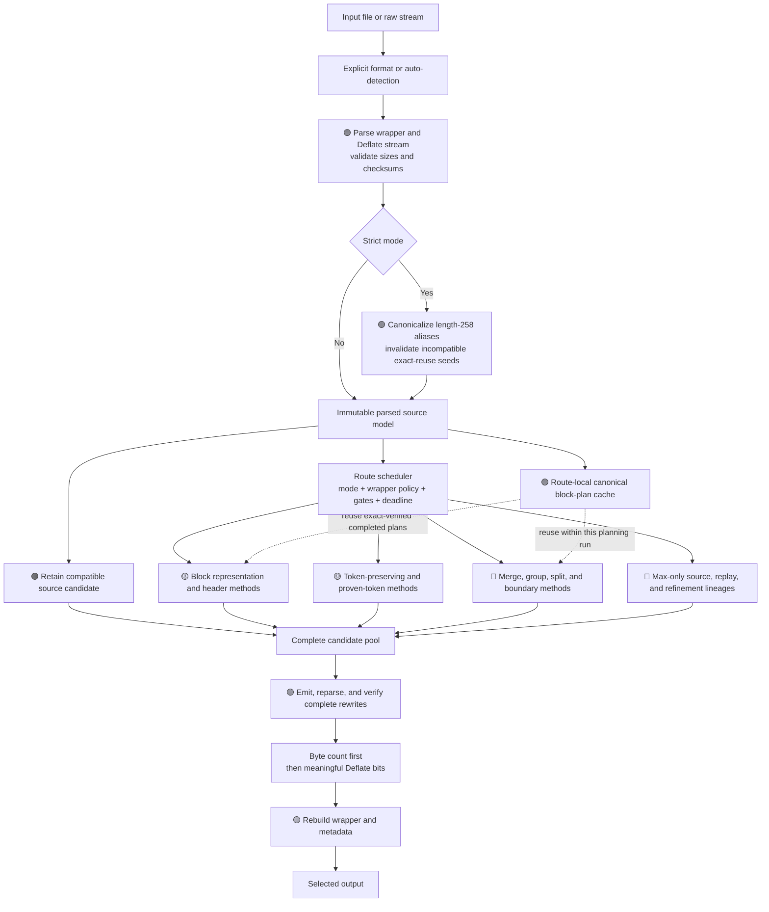
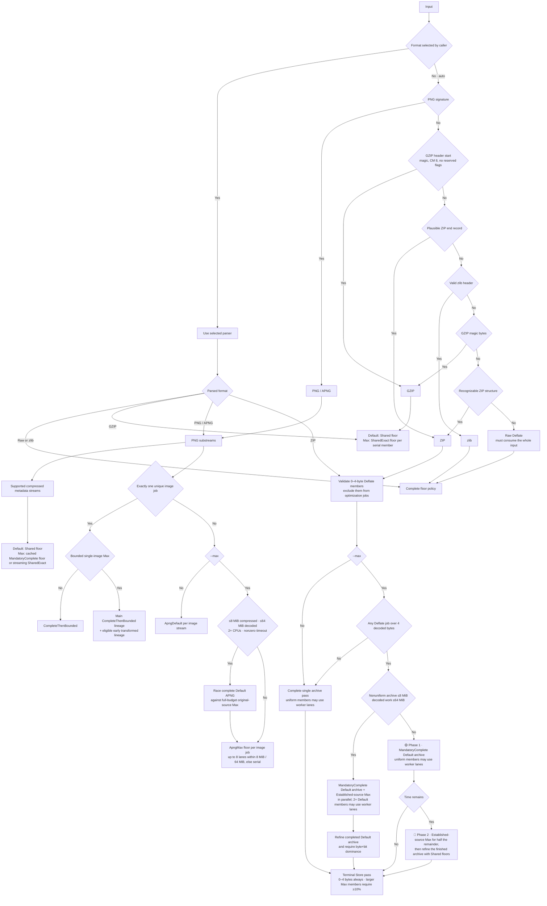
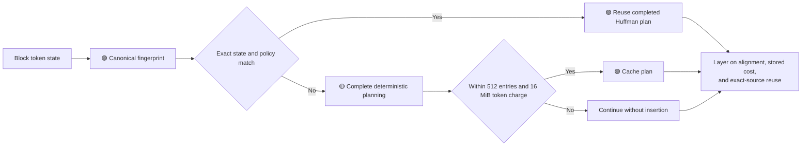

<!-- SPDX-License-Identifier: MIT -->

# Columbo routes and optimization methods

This document maps Columbo's routes and methods, and the format, topology,
work, memory, mode, and deadline gates that decide which optional routes build
complete candidates.

Columbo is a **post-optimizer**: it preserves the decoded bytes and works from
the source's literals, matches, blocks, and Huffman codes, with no new LZ77
match finder and no external recompressor ([Scope boundary](#scope-boundary)).

Routing code:

| Area | Source |
| --- | --- |
| File and wrapper dispatch | `src/format/mod.rs`, `src/format/png.rs`, `src/format/zlib.rs`, `src/format/gzip.rs`, `src/format/zip.rs` |
| Raw-stream scheduling, floors, replays, and deadlines | `src/deflate/optimize/schedule.rs` (phase order), `src/deflate/optimize.rs` (routes and gates) |
| Stream grouping, merging, splitting, and boundary search | `src/deflate/stream.rs` |
| Token transformations and proven-submatch search | `src/deflate/search.rs` |
| Terminal restoration of original match choices | `src/deflate/restore.rs` |
| Representation selection and route-local plan cache | `src/deflate/block.rs` |
| Huffman construction and dynamic-header search | `src/deflate/huffman.rs`, `src/deflate/header.rs` |
| Source-ordered recode route (deft4j-derived) | `src/deflate/source_recode.rs` |

Thresholds below are work bounds, not Deflate format limits; parser validity
checks and the configurable input and decoded-size limits apply to every route.
Corpus measurements set gates but never accept an output: every candidate is
compared by its exact complete-stream bytes and meaningful bits.

## Speed legend

| Indicator | Speed | Meaning |
| --- | --- | --- |
| 🟢 | Fast | Small, bounded work; normally close to linear in bytes, blocks, or tokens. |
| 🟡 | Medium | Rebuilds and compares several trees, token spellings, or block layouts. |
| 🔴 | Slow | Searches broad token, table, merge, replay, or boundary state, especially in Max. |

Indicators are relative: a 🟢 method can still be noticeable on a very large
stream or many streams. A method spanning two classes shows the range (🟡–🔴)
or the slower one.

## Overall pipeline

Candidate ordering is strict and stable: fewer output bytes win; at equal byte
length, fewer meaningful bits win; an exact tie keeps the earlier candidate.
Meaningful bits cover the complete stream through the final block's
end-of-block symbol, excluding final-byte padding. A same-byte result that saves
**one meaningful bit** is a real win, which the CLI writes unless `--dry-run`
is used. A padding-only change is not reported as a saving and does not
replace a file for compression alone.

ZIP has one wrapper-policy exception. An unencrypted method-8 member that
decodes to 0–4 bytes always becomes method 0 (Store) in Default and Max,
bypassing every Deflate route, because no valid Deflate stream is smaller at
those lengths. A four-byte Deflate payload can tie Store in bytes with fewer
meaningful bits; the CLI still writes this mandatory normalization but reports
no saving. For larger members, only Max may choose Store, and only when Store is
at least 10% smaller in payload bytes than the final Deflate stream. In
aggregate ZIP ordering, a stored payload costs eight meaningful bits per byte.

For raw Deflate, relaxed mode keeps the original unless a generated stream wins;
a wrapper can still be rebuilt to normalize a field such as zlib FLEVEL. Strict
mode may emit a larger standards-compatible stream when the source uses the
non-standard length-258 spelling or an incompatible Huffman alphabet.

## Routing decision tree

The diagrams use gate IDs, defined in the
[route-gate reference](#route-gate-reference) (top-level routes) and
[Inner stream-planner gates](#inner-stream-planner-gates) (block and boundary
methods). The [codebase guide](architecture.md#terms) defines route, candidate,
floor, and lineage.

| Term | Meaning in the routing diagrams |
| --- | --- |
| Fixed point | A completed replay that reproduces the same bytes and meaningful-bit count; the same planner need not rerun on that encoding. |
| Max seed | The ordinary planner's candidate before Default's feedback and terminal methods. Max routes start from it; the complete Default endpoint is kept separately. |
| `Complete` | Standalone raw and zlib streams, and ZIP in Default: finish the ordinary route before Max-only work on the same stream. |
| `CompleteThenBounded` | A PNG with exactly one unique image job: keep the complete Default result, then give Max routes a bounded shared schedule. |
| `Shared` | Multi-stream Default work and ZIP Max refinement: a bounded per-stream heuristic floor that leaves time and decoded-size budget for later streams. |
| `SharedExact` | GZIP Max and streaming PNG-metadata Max: `Shared` scheduling that keeps the complete Default endpoint before Max-only descendants. |
| `ApngDefault` | Multi-image APNG Default: run the full initial planner once; leave reparse/replay, endpoint-proven, and compact feedback lineages to Max. |
| `ApngMax` | Multi-image APNG Max: shared per-stream scheduling with all Max routes; keeps the complete `ApngDefault` result (initial planner, then R1–R5) beside a replay-bounded Max seed. |
| `Established` | A complete, validated stream the caller keeps as its floor; a new Max lineage starts from it without rebuilding Default, and every selectable descendant is still reparsed and identity-checked. |
| `MandatoryComplete` | A container-level Default branch built for Max (ZIP Default archive sibling, cached PNG-metadata floors): ordinary routes that Max's clock cannot interrupt. |

With the same strictness, stripping, and safety policy and enough time, Max is
never worse than Default for any supported wrapper: exact floor policies keep
the completed Default endpoint beside the Max seed, APNG Max also keeps a
complete file-level Default sibling for bounded models, and container selection
rejects any ZIP or PNG/APNG contender worse in bytes or aggregate meaningful
bits. A short deadline can expire before an exact floor finishes outside the
bounded file races, so equal short timeouts need not give equal results.

### Wrapper and floor-policy routing

`Shared` and `SharedExact` are per-stream floor and deadline policies; separate
members do **not** share a Huffman tree, candidate, or worker.

Every multi-stream wrapper has one file deadline. A child's proportional
allowance is a scheduling slice, not a file timeout: when it ends, the best
complete candidate is kept, and locally yielded PNG image jobs, ZIP members, and
GZIP members enter a weighted reclaim pass using the time actually left after
the initial schedule. Only expiry of the file deadline sets the public timeout
result ([reporting](#scheduling-and-observability)).

| Wrapper route | Exact gate and scheduling behavior | Indicator |
| --- | --- | --- |
| Auto detection | In order: PNG signature; GZIP header start (magic bytes, CM 8, no reserved flags); plausible ZIP end-of-central-directory record; valid zlib header (CM 8, CINFO ≤7, FCHECK); bare GZIP magic bytes; recognizable ZIP structure; else raw Deflate, which must consume the whole input (trailing data needs `--raw`). | 🟢 |
| Raw / top-level zlib | `Complete`; Default and Max route families run serially. M10d may follow the timed routes for a compact completed source-max parent. | 🔴 |
| GZIP | ≤16,384 concatenated members, preflighted, then optimized serially from smallest to largest compressed payload; one file deadline and cumulative decoded budget; `Shared` in Default, `SharedExact` in Max; initial slices weighted by decoded work; output in physical order. | 🟡 |
| PNG metadata | `zTXt`, compressed `iTXt`, and `iCCP` zlib streams. Default: `Shared`; an unstripped stream ≤4,096 bytes may get a 100 ms probe (64 MiB compressed-plus-decoded probe budget). Max with ≤64 MiB compressed metadata in total: cached complete Default floors (`MandatoryComplete`), built beside image work (static PNG) or before it (APNG); time left after image work goes half to an `Established` original-source Max branch, half to an `Established` continuation of the floor, both validated against the known decoded size without recharging the budget. Either replaces the floor only if no worse in metadata bytes and meaningful bits and better in one. Larger: streaming `SharedExact`. Exception: the unsafe-ancillary early return. | 🟡 |
| PNG / APNG image data | IDAT is one job; fdAT frames share a job only with equal compressed bytes and decoded size. One job: `CompleteThenBounded`; more: `ApngDefault` (Default) or `ApngMax` (Max). M8, M7a, and M10b govern original-source Max overlap. M10d only for a single job, after all timed routes; eligible `ApngMax` children reserve 1/20 of their slice instead (G0t). Bounded multi-image work (≤8 MiB compressed, ≤64 MiB decoded in total) runs on image lanes, and bounded APNG Max races a complete Default file sibling ([Multithreading](#multithreading)); other work is serial. With compressed metadata after the images, Default caps initial per-image allowances at 90% of the file remainder, and Max refines metadata only in time image search leaves. Yielded jobs get compressed-work-weighted reclaim passes that keep any mandatory later-stream reserve. | 🔴 |
| PNG single-image Max | ≤8 MiB compressed; ≤64 MiB decoded; and either >512 matches in same-distance runs, or ≥2 nonempty blocks decoding to ≤768 KiB that would otherwise build exact Default serially. The main `CompleteThenBounded` lineage then races an early lineage that spends 1/5 of the allowance on an ordinary parent and refines it through `Established`; exact Default stays the floor. | 🔴 |
| PNG decoded-equivalent frame reuse | After image-job optimization, frames with matching checksum and size are decoded and byte-compared; equal frames reuse the best compressed spelling. Caps: 32 MiB retained comparison data; 64 MiB comparison work. | 🟡 |
| PNG unsafe ancillary fallback | Without `--strip`, a `caBX` or `dSIG` signature or an unknown unsafe-to-copy ancillary chunk returns the source PNG unchanged (even with invalid `tRNS`) after only the container parse; `Optimization::blocking_chunk` names the first such chunk, and the CLI reports it on stderr with a `--strip` hint. Apple's `iDOT` does not block; rewrites drop it because they invalidate its IDAT offsets. | 🟢 |
| PNG invalid-exporter repair | Accepts and omits one `tRNS` that PNG forbids in color-type-6 (RGBA) images: non-empty, palette-sized, after a valid suggested `PLTE`, before image data. Other invalid `tRNS` shapes are errors; rewrite-sensitive unknown ancillary data blocks the repair unless stripping. Bytes after `IEND` are kept unless `--strip`. | 🟢 |
| ZIP member scheduling | All unencrypted method-8 entries are validated. Entries >4 decoded bytes are jobs; 0–4-byte entries are always stored ([Overall pipeline](#overall-pipeline)), and if they are the only Deflate entries, Max skips its direct and refinement archive lineages. Unencrypted stored entries: validated only; encrypted: kept undecoded. Order: Default largest-first, Max small-first ([member lanes](#multithreading)). Max's 10% Store test follows a complete archive lineage and ignores header and descriptor savings. Both ZIP headers are updated; Verbose and Visual report each Deflate-to-Store change with sizes and saving, including zero-saving normalizations. Local records keep physical order, central records directory order. | 🟡–🔴 |
| ZIP max archive lineages | ≥1 optimization job; nonuniform member work; input ≤8 MiB; jobs ≤64 MiB decoded in total: race the complete Default archive (`MandatoryComplete`) against direct original-source Max from the validated source (`Established`). Larger or uniform archives: complete Default, give original-source Max half the actual remainder, then refine the completed floor with the rest. No jobs: one pass. A Max archive replaces the Default archive only when no worse in file bytes and aggregate meaningful bits and better in one. | 🔴 |

### Raw-stream route tree

A diamond labeled `+ G0` rechecks the soft route deadline and sibling
cancellation. Deterministic cleanup, labeled as such, may finish after the soft
deadline once started.

#### Default and standalone max

```mermaid
flowchart TD
    RAW["Parsed raw Deflate stream"] --> MODE{"--max"}
    MODE -- "No" --> DEF["🟡 Ordinary planner + eligible proven endpoint<br/>at most 3 strictly improving replays"]
    DEF --> D1{"D1 eligible + G0"}
    D1 -- "Yes" --> D1RUN["🟡 Match-preserving feedback sibling"]
    D1 -- "No" --> D2
    D1RUN --> D2{"D2 eligible + G0"}
    D2 -- "Yes" --> D2RUN["🟡 Integrated multi-block feedback sibling"]
    D2 -- "No" --> D3
    D2RUN --> D3{"D3 · strict literal-only tree"}
    D3 -- "Yes" --> D3RUN["🟡 Up to 4 improving balanced-tree rounds"]
    D3 -- "No" --> TFLOORS
    D3RUN --> TFLOORS["🟡 Terminal tree floors"]
    TFLOORS --> D4{"D4 · ≥128 KiB decoded, M2's class + G0"}
    D4 -- "Yes" --> D4RUN["🟡 Search each source block from its chain or re-spell seed;<br/>if strictly smaller, finish it through R1–R18 too<br/>and keep the smaller endpoint"]
    D4 -- "No" --> R1
    D4RUN --> R1{"R1 · original-match restoration + G0"}
    R1 -- "Yes" --> RESTORE["🟢 Restore certified matches under unchanged trees"]
    R1 -- "No" --> R1B{"R1b · strict degenerate distance tree + G0"}
    RESTORE --> R1B
    R1B -- "Yes" --> COMPLETE["🟢 Price uniform complete distance trees"]
    R1B -- "No" --> R2{"R2 · payload/header tradeoff + G0"}
    COMPLETE --> R2
    R2 -- "Yes" --> TRADEOFF["🟡 Price positive-payload length swaps"]
    R2 -- "No" --> R3{"R3 · literal/length span + G0"}
    TRADEOFF --> R3
    R3 -- "Yes" --> SPAN["🟡 Price legal advertised literal spans"]
    R3 -- "No" --> R4{"R4 · joint tree/RLE + G0"}
    SPAN --> R4
    R4 -- "Yes" --> JOINT["🟡 Choose payload lengths and repeats together"]
    R4 -- "No" --> R5{"R5 · symbol set removal + G0"}
    JOINT --> R5
    R5 -- "Yes" --> SETS["🟡 Rewrite small symbol sets and reprice tables"]
    R5 -- "No" --> R1C{"R1c · fixed-tree boundary slide until hard stop"}
    SETS --> R1C
    R1C -- "Yes" --> SLIDE["🟢 Slide boundaries under fixed trees;<br/>re-plan moved blocks until none moves"]
    R1C -- "No" --> R13{"R13 · distance-alphabet ladder until hard stop"}
    SLIDE --> R13
    R13 -- "Yes" --> LADDER["🟡 Spell matches outside kept distance symbols as literals"]
    R13 -- "No" --> R14{"R14 · smoothed-tree finish until hard stop"}
    LADDER -- "Win" --> RESLIDE["🟢 Slide once more under the new trees"]
    LADDER -- "No win" --> R14
    RESLIDE --> R14
    R14 -- "Yes" --> SMOOTH["🟡 Adopt strictly smaller smoothed payload trees"]
    R14 -- "No" --> R15{"R15 · entropy cuts until hard stop"}
    SMOOTH -- "Win" --> RESLIDE14["🟢 Slide once more under the new trees"]
    SMOOTH -- "No win" --> R15
    RESLIDE14 --> R15
    R15 -- "Yes" --> CUTS["🟡 Cut blocks where symbol statistics change;<br/>cut kept halves again"]
    R15 -- "No" --> REPEAT{"R13, R14 or R15 won this pass;<br/>no repeat yet"}
    CUTS -- "Win" --> RESLIDE15["🟢 Slide once more under the new trees"]
    CUTS -- "No win" --> REPEAT
    RESLIDE15 --> REPEAT
    REPEAT -- "Yes" --> R13
    REPEAT -- "No" --> R16{"R16 · settled finish; terminal merges until hard stop"}
    R16 -- "Yes" --> MERGE["🟡 Merge neighbors that cost less as one block"]
    R16 -- "No" --> R17{"R17 · terminal token replay until hard stop"}
    MERGE -- "Win" --> RECUT["🟢 Slide once more, then R15 once more"]
    MERGE -- "No win" --> R17
    RECUT --> R17
    R17 -- "Yes" --> REPLAY["🟡 Replay the token floor from each block's final codes"]
    R17 -- "No" --> R18["🟡 R18 · terminal tree floors once more"]
    REPLAY -- "Win" --> RESLIDE17["🟢 Slide once more"]
    REPLAY -- "No win" --> R18
    RESLIDE17 --> R18
    R18 --> DEFAULTEND["Retain complete Default result"]

    MODE -- "Yes" --> POLICY{"Floor policy"}
    POLICY -- "Complete" --> CFLOOR["🟡 Mandatory ordinary comparison floor<br/>optional R6–R9 within remaining Max allowance"]
    CFLOOR --> CM1{"M1 eligible + G0"}
    CM1 -- "Yes" --> CDEFT["🔴 Direct deft4j source candidate"]
    CM1 -- "No" --> LATE["Continue at late-max tree"]
    CDEFT --> LATE
    POLICY -- "CompleteThenBounded, Shared, SharedExact,<br/>ApngMax, or Established" --> BOUNDED["Continue at bounded-max tree"]
```

`ApngDefault` skips D1–D3 and the terminal tree floors; Max runs them for
APNG. R18 runs the tree floors at the end of every finish, APNG frames
included. Because only R14 and R18 choose `ApngDefault`'s codes, it runs R2–R5
after R18 instead of in the sweep: R2–R4 fit lengths and headers to the chosen
codes, and R5 keeps a token rewrite only if it beats that fitted parent. D4
applies under every Default policy.

#### Bounded max

```mermaid
flowchart TD
    START["Max + bounded floor policy"] --> EST{"Established"}
    EST -- "Yes" --> EFLOOR["Retain caller-validated complete floor"]
    EST -- "No" --> M0{"M0 · prebuild floor"}
    M0 -- "Yes" --> PREFLOOR["Shared: bounded floor<br/>SharedExact / CompleteThenBounded: complete Default + Max seed<br/>ApngMax: complete APNG Default + bounded floor"]
    M0 -- "No" --> DEFER["Build floor inside bounded phase"]
    EFLOOR --> M1F
    PREFLOOR --> M1F["M1 · record deft eligibility"]
    DEFER --> M1F
    M1F --> M2F["M2 · record no-split eligibility"]
    M2F --> M3F["M3 · record compact proven-feedback eligibility"]
    M3F --> M4F["M4 · record compact balanced-tree eligibility"]
    M4F --> M5{"M5 · parallel work cap"}

    M5 -- "Fails" --> SERIAL["🟡 Standard serial phase<br/>floor + eligible M1/M2 under G0<br/>source max and M3 remain later"]
    M5 -- "Passes" --> BTYPE{"CompleteThenBounded"}
    BTYPE -- "No · Shared / SharedExact / ApngMax" --> SHARED["🔴 Bounded phase<br/>floor + eligible M1 under G0"]
    BTYPE -- "Yes" --> M6{"M6 · bounded PNG policy"}
    M6 -- "GenericParallel" --> GENERIC["🔴 Source max worker + floor lineage<br/>M1/M2 are ineligible by definition"]
    M6 -- "Standard" --> STANDARD["🔴 Floor + eligible M1/M2 under G0"]
    M6 -- "FloorExpansion" --> M10A{"M10a · dependency-first deft case<br/>M1 + G0"}
    M10A -- "Yes" --> PREDEP["🟡 Prebuild/refine deft prerequisite"]
    M10A -- "No" --> M8
    PREDEP --> M10CPRE{"M10c · dependency split parent eligible"}
    M10CPRE -- "Yes" --> PREDSPLIT["🟡 Deterministic compact split cleanup"]
    M10CPRE -- "No" --> M8
    PREDSPLIT --> M8{"M8 · compact initial source-max class"}
    M8 -- "No" --> EXPAND
    M8 -- "Yes" --> M9{"M9 · choose source-max / M3 token route"}
    M9 --> EXPAND["🔴 FloorExpansion phase<br/>floor + eligible M1/M2<br/>source/M3 workers per M8/M9"]

    SERIAL --> M7
    SHARED --> M7
    GENERIC --> M7
    STANDARD --> M7
    EXPAND --> M7{"M7 · floor selected + route window open"}
    M7 -- "No" --> POST
    M7 -- "Yes" --> DESC{"GenericParallel or FloorExpansion"}
    DESC -- "Yes" --> SEEDED["🔴 Established-floor max descendant"]
    DESC -- "No" --> MULTI{"Reparsed floor has multiple nonempty blocks"}
    MULTI -- "Yes" --> GROUP["🟡 Standalone bounded grouping"]
    MULTI -- "No" --> POST
    SEEDED --> POST
    GROUP --> POST["Bounded phase rejoined"]

    POST --> M3POST{"M3 eligible, not completed, + G0"}
    M3POST -- "Yes" --> M3RUN["🔴 Proven-feedback sibling<br/>+ header-aware spelling beam"]
    M3POST -- "No" --> S0
    M3RUN --> S0{"S0 · proven candidate ties floor bytes<br/>and wins meaningful bits"}
    S0 -- "Yes" --> SINTEGRATED["Later source max uses integrated compact order"]
    S0 -- "No" --> SORDINARY["Later source max uses ordinary order"]
    SINTEGRATED --> M10CSEED
    SORDINARY --> M10CSEED{"M10c · M4 flag + floor-seeded split parent eligible"}
    M10CSEED -- "Yes" --> SEEDSPLIT["🟡 Deterministic compact split cleanup"]
    M10CSEED -- "No" --> M4SEED
    SEEDSPLIT --> M4SEED{"M4 · resulting floor-seeded parent eligible"}
    M4SEED -- "Yes" --> M4SEEDRUN["🟡 Deterministic balanced-tree / feedback cleanup"]
    M4SEED -- "No" --> M7A
    M4SEEDRUN --> M7A{"M7a · floor-seeded descendant leads + G0"}
    M7A -- "Yes" --> M7ARUN["🔴 Continue the floor-seeded lineage first<br/>beside eligible deft4j, compact-split,<br/>or ApngMax source-max workers"]
    M7A -- "No" --> FOLLOW
    M7ARUN --> FOLLOW["Bounded follow-up + G0<br/>caller refines the deft4j lineage (M10b)<br/>beside the M2c or source-max worker and M10c"]
    FOLLOW --> M2C{"M2c · changed no-split winner<br/>new topology + G0"}
    FOLLOW --> M10B{"M10b · bounded deft / weak-split lineage"}
    FOLLOW --> M10CPOST{"M10c · normal/seeded/direct/refined parent eligible"}
    M2C -- "Yes" --> M2CRUN["🔴 One no-split continuation<br/>in the source-max worker slot"]
    M2C -- "No" --> LATE
    M2CRUN --> LATE
    M10B -- "Applicable" --> M10RUN["🔴 Timed refinements start under G0<br/>started compact cleanup may finish deterministically"]
    M10B -- "Not applicable" --> LATE
    M10RUN --> LATE
    M10CPOST -- "Yes" --> POSTSPLIT["🟡 Compact split cleanup"]
    M10CPOST -- "No" --> LATE
    POSTSPLIT --> LATE["Continue at late-max tree"]
```

#### Late max sequence

```mermaid
flowchart TD
    START["From Complete or bounded max"] --> M11{"M11 · fragmented seed + G0"}
    M11 -- "Eligible" --> FRAG["🔴 Fragmented replay lineage"]
    M11 -- "Ineligible" --> M12
    FRAG --> M12{"M12 · earlier source-max state"}
    M12 -- "Completed" --> M4SRC
    M12 -- "Suppressed" --> M13
    M12 -- "Absent" --> M12G{"G0"}
    M12G -- "Yes" --> SMAX["🔴 Broad source-max route<br/>+ eligible forced-split escape"]
    M12G -- "No" --> M13
    SMAX --> M4SRC{"M4 · rewritten source-max parent eligible"}
    M4SRC -- "Yes" --> M4SRUN["🟡 Deterministic balanced-tree / feedback cleanup"]
    M4SRC -- "No" --> M13
    M4SRUN --> M13{"M13 · seed selectable, not stable,<br/>optional routes allowed, + G0"}
    M13 -- "Yes" --> SEEDRUN["🔴 Max planner on selected rewrite"]
    M13 -- "No" --> M2LATE
    SEEDRUN --> M2LATE{"M2 late · complementary no-split<br/>policy eligible + G0"}
    M2LATE -- "Yes" --> M2LATERUN["🔴 Complementary cumulative / individual route"]
    M2LATE -- "No" --> M4FINAL
    M2LATERUN --> M4FINAL{"M4 · final selected parent eligible + G0"}
    M4FINAL -- "Yes" --> QFINAL["🟡 Final balanced-tree cleanup"]
    M4FINAL -- "No" --> CDEFAULT
    QFINAL --> CDEFAULT["Compare the retained complete Default endpoint"]
    CDEFAULT --> M10D{"M10d · saved source-max parent<br/>Complete or CompleteThenBounded"}
    M10D -- "Eligible" --> DSPLIT["🟡 Deferred bounded split finalization"]
    M10D -- "Ineligible" --> FINALFLOORS
    DSPLIT --> FINALFLOORS["🟡 Terminal tree floors"]
    FINALFLOORS --> R1{"R1 · original-match restoration + G0"}
    R1 -- "Yes" --> RESTORE["🟢 Restore certified matches under unchanged trees"]
    R1 -- "No" --> R1B{"R1b · strict degenerate distance tree + G0"}
    RESTORE --> R1B
    R1B -- "Yes" --> COMPLETE["🟢 Price uniform complete distance trees"]
    R1B -- "No" --> R2{"R2 · payload/header tradeoff + G0"}
    COMPLETE --> R2
    R2 -- "Yes" --> TRADEOFF["🟡 Price positive-payload length swaps"]
    R2 -- "No" --> R3{"R3 · literal/length span + G0"}
    TRADEOFF --> R3
    R3 -- "Yes" --> SPAN["🟡 Price legal advertised literal spans"]
    R3 -- "No" --> R4{"R4 · joint tree/RLE + G0"}
    SPAN --> R4
    R4 -- "Yes" --> JOINT["🟡 Choose payload lengths and repeats together"]
    R4 -- "No" --> R5{"R5 · symbol set removal + G0"}
    JOINT --> R5
    R5 -- "Yes" --> SETS["🟡 Rewrite small symbol sets and reprice tables"]
    R5 -- "No" --> R6{"R6 · alphabet boundaries + G0"}
    SETS --> R6
    R6 -- "Yes" --> ALPHABET["🟡 Price paired alphabet-support cuts"]
    R6 -- "No" --> R7{"R7 · code-length tree + G0"}
    ALPHABET --> R7
    R7 -- "Yes" --> CLTREE["🟡 Choose CL tree and RLE together"]
    R7 -- "No" --> R8{"R8 · code-length rotations + G0"}
    CLTREE --> R8
    R8 -- "Yes" --> ROTATE["🟡 Rotate three payload lengths and reprice"]
    R8 -- "No" --> R9{"R9 · coupled code-length swaps + G0"}
    ROTATE --> R9
    R9 -- "Yes" --> COUPLED["🟡 Swap LL and DD lengths together and reprice"]
    R9 -- "No" --> R10{"R10 · R1–R9 settled; match response + G0"}
    COUPLED --> R10
    R10 -- "Yes" --> RESPONSE["🟡 Fit certified match spellings to proposed trees"]
    R10 -- "No" --> R11{"R11 · R1–R10 settled; length exchange + G0"}
    RESPONSE --> R11
    R11 -- "Yes" --> EXCHANGE["🟡 Reassign a length code and fit certified spellings"]
    R11 -- "No" --> R1CMAX{"R1c · R1–R11 settled or last sweep; slide until hard stop"}
    EXCHANGE --> R1CMAX
    R1CMAX -- "Yes" --> SLIDEMAX["🟢 Slide boundaries under fixed trees;<br/>re-plan moved blocks until none moves"]
    R1CMAX -- "No" --> R13MAX{"R13 · R1–R11 and R1c settled or last sweep;<br/>distance ladder until hard stop"}
    SLIDEMAX --> R13MAX
    R13MAX -- "Yes" --> LADDERMAX["🟡 Collapse distance alphabets; slide once more after a win"]
    R13MAX -- "No" --> R14MAX{"R14 · R1–R11, R1c and R13 settled or last sweep;<br/>smoothed-tree finish until hard stop"}
    LADDERMAX --> R14MAX
    R14MAX -- "Yes" --> SMOOTHMAX["🟡 Adopt smoothed payload trees; slide once more after a win"]
    R14MAX -- "No" --> R15MAX{"R15 · R1–R11, R1c, R13 and R14 settled or last sweep;<br/>entropy cuts until hard stop"}
    SMOOTHMAX --> R15MAX
    R15MAX -- "Yes" --> CUTSMAX["🟡 Cut blocks where symbol statistics change; slide once more after a win"]
    R15MAX -- "No" --> R12{"R12 · sweep improved + G0"}
    CUTSMAX --> R12
    R12 -- "Yes" --> R1
    R12 -- "No" --> R16MAX{"R16 · settled or last sweep;<br/>terminal merges until hard stop"}
    R16MAX -- "Yes" --> MERGEMAX["🟡 Merge neighbors that cost less as one block;<br/>slide, then R15 once more after a win"]
    MERGEMAX --> R17MAX{"R17 · terminal token replay until hard stop"}
    R16MAX -- "No" --> R17MAX
    R17MAX -- "Yes" --> REPLAYMAX["🟡 Replay the token floor; slide once more after a win"]
    R17MAX -- "No" --> TAILWIN{"R16 or R17 won + G0"}
    REPLAYMAX --> TAILWIN
    TAILWIN -- "Yes" --> R12
    TAILWIN -- "No" --> R18MAX["🟡 R18 · terminal tree floors once more"]
    R18MAX --> PICKMAX["Select byte/meaningful-bit winner,<br/>including Default's final competitor,<br/>or relaxed raw source"]
```

The diagrams show eligibility and dependencies: M1–M4 are recorded as flags for
the bounded phase, not started on those four arrows. Eligible independent
branches may overlap where M5 and the thread-site gates allow, then rejoin in a
fixed comparison order.

The terminal methods run as one ordered sweep: R1, R1b, R2–R11, R1c, R13, R14,
R15. Default runs one sweep without the Max-only R6–R11; when R13, R14 or R15
wins, R13–R15 run one more pass, each sliding (R1c) once more after a win. In
Max, R10, R11, R1c, and R13–R15 run only when nothing earlier in the same sweep
changed the candidate; R1c and R13–R15 also run once no further sweep can
start, then with Default's one-pass repeat bound. R12 repeats the sweep after
any improvement while G0 permits, revisiting only methods whose input changed
and never rerunning the primary planner. Once the sweeps settle, R16 merges
adjacent blocks, sliding once more and running R15 once more after a win, and
R17 then replays the token floor on the resulting blocks, sliding once more
after a win; so neither redirects R13–R15. In Max, an R16 or R17 win lets R12
sweep again while G0 permits. Last, in both modes, R18 runs the terminal tree
floors once more on the final blocks.

Max's mandatory Default endpoints (`Complete`, `CompleteThenBounded`,
`SharedExact`, and `ApngMax`) run Default's sweep but keep its R1c and R13–R18
finish, and an R1b win, only as a final competitor compared after Max's terminal
sweeps; Max's own sweep applies those steps to its final incumbent. `ApngMax`'s
APNG Default endpoint follows `ApngDefault`'s order, R2–R5 after R18, while
Max's parent keeps them in the sweep. Max may also strengthen a completed
ordinary or APNG Default endpoint with R6–R9, within the existing deadline or
route window, before continuing from its Max seed. With a G0t share, G0 uses
the primary phase deadline through M10d and the full deadline from the terminal
tree floors onward.

### Route-gate reference

Rules shared by the terminal methods R1b–R17: run on the complete incumbent;
skipped when parsing it drops redundant empty blocks (every planned block must
map to one wire block); keep completed work at the stop; reprice stored-block
padding; no primary-planner replay; replace the parent only with a strictly
smaller whole stream (bytes, then meaningful bits); one work and price budget
per invocation, shared across the stream's blocks. R1b–R11 also need ≤128 parsed
blocks, and candidate compressed size and stream decoded size each ≤128 KiB in
Default (including Max's mandatory Default floors) or ≤1 MiB in Max. The
mandatory floors run R1–R5 to completion without the optional-search deadline;
the Max-only R6–R11 add no mandatory Default work, time, or grace.

| Gate | Condition | Effect |
| --- | --- | --- |
| G0 · timed-route start | New independent timed route: before its soft deadline; no sibling cancellation. Hard stop for active work: timeout + 10% + 1 second (no grace for a zero timeout or the G0t search phase). Linear finalization (bounded-depth tree floor, R1c, R13–R17) may start until the hard stop. Multi-route bounded phases: 4/5 of the remaining soft time; 1/5 kept for follow-up. | Blocks new timed starts only; parsing, validation, and the complete fallback always run, and an active atomic price or validation may finish. One accepted compact-split parent may use the file grace for M10c's rescue ([Boundary polishing](#boundary-polishing-inside-proven-matches)). |
| G0t · Max terminal share | Max; `Complete`, `CompleteThenBounded`, or `ApngMax`; nonzero timeout. Search share: source ≤1 MiB compressed and decoded, ≤128 blocks. Finalization share: the same policies outside that class, and any `Established` continuation outside it. Judged on the source; R1b–R11 still gate on the candidate. | Search share: primary routes get 4/5 of the allowance (`ApngMax` child: 19/20 of its slice) without grace; tree floors and R1–R14 get the full deadline and grace. Finalization share: primary routes get 19/20 of the allowance with grace; the bounded-depth tree floor, R1c, and R13–R17 finish in the last 1/20. `Established` applies this to its own window. A primary yield is not a file timeout and does not change other container children. [Validation](research/terminal-closure-validation.md#follow-up-on-13-september-2026-the-larger-max-work-class); [APNG evidence](benchmark-miss-regression-audit.md#apng-terminal-share-follow-up-on-22-september-2026); [finalization evidence](benchmark-miss-regression-audit.md#linear-finalization-share-on-8-october-2026). |
| D1 · match-preserving default feedback | Complete Default floor pass; one parsed block; ≥1 match; ≤4,000 tokens; ≤80,000 decoded bytes. | Adds proven-before-feedback and ordinary endpoint orders as independent candidates, in Default and in the exact Max floors (`Complete`, `CompleteThenBounded`, `SharedExact`), where it is mandatory and skips G0. |
| D2 · integrated default feedback | Complete Default floor pass; 2–4 parsed blocks; ≤16 KiB compressed; ≤128 KiB decoded; ≤16 Ki tokens; ≥1 block within D1's limits. | Adds a compact multi-block integrated-proven candidate, scheduled like D1. The second endpoint replay runs only if the first did not beat the incumbent and hard time remains. |
| D3 · strict literal-only balanced tree | Strict; complete Default floor pass; ≤8 KiB compressed; one nonempty block: dynamic, ≤4,096 tokens, no distance symbols. | ≤4 strictly improving balanced-tree rounds (pair and quad moves on the ordinary header grid; only the winner exhaustively finalized and reparsed); stops at a fixed point. |
| D4 · source topology | Default; source ≥128 KiB decoded; in M2's class (≤1 MiB compressed; 2–128 nonempty blocks, all fixed or dynamic); after D1–D3 and the terminal tree floors; G0. | Keeps the source's own block layout. Each nonempty block is seeded with the smallest of its ordinary plan, its [length-family chain](#block-huffman-and-token-methods) and its re-spell from literals, then searched from that seed with the no-split route's narrow whole-block search, including the large-source length bands; blocks are not merged. Only if that candidate is strictly smaller than the selected candidate is it also finished through R1–R18, and the smaller finished endpoint is kept. A reached stop leaves no candidate. Max runs it in its complete Default floor as mandatory work without G0, finishing both lineages and keeping the one whose Default endpoint is smaller, so Max never ends above Default; Max's own routes, M1 and M2, explore the same transforms and searches more widely. Validation: [chains](research/source-family-chain-validation.md), [narrow search](research/source-layout-search-validation.md), [re-spell](research/literal-respell-validation.md). |
| R1 · original-match restoration | Parent differs from the original; both ≤128 KiB compressed and decoded; each layout ≤128 blocks; ≥1 original match certificate; parser keeps every wire block; Huffman blocks ≤16 Ki tokens; a certificate clipped to its block spans 3–4,096 decoded bytes, meets token boundaries, and includes selected literals; G0 (not in Max's mandatory Default floor). | Restores certified source matches under the final trees and headers: ≤2^20 DP edge evaluations per stream; no replay; source stored and literal bytes uncertified. Keeps completed repairs at the hard stop. Must strictly improve bytes and bits, including stored alignment; reports the actual maximum distance to wrappers. [Validation](research/permanent-match-proofs-validation.md). |
| R1b · strict distance completion | Strict; after R1; G0. Each dynamic block using ≤1 distance symbol with a strictly compatible parent header. | Prices, against planning's two one-bit distance codes, the four uniform complete trees of depth 1–4 (contiguous, covering the used symbol), literal/length tree kept: ≤4 prices per block, 1,024 per stream. [Validation](benchmark-miss-regression-audit.md#strict-distance-completion-on-30-september-2026); [final-competitor evidence](benchmark-miss-regression-audit.md#strict-completion-as-a-final-competitor). |
| R1c · fixed-tree boundary slide | After R5 (Default) or R11 (Max); also ends the PNG early lineage's quick floor, a seed only ([evidence](benchmark-miss-regression-audit.md#early-lineage-parent-8-october)). No size or block limit; linear per round. Boundaries between two non-stored blocks only. | Moves each boundary to the cheapest token cut both fixed trees can price (blocks stay nonempty; ties keep the cut), ≤16 sweeps while payload falls; re-plans moved blocks, keeping the cheaper code (ties keep the header), and repeats, ≤16 strictly improving rounds. Tokens keep their spelling; a match joining the neighbor costs the cheaper of its spelling and its literals. Stored blocks (including blocks re-planned as stored) and their boundaries stay fixed. Polls the hard stop between boundaries and every 64 Ki tokens. [Validation](research/boundary-slide-validation.md). |
| R2 · payload/header tradeoff | After R1, or after R18 under `ApngDefault`; G0. | Reprices unchanged dynamic trees, then ≤32 length swaps per alphabet (two unequal nonzero lengths, no reserved distances, 1–18 payload bits, fewer adjacent transitions); 1,024 header prices per stream. Tokens, support, and code-length histogram fixed. Max may price its final result after keeping the Default floor. [Validation](research/payload-header-tradeoff-validation.md); [size-class validation](research/terminal-header-work-class-validation.md); [APNG order](research/apng-header-fit-validation.md). |
| R3 · literal/length span | After R2; G0 for timed work. | Tries every legal HLIT from the minimum to 286 except the parent's, with complete header pricing; 1,024 prices. Tokens, codewords, distance lengths, and HDIST fixed; strict trees stay complete. [Validation](research/literal-span-validation.md). |
| R4 · joint tree/RLE | After R3; G0 for timed work. | Jointly chooses complete payload code lengths (depth ≤9) and their RLE under the parent's code-length tree; repeats may cross the alphabet seam and unused positions may gain codes. HLIT/HDIST, tokens, boundaries, and zero reserved distances fixed. 2^27 shared work units; ≤24 MiB scratch per solver; ≤1 full header reprice per successful block. [Validation](research/joint-tree-rle-validation.md). |
| R5 · symbol set removal | After R4 (so after R18 under `ApngDefault`); G0 for timed work; dynamic parent blocks with strictly compatible codes, ≤128 KiB decoded, ≤8,192 tokens. | Tries removing 2–4-symbol sets (intervals and mixed literal/length–distance sets): distances become literals, lengths become same-distance submatches. Per proposal ≤64 matches and ≤8,192 bytes; 8 proposals, one feedback attempt each; per stream 2^25 rewrite units and 128 spelling prices. Prices on the Default table grid plus bounded-depth and RLE-smoothed families (strict codes); boundaries fixed. [Validation](research/symbol-set-validation.md). |
| R6 · alphabet boundaries | Max; after R5; completed Default or APNG Default endpoint, or final Max incumbent; G0; non-stored blocks with 16–32,768 tokens. | Tries cuts at first/last occurrences of symbols, symbol groups, and high-symbol tails: ≤8 exact-priced pairs within a 64-bit estimate window, then the eight-residue boundary graph (≤80 cuts). Per stream 2^26 work units and 4,096 range prices; 512-entry header cache. [Validation](research/alphabet-boundary-validation.md). |
| R7 · code-length tree | Max; after R6; same parents; G0; dynamic only. | Optimizes the code-length tree (symbols 0, 16, 17, 18 enumerated, the rest by an exact 128-unit Kraft DP); data codes, tokens, and spans fixed. 2^24 work units per stream. [Validation](research/code-length-tree-validation.md). |
| R8 · code-length rotations | Max; after R7; same parents; G0; dynamic only. | Rotates three distinct positive payload lengths in one alphabet: ≤64 cycles per alphabet, payload delta −32…+32 bits; 2^24 generation units and 512 header prices per stream. Tokens, support, length histogram, and spans fixed. [Validation](research/code-length-rotation-validation.md). |
| R9 · coupled code-length swaps | Max; after R8; same parents; G0; dynamic only. | Swaps lengths in both payload alphabets at once: ≤32 swaps per alphabet, ≤256 pairs, individual and combined deltas −32…+32 bits; 2^20 generation units and 512 header prices per stream. Tokens, support, histograms, and spans fixed. [Validation](research/coupled-code-length-swaps-validation.md). |
| R10 · header-directed match response | Max; final Max incumbent; R1–R9 changed nothing this sweep; G0; dynamic blocks with ≤4,096 decoded bytes, ≤1,024 tokens, 1–128 matches. | For the current tree and each nonzero single swap, re-solves every match's certified spelling: ≤256 profiles (payload tax ≤128 bits, no added transitions); 2^25 work units and 512 header prices per stream. Support, histograms, spans, boundaries, and submatch intervals and distances fixed; no missing codes. [Validation](research/header-response-validation.md). |
| R11 · length-symbol exchange | Max; final incumbent; R1–R10 changed nothing this sweep; G0; dynamic blocks with ≤4,096 decoded bytes, ≤1,024 tokens, 1–128 matches. | Moves a used length symbol's code length to an absent one (including an unused spare), then fits certified spellings: ≤210 pairs, bound-ranked before the exact DP; 2^25 units and 512 header prices per stream. Literal, end-of-block, and distance prices, the literal/length length histogram, and boundaries fixed; a source code may vanish only if another spelling exists. [Validation](research/length-symbol-exchange-validation.md). |
| R12 · terminal method closure | Max; final incumbent after R1–R11, R1c, R13–R15; repeats only after a strict complete-stream improvement while G0 allows. | Reruns, in order and with usual bounds, methods whose input changed; 15 input-score slots skip repeats. No round cap, primary replay, extra grace, or mandatory Default rework; earlier floors unchanged. A completed unexpired sweep without change is a fixed point for these methods only. [Validation](research/terminal-closure-validation.md). |
| R13 · distance-alphabet ladder | After R1c; no size or block limit; non-stored blocks using ≥2 distance symbols. Also ends the PNG early lineage's quick floor, a seed only ([evidence](benchmark-miss-regression-audit.md#iterated-slide-and-distance-ladder-on-9-october-2026)). | Estimates three ladders of kept distance-symbol sets (shortest first, most frequent first, singletons; ≤88 sets) in one pass, with DeflOpt variant-0 trees and a greedy header or the fixed tree; plans ≤2 rungs not above the parent's estimate with the non-exhaustive planner in both modes (ties: smaller set). Adopts only a strictly smaller block plan. Polls the stop every 4,096 tokens and between rungs. A win triggers one more R1c. [Validation](research/distance-ladder-validation.md). |
| R14 · smoothed-tree finish | After R13; no size or block limit; non-stored blocks (the compact payload-tree floor keeps its earlier pass and closure). | Prices Brotli fixed-point and Zopfli nearby-count smoothed trees at maximum depths 15–9 on true counts; adopts the cheapest if strictly smaller and, in strict mode, strictly compatible. Polls the stop between blocks. A win triggers one more R1c. [Validation](research/smoothed-tree-finish-validation.md). |
| R15 · entropy cuts | After R14; no size or block limit; non-stored blocks with ≥32 tokens. | One linear pass over a token range keeps both sides' literal/length and distance histograms and fixed-point `c log2 c` sums, giving the zeroth-order entropy of every token cut, each side with one end-of-block. The lowest cut that saves ≥32 estimated bits, with ≥16 tokens per side, is priced with the bounded planner in both modes and kept only if the block's planned sequence is strictly smaller; if it fails, or none saves enough, the same pass's lowest cut by entropy plus a header estimate (64 bits per side and 4 per used symbol) is priced instead when that total is below the range's. Each kept half is then cut the same way, left first. Per pass, work units scale with the stream: 64 per token and decoded byte, at least 2^28; and 4,096 range prices. Polls the stop every 65,536 scanned tokens and before each price; in Max, R12 repeats a pass that changed the stream. A win triggers one more R1c. [Validation](research/entropy-cut-validation.md). |
| R16 · terminal merges | Once the sweeps settle (Default after its sweep; Max when no further sweep starts or a sweep changed nothing); no size or block limit; adjacent non-stored blocks. | One left-to-right pass prices each neighbor pair as one block with the bounded planner in both modes, at its real bit alignment, and keeps the merge only if it is strictly smaller than the pair as encoded; a merged block may absorb its next neighbor too. Per pass, planned token and decoded-byte volume up to 64 units per token and decoded byte of the stream, at least 2^28; polls the stop before each pair; completed merges are kept. A win triggers one more R1c and then one more R15 (with its own R1c); in Max it also lets R12 sweep again. [Validation](research/terminal-merge-validation.md). |
| R17 · terminal token replay | After R16; no size or block limit; dynamic blocks with ≤50,000 tokens and ≤10,000,000 decoded bytes. | Replays the Default extended token floor (same-distance runs, match-to-literal expansions, short-length bands, feedback trees and table replay) with the block's final codes as its source codes, at its real alignment, and keeps the plan only if strictly smaller than the block as encoded. Blocks of ≥4,096 tokens always get the floor; smaller ones only when a match costs strictly more than its literals under their codes, priced as the table replay prices it. Polls the stop between blocks. A win triggers one more R1c; in Max it also lets R12 sweep again. [Validation](research/token-replay-validation.md). |
| R18 · late tree floor | After R17 in Default, and after Max's last sweep; also ends Max's mandatory Default endpoints. Same gates as the terminal tree floors: the compact payload-tree floor for ≤8 KiB compressed and ≤128 KiB decoded, and the bounded-depth frontier unless the compact pass covered it, with Max's hard-stop rescue. | Prices the compact and bounded-depth tree families once more on the final blocks, which R13–R17 and D4 may have cut, merged or re-spelled since the first floors, and on APNG Default frames, which skip the first floors; keeps only a strictly smaller stream. [Validation](research/late-tree-floor-validation.md). |
| M0 · bounded-floor prebuild | Max. `Shared`: bounded floor. `SharedExact`: complete Default endpoint and Max seed. `ApngMax`: complete APNG Default endpoint and bounded floor. `CompleteThenBounded`: when ≤1 nonempty block, decoded ≤768 KiB or >2 MiB, or >512 matches in same-distance runs (plus complete Default endpoint and Max seed). `Established`: caller's floor. `Complete`: exact floor later, in the serial tree. | Builds the floor before the bounded phase; otherwise the multi-block single-image PNG floor is built inside it. |
| M1 · deft4j source | Max; any wrapper or policy; one nonempty fixed or dynamic block, or ≥2 nonempty blocks of any type and count. Rejected: all-empty stream; lone stored block. Bounded by a 128 MiB route arena and G0 only. | Adds the direct deft4j-derived source candidate. |
| M2 · no-split source | Max; `CompleteThenBounded`; ≤1 MiB compressed; 2–128 nonempty blocks, all fixed or dynamic. | Deft4j-derived per-block seed, then length-family pruning (individual first for 2–3 blocks, cumulative first for ≥4) and adjacent source-order merges; late Max time also tries the other order as an independent topology. Changed boundaries or spellings get one Default refinement (route window if parallel, hard deadline if serial); header-only rewrites do not. |
| M2c · changed no-split continuation | M2 strictly improved with changed tokens or boundaries; G0. | Reruns the no-split transformation once on the emitted parent, in the source-max worker slot (follow-up ≤3 workers); source max stays eligible later. M2's limits apply instead of M5. |
| M3 · compact proven feedback | Max; `CompleteThenBounded`; one parsed block; ≥1 match; ≤4,000 tokens; ≤80,000 decoded bytes. | Proven-first sibling in the initial phase under M8/M9, or afterward if unfinished and G0 allows. Its floor also gets the header-aware spelling beam when the rewritten parent has ≤8,000 tokens and 2–128 matches. |
| M4 · compact balanced tree | Max; `CompleteThenBounded`; ≤8 KiB compressed; ≤128 KiB decoded; one nonempty dynamic source block, ≤4,096 tokens. Each rewritten parent: one dynamic block, ≤4,096 tokens, kept source dynamic-tree seed. | Pair/quad tree cleanup of floor-seeded and source-max parents (deterministic, no G0; the final selected-parent trial needs G0): ≤16 paired candidates from the four lowest-payload-delta moves per side. Pairing: Default at combined delta ≤0; Max ≤18 extra payload bits and, with matches, no standalone literal pairs. Only a complete header-plus-payload win survives. |
| M5 · route-level parallel cap | Max; bounded floor policy (`CompleteThenBounded`, `Shared`, `SharedExact`, `ApngMax`, `Established`); ≤8 MiB compressed; ≤64 MiB decoded; estimated model ≤64 MiB. | Allows broad routes to overlap. Otherwise Standard scheduling: floor, M1/M2, and dependents serial; no M8; source max later; no deferred floor-max descendant guaranteed. |
| M6 · bounded PNG policy | `CompleteThenBounded`, after M5. `GenericParallel`: neither M1 nor M2. Else `FloorExpansion`: ≥2 nonempty source blocks, or the floor changed nonempty boundaries or tokens. Else `Standard`. | Chooses the independent lineages of the initial window. |
| M7 · floor descendant | Floor selected (strict mode, or strictly smaller than the source); bounded window open. `GenericParallel`, `FloorExpansion`: established-floor Max descendant. Standard: standalone bounded grouping if the reparsed floor has ≥2 nonempty blocks. | Runs one descendant (mutually exclusive). A Max descendant that rejoins as the strongest candidate without a fixed point continues under M7a before weaker parents. |
| M7a · best-first floor continuation | Floor-seeded Max descendant strictly beats the floor; no deft4j, no-split, or source-max candidate beats it; no exact Max fixed point; G0. With a pending compact split that cannot run in parallel: ≥2% saving over the floor. | Continues the strongest dependent lineage first; beside it run the deft4j-derived refinement and any pending compact split (bounded single-image class) or original-source Max (`ApngMax`). Every independent root still gets work as the allowance grows. |
| M8 · initial compact source max | `FloorExpansion` + M5 (`CompleteThenBounded` only), and one of: ≤2,048 tokens; ≤16 KiB compressed, one nonempty block, ≤128 KiB decoded; ≤16 KiB compressed, 2–4 nonempty blocks, decoded ≤128 KiB × nonempty blocks, ≤16 Ki tokens, ≥2 repartition runs; one block >128 KiB decoded, ≤16 KiB compressed, ≤16 Ki tokens, and either ≥1 repartition run per 16 tokens or ≤4,000 tokens averaging ≥224 decoded bytes per token. | Source max joins the initial bounded worker phase; otherwise it is a later G0 route. |
| M9 · compact source-token route | M8. ≤2,048 tokens: both roots. 2,500–4,000 tokens: source max alone if M3 exists and the topology is distinct (a repartition run, or >65,535 decoded bytes). Otherwise source max needs ≥2 repartition runs or no M3. | Selects source max, M3, or both; M3 is suppressed only when the single source route starts. |
| S0 · source-max state order | Completed M3 candidate ties the bounded floor in bytes with fewer meaningful bits. | Later source max starts with the integrated compact proven order; otherwise the ordinary order. A running initial source max is unaffected. |
| M10a · dependency-first deft | `FloorExpansion`; M1; G0; and a unique one-nonempty-block floor descendant, or a source with ≤16 KiB compressed, ≤128 KiB decoded, ≤16 Ki tokens, ≥2 nonempty blocks, and a non-dense repartition graph (dense: every nonempty block ≤4,000 tokens and repartition runs ≥ nonempty blocks). | Builds and refines the direct deft parent before long beams; the multi-block case also completes its eligible split descendant. |
| M10b · bounded deft refinement | Bounded policy; G0. Weak deft signal: `CompleteThenBounded`, completed deft candidate, ≥2 nonempty blocks, meaningful-bit gain <2%. Floor reseed: floor strictly beats the source; in the weak reseed branch, ordinary replay and terminal merge each recheck G0, and terminal merge also needs a seed ≤1 MiB and no better M2 candidate. Existing direct deft candidate: the single M10b check. | Refines the direct or floor-seeded deft lineage beside eligible work; original-source Max runs beside direct-deft refinement under `CompleteThenBounded` and `ApngMax` when bounded parallel work is available, serially otherwise. A new, smaller Default topology that beats a completed M2 candidate gets one no-split continuation, then a changed direct-deft parent may get one full Max continuation; header-only rewrites get neither. |
| M10c · compact split cleanup | Prepared parent ≤16 KiB compressed; reparses to 2–4 blocks, none empty or stored; ≤128 KiB decoded; ≤16 Ki tokens; ≥1 block with ≥16 tokens and ≥128 decoded bytes. A later refined parent: distinct, and beats every early parent or passes G0. | Runs the compact split floor ([Boundary polishing](#boundary-polishing-inside-proven-matches)) on normal, floor-seeded, direct-deft, and refined-deft parents; each stage forwards a complete candidate. The bounded phase records its completed parent and any same-token, same-block endpoint as fixed points, so follow-up skips them; structurally changed descendants stay eligible. |
| M10d · deferred source-max split | Max; `Complete` or `CompleteThenBounded`; distinct completed source-max parent ≤16 KiB compressed; reparses to 1–4 blocks, none empty or stored; ≤256 KiB decoded; ≤16 Ki tokens; ≥1 block with ≥16 tokens and ≥128 decoded bytes. | Keeps the compact parent during timed routes, then runs M10c's coarse-to-fine planner or bounded rescue (a one-block parent gains its second block). Not under `Shared`, `SharedExact`, `ApngMax`, or `Established`, whose time is reserved for later streams. |
| M11 · fragmented collection | Max; optional routes not suppressed; G0; ≥64 source blocks; encoded source 16,000–100,000 bytes; no stored block. Collection: ≤4,096 tokens and ≤512 KiB decoded per run; yields fewer source blocks and 2–8 collected blocks. | Replays the fragmented seed until a metric fixed point or the deadline; the replay accepts 1–12 non-stored blocks. |
| M12 · later source max | Max; reuse a completed earlier source-max candidate; skip if policy suppressed it; else start only while G0 allows. | Runs original-source Max before a rewritten seed, never repeating an initial source-max route. |
| M13 · rewritten-seed refinement | Max; selected candidate allowed (strict mode, or beats the source); no exact unexpired Max-planner fixed point; optional routes not suppressed; G0. | Reparses and runs the Max planner from the selected rewrite. |

Replay limits: ordinary Default and compact-feedback lineages ≤3 replays;
terminal merge ≤2; direct deft candidates none until a scheduled refinement.
Broad, floor-seeded, and fragmented Max lineages continue until a metric fixed
point or the deadline, capped at eight times the initially emitted byte length.
A replay round is adopted only on a strict byte/meaningful-bit win, and only an
unexpired exhaustive round can establish a fixed point. Standalone `Complete`
Max keeps every eligible D1/D2/D3/D4 endpoint and R1 in its complete Default
endpoint, then continues Max from the Max seed; `SharedExact` does the same for
scheduled multi-stream work.

## Inner stream-planner gates

These gates decide which block-layout and boundary methods run inside a started
route.

| Method | Exact gate | Indicator |
| --- | --- | --- |
| All-stored repack | ≥2 blocks, all stored; ≤64,000,000 decoded bytes. Rechunks to payloads ≤65,535 bytes. | 🟢 |
| Regroup family | Floor work remains; Max, or encoded source 16,000–100,000 bytes. | 🟡 |
| Source-aligned floor | Regroup; 2–8 source blocks; no stored block; each range ≤250,000 tokens and ≤64,000,000 decoded bytes; optional composite model ≤48 MiB. | 🟡 |
| Whole-stream merged replay | Eligible source-aligned floor; merged range ≥100,000 decoded bytes. A fixed or dynamic seed ≤256 bits above the best immediate recode may get extended-floor replay (≤50,000 tokens) and a four-step table ladder (≤100,000 tokens), both ≤10,000,000 decoded bytes. | 🟡 |
| Greedy and bounded grouping | Ordinary regroup 9–128 blocks; floor-seeded standalone form 2–128; no stored source block; 2 × retained payload ≤48 MiB. Bounded grouping: spans ≤16; aborts if any source block planned alone selects stored. | 🟡 |
| Collected and wide-collected layouts | Regroup; >8 blocks; 3 × retained payload ≤48 MiB; layouts >2,048 blocks abandoned. Bounded runs ≤8,192 tokens and ≤512 KiB decoded. Wide: Max or ≥128 blocks; 250,000-token/64,000,000-byte merge caps; must differ from bounded collection. | 🟡 |
| Mandatory token floor | ≤128 blocks; extended compact feedback floor only at ≤8 blocks. Proven resegmentation runs before feedback when same-distance repartition opportunities exist, else as an independent endpoint lineage. | 🟡 |
| Selected-plan merge cleanup | Max; searched source-order plan strictly replaced the fallback; 2–8 alignment-independent Huffman blocks; ≤8,192 tokens; ≤512 KiB decoded. | 🟡 |
| Comparison-floor boundary reseat | Max; deadline remains; secured comparison floor of 2–8 alignment-independent Huffman blocks, ≤8,192 tokens, ≤512 KiB decoded; each adjacent union passes the adaptive probe's histogram, ≥513-token, and ≥128-byte gates and finds a new cut. Keeps only the strongest single reseat, on a strict complete-plan bit win. | 🟡 |
| Forced-split boundary escape | Max; deadline remains; secured floor of 2–7 alignment-independent Huffman blocks, ≤8,192 tokens, ≤512 KiB decoded; largest block with ≥513 tokens and ≥128 decoded bytes has a sampled local minimum ≥ max(span / 7, 16) tokens from its best cut. Forces that cut, plans both children exactly, tries one adjacent reseat; needs a complete-plan bit win over the floor. | 🟡 |
| Per-source split | Whole-block search instead when <16 tokens, <128 decoded bytes, or (Default) <32,768 decoded bytes. Else seven decoded-eighth probes; Max blocks ≤512 tokens add cuts at multiples of 32 tokens (≥32 before, >32 after), ≤32 cuts with the source cuts. | 🔴 |
| Exact inside-match siblings | Max: always; Default: `token_count × 7 ≤ 32,768`. A source's own eighths: ≥16 tokens, ≥128 decoded bytes, (Default) ≥32,768 decoded bytes. With regroup and ≤8 sources, both modes add combined Huffman runs and their ≥2-source subgroups, each ≥16 tokens and ≥128 decoded bytes. | 🔴 |
| Default nested split | ≥2 exact-priced splits; runner-up ≤64 bits behind the best. Refines only the runner-up's larger child at its snapped midpoint, plus an exact inside-match sibling if Default's gate passes (≤2 cuts). | 🟡 |
| Adaptive split | Max; 513–250,000 tokens; ≥128 decoded bytes; usable range histogram; new cut; ≤128 sample/probe positions; exact structural saving ≥32 bits. | 🟡 |
| Entropy-state boundary scout | Max global-boundary work; 513–250,000 tokens; ≥128 decoded bytes; no stored source block; deadline remains. Fits 2–8 literal/length-plus-distance code states to the existing tokens (two refinement rounds, 128 bits per switch), ranks transitions in 64-token neighborhoods, keeps ≤16 token-boundary anchors. The pre-scout cut graph stays; exact boundary pricing decides. | 🔴 |
| Priority boundary graph | Max; established comparison floor; regroup; 1–2 blocks; ≤8,192 tokens; ≥100,000 decoded bytes; ≥2 same-distance repartition runs. Two blocks: first replay after a structural split; longer lists keep source-order priority. | 🔴 |
| Global boundary graph | Regroup; deadline remains; >2 distinct cuts; composite within the 48 MiB optional-model cap (histogram probes skipped if their index is not); token-boundary cuts before inside-match cuts; ≤2,048 cuts. | 🔴 |
| Boundary edge legality | Default same-source edges touch the source's start or end; Max may use middle ranges. Cross-source edges ≤250,000 tokens and ≤64,000,000 decoded bytes. Cross-source stored edges: whole sources, ≤65,535 bytes; no mixed stored/Huffman ranges. Default cross-source Huffman ranges: regroup, ≤8 sources, a touched source boundary, except ≤512-byte or all-fixed whole-source ranges. Each edge is priced from every reachable start residue. | 🔴 |
| Adjacent merge | Merge search on; combined decoded ≤512 bytes, Max, or route-selected long-run Huffman merging; ≤250,000 tokens and ≤64,000,000 bytes. Fixed/fixed joins and identical-source-tree reuse have cheaper dedicated candidates. | 🔴 |
| No-split route | Direct fallback, narrow whole-block searches, and long-run adjacent merging only; no grouping, split probes, global boundaries, broad state queues, or unbounded replay. See M2 and M2c. | 🟡 |

### Inner token-search gates

| Method | Exact gate | Indicator |
| --- | --- | --- |
| Same-distance candidate | ≥2 tokens; ≥1 adjacent same-distance run; strict complete-block bit win. DP limits: [same-distance normalization](#same-distance-match-run-normalization). | 🟢 |
| Mandatory block floor | ≤50,000 tokens; ≤10,000,000 decoded bytes. | 🟡 |
| Ordinary short-family floor | ≤250,000 tokens; ≤64,000,000 decoded bytes. Cumulative ranges 260, 260–261, …, 260–264. | 🟡 |
| Compact short-band floor | ≤12,000 tokens; ≤80,000 decoded bytes. Prefixes ending at 257, 258, 259, 260, 262, 264. | 🟡 |
| Large no-split bands | Narrow/no-split block search (M2, D4); ≥128,000 decoded bytes; ≤80,000 tokens. Cumulative endpoints 262, 265, 267, 269, 270, plus the sparse 260–270-and-280 family. | 🟡 |
| All-literal endpoint | ≤80,000 decoded bytes, or ≤1,000,000 with ≤256 matches; enclosing bounds apply. A frequency-only preflight rejects distant candidates before expansion. | 🟡 |
| Match-expansion ladder | Matches exist; ≤12 token-expansion states per seed; keeps strict winners and useful non-larger intermediates per route policy. | 🔴 |
| Match groups | Max; ≤250,000 tokens; ≤10,000,000 decoded bytes. Per ≤2 deduplicated table seeds: ≤20 individual groups and the first 2-, 3-, 4-, and 5-group prefixes. | 🔴 |
| Individual match pruning | Default: ≤20,000 tokens, ≤10,000,000 decoded bytes, ≤32 matches. Max individual-prune root: ≤4,000 tokens; shares state deduplication with the intact root. | 🔴 |
| Ordered token-state queue | Max; ≤12,000 tokens; ≤80,000 decoded bytes. Beam 8, depth 5, ≤6 children per state; a child enters within 256 bits of its parent or if no worse than the best. | 🔴 |
| Transformed-winner replay | Max; after a transformed token winner; ≤4 non-Max child rounds. Lineage limits: [route-gate reference](#route-gate-reference). | 🔴 |
| Terminal tightening | Huffman plan and extended floor replay ≤50,000 tokens; four-pass table ladder ≤100,000 tokens; all ≤10,000,000 decoded bytes. | 🟡 |

The stream planner secures a complete structural and token floor before
optional search. With more than eight source blocks, Default can search the
selected and collected layouts but returns before the broad cross-source
boundary graph; with regroup disabled, it returns after the per-source work.
Max may continue into the global graph until its deadline.

## Same-distance match-run normalization

🟢 A maximal sequence of adjacent matches using one semantic distance forms a
proven run. A run decoding `S` bytes needs at least `ceil(S / 258)` matches:

- ≤258 bytes: one canonical match.
- An exact multiple of 258: all 258-byte matches.
- Otherwise: a bounded deficit search under current Huffman costs.

Non-exhaustive structural work, including structural floors inside Max, uses
the exact cost search with ≤16 active shortened matches and otherwise a legal
minimum-token fallback with ≤2 shortened matches; the full Max token search
keeps the wider bounded cost table. The distance never changes, and the
complete block is replanned before adoption.

Verbose mode reports source-only counters: maximal same-distance runs, their
matches and decoded bytes, direct coalesces, longer repartition opportunities,
and the maximum removable match tokens. Counters span block boundaries; the
transformation crosses one only after another route has merged the blocks.

## Proven-submatch resegmentation and feedback

🔴 Proven-submatch search builds an acyclic graph over the decoded positions
of one existing match:

- A literal edge emits the already-known byte.
- A match edge emits 3–258 bytes at the source match's distance.
- No edge leaves the source match's decoded interval.

The source match wins estimated payload ties; alternatives that avoid the
source length symbol or remove the highest used length symbol are also priced
for their header savings. Complete spellings are deduplicated, replanned, and
compared exactly.

| Policy | Gate and breadth | Indicator |
| --- | --- | --- |
| Default targeted pass | Block ≤50,000 tokens, ≤10,000,000 decoded bytes, ≥1 match. ≤8 ranked targets, ≤2 per length symbol; one pass. | 🟡 |
| Max targeted pass | Block ≤250,000 tokens, ≤10,000,000 decoded bytes, ≥1 match. ≤32 ranked targets, ≤4 per length symbol. | 🔴 |
| Compact individual trials | ≤4,000 tokens; ≤80,000 decoded bytes. ≤4 (Default) or ≤8 (Max) individual siblings per rewrite family. | 🔴 |
| Full max graph | ≤12,000 tokens; ≤80,000 decoded bytes; ≤512 matches. May target every eligible match. | 🔴 |
| Max repetition | Only after a strict token/bit winner; until stable, deadline, or 12 passes. Highest-symbol elimination: ≤64 matches. | 🔴 |

Ranking favors rare (frequency ≤2), expensive (≥9 code bits or absent from the
seed tree), or high length symbols, and positions within two decoded bytes of a
length-code transition or eight bytes of a source split.

The ordinary planner runs proven resegmentation as an independent endpoint
lineage, so a locally smaller spelling cannot hide the ordinary replay fixed
point. D1, D2, and M3 add the proven-before-feedback and integrated-proven
state orders.

Within M3, 🔴 header-aware proven-spelling composition combines choices across
≤8 ranked matches. Each menu holds the source spelling and ≤3
frequency-distinct alternatives: the current-tree payload minimum, the path
without the source length symbol, and all literals. The beam keeps ≤16 exact
frequency/extra-bit states within 24 estimated payload bits of its best. Only
combinations rewriting ≥2 matches are materialized, with ≤32 complete block
prices; the earlier M3 floor wins exact ties.

For an unsplit source block of ≤1,024 decoded bytes with ≥3 menus, Max adds a 🔴
closed-loop composition sibling: exact-priced cumulative forward prefixes of
each menu's best alternate under the current frequencies, then a reverse repair
sweep ranked by the aggressive endpoint's Huffman lengths. A strict win seeds
one second round. Both rounds share ≤24 complete block prices; the static
composition parent stays the incumbent.

## Boundary polishing inside proven matches

🔴 A selected decoded cut may fall inside an existing match. Columbo keeps the
snapped token-boundary candidate and may add an exact sibling at the decoded
target: a 3–258-byte fragment becomes a canonical match at the original
distance, a one- or two-byte fragment becomes known literals. No new distance is
introduced; the [inner gates](#inner-stream-planner-gates) limit where siblings
are added. The boundary graph tracks all eight bit residues at each cut, so
stored and Huffman representations are compared at their real alignment.

The compact split floor (M10c, M10d) prices decoded-eighth splits without deep
token or merge search and forwards a complete best prefix at the deadline. Its
timed form is coarse-to-fine: a non-exhaustive sweep with ordinary headers over
every token-boundary cut and the inside-match cuts Default's work bound allows;
then exhaustive header finalization only for blocks after the last one kept in
original or stored form; then, if hard time remains, the exact Max sweep.

If an accepted route reaches its hard deadline before that sweep, only a route
with the file-level grace may run the bounded rescue: ordinary-header prices
for every snapped and exact eighth of the largest eligible block (≤14 probes),
then exhaustive pricing of the best child pair. Zero-grace container children
and route-window yields forward their incumbent immediately. After a G0t
primary yield, M10d may run the rescue only under `Complete` or
`CompleteThenBounded` while the full allowance's soft deadline is open, never
spending the reserved terminal share on exhaustive split pricing. A result with
the same token and decoded arrays, block count, and block types is a
deterministic endpoint and is not immediately replanned; an accepted split or
block-type change is a new state and stays eligible.

## Candidate reuse and duplicate-work control

Columbo has two bounded route-local caches, a bounded per-thread store of
completed header plans, and no global route DAG or interval cache. The block-plan cache stores completed alignment-independent fixed,
dynamic, and header results for identical token states within one planning run.

A hash hit is verified exactly against the token spelling, symbol frequencies,
source dynamic-tree seed, and strict and Default/Max policy, so collisions are
harmless. Timed work may use a completed entry but never stores a partial plan;
each route worker has its own caches, with no shared lock. The header-plan
cache (`HeaderPlanCache`, ≤512 entries) keys on the exact trimmed code-length
sequences and header policy, so dynamic planning reuses header work across
token orders; each caller adds its own checked payload cost. Most block
planning starts a fresh route-local cache, yet more than half of all header
plans repeat code lengths that another route on the same thread already
planned. Misses therefore fall through to a per-thread store with the same
exact key and verification, holding packed plans in two generations within an
8 MiB charge; a top-level `optimize` call empties its thread's store on
return. Header plans take no stop, so the store holds only completed plans. The deft4j state
queue likewise compares complete token and code-length arrays after a
fingerprint match.

Besides the gates that skip repeated work (M9, M13, R12, `Established`, and
fdAT deduplication), Columbo:

- reuses a completed Default floor before Max descendants, and parses a
  completed bounded floor once for its grouping and Max descendants;
- closes a losing floor-seeded, deft4j, source-max, or changed no-split
  topology with the terminal tree floors before discarding it, and a winning
  branch once, at the final stage;
- prices bounded grouping ranges once before selecting the segmentation;
- merges per-block literal/length and distance histograms in fixed-size arrays
  when blocks join, and rebuilds a block histogram after plan adoption only
  when the token buffer changed.

## Multithreading

The CLI processes files one at a time; there is no persistent thread pool or
thread-count option. GZIP members and standalone raw and zlib streams run
serially, though a GZIP Max member may overlap its own routes under M5. Each
site below has its own bounds and rejoins before wrapper reconstruction. Broad
candidate-route overlap requires **all** of M5, whose model estimate charges
token storage, decoded bytes, and per-block overhead; compact-split follow-up,
M2c, and floor-seeded grouping use their own limits.

| Internal thread site | When it runs | Work split | Indicator |
| --- | --- | --- | --- |
| ZIP archive lineages | ZIP max archive lineages row of the [wrapper table](#wrapper-and-floor-policy-routing). | One worker runs original-source Max from `Established`; the caller builds the `MandatoryComplete` Default archive (≤8 member lanes for ≥2 members), then refines it. | 🔴 |
| ZIP member lanes | Any reporting mode; ≥8 similarly distributed jobs, or ≥2 in the Default sibling of a nonuniform Max race; input ≤8 MiB; unencrypted stored and Deflate entries ≤64 MiB decoded. | ≤8 balanced contiguous slices of the mode's entry order, each with its own metadata and output. Exhaustive workers time only their own slice; Default-floor workers run ordinary routes. Yielded members rejoin a serial weighted reclaim pass. | 🟡–🔴 |
| Single-image PNG lineages | PNG single-image Max row of the [wrapper table](#wrapper-and-floor-policy-routing). | One worker builds a quick ordinary parent and continues it through `Established`; the caller keeps exact Default and the direct bounded routes. | 🔴 |
| APNG whole-file lineages | Max; ≥1 fdAT frame; ≥2 CPUs; nonzero timeout; image data ≤8 MiB compressed, ≤64 MiB decoded. | A quiet worker completes the APNG Default file while the caller runs original-source Max for the full allowance, each with its own decode budget, state, and output. Max is kept only if no larger in bytes and aggregate meaningful bits. | 🔴 |
| Multi-image PNG jobs | ≥2 unique jobs; time remains; ≤8 MiB compressed and ≤64 MiB exact decoded; Default also ≥2 CPUs. | ≤8 fixed lanes (Default: ≤ CPU count) run balanced contiguous slices of the small-to-large job order. Default lanes use the serial per-job timeouts; Max lanes use child-grace-aware proportional time and keep 4% of the phase for container work. Yielded jobs rejoin a serial weighted reclaim pass. | 🔴 |
| Static PNG metadata floor | Max; no fdAT; compressed metadata 1 byte to 64 MiB. | One worker builds the cached `MandatoryComplete` metadata floors beside image work; the images' decoded size is pre-deducted from its budget. | 🟡 |
| Initial bounded max phase | M5; M1/M2/M8/M9 gates; G0. | ≤4 workers (deft4j, no-split, initial source max, initial proven feedback) while the caller builds or reuses the floor lineage. `Shared`, `SharedExact`, and `ApngMax` can overlap eligible direct deft work with their Max seed. | 🔴 |
| Generic single-image PNG phase | `CompleteThenBounded`; M5; G0; M6=`GenericParallel`. | One source-max worker; the caller builds the floor and its seeded Max lineage. | 🔴 |
| Floor-seeded continuation | M7a; M5. | The caller continues the floor-seeded lineage; workers may run the deft4j-derived refinement (`CompleteThenBounded`), a pending compact split, and, under `ApngMax`, original-source Max. | 🔴 |
| Bounded follow-up | Bounded policy; G0; refinement remaining. Source-max worker: `CompleteThenBounded` or `ApngMax`, M5, no completed or suppressing source-max route (a changed M2c parent takes the slot instead). Compact-split worker: ≥1 prepared weak-deft parent (M10c). | The caller refines the deft4j lineage beside compact split and one of source max or M2c (≤3 workers). | 🔴 |
| Floor-seeded bounded grouping | M7 selects standalone grouping; greedy and bounded grouping [inner gate](#inner-stream-planner-gates). | ≤4 workers (bounded by hardware threads and block count) price ranges from assigned source blocks; results return in source order and the segmentation is chosen serially. The ordinary stream planner prices ranges serially. | 🟡 |
| CLI spinner | Any reporting mode with an interactive standard error; detailed modes start it after format preflight. | Presentation only: from one second on, shows `optimizing` with the timeout countdown each second, then `concluding work` at zero. Detailed modes pause it around reports and stop it before the footer. | 🟢 |

If a worker fails to spawn, the caller runs equivalent work where appropriate
or leaves the later serial route eligible. Route siblings share the immutable
parsed input but own their candidate arenas and caches. An error or panic in a
candidate-route sibling requests cooperative cancellation; every started scoped
worker is joined before the error returns or the panic resumes, and no worker is
killed. Grouping workers have no cancellation flag: an allocation failure marks
range pricing unsuccessful, and a panic is held until every worker joins.

Completed candidates merge in a fixed route order; ties keep the incumbent.
Range pricing is deterministic: every started range completes, and results
return in source-index order. With a finite deadline, operating-system
scheduling can change how far a cooperative search gets, so timed runs need not
be bit-for-bit identical.

`Options` is immutable and reusable, so callers may run independent public API
calls on their own threads; calls with verbose or visual reporting run one at a
time because they share standard output.

## Method catalog

Each route's gates and bounds are in the
[route-gate reference](#route-gate-reference); [Attribution](#attribution)
expands the Provenance column.

### Wrapper and scheduling methods

| Method or route | Current behavior | Indicator | Provenance |
| --- | --- | --- | --- |
| Candidate selection and container lineages | Raw-source fallback and one-bit selection ([Overall pipeline](#overall-pipeline)); floor policies, ZIP and PNG lineages, frame reuse ([wrapper table](#wrapper-and-floor-policy-routing)). | 🟢–🔴 | **Columbo** |
| Fair slices, member lanes, and APNG budgets | Multi-stream slices and reclaim, parallel ZIP members, `ApngDefault`, APNG Max file floor ([wrapper table](#wrapper-and-floor-policy-routing), [Multithreading](#multithreading)). | 🟡–🔴 | **Columbo Rust** |
| PNG compressed-metadata scheduling | Bounded early probe in Default; complete Default floors and `Established` descendants in Max (PNG metadata row). | 🟡 | Original **Columbo C** probe; **Columbo Rust** floor preservation |
| PNG invalid-exporter repair | Removes only the palette-shaped `tRNS` that PNG forbids in RGBA inputs. | 🟢 | **PNG specification / Columbo Rust** |
| PNG geometry, packet coalescing, and APNG renumbering | Requires each IDAT/fdAT stream to decode to the filtered IHDR/fcTL size (Adam7 included); coalesces packets (12 bytes per removed chunk); renumbers APNG sequences. | 🟢 | **PNG/APNG / Columbo** |
| zlib header normalization | Rebuilds the RFC 1950 header: FLEVEL=3, valid FCHECK, CM kept, smallest CINFO covering the largest output distance; rejects preset dictionaries. The CLI still needs nonzero `bits_saved` to write for compression alone. | 🟢 | **RFC 1950 / Columbo** |
| GZIP member scheduling | Serial smallest-first members with decoded-work-weighted slices and reclaim, physical-order reconstruction, and optional metadata stripping. | 🟡 | **RFC 1952 / Columbo** |

### Block, Huffman, and token methods

| Method or route | Current behavior | Indicator | Provenance |
| --- | --- | --- | --- |
| Strict length-258 normalization | Rewrites the non-standard symbol-284 spelling of length 258 and clears stale exact-source and tree reuse data. | 🟢 | **RFC 1951 / Columbo** |
| Empty-block and adjacent-stored preparation | Removes redundant empty blocks (keeping one for an empty stream); joins adjacent stored payloads up to 65,535 bytes while the three-view payload model stays ≤48 MiB. | 🟢 | **Columbo** |
| Exact source-block reuse | Reuses compatible source bits: stored originals only at their original starting residue, fixed and dynamic at any alignment, strict dynamic only with compatible complete alphabets. Same residue: byte copy; otherwise bounded bit copy. | 🟢 | **Columbo**; emission informed by the bitstream locality of **libdeflate** |
| Stored/fixed/dynamic comparison | Prices complete legal representations with real alignment, payload, and header cost. | 🟡 | **RFC 1951 / Columbo** |
| All-stored repack | Rechunks adjacent stored payload into legal 65,535-byte blocks without token search. | 🟢 | **RFC 1951 / Columbo** |
| Safe payload decode and emission hot paths | Bounded 258-byte match scratch, doubled overlap periods, and sliced history-ring updates in the validating parser; a decode entry consumes a codeword with its extra bits, and emission writes both at once. | 🟢 | Fast-Deflate techniques from **libdeflate**; safe **Columbo** implementation |
| Strict/relaxed tree-shape policy | Strict completes required alphabets; relaxed permits the supported empty or singleton forms and the compatibility length-258 alias. | 🟢 | **RFC 1951 / Columbo** |
| Route-local plan caches | Block-plan and header-plan caches, with a bounded per-thread header-plan store behind them ([Candidate reuse](#candidate-reuse-and-duplicate-work-control)). | 🟢 | **Columbo** |
| Length-limited Huffman families | Default tries the DeflOpt-heap and Columbo order-heap variants; Max adds generic, Columbo/Defluff, exact Defluff, deft4j Java-heap, and the package-first equal-payload shape under a capped, deduplicated cross-product. | 🔴 | **DeflOpt / Defluff / deft4j / Zopfli / Columbo** as labeled in source; Zopfli equality choice with **Columbo** package-list integration |
| Reduced-depth payload-tree pair | Max only: an exact Defluff tree pair at maximum depths 10 and 9, outside the tree-family cross-product; adopted only on a complete-pricing win. | 🟡 | Reduced-depth dimension from **ECT**; **Columbo** implementation |
| Bounded-depth terminal tree floor | After the main search, and again as R18 after the terminal methods, each dynamic block prices deduplicated leaf-first and package-first shapes on raw counts at every depth ceiling from the first feasible (`2^depth >= populated symbols`) through 14, beside the 15-bit parent; Max prices the cross-product of both tie families over all feasible literal/length and distance depths. A payload lower bound orders pairs and skips headers that cannot strictly win. Polls the hard stop between pairs and blocks. Max: at the hard deadline, a fixed rescue prices every dynamic block when the parent is ≤1 MiB compressed and decoded with ≤128 blocks. No token feedback; only an exact whole-stream win is selectable. | 🟡 | Bounded-depth dimension from **7-Zip**, equality choice from **Zopfli**; generalized **Columbo** implementation |
| Compact payload-tree floor | Compact Huffman streams (≤8 KiB compressed, ≤128 KiB decoded, ≤8 blocks, ≤4,096 tokens), after ordinary or Max search: one pass comparing the raw bounded-depth frontier with Brotli and Zopfli smoothed trees at paired depths 15–9; a winner gets one bounded pair/quad tree closure and a final price. Tokens fixed; exact emission must strictly win. | 🟡 | Smoothers by **Google Brotli** (MIT) and **Google Zopfli** (Apache-2.0); bounded-depth dimension from **7-Zip/ECT**; **Columbo** implementation |
| Deflate decode tables | 64-bit payload entries (code length plus extra-bit data) with ten-bit literal/length and six-bit distance roots; a checked 128-byte single-level code-length table, with short probes when fewer than seven bits remain. | 🟢 | **Columbo**; table dimensions informed by **7-Zip** and **libdeflate** |
| Planned bit emission | Reserves the exactly priced output once and enforces its bit limit on every write; a 64-bit accumulator drains 32-bit little-endian words, and aligned byte insertion flushes pending bytes first. Unplanned writers grow fallibly. | 🟢 | **Columbo**, informed by the buffered emission of **libdeflate** |
| Header RLE search | Each distinct result of the eight repeat-code masks plus balanced and residual variants, then feedback, deft4j-pruned headers, and, in Max, a fixed-cost shortest RLE parse; each scored exactly from its code-length histogram. | 🔴 | **DeflOpt / deft4j / Columbo** as labeled in source |
| Adjacency-quantized RLE tree | Max only: one RLE-friendly tree pair from quantized adjacent frequencies, priced on the true frequencies. | 🟡 | Inspired by **Zopfli**'s pseudo-frequencies, which **Turtledeflate** also uses; **Columbo** quantizer and exact scoring |
| Exact Zopfli RLE-friendly tree | Max only: one paired tree from Zopfli's run-preserving count smoothing, outside the tree-family cross-product, priced on the true frequencies. | 🟡 | **Zopfli** `OptimizeHuffmanForRle` behavior; **Columbo** implementation |
| Equal-frequency and code-length adjustments | Payload-neutral equal-frequency assignments and bounded length swaps, kept when their complete header-plus-payload cost wins. | 🔴 | **Columbo** |
| Same-distance normalization | Coalesces or cost-repartitions adjacent matches that already use one proven distance ([details](#same-distance-match-run-normalization)). | 🟢 | **Columbo** |
| Cumulative short-length bands | Prices cumulative length-symbol families (short-family, short-band, and no-split rows of [Inner token-search gates](#inner-token-search-gates)). | 🟡 | **Columbo**, inspired by deft4j least-family pruning |
| Length-family chain | D4 only, as each block's search seed. A prune chain expands every match no cheaper than its literals under the current codes and rebuilds deft4j's heap codes from the new counts, up to 32 times. One runs from the block's own codes; then, up to three times, every match of the length symbol whose matches cost least as literals in total is expanded and another runs. Every state is exactly planned; the smallest is kept if strictly smaller. Expanding a whole family frees its code space, so the rebuilt codes can make matches dearer that no single expansion would. | 🟡 | deft4j's least-expensive family and pruning transforms; **Columbo** chain and placement |
| Re-spell from literals | D4 only, as each block's search seed. Starts from deft4j's heap codes for the block's bytes as literals, where no match has a code; each pass keeps exactly the source matches cheaper than their literals under the current codes and rebuilds the codes from the new counts, until the spelling repeats or after 32 passes. A match dropped in one pass can return in the next; every state is exactly planned, the smallest kept if strictly smaller. | 🟡 | **Columbo**; two-way counterpart of deft4j's prune chain |
| Match-to-literal alternatives | Emits known literals for selected existing matches when complete repricing wins; never finds a new match. | 🔴 | **Columbo**; labeled primitives keep DeflOpt/deft4j attribution |
| Preflighted all-literals endpoint | Replaces every existing match by its literals; a one-tree estimate rejects distant candidates, and tokens are expanded only for a strict complete-block win. | 🟡 | Idea from **libdeflate**; **Columbo** implementation |
| Proven-submatch resegmentation and compositions | Literal/match paths inside a proven match at its distance, as an endpoint lineage, D1/D2/M3 state orders, and Max compositions ([details](#proven-submatch-resegmentation-and-feedback)). | 🟡–🔴 | **Columbo**; closed-loop search shape from **Google Guetzli** |
| Terminal methods R1, R1b, R1c, and R2–R12 | Bounded post-search methods on the complete incumbent; see the [route-gate reference](#route-gate-reference). | 🟢–🟡 | **Columbo** |
| Distance-alphabet ladder | Spells every match outside a kept set of distance symbols as literals, shrinking the distance alphabet (R13). | 🟡 | Inspired by **zenflate**'s runs-only guard; **Columbo** method |
| Smoothed-tree finish | Adopts strictly smaller Brotli or Zopfli smoothed trees for every completed block (R14). | 🟡 | Smoothers by **Google Brotli** and **Google Zopfli**; every-block comparison as in **ECT** and **zenzop**; **Columbo** placement |
| Entropy cuts | Cuts completed blocks where their symbol statistics change: a linear exact-entropy scan proposes each cut, with a header-aware cut as a fallback, exact pricing decides, and kept halves are cut again (R15). | 🟡 | Top-down recursive splitting as in **Google Zopfli**'s block splitter; linear entropy scan and terminal placement **Columbo** |
| Terminal merges | Merges adjacent blocks once the terminal finish settles, when one block prices strictly smaller than the pair as encoded; R15 may then re-cut the merged block (R16). | 🟡 | **Columbo** |
| Terminal token replay | Replays the Default token floor on each finished block with its final codes, so blocks that R13–R16 re-cut or merged get the match-to-literal and feedback-tree search their spelling never had (R17). | 🟡 | DeflOpt-style table replay; **Columbo** floor and placement |
| Late tree floor | Runs the terminal tree floors once more after R17, so blocks the finish cut, merged or re-spelled, and APNG Default frames, get the compact and bounded-depth tree families (R18). | 🟡 | **Columbo** placement of the existing tree floors |
| Terminal tree tightening | Applies bounded feedback trees and one strictly improving existing-match-to-literal replay to eligible final Huffman blocks. | 🟡 | DeflOpt-inspired primitive; **Columbo** scheduling |
| Table replay ladder | Follows the selected table through up to four token-expansion and rebuild states, keeping the best intermediate. | 🟡 | **Columbo** |
| Compact pair lengthening | One dynamic block, per data alphabet: one length-L code to L−1 and two others to L+1 (Kraft sum kept); bounded frequency-ranked candidates; ≤18 extra payload bits; complete header-plus-payload win. | 🟡 | **Columbo Rust** |
| Compact quad lengthening | As pair lengthening, with one code shorter and four longer. | 🟡 | Original **Columbo C** literal/length method; **Columbo Rust** distance extension |
| Compact balanced-tree cleanup | Exact-prices ≤16 pairs of the four lowest-payload-delta moves per alphabet (header RLE across the seam included); keeps the best standalone or paired tree, exhaustively finalizing only Default's winner. Max may combine it with compact proven feedback (M4, D3). | 🟡 | **Columbo Rust** |

### Structural and max routes

| Method or route | Current behavior | Indicator | Provenance |
| --- | --- | --- | --- |
| Fixed/fixed 10-bit join | Removes one fixed end-of-block code and the next fixed block header when adjacent selected blocks are fixed. | 🟢 | **DeflOpt** |
| Shared source dynamic tree | Reuses an identical source dynamic tree over concatenated tokens and removes one header when cheaper. | 🟢 | **Columbo** |
| Source-aligned floor | Prices all contiguous ranges over ≤8 sources (36 ranges at eight blocks) and chooses the best source-boundary segmentation. | 🟡 | **Columbo** |
| Whole-stream recode and replay | One early extended token-preserving floor and near-seed table replay for a large merged range. | 🟡 | **Columbo** |
| Greedy adjacent grouping | Carries a strictly winning merged block into the next adjacent comparison. | 🟡 | Original **Columbo C** block-list behavior |
| Bounded grouping with ordered selection | Prices each legal span of ≤16 blocks once, then selects the least-cost complete ordered segmentation. | 🟡 | **Columbo** |
| Bounded and wide collection | Folds long Huffman runs under bounded or broad limits before replay. | 🟡 | **Columbo** |
| Selected-plan merge cleanup | Prices every adjacent pair once on a newly selected compact Huffman plan without reparsing the whole stream. | 🟡 | **Columbo** |
| Comparison-floor boundary reseat | Max: uses each adjacent pair of a compact floor to find an adaptive cut; keeps the strongest strict reseat. | 🟡 | **Columbo** |
| Forced-split boundary escape | Max: forces one well-separated runner-up adaptive cut in a compact comparison floor and tries one adjacent-boundary reseat. | 🟡 | Pushed-split concept from Turtledeflate; **Columbo** implementation |
| Source split family | Decoded-eighth cuts, compact Max 32-token anchors, child search, and Default's runner-up midpoint. | 🔴 | **Columbo** |
| Inside-match boundary polishing | Adds exact decoded-boundary siblings inside proven matches at the original distance. | 🔴 | **Columbo** |
| Adaptive split probe | Bounded sample–smooth–narrow histogram search; needs a 32-bit exact win. | 🟡 | Search shape from Turtledeflate; **Columbo** implementation |
| Entropy-state boundary scout | Learns ≤8 whole-stream Huffman states over existing tokens and offers ≤16 state transitions to the exact global boundary graph; emits no block itself. | 🔴 | Block-splitter search shape from [Google Brotli](https://github.com/google/brotli); **Columbo** Deflate costs and exact acceptance |
| Priority and global boundary graphs | Price legal ranges across cuts and bit residues and choose a complete path; the priority form runs first on compact one- or two-block inputs. | 🔴 | **Columbo** |
| Dedicated deft4j source route | Runs the reconstructed deft4j source-state graph (M1). | 🔴 | **deft4j-inspired** where labeled in source |
| No-split source route | Per-block deft4j-derived seed, then length-family pruning and source-order merges (M2). | 🟡 | deft4j-derived seed; route and cumulative/merge policy **Columbo** |
| Fragmented collection and replay | Collects a highly fragmented stream into 2–8 blocks and replays it (M11). | 🔴 | **Columbo** |
| Floor-seeded max continuation | Max planning from a completed rewritten floor, strongest first (M7, M7a). | 🔴 | **Columbo** |
| Source max route | Applies the broad original-source token, table, split, merge, grouping, and boundary planner. | 🔴 | **Columbo** |
| Rewritten-seed refinement | Reruns Max on the selected rewrite unless it is a known fixed point (M13). | 🔴 | **Columbo** |
| Compact split floor | Bounded eighth splits on completed parents (M10c, M10d; [Boundary polishing](#boundary-polishing-inside-proven-matches)), in byte/meaningful-bit order (route order on ties); all stay eligible given enough Max time. | 🟡 | **Columbo** |
| Terminal merge | Greedy merge of a selected Huffman seed with deterministic floors, then ≤2 ordinary replays while time remains. | 🟡 | **Columbo** |
| Fixed-point suppression | Skips another Max replay when an unexpired exhaustive pass reproduced the exact bytes and meaningful-bit count. | 🟢 | **Columbo** |

## Scheduling and observability

Embedded streams share the file deadline and cumulative decoded budget. A
timeout ends search, not validation: later GZIP and ZIP members and scheduled
PNG image streams are still parsed, decoded, checksum-checked, and given a
complete safe fallback, except after the unsafe-ancillary early return. fdAT
duplicates reuse their validated representative but charge the decoded budget
once per occurrence.

Reporting does not change optimization: quiet, Verbose, and Visual runs use the
same route gates, deadlines, candidate ordering, memory bounds, and worker
parallelism. Workers buffer complete stream reports; one file-level coordinator
writes each physical stream in source order once every earlier stream and every
producer of that stream are final, including its reclaim passes and, in ZIP
Max, all its archive lineages. Concurrent ZIP Default and direct-Max lineages
are labeled separately. Visual mode keeps the final card of each optimizer
trial and emits ordered, immutable cards without cursor rewinds.

`--verbose` reports route timings, same-distance and balanced-tree
opportunities, candidate bit gains, the `Pricing block boundaries` phase, the
selected route, and the final block plan, and combines with `--dry-run`
(optimize without writing). Verbose and Visual show the CLI timeout warning,
distinguish `search slice reached` from `deadline reached`, and label a
follow-up card `reclaimed time`; default output is one line per file. The
spinner is under [Multithreading](#multithreading).

## Attribution

These acknowledgments describe algorithmic inspiration and behavioral
reconstruction, not copied source code.

- **DeflOpt**, by Ben Jos Walbeehm: existing-stream Deflate optimization,
  especially dynamic-header transformations and the exact ten-bit fixed/fixed
  join; Columbo's arbitrary merging and regrouping are independent. See
  [Ben Jos Walbeehm's DeflOpt: what does it actually do?](https://encode.su/printthread.php?page=1&pp=30&t=455)
  and the [DeflOpt method analysis](research/deflopt-methods.md).
- **defluff**, by Joachim Henke (`jo.henke`): repeated Huffman optimization of
  existing Deflate streams and data-section-aware feedback. See
  [defluff — a deflate Huffman optimizer](https://encode.su/threads/1214-defluff-a-deflate-huffman-optimizer)
  and the [defluff method analysis](research/defluff-methods.md).
- **deft4j**, by `NeRd`: existing-stream Deflate and archive optimization,
  whose minimum-code and structural behavior Columbo's deft4j route
  reconstructs. See
  [deft4j and JarTighten](https://encode.su/threads/4112-deft4j-amp-JarTighten-yet-another-deflate-stream-amp-Zip-optimiser)
  and the [deft4j method analysis](research/deft4j-methods.md).
- **Turtledeflate**, by Ralf Willenbacher: cumulative range histograms and the
  sample–smooth–narrow shape of the adaptive split probe. See
  [Turtledeflate](https://github.com/rwillenbacher/turtledeflate) and the
  [Turtledeflate method analysis](research/turtledeflate-methods.md).
- **Zopfli**, by Google: length-limited Huffman construction, its
  package-before-leaf equality choice, header-aware histogram adjustment, and
  block splitting; Columbo's alternate package tree uses its own list builder
  and exact selector. See [Zopfli](https://github.com/google/zopfli).
- **ECT**, by Felix Hanau: reduced maximum Huffman depth and the choice
  between Brotli's and Zopfli's smoothers as Deflate tree-search dimensions;
  Columbo does not adopt ECT's recompression, match discovery, PNG pixel
  transforms, or JPEG routes. See
  [Efficient Compression Tool](https://github.com/fhanau/Efficient-Compression-Tool).
- **libdeflate**, by Eric Biggers: the all-literals alternative (applied to
  existing source matches) and the decode and emission techniques credited in
  the method catalog; no libdeflate match finder or parser is used. See
  [libdeflate](https://github.com/ebiggers/libdeflate).
- **zenflate**, by Imazen: the idea behind R13, from its PNG-mode comparison of
  each block with a runs-only parse; Columbo removes existing matches instead
  of adding distance-1 matches. See [zenflate](https://github.com/imazen/zenflate).
- **RFC 1951**, by L. Peter Deutsch: the normative Deflate format. See
  [RFC 1951](https://www.rfc-editor.org/rfc/rfc1951).

The method catalog also credits Google Brotli, Google Guetzli, 7-Zip, and zenzop
for the search dimensions named in its provenance column.

## Scope boundary

### Inside Columbo

- Parse and validate existing Deflate streams and supported wrappers.
- Reuse or rewrite Huffman tables and dynamic headers.
- Repack stored blocks or select stored, fixed, dynamic, or compatible exact
  source representations.
- Coalesce or repartition same-distance match runs.
- Replace selected existing matches with their decoded literals.
- Resegment proven matches at their original distance.
- Merge, split, collect, and regroup blocks, including bounded cuts inside
  proven matches.
- Compare complete output by file bytes and meaningful Deflate bits.

### Outside Columbo

- Searching the 32 KiB history for new matches.
- Choosing a new distance for a match.
- Running Zopfli, libdeflate, or another recompressor.
- LZ77 path search over randomized or perturbed cost models.
- Sharing one dynamic tree between separately emitted Deflate blocks; each block
  must transmit its own tree, so merging is the useful legal form.

Proven-submatch resegmentation and inside-match boundary polishing do not search
the history window: every generated match stays within a source-proven decoded
interval and keeps that source token's distance.
